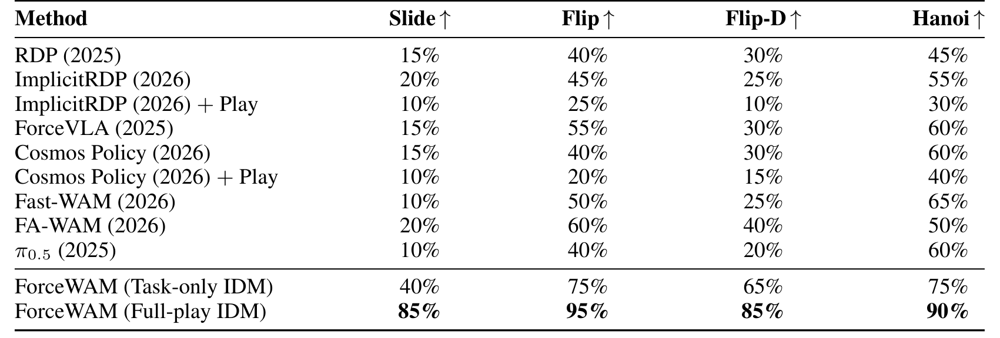
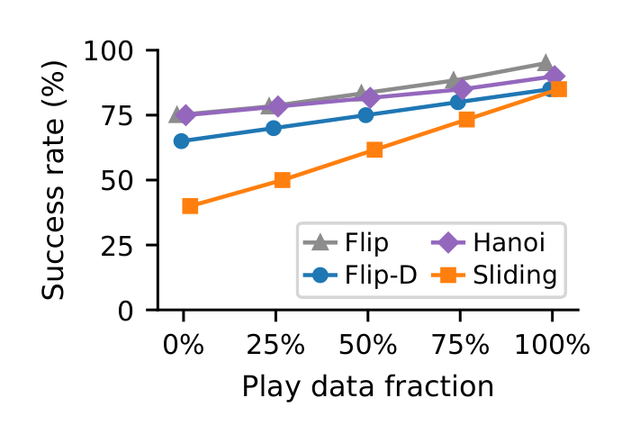
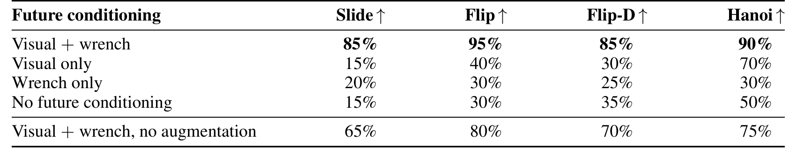
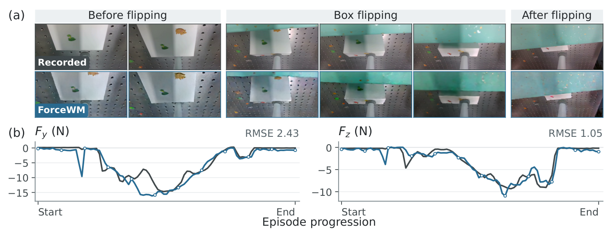

# ForceWAM: Decoupling Future and Response Learning from Demo and Play Data for Contact-Rich Manipulation

非任务 play 可以教机器人怎样压住、滑动或释放接触，却不一定教它怎样完成指定任务。ForceWAM 将“成功交互应到哪里”交给世界模型，将“如何响应眼前接触偏差”交给逆动力学模型，使两种数据能够各自发挥作用。

Zijun Xu、Wendi Chen 等，2026；[arXiv:2610.18852](https://arxiv.org/abs/2610.18852)；[项目页](https://force-wam.github.io/)。依据 15 页全文，核心为第 3–4 节与附录 B–E。

## 任务意图与局部接触响应为何要拆开

视觉上相似的动作可能对应完全不同的接触载荷。仅预测物体将移动到哪里，无法告诉执行器应维持多大压力；把无任务 play 直接混进端到端行为克隆，又可能学会与目标无关的动作。作者将未来参考设为视觉与六轴 wrench 的组合，让 play 只进入学习局部执行响应的模型。

设当前观测 $o_t=(I_t,w_t)$，其中 $I_t$ 为腕部图像，$w_t\in\mathbb R^6$ 为 TCP 力与力矩；语言为 $\ell$，未来条件为 $g_t$，短动作块为 $A_t$。模型分解为

$$
p(g_t,A_t\mid o_t,\ell)
\approx p_\phi(g_t\mid o_t,\ell)\,p_\theta(A_t\mid o_t,g_t).
$$

左因子 ForceWM 学任务目标，右因子 IDM 学怎样实现给定未来。概率链式分解本身是精确的，但去掉 IDM 独立语言输入、用有限模型逼近两因子是设计假设：未来必须足够表达任务意图。它不能自动保证不可达的生成未来会被正确拒绝。

_图 2：世界模型只学成功任务；逆动力学从任务与 play 的真实记录未来学习，部署才换成生成未来。_

## 一次观测怎样变成力视觉未来

ForceWM 从 Cosmos Predict 2B 初始化，将输入压成五个视频潜变量槽：空前缀、当前 wrench、当前图像、未来 wrench、未来视觉。前三槽固定为干净条件，只有后两槽加噪和重建。低维力信号被周期重复填充到视频潜变量大小，解码时对完整重复取平均，并非把力信号先画成热图再从图像识别回来。

未来视觉取控制偏移 4、8、12、16 的腕图像，编码为一个 $16\times56\times56$ 潜变量；未来 wrench 为后续 16 个六维测量。训练仅用成功示范，EDM 加权重建损失只作用于生成槽，因此不会要求网络重新预测已知观测。跨 episode 的不完整未来模态从损失排除，不能用补零冒充接触解除。

未来力与即时测量流有两套独立训练归一化：前者固定用 ForceWM 训练集统计，后者用 IDM 数据统计。部署保持各自坐标，若将两者在执行端统一重归一化，就改变了训练时的力语义。

## 逆动力学如何利用非任务play

每个 IDM 样本用同一条真实轨迹窗口的当前图像、记录未来、动作和力反馈训练。**训练 IDM 时不运行 ForceWM 生成条件。** play 即使没有完成任务，也提供“这些动作导致这个接触结果”的有效对应关系。训练时对未来条件做整组或模态 dropout、噪声与尺度扰动，以缓解部署时记录未来被不完美预测替代的分布差。

扩散 IDM 对归一化动作 $\bar A$ 使用速度参数化：

$$
A^{(q)}=\sqrt{\bar\alpha_q}\bar A+\sqrt{1-\bar\alpha_q}\epsilon,
\quad v_q^*=\sqrt{\bar\alpha_q}\epsilon-\sqrt{1-\bar\alpha_q}\bar A.
$$

$q$ 为扩散步，$\bar\alpha_q$ 是累计信号系数，$\epsilon$ 是高斯噪声；网络回归 $v_q^*$ 的均方误差。对第 $k$ 个动作，其可用条件被限制为当前观测、未来参考和已测 wrench 前缀 $w_{t:t+k}$。这个时间边界比损失形式更关键：动作不能偷看稍后才获得的真实力反馈。

当前图像由 ResNet-34 编码，未来视觉和力各有适配器，单向 GRU 编码测量前缀，7 层 Transformer 去噪动作。动作自注意力与测量力交叉注意力均为下三角；参考力中偏移不晚于当前动作的槽被遮住，只保留更晚的目标参考，未来视觉则可整体读取。真实未来反馈和预测未来参考必须在代码里属于不同张量。

## 慢参考与快反馈如何避免未来泄漏

一次慢刷新缓存生成未来、慢编码、起始 TCP 位姿及 IDM 初始噪声。每有新 wrench，GRU 处理增长的已知前缀，IDM 从相同缓存噪声确定性重去噪，只将当前动作发送给低层控制器。固定噪声减少单纯重采样造成的抖动，条件变化则允许动作随接触调整。

动作训练目标有 14 维和 18 步预测窗口，其中包含继承自 ImplicitRDP 的虚拟位姿与刚度辅助目标；部署只解码实际 TCP 位姿与夹爪，辅助量丢弃。参考每 6 个动作刷新一次，只执行当前慢窗口内的前缀，超出未来参考的末端词元仅用于训练。

附录 E 报告 ForceWM 单次约 100 ms、IDM 约 60 ms，分别用 1 步和 5 步去噪。刷新时先运行世界模型再运行 IDM，期间保持旧控制目标；第一动作仍使用请求时刻的力，后续动作才纳入新测量。“快反馈”是相对于慢世界模型的架构安排，不是已证明的千赫兹闭环。

## 真机结果怎样支持这次分解

全部实验在 Flexiv Rizon 4S 单机械臂上进行，三任务族各有 200 条成功示范和 200 条 play；Flip 与受扰 Flip-D 共用训练数据。每轮每任务 20 次，从匹配初态出发，共享安全限制与控制器接口。滑动除完成全路径，还必须满足 5–15 N 接触力标准，不能只按视觉到位算成功。

_表 1：任务专用与完整 play 版本需要分开读，外部基线的 +Play 行不是同一个训练接口。_

| 条件 | 任务专用 IDM | 完整 play IDM | 增量 |
|---|---:|---:|---:|
| 受力滑动 | 40% | 85% | +45 pp |
| 翻盒 | 75% | 95% | +20 pp |
| 受扰翻盒 | 65% | 85% | +20 pp |
| Hanoi 套环 | 75% | 90% | +15 pp |

_图 4：任务数据、世界模型和 IDM 优化步数固定，改变 play 数量。_

这个设计支持增益来自执行模型从额外接触转移中学习，而非新增任务示范或更多优化步。但样本来自同一任务族和硬件，不能推出跨物体、跨传感器的任意 play 都有价值。ImplicitRDP 与 Cosmos Policy 直接加入 play 后反而下降，说明“有更多数据”与“有合适监督接口”需要区分。

_表 2：所有版本都保留当前图像和真实力反馈，移除的是未来条件。_

完整视觉加力未来为 85/95/85/90%，仅视觉为 15/40/30/70%，仅力为 20/30/25/30%，无未来为 15/30/35/50%。互补性比单模态“更强”的说法更符合结果。关闭未来条件增强后降到 65/80/70/75%，说明训练记录未来与部署生成未来的差异确实影响执行。

_图 5：同一翻盒 rollout 的图像与 Fy、Fz，灰色为记录、蓝色为预测。_

示例 Fy、Fz 的 RMSE 分别 2.43 N、1.05 N，阶段趋势相符但局部峰值不同。它是单条定性轨迹，不是全测试集预测精度统计，更不是稳定控制证明。

## 部署成本与复现边界

我的分析：优先复现的是因果遮罩、归一化坐标和缓存刷新契约。只复刻 Cosmos 加力输入而不限制未来反馈，会得到无法在线执行的训练结果。固定种子的确定性去噪也不能替代低层安全控制。

论文支持在单臂三任务族中的接触学习增益；未提供跨硬件迁移、长期磨损漂移或大规模训练种子置信区间。尚不能确定当生成的未来在物理上不可达、力传感器偏置变化或慢更新显著延迟时，系统能否继续保持表中的成功率。这里应把生成未来视作可修正的条件，而非必须精确追踪的真实力轨迹。
