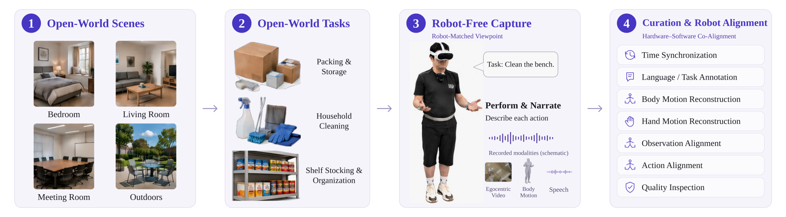
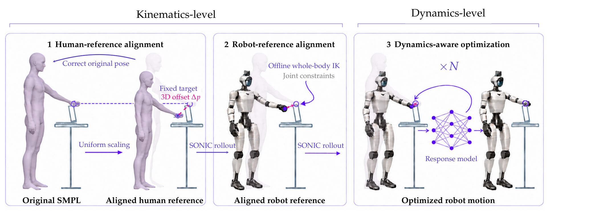
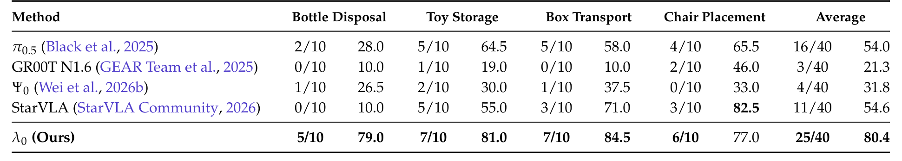
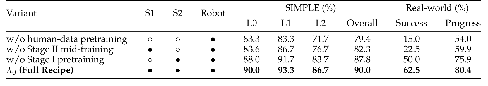
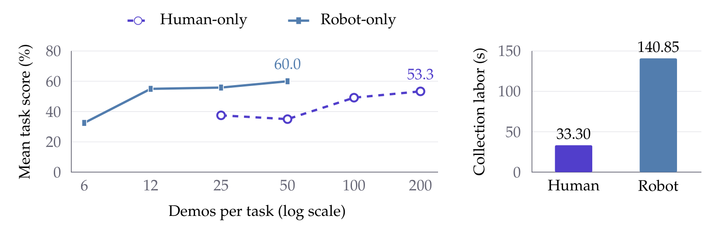

# λ₀: Scaling Open-World Egocentric Human Data for Humanoid Loco-Manipulation

人类可以低成本演示开冰箱、拉窗帘、搬物体，但这些演示不能直接成为人形机器人的控制标签。λ₀ 的工作重点是把视觉外观、全身运动和控制器响应同时对齐，然后让人类数据承担机器人训练之前的中间阶段。它提供了一条完整工程链，也保留了必须谨慎解释的评估选择问题。

humanoid Team，2026；[arXiv:2610.18950](https://arxiv.org/abs/2610.18950)；[项目页](https://lambdahumanoid.github.io/)。依据 24 页全文，重点为第 3–5 节及附录 B–D。

## 人类数据缺少的首先是机器人接口

只估计人手轨迹无法解释身体如何靠近物体、支撑姿态如何变化，也不能保证对应机器人末端真的能到达目标。人类骨架和 G1 的可达空间不同，而通过逆运动学得到的静态关节姿态，还不等于低层控制器实际执行后的运动。

HumanVerse 配对第一人称视频、身体运动与手部估计，约 500 小时是**转换和过滤之前的原始采集量**。论文报告 32,993 个 episode、87M 姿态帧、827 种任务。PICO 的身体运动来自设备运动学重建，并非实验室运动捕捉真值；手部依赖 Dyn-HaMR、ViPE 等视觉估计。作者用有效性掩码处理缺失标注，不能把这批数据理解成全量精确动力学标签。

_图 3：采集、整理与机器人对齐构成连续流程，原始小时数不是最终可训练小时数。_

训练与验证按 session 先分割再切窗口，防止相邻时间帧泄漏。采集时颈部 GoPro 视角靠近 G1 相机位置，SAM2 分割人臂和追踪器，DiffuEraser 修补后渲染机器人手臂，以缩小外观差异。这类生成修补不保证图像完全忠实，后续机器人数据仍承担真实执行校正。

## 从采集到可执行全身监督

对齐第一步按人体尺度修正 SMPL，第二步做 G1 关节约束的全身 IK，第三步用响应模型和 SONIC rollout 优化运动潜变量。关键是第三步将控制器造成的执行偏差纳入离线优化，而不是只让参考姿态在几何上相符。候选阶段中选择有效且较好的结果，必要时回退，不把所有转换都当成成功。

_图 6：尺度、运动学和控制响应依次处理不同误差来源。_

在 50 任务约 1 小时的对齐评估上，位置误差从 17.03 cm 降至 3.83 cm，方向误差从 36.06° 降至 10.85°。这验证转换精度改善，不等同于所有 500 小时均达到此误差，也不是任务成功率。

机器人状态有 44 维：29 身体关节、12 手部量和 3 维重力方向。动作接口则为 64 维 SONIC 运动潜变量加两手共 12 维命令，合计 76 维。训练数据需要离线转换到这个控制接口，部署不要求输入人的动作流。

## 三阶段训练如何接上SONIC

第一阶段用七个人类手部数据集训练 Qwen3.5-2B 骨干预测未来离散手状态，不训练动作专家。每侧手状态由位置、6D 旋转和局部关键点组成，量化到 256 个桶。数据集采样概率与有效帧数平方根成正比，避免最大数据源完全主导。

第二阶段将第一阶段 EMA 权重用于骨干，新增动作专家，以转换后的 HumanVerse 全身动作训练。第三阶段从第二阶段 EMA 初始化，用实际机器人示范联合更新骨干与动作专家。对应更新步数为 200k、100k、50k，EMA 衰减 0.999。它不是把人类动作词元直接当成机器人关节词元。

_图 7：手部预训练、全身人类中间训练、机器人后训练共享骨干但监督接口不同。_

后两阶段使用条件流匹配。设目标动作块为 $a$、噪声为 $\epsilon\sim\mathcal N(0,I)$、插值时刻为 $s$、观测语言状态条件为 $c$：

$$
x_s=(1-s)\epsilon+sa,\qquad
\mathcal L=\mathbb E\left[
\frac{\sum_{h,j}m_{h,j}\big(v_{\theta,h,j}(x_s,s,c)-(a_{h,j}-\epsilon_{h,j})\big)^2}
{\sum_{h,j}m_{h,j}}
\right].
$$

$h$ 是块内时间，$j$ 是动作维度，$m$ 只对有效且未提供为前缀的位置取 1。掩码把缺失标注、补齐和 RTC 固定前缀排除；前缀也不加噪。该式定义生成学习目标，不是机器人动力学方程；实现需避免无有效目标的样本分母为零。推理对 50 步动作块执行 10 步 Euler 积分，SONIC 解码身体动作，手控制器执行剩余命令。

## 真机证据比仿真总分更可靠

四项真机任务每方法各 10 个固定初态，共 40 次，执行顺序随机、盲法判定。完整模型成功 25/40=62.5%，π0.5 为 16/40=40%，StarVLA 为 11/40=27.5%；任务进度分别为 80.4%、54.0%、54.6%。进度允许部分完成，因此不能把 80.4% 写成成功率。

_表 1：逐任务成功率与进度同时保留，避免只看平均值。_

椅子任务中 λ₀ 成功 6/10 高于 StarVLA 的 3/10，但进度 77.0% 低于 82.5%。成功与进度的排序不同说明评价维度确实有差异。40 次总试验也不能替代多训练种子的置信度。

_表 3：真实成功率与任务进度支持全身人类中间阶段的重要性。_

| 训练版本 | 真机成功率 | 真机进度 |
|---|---:|---:|
| 无人类预训练 | 15.0% | 54.0% |
| 无全身中间训练 | 22.5% | 59.9% |
| 无手部预训练 | 50.0% | 75.9% |
| 完整流程 | 62.5% | 80.4% |

删去全身中间训练的降幅更大，支持全身数据对当前系统有价值，但不证明仅靠增加同样小时数的任何人类视频都有效。

> 图表占位：原文表 2，SIMPLE 六任务与三级难度结果。当前候选裁剪未通过视觉质量检查，保留原文定位；核心数字为 180 次评估中的 162 次成功，即 90.0%，解释须结合附录 D.2 的配置选择限制。

**附录 D.2 明确限制了 SIMPLE 的解释**：报告的是每任务最好记录配置，没有统一共享检查点和推理配置；不能确认只用独立验证集挑选，也未验证所有消融配置完全匹配。我的判断是，这使 90.0% 更适合作为选择后的系统表现，而非一次固定策略配置的无偏泛化成绩。

## 规模、迁移和采集成本怎样计量

固定机器人数据下，Stage II 人类量从 0%、5%、10%、25%、50% 到 100%，真机进度为 59.9%、64.2%、67.3%、72.1%、76.4%、80.4%。非零数据比例共享更新预算；训练损失拟合只来自一个种子及给定范围，不能外推成普遍缩放定律。

未见物体实例 B 上，人类引导版本进度 55.8%，机器人专用 48.4%，提高 7.4 个百分点；仍低于已见实例。该版本同时包含 A 的机器人数据和先前人类训练，并未单独隔离 B 的人类示范贡献。

_图 9：左为两任务平均进度而非完整成功率，右为每条演示的人秒成本。_

人类每任务 200 条示范得到 53.3% 进度，机器人 50 条为 60.0%，表明人类数据尚非逐条等价替代。人工成本为人类 33.30 与机器人 140.85 人秒，约 4.23 倍；长程采集另有 130→25 秒的经过时间对比。首页约 3.4 倍使用另一舍入时间代理，不能把这些数当成相同计量口径。

## 复现前必须保留的选择偏差

最值得复用的是控制器感知的数据转换和分阶段接口。复现应保留 session 切分、有效标注掩码、固定前缀与动作解码约定，并记录最终过滤后数据量。仅发布原始小时数不能说明有效训练成本。

尚不能确定的是，更广环境、未见接触动力学和更长任务中，离线响应对齐的收益能保留多少。应优先用固定配置、多训练种子重测真机与 SIMPLE，再隔离视觉修补、IK 和控制响应优化各自贡献。这些是本文证据尚未完全回答的问题，不是已经观察到的失败。
