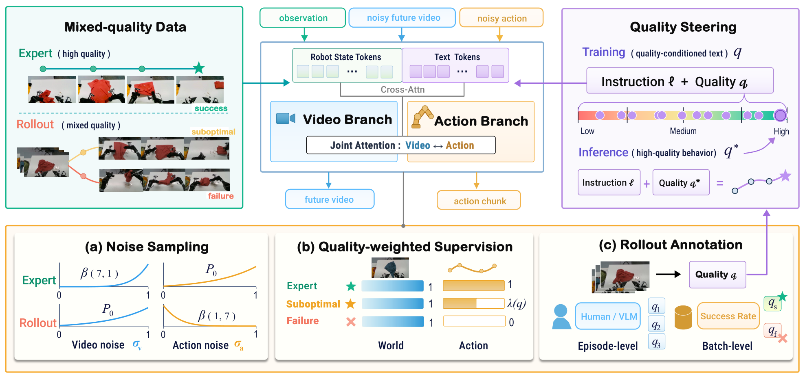
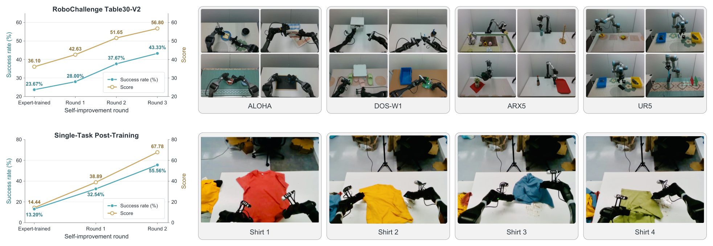
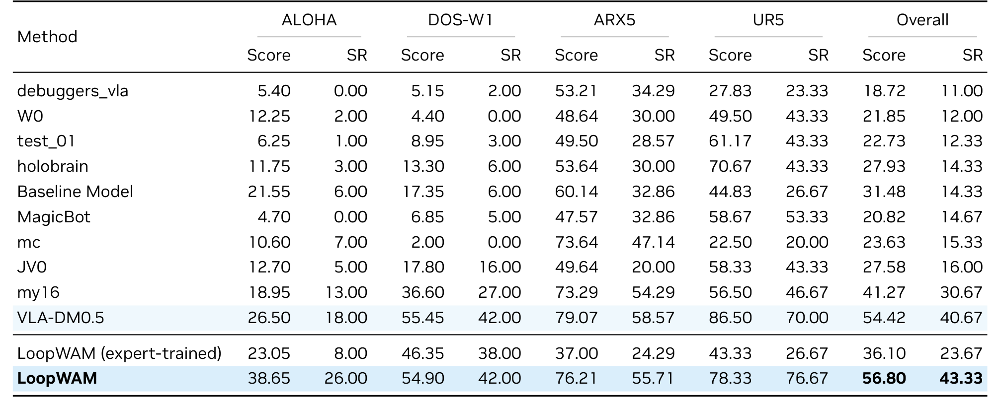
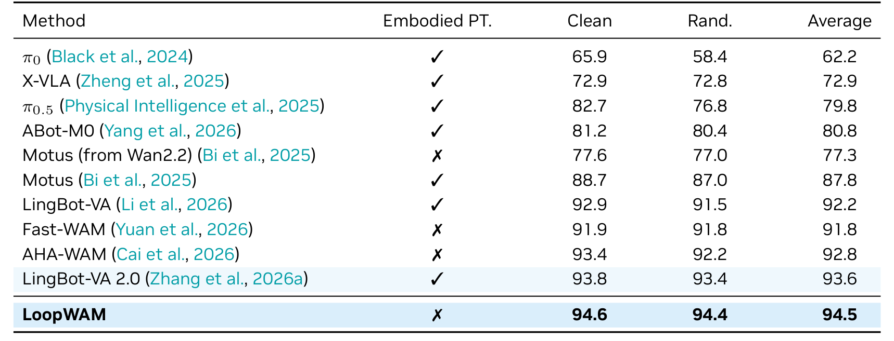
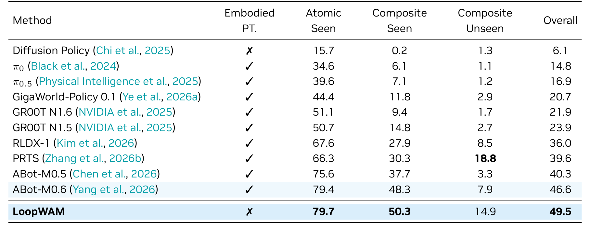
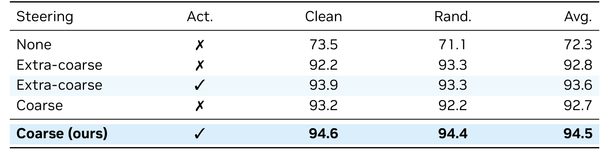

# LoopWAM: Closed-Loop Generalist Policy Improvement from Deployment Rollouts

机器人部署产生的失败轨迹包含两种不同价值：动作不值得照抄，动作造成的物理后果却值得学习。LoopWAM 把这一区分落实到世界动作模型的训练目标，保留所有质量轨迹的视频监督，再用质量条件与动作权重控制策略模仿什么。理解它的关键，是把“学习发生了什么”与“选择应该怎样做”分开。

Wenxuan Guo 等，2026；[arXiv:2610.18873](https://arxiv.org/abs/2610.18873)；[项目页](https://loop-wam.github.io/)。下文依据全文 25 页，重点为第 3–4 节、表 1–4 和附录 A。

## 为什么失败轨迹仍值得学习

只收专家示范能提供好动作，却不覆盖策略部署后最常进入的偏离状态。直接行为克隆所有回流动作会复制错误；只保留成功则丢掉碰撞、物体滑落和错误接触的结果。作者选择让不同数据源承担不同监督职责，而不是把整个失败片段当成废数据。

这并不等于强化学习奖励优化。模型接受一个轨迹质量分数作为语言条件，仍然用监督式生成训练；质量来自人工、平台评分或基于策略批次的粗粒度判断。闭环意味着部署、收集、标注、离线再训练连续发生，并不意味着机器人运行时自主更新权重。

## 视频与动作如何共享一次生成

一次输入包括当前视觉观察、机器人状态、任务语言和质量条件。视频 VAE 将观察与未来图像压到潜空间；初始化自 Wan2.2-TI2V-5B 的视频分支与动作分支构成 Mixture-of-Transformers。未来视频和动作在每层双向交换信息，观察潜变量保持干净，观察自身的注意力不能读取未来目标。

_图 2：上半部说明视频与动作互相条件化，下半部区分噪声采样、动作权重和回流评分。_

对任一模态的干净目标 $X$，训练构造

$$
X_\sigma=(1-\sigma)X+\sigma\epsilon,\qquad v^*=\epsilon-X.
$$

$\epsilon$ 是标准高斯噪声，$\sigma\in[0,1]$ 是噪声强度，$v^*$ 是流匹配速度目标。训练网络回归速度；推理从噪声沿减小的 $\sigma$ 共同积分出动作和未来视频。因此未来不是先生成完再交给独立策略，而是在动作去噪过程中持续参与。该线性概率路径是生成训练的构造，不是机器人真实动力学的线性假设。

附录 A 的默认动作块长 64 步，视觉每 8 控制步取一帧，共 9 帧含初始帧；多相机图像拼接。Table30-V2 的关节目标相对块起点表示，夹爪仍为绝对量，执行时只能对关节部分加回起点。照搬归一化而忽略这一区分会改变动作语义。

## 质量、噪声与损失各自负责什么

专家数据中视频噪声取 $\mathrm{Beta}(7,1)$，动作噪声取基础分布；部署数据则视频取基础分布、动作取 $\mathrm{Beta}(1,7)$。基础分布由均匀变量 $u$ 经 $\sigma=5u/(1+4u)$ 获得。专家样本迫使模型从强噪声动作学习好行为；部署样本动作通常较清楚，便于学习其结果。两模态都没有变成固定的真值输入，仍然属于共同去噪。

将每个样本的视频损失记为 $\ell_{v,i}$、动作损失记为 $\ell_{a,i}$，批次大小为 $B$，质量权重为 $\lambda(q_i)$，其关键加权结构是

$$
\mathcal L=\frac1B\sum_i\ell_{v,i}
+\frac{\sum_i\lambda(q_i)\ell_{a,i}}
{\max(1,\sum_i\lambda(q_i))}.
$$

这里省略了各模态相同的时间调度权重，保留决定数据职责的结构。所有轨迹参与第一项；专家动作权重为 1，失败为 0，次优成功介于其间。分母避免有效动作样本数量变化时任意缩放动作梯度，并处理全零权重批次。实现中还要屏蔽补齐位置。

失败的直接动作回归项被关掉，**不表示动作分支被冻结**：由于联合注意力，视频损失仍可能通过动作特征反向传播。质量分数也不是成功概率。附录使用两套刻度：逐轨迹评分专家为 12、回流最高 10；粗评分专家为 5、回流为 1–4。部署固定使用专家分数，不能把两套刻度混用。

## 部署闭环怎样落到数据流程

模型用高质量条件共同去噪，执行动作前缀，记录新观察和实际动作。回流经过质量标注后与专家数据合并，再做下一轮训练。Table30-V2 用平台人工逐轨迹评分；仿真粗粒度评分根据源策略整体成功率及约 0.7% 轨迹的人工动作质量检查，为该策略的成功轨迹赋同一分数。失败统一最低分。这会引入源策略级近似，不能理解成准确逐状态价值函数。

Table30-V2 还用 Qwen2.5-VL-7B 对四项长任务进行子任务语言切换，其他任务保留完整指令。复现总成绩时，这属于执行系统配置。可视化中的失败恢复是同一策略重新观察后改动作的案例，不是运行中学习权重的证明。

_图 3：左侧多任务三轮回流，右侧单任务折衣两轮后训练；两者数据条件不同。_

## 实验提升与最强反例

Table30-V2 涵盖 30 任务、ALOHA、DOS-W1、ARX5、UR5 四类本体，每轮约每任务 100 轨迹，三轮约新增 9,000 条真实部署轨迹。成功率依次为 23.67%、28.00%、37.67%、43.33%，增加 19.66 个百分点；分数从 36.10 到 56.80。与比较表中的最强其他方法相比，最终成功率优势约为 2.66 个百分点，不能把相对初始版本的 19.7 个百分点写成相对所有基线的优势。

_表 1：真实多任务比较，同时报告分阶段得分和完整成功率。_

RoboTwin 2.0 的 50 任务先用 2,500 条 clean 和 25,000 条随机化专家示范，之后加入 LoopWAM、X-VLA、π0.5 的 22,500 条回流。clean 和 random 成功率分别 94.58%、94.42%，平均 94.50%。这不是只用极少 clean 示范的结果。

_表 2：预训练数据列是解释不同基线成绩时必须一起看的条件。_

RoboCasa365 使用 Human300 的 50 任务划分，排除 16 项未见复合任务的训练数据。三组成功率为 atomic-seen 79.7%、composite-seen 50.3%、composite-unseen 14.9%，总体 49.5%。总体领先没有抹平最强反例：PRTS 的未见复合任务为 18.8%，高于 LoopWAM。论文的“无额外具身预训练”仍包含视频骨干预训练成本。

_表 3：总体平均与未见复合任务的排序不同，不能合并成全面最优。_

_表 4：消融改变质量引导与回流动作监督，专家动作和所有视频监督保留。_

无引导且无回流动作监督为 72.3%；加入粗粒度引导而仍不模仿回流动作已达 92.7%，再用加权回流动作达到 94.5%。这支持质量条件的重要性，但这张表没有单独隔离源相关噪声分布或双向架构的贡献。不同方法的训练数据与预算也没有完全统一，排行榜不能取代所有受控实验。

## 迁移这套训练接口需要什么

我的分析：最值得迁移的是“不同损失对同一条轨迹有不同使用资格”的接口，而不是直接抄一个质量阈值。数据记录应保留行为策略、动作和观察的严格对齐、真实失败结果以及质量标注来源，否则世界损失可能学习错误对应关系。

首先应在固定专家量、回流量、训练步数下比较过滤失败、全量模仿和质量加权；再单独测试噪声方案及联合注意力，防止把数据增加当成全部机制收益。尚不能确定的是，在自动质量标注错误、长期分布漂移和更少人工复位条件下，闭环能维持多少轮稳定提升。本文没有给出无需人工监督的持续部署保证。
