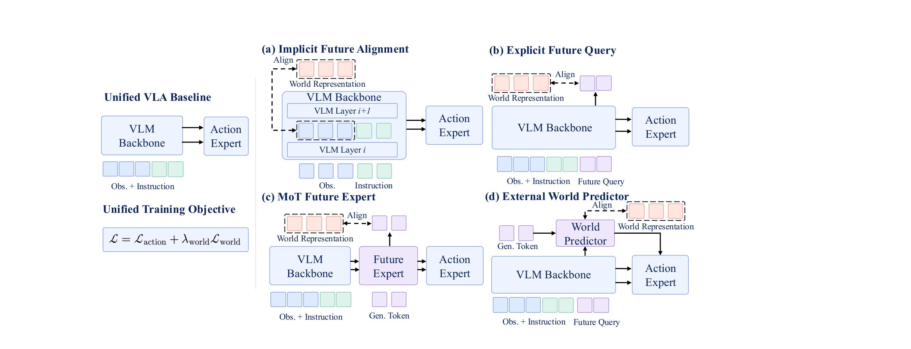
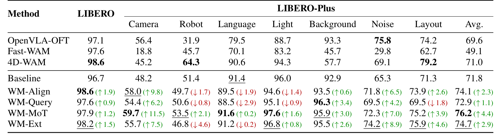
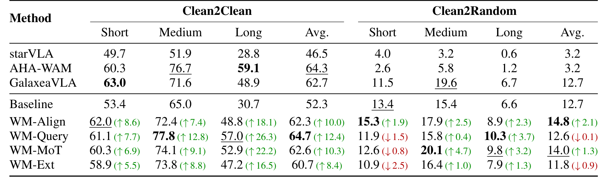
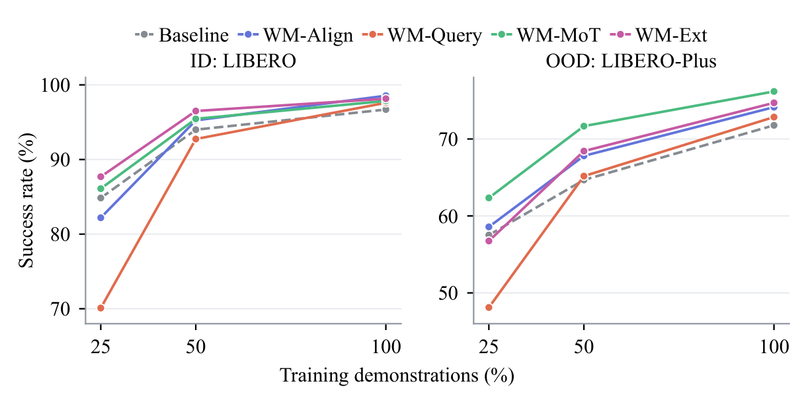

# What Matters for World Modeling in Vision-Language-Action Models?

给 VLA 增加未来预测目标是否有用，取决于预测什么、从哪里预测，以及动作模块如何读取预测。本文把四种世界模型接入方式放进共同训练框架，显示收益存在，也显示已有 VLA 可以因直接特征对齐而退化。它更适合作为设计选择的对照证据，而非通用最佳架构声明。

Qisen Ma、Yixiang Chen 等，2026；[arXiv:2610.19825](https://arxiv.org/abs/2610.19825)；[项目页](https://dylanmqs.github.io/WM-in-VLAs/)。依据 32 页全文，核心为第 3–4 节和附录 A–C。

## 先把世界模型接入方式变成可比较变量

现有工作往往同时换骨干、数据、未来编码器和动作架构，最终成绩不能说明哪个变化有效。本文主平台统一为 Qwen3-VL-2B 加逐层 cross-DiT 动作专家，再分别接入四种预测接口。另用已经完成机器人预训练的 π0.5 测试兼容性。

所有方法取未来偏移 4、8、12、16 的相同帧。冻结编码器 $E$ 构造目标特征 $z=E(o_{t:t+T})$，网络输出预测 $\hat z$，联合目标为

$$
\mathcal L=\mathcal L_{action}
+\lambda_{world}\big(1-\cos(\hat z,z)\big).
$$

$o$ 是图像观察，$T$ 为预测时域，$\lambda_{world}$ 控制辅助监督，主 LIBERO 设置取 0.1；动作项是连续流匹配。余弦损失强调特征方向而非像素重建，不表示预测必须可解码成高保真视频。将目标统一能减少一个混杂，但特征的语义与接口位置仍影响梯度。

## 四种预测接口怎样改变动作路径

_图 2：关键差异在未来信息写入共享骨干还是独立模块，以及动作专家读取中间状态还是最终预测。_

WM-Align 将骨干中间图像词元通过 MLP 对齐未来特征。动作专家仍读取原来的视觉语言上下文，只是视觉表示接受了额外梯度。部署丢弃 MLP，因此没有额外预测前向；但训练中可能改变原有特征空间。

显式查询（WM-Query）在输入后加入 16 个未来查询词元，从视觉语言读取上下文，辅助解码器将它们还原成密集未来特征。动作专家在各层同时读取查询词元。推理丢弃密集解码器，但查询词元仍留在骨干里，不是完全删除未来模块。

WM-MoT 设一个独立 28 层未来专家，其生成词元从冻结编码器的当前图像特征初始化。未来专家可读取视觉语言，但不读取动作；动作专家逐层读取两者。用 $x^A,x^V,x^L,\tilde x^G$ 表示动作、视觉、语言和更新后的生成词元，其接口可写为

$$
\tilde x^A=\operatorname{CrossAttn}
\left(x^A,[x^V;x^L;\tilde x^G]\right).
$$

方括号为上下文拼接，动作词元是查询，其余为键和值。式子描述信息流，省略残差、归一化和自注意力。实现时不能让未来专家反向读取动作而仍声称同一受控范式。推理丢弃预测投影头，却保留未来专家及当前图像编码。

WM-Ext 另设 12 层世界预测器，以骨干的 8 个查询词元通过 AdaLN 调制当前图像特征，产生最终未来特征后供动作专家读取。它与 MoT 的区别是动作不逐层读取未来专家的演化过程，而以外部模块的最终预测为条件。

## 目标编码器不是独立于架构的选项

六类冻结编码器为 DINOv3、SigLIP、VGGT、ImageVAE、WanVAE、V-JEPA 2.1。所有未来时域一致，图像编码器逐帧处理，视频编码器联合处理。2D 语义特征在四范式中较稳，但没有单一表征处处最优；例如 V-JEPA 在 MoT 的域外结果较好，在外部预测接口中反而低于基线。

附录 A.2 指出，MoT 和 Ext 使用 $E$ 既编码当前输入，也构造未来目标；Align 和 查询范式只把 $E$ 用作辅助目标。因此换编码器对前两者同时改变了当前感知与未来监督。所谓表示排序首先是整个接口兼容性，不能全归因于未来表征质量。

附录 B 的控制实验把当前 DINOv3 输入也提供给其他方法：基线 71.8→72.5%，MoT 无世界损失为 73.6%，加入未来监督达到 76.2%。这比只看容量增加更支持预测监督的贡献，但跨范式在线参数量并未完全相等。

## 长任务收益与短任务退化同时出现

_表 1：域外平均提高，不代表每个扰动维度都提高。_

主结果 LIBERO 基线 96.7%，Align 为 98.6%；LIBERO-Plus 基线 71.8%，MoT 为 76.2%。Align 在语言扰动 91.4→89.5%，Ext 在机器人初态扰动 51.4→46.8%，说明平均值掩盖局部负迁移。LIBERO-Plus 按各类实际 rollout 数汇总，不能直接对七个类别百分比再做等权平均。

_表 2：Clean2Clean 的长任务收益很大，Clean2Random 的整体收益明显较小。_

RoboTwin 2.0 每任务 50 条 clean 示范、每条件 100 次评估。Clean2Clean 总体基线 52.3%，四方法 60.7–64.7%；长任务从 30.7% 提至 47.2–57.0%。而 Clean2Random 基线 12.7%，查询范式为 12.6%、Ext 为 11.8%，并非全面改善。只有 Align 在随机域短任务比基线高，其余降低 0.8–2.5 个百分点。

> 图表占位：原文表 3，第 8 页，DOMINO Level 1 动态操作。候选尚未通过视觉质量审查，保留数字转录：成功率基线 10.6%，Align 11.9%、查询范式 13.5%、MoT 15.5%、Ext 15.1%；最高值仍意味着多数动态试验失败。

任务更长时预测能缓解复合误差，是与数据一致的解释；动态任务中独立预测容量更灵活是作者提出的可能原因，并非已隔离的唯一因果机制。

## 已有VLA、少数据和真机怎样改写排序

> 图表占位：原文表 4，第 9 页，π0.5 的接入实验。候选未获正式视觉通过，保留原文定位和关键数值。

| π0.5 接口 | Clean2Clean | Clean2Random |
|---|---:|---:|
| 原基线 | 69.1% | 46.4% |
| Align | 63.6% | 41.0% |
| 查询范式 | 68.7% | 46.2% |
| MoT | 71.3% | 49.7% |
| Ext | 71.7% | 48.5% |

已有机器人先验被直接特征监督扰动，是作者对 Align 下降的合理解释，但梯度干扰的全部原因尚未被证明。结果足以说明，Qwen 主平台中便宜有效的策略不能直接外推到预训练 VLA。

_图 4：查询范式在 25% 数据下显著下降，说明增加预测词元也有学习成本。_

关键结论另做三训练种子重复：LIBERO-Plus MoT 为 76.4±1.0%，基线 71.4±0.4%；25% 数据的 查询范式为 70.2±1.4%，基线 84.8±0.6%。主表多数设置仍是一个统一种子，不能将这组复验误写成所有编码器和任务全有三种子统计。

真机使用 Franka Research 3 和 ZED 2i，四任务每项 50 示范、40 次评估。平均成功率从 45.0% 到 56.3–73.8%，MoT 动态摘取 75%、放番茄 55%，总体 73.8%。四项任务支持这套设置下的真实收益，不代表所有动态环境都达到相同水平。

## 计算预算决定工程选择

附录 A 的 H100 测量采用 224² 图像、BF16、4 步 Euler，预热后测单样本中位延迟。基线端到端 103.3 ms、Align 103.0 ms、查询范式 105.4 ms、MoT 136.1 ms、Ext 119.3 ms；MoT 与 Ext 包含在线 DINOv3 的 6.3 ms。50k 步在 8 张 H100 上分别耗时 8.71、9.13、9.04、10.53、9.59 小时，不含一次性目标特征预计算。

我的分析：已有 VLA 应先检验解耦模块与特征漂移，资源紧张且从普通 VLM 构建策略时可以测试 Align，但仍需域外和语言扰动对照。统一学习率、损失权重和训练步数让比较更清楚，却不代表每种架构都达到独立调优最优。更好的世界监督需要同时交代输入额外信息、参数、预计算和执行延迟，不能只按成功率选择。
