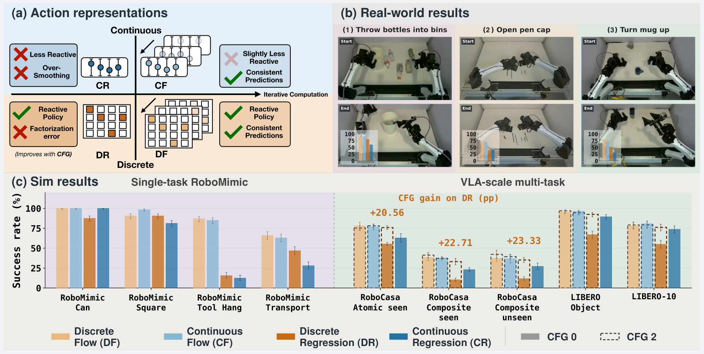
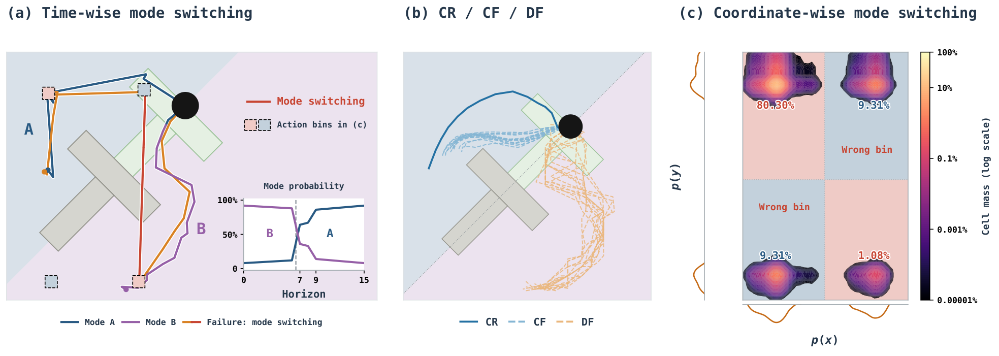

# When Do Discrete Actions Make Good Continuous Controllers?

离散动作并不天然损失机器人控制能力。本文把同一视觉语言主干接上不同动作头，发现影响闭环执行的关键还包括动作块的时间一致性、概率采样和引导方式。理解它最有用的办法，是把“数值是否量化”“各步怎样相互依赖”“怎样从预测分布取动作”拆成三个变量。

Zeji Yi 等，2026。论文：[arXiv:2610.20429](https://arxiv.org/abs/2610.20429)；[项目页](https://iscoyizj.github.io/discrete-action-website/)。首次提交北京时间 2026-10-15 00:20:58。全文 53 页，以下结合主文与附录 B、C、G、H 解读；项目页尚未确认可用代码和权重，论文称将于发表时发布。

## 离散化为何没有决定控制上限

连续回归用均方误差拟合动作，在同一观察存在多个有效抓取方向时容易取条件均值；这个均值可能恰好不是有效动作。连续流模型能表达多峰分布，但需要多步求解。逐维分类则直接预测分箱概率，速度和多峰表达都很吸引人，代价是同一动作块里不同位置可能独立选择不兼容的模式。

作者比较连续回归 CR、连续流 CF、离散回归 DR 与离散流 DF。图 1 的意义不是宣布某一类普遍最优，而是展示在相同策略主干下，离散方法通过适当的概率结构也能支持精细真机操作。

_图 1：动作表示与预测结构的比较；图中真机示例支持可执行性，不替代统一测试协议的数值分析。_

默认离散方案对归一化并裁剪的每个动作维度做 512 个等宽分箱，再用箱中心解码。视觉语言策略使用相对动作块起点的末端位姿，不能误实现为逐帧增量；其 7 维表示与 RoboMimic 的 10 维旋转表示也不能直接混用。量化确实引入数值误差，但实验没有支持“箱子更多、重建更准，闭环就一定更好”的简单推断。

## 四种动作头怎样组织条件分布

设观察为 $o$，动作块为 $A=(a_1,\ldots,a_H)$。CR 直接拟合 $\mathbb E[A\mid o]$，CF 学习从噪声到连续动作的时间相关速度场。DR 将所有离散位置 $j$ 的交叉熵相加，其条件分布近似为 $p_\theta(z\mid o)=\prod_jp_\theta(z_j\mid o)$。这里 $j$ 同时索引时间和动作维度，$z$ 是量化后的动作块。这使一次前向能够并行产生所有位置，却没有在输出分布里显式要求各位置属于同一动作模式。

DF 保留逐位置分类头，但增加当前噪声动作块和生成时间作为条件。训练先从真实干净动作 $z$ 构造：

$$
q_t(z_t\mid z)=\prod_j\left[\alpha(t)\mathbf1(z_{t,j}=z_j)+(1-\alpha(t))q_{0,j}(z_{t,j})\right].
$$

$q_0$ 是初始噪声分布，$\alpha(t)$ 随生成时间增大，逐渐增加干净信息；$z_t$ 是混合后的中间动作。网络用交叉熵从 $(o,z_t,t)$ 预测干净类别，而不是回归一个连续速度。这一条件改变很关键：即使某一步的输出仍逐位置分解，下一步也会读到上一步形成的整块动作，因此能协调跨时间选择。

## 离散流如何恢复跨步一致性

推理时从 $q_0$ 采样初始动作块，网络预测各位置的干净类别候选，再以

$$
\eta=\frac{\alpha(t_{k+1})-\alpha(t_k)}{1-\alpha(t_k)}
$$

的概率将当前位置替换为候选，否则保留原值。$t_k$ 是第 $k$ 次生成迭代的时间；该式把本次新增的干净概率归一化到尚未变干净的部分。迭代后的动作再解码为连续命令，执行动作块前缀，下一次策略查询重新规划。它不是把所有位置一次独立抽样之后做平滑。

论文用离散差分近似动作块的三阶变化：$\Delta^3a_h=a_{h+3}-3a_{h+2}+3a_{h+1}-a_h$，再比较预测和示范的平均范数比。比值过小可能是回归过度平滑，过大可能是模式不一致；它没有除以物理采样周期的三次方，不能直接当作带物理单位的 jerk。DF 的不一致模式计数较 DR 低约 5.28 倍，并随求解次数增加下降，但接近示范的平滑度仍不等于动态稳定性证明。

## 引导与误差为什么不能互相替代

离散分类器自由引导把有条件概率 $p_c$ 与无条件概率 $p_u$ 合成：

$$
p_{\mathrm{CFG}}(z_j)\propto p_c(z_j)^{1+\lambda}p_u(z_j)^{-\lambda}.
$$

$\lambda$ 是引导强度，计算在对数概率域完成，再归一化。它会强化与观察条件相符的模式，而不是修正动作单位或机械臂标定。无条件训练使用条件丢弃；推理需要两次动作头预测，虽然共享的视觉语言骨干可复用，求解次数也不能直接替代真实延迟比较。连续流的引导作用于速度场，二者的强度数值没有天然可比性。

| RoboCasa 设置 | 成功率 | 支持的观察 |
|---|---:|---|
| DR，无引导 | 27.1% | 独立分类本身不足 |
| DR，引导强度 2 | 49.2% | 采样选择能大幅改变结果 |
| DF，无引导 | 52.3% | 迭代依赖已明显改善执行 |
| DF，选定引导设置 | 53.9% | 继续改善但增益较小 |
| CF，最佳报告设置 | 52.7% | 连续流仍具竞争力 |

这些是论文对应配置的汇总，不是所有任务和预算的普遍排序。DR 的引导显著改善闭环成功率，却不保证离线动作重建误差更低；因此用均方误差选动作头可能错过更好的控制器。

_图 5：引导对闭环成功率、覆盖与重建指标的影响；各指标不能当作同一个优化目标。_

进一步的对照也限制了“离散流只靠几何邻近”的解释：几何腐化变体为 52.8%，低于均匀离散方案的 53.9%；DF 搭配 nFSQ、FAST、RVQ 的结果也不同。编码器、腐化路径和解码方式需要一起检查，不能把某一种词元化方案的结论推广到全部离散策略。

## 统一比较里仍有哪些协议变量

各头共用 PaliGemma 主干和训练数据配方，固定训练种子 7，训练 150k 步；但每个头从最后五个检查点中分别选最好者。报告的五个种子是评估环境种子，不是五次独立训练，误差条不能解释成优化过程的方差。

RoboCasa 每个评估种子包含 180 个原子、160 个已见组合、160 个标称未见组合试验，总计 500 次。LIBERO 使用 Object 和 Long 两个套件，不是全部 40 个任务；DROID 仅能离线评估，不能把它的重建指标写成真机闭环成功率。

> 图表占位：论文表 1 的综合结果对理解跨环境排序重要；当前没有取得可通过视觉审查的独立表格图片，因此保留占位，上表仅转写已核实的 RoboCasa 配置数值。

还存在一个复现前必须澄清的命名问题：附录 B 的训练混合表列出约 5.99M 帧的 “RoboCasa target composite-unseen”，主文同时讨论未见组合测试。仅靠名称不能证明数据泄漏，也不能证明完整零样本隔离；需要作者提供任务标识与划分清单后才能核实。本文成绩可以说明这套记录下的动作头差异，不能在划分未对齐时扩张为严格的未见组合泛化结论。

## 复现时应该保留哪些控制

最值得复用的是比较方法：固定视觉语言特征、动作坐标和训练混合，再分别改变动作分布结构、生成次数与引导强度，最后同时报告闭环成功、延迟和离线误差。对精细操作，先检查动作块内部的模式协调，比先增加分箱数更有针对性。

论文提供了多种真机任务的执行证据，但代码、完整任务划分和检查点尚待公开，本文没有独立复现。工程上仍需在目标机械臂上验证执行频率、观测延迟和不连续采样造成的瞬时动作，不能由分类损失或轨迹平滑图替代这些检查。
