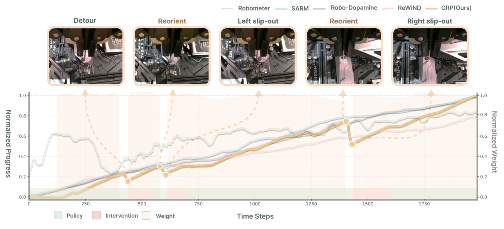
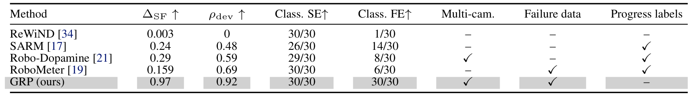

# Graph-Reweighted Behavior Cloning with Human Interventions for Precise Robotic Manipulation

机器人偏离后由人纠正，再把所有执行帧无差别加入模仿学习，会同时强化有用恢复和错误停滞。GR-BC 用多视角轨迹图估计“离成功还剩多少路”，只给确实前进且没有明显回退的动作块正权重。它用数据的可连接结构替代额外训练的神经进度模型，但图中的相似边仍是近似，不是物理可达证明。

Xiaoman Li 等，2026。[arXiv:2610.20504](https://arxiv.org/abs/2610.20504)；[项目页](https://gr-bc.github.io/)。首次提交北京时间 2026-10-15 01:09:36。全文 25 页，含图算法、对照与泛化诊断附录；未找到可确认的公开代码、权重。

## 干预轨迹不能把每一帧都当正例

失败轨迹并非完全无用：其中可能有正确接近、少量偏差和关键恢复。按整条成功或失败打权重会损失局部信息；以视频时间位置作为进度标签，又容易把走回头路的帧误标为越来越好。作者把问题改成数据图上的成功可达距离，让不同轨迹在相似状态之间借用已有恢复路径。

_图 1：图构建、成功汇点、进度估计和行为克隆重加权；权重针对实际执行的动作片段。_

## 由多视角状态建立可拼接图

每隔 15 帧抽取节点，并保留轨迹终点。冻结 MCR 编码器分别提取三个相机视角的嵌入；本体状态虽有存储，相似检索主要用视觉与夹爪状态，并未把全部本体量直接作为距离度量。

图有两类边。相邻时间节点形成向前边，代价为跨过的帧数；跨轨迹的相似边要同时通过各视角互为近邻与夹爪状态过滤。其长度使用各视角中最大的归一化视觉距离，再映射到时间边的尺度。取多视角交集与检查夹爪，可以减少“正面相似、侧面不同”或“开爪和闭爪混淆”的伪连接，代价是丢掉部分真实恢复边。

只有成功终点连接零代价的成功汇点。逆向 Dijkstra 得到节点到汇点的最短剩余长度 $R(s)$；失败终点不会自动被设为成功。跨轨迹连接让失败中间帧也可能找到一条已见数据支持的恢复路，但算法没有真正执行该边验证可控性，也没有建模碰撞风险或接触力代价。

## 最短路径怎样变成动作片段权重

将距离归一化为进度：

$$
p(s)=\operatorname{clip}\left(1-\frac{R(s)}{R_{\max}},0,1\right), \qquad \Delta_t=p(s_{t+N})-p(s_t).
$$

$R_{\max}$ 取有限距离的第 95 百分位；不可达节点权重为零。抽样节点之间只对两端均有限的区间插值，避免跨越不可达空洞。$N=30$ 帧，约为 30Hz 下的一秒动作块，$\Delta_t$ 表示该块净进展。

净进展仍可能掩盖先大退再小进，因此再计算块内最大相对回退 $d_t=p(s_t)-\min_{u\in[t,t+N]}p(s_u)$。通过 $d_t\leq\eta$ 且 $\Delta_t>\delta$ 的块才有权重：

$$
w_t=\operatorname{clip}\left(1+\beta\tanh(\gamma\Delta_t),0.5,1.5\right),\qquad L=\mathbb E[w_tL_{\mathrm{VLA}}].
$$

这里 $\eta=0.03$、$\delta=0.002$，$\beta=0.5$，$\gamma$ 控制进度增益的斜率；不满足条件的块令 $w_t=0$。$L_{\mathrm{VLA}}$ 是原策略的模仿目标，而不是新奖励模型的损失。零权重片段仍保留在图中，只是不贡献这次策略拟合，所以过滤监督不等于删去恢复路径证据。

每轮收集的自主执行与人工接管数据追加到历史数据，再重新计算图距离并离线后训练。被监督的始终是实际执行动作，视觉近邻边并没有凭空生成可执行动作标签。这条边界对理解方法尤其重要。

## 真实结果与进度诊断要分开

主要真机采用 X-VLA，30Hz、8 维动作，RTX 5090 推理。四项精密任务的最终结果如下，不同任务使用 2、3、4、3 轮收集与后训练，不能解释为同一轮预算的统一比较。

| 方法 | 装配 | 显卡 | 螺丝 | 内存 |
|---|---:|---:|---:|---:|
| DAgger-style | 88% | 63% | 56% | 49% |
| RA-BC | 86% | 72% | 52% | 57% |
| AWR | 72% | 32% | 37% | 19% |
| GR-BC | 98% | 93% | 89% | 83% |

GR-BC 四任务平均为 90.75%，四舍五入约 91%；它不是所有机器人和装配任务的普遍成功率。训练每轮仍需约 20k 步和 4 张 H100，不训练额外进度网络并不意味着没有后训练成本。

_图 5：多轮后训练的任务曲线；应结合各任务轮数与共享控制数据来源阅读。_

另一类证据检查进度模型自身，主表在每任务 30 条成功与 30 条失败轨迹上做诊断。由于这些轨迹参与图结构，其完美分类与较大进度差不能直接当作独立测试泛化。

_表 1：进度估计的主诊断；图内结构参与得分，不能用这里的满分替代留出轨迹验证。_

附录另提供以 100 条示范构图、逐条插入查询轨迹的留出诊断，查询终点不自动变为成功汇点，查询之间不共享信息。这个设计更接近新轨迹评估，应与主表分开解读；它仍不等于部署中任意新接触状态都有正确进度。

## 基线与消融究竟比较了什么

DAgger-style 是共享控制场景下的均匀数据聚合：自主块用实际策略动作，接管块用人工动作，并未对每个自主访问状态重新请求专家标签。因此结果支持优于这一聚合基线，不能写成击败全部 oracle 重标版本的 DAgger。

RA-BC 用成功示范的归一化时间训练进度，其他失败与接管数据用于下游策略；图方法和学习进度方法的归纳偏置及监督接口不同。AWR 则额外训练动作块评论家，再用优势权重拟合策略。表中排序不能只归因为“图比神经网络好”，还涉及这些具体配方。

> 图表占位：论文表 2 的图结构消融重要，但当前独立表格候选尚未通过视觉审查；此处保留占位，相关数字按原文转写。

只用时间边时失败节点可达率为零，大量块被置零；加入视觉近邻可以连起恢复片段。去掉夹爪过滤时，报告的夹爪不匹配边比例达到 15.8%，完整方案为零；完整图的失败可达率约 98.3%，零权重块约 25.0%。其中“零不匹配”只覆盖这项夹爪状态判据，不代表不存在其他物理伪连接。π0.5、SmolVLA 的扩展主要在显卡单任务上验证，不能说三种骨干都已完成四任务覆盖。

## 迁移到接触任务的风险

这套方法适合有重复任务、多视角、可辨认终点与共享控制数据的场景。作者也承认，错误视觉桥接会产生虚假的短路径，过于保守则丢失恢复；最短路不是最低风险路径，对分布外状态缺少可靠支持。

我的分析是，复现应先抽查连接边是否保持接触与抓握条件，再关注平均成功率。图的阈值、相机配置、回退窗口和每轮数据规模都需要一起报告。原文附录通用相机说明与螺丝任务的焦距表述也存在需核对的设置差异，不能假定所有任务视觉预处理完全一致。
