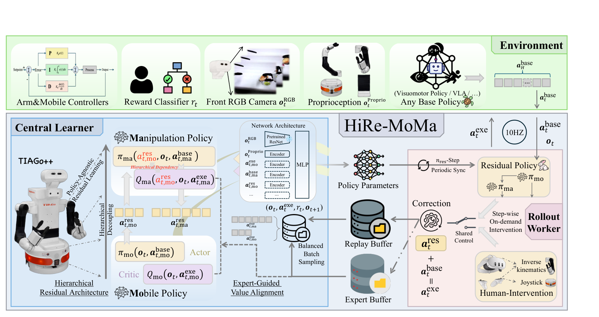
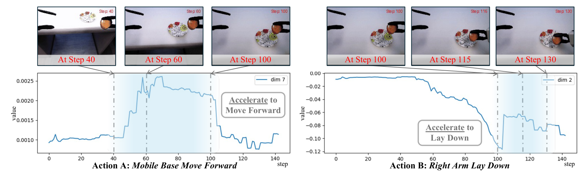

# Hierarchical Residual Policy Learning for Real-World Mobile Manipulation with Sparse Human Guidance

HiRe-MoMa 在冻结的模仿策略上学习小幅动作修正，并把底盘与手臂分开处理。它试图解决的不是从零学会移动操作，而是让一个已经能完成部分任务的策略，在有人接管的短时间真机训练中改善接触与协调。核心线索是：动作维度虽然可以拼成一个向量，底盘误差与手臂误差却有不同的因果关系。

Zhefei Gong、Hefeifei Jiang、Zehao Wang、Jiachen Li，2026。[arXiv:2610.20607](https://arxiv.org/abs/2610.20607)；[项目页](https://hire-moma.github.io/)。首次提交北京时间 2026-10-15 01:59:52。全文 20 页，包含算法与任务附录；尚未找到可确认的公开代码、权重。

## 移动底盘和手臂为何不宜共用一个残差

纯行为克隆会在训练分布外积累误差，但直接让强化学习改写整个高维策略既昂贵又容易破坏已有能力。残差强化学习将基础策略作为稳定起点，只学习纠偏。对移动操作而言，一个平坦残差头还要同时解决底盘定位、双臂末端动作和夹爪切换，梯度可能互相干扰。

底盘变化会改变手臂可达范围和接触位置，因此作者用单向条件表达这种关系：先决定底盘修正，再让手臂根据底盘修正作补偿。这里的“分层”是动作模块依赖，不是高层低频规划、低层高频控制的时间层级。

_图 2：冻结基础策略产生动作，底盘与手臂残差作有界修正；人工接管数据同时用于价值对齐。_

## 分层残差怎样接在冻结策略上

设观察为 $o$，冻结策略产生 $a^{\mathrm{base}}$，残差为 $r$，执行动作是

$$
a^{\mathrm{exe}}=a^{\mathrm{base}}+r,\quad r_b\sim\pi_b(\cdot\mid o,a^{\mathrm{base}}),\quad r_m\sim\pi_m(\cdot\mid o,a^{\mathrm{base}},r_b).
$$

$b$ 表示底盘，$m$ 表示操作臂。两个分支各自有策略和价值网络，手臂接收底盘残差，但底盘不反向依赖手臂输出。它们共享任务的稀疏成功信号，仍需各自从耦合的真实执行中学习；结构拆分没有消除奖励归因的全部困难。

完整平台动作最多 17 维：底盘 3 维速度，双臂各 6 维末端位姿变化与 1 维夹爪；头部和躯干固定。实际三个任务使用 10、15、10 维任务动作。残差幅度限制为归一化空间的 $\epsilon=0.3$，它约束基础动作附近的探索范围，不能解释为实际米、弧度或碰撞安全半径。

基础策略可以是 Diffusion Policy（DP）或 ACT，训练阶段保持冻结。分支采用带价值集成的 SAC 更新，以较保守的目标价值和自适应熵温度学习。熵鼓励探索，但残差范围来自显式边界，二者作用不同。

## 人工接管怎样影响价值而非只增加示范

训练遇到错误时，操作者通过 Meta Quest 3 接管；本地仲裁给人工绝对优先权。自主执行与专家修正进入不同缓冲区，训练批次从两者均衡采样。作者所说“低于 20%”指采集转移中的人工覆盖率，不是训练批次里专家样本的比例。

专家引导价值对齐额外要求价值网络不要把当前策略修正评得比已观察的专家修正更高。用附录中统一执行动作坐标的写法，其核心项可表示为：

$$
L_{\mathrm{align}}=\lambda\,\mathbb E_{\mathcal D_E} \operatorname{softplus}\left[Q(o,a^{\mathrm{base}}+r_\pi)-Q(o,a^{\mathrm{base}}+r_E)\right].
$$

$\mathcal D_E$ 是专家缓冲，$r_E$ 为接管时记录的残差，$r_\pi$ 为策略残差，$\lambda=10^{-3}$。当策略动作价值高于专家时损失增大，校准稀疏奖励下容易失真的价值地形。主文省略基础动作的记号不应让实现把残差坐标与完整执行动作坐标混用。

这并不直接强迫策略逐点复制专家，也不是一个安全证书。我的理解是，它把干预当成局部偏好信号，帮助减少明显错误方向的探索；如果专家修正本身受限、任务状态不充分可观测，价值对齐也会继承这些偏差。

## 真机训练的实际数据与调度

基础 DP 使用三个任务分别 80、100、200 条示范预训练，1000 个训练周期，预测 8 步、执行 6 步；ACT 的动作块设置相匹配。在线强化学习前还用人工辅助取得约 500–600 条成功转移来热启动，这不是无数据的直接在线学习。

TIAGo++ 以 10Hz 交互，工作站 RTX 4090 承担学习与基础策略推理服务，每 50 个环境步同步参数。训练人工干预比例从前期约 15–20% 降至后期 0–3%。不同方法使用对方法身份不知情的同一操作者，但各自采集干预轨迹，不是共享完全相同的人类动作数据。

_图 6：真机训练中的学习与人工介入变化；后期介入减少不能被扩张成无人值守部署保证。_

## 成功率表里的半分指标

三个任务各评估 20 次，初始状态在训练范围内随机化。必须先读任务评分，再理解结果：

| 任务 | 冻结 DP | HiRe-MoMa | 在线预算 | 指标解释 |
|---|---:|---:|---:|---|
| Place Only | 50% | 95% | 约 25 分钟 | 二值任务成功 |
| Sweep | 45% | 90% | 约 30 分钟 | 二值任务成功 |
| Pick Place | 22.5% | 40% | 约 40 分钟 | 抓取半分、放置一分的归一化阶段得分 |

> 图表占位：论文表 1 的任务与主结果需要保留；当前表格候选未通过视觉质量门槛，以上为按原文核实的数值转写，尚无可插入的合格原表图片。

Pick Place 的 40% 不能写成“20 次中 8 次完成整个任务”，因为只完成抓取也可获得 0.5 分。三个任务平均 39.2% 到 75.0% 混合了二值成功与分阶段评分，不宜不加限定地当作统一任务成功率。论文还报告平均执行步数从 455 降至 352.7，但任务预算和难度不同，不能因此推出任意移动操作都减少同样时长。

在 ACT 基础策略上，两项任务均值由 40% 升至 77.5%，提供了跨两类基础策略的适用证据；它没有覆盖所有预训练策略或新的机器人本体。

## 消融解释与部署边界

两项较便宜任务的消融依次为：平坦残差 50%，仅底盘与手臂拆分 80%，加入单向条件 85%，再加入价值对齐 92.5%。最大的增益来自拆分；条件化对 Sweep 有帮助，Place 的对应结果未进一步提升，所以不能说每一组件在每个任务上都同等必要。

> 图表占位：论文表 4 的分层与价值对齐消融无可用独立表格资产，暂保留占位；四级均值已在正文转写。

Pick Place 因硬件限制与单轮约 800 步的成本未纳入这项消融，尚不能把两任务的组件贡献推给最复杂任务。每配置的真机试验数量有限，且没有多训练种子重复；同一平台上的初始范围随机测试，也不同于新场景或新物体的分布外泛化。

作者明确指出系统仍依赖操作者，存在逆运动学可行域和底盘脚轮卡滞等失败，基础动作附近的有界残差未必能跨越这些障碍。可迁移的设计是按执行模块的因果关系拆残差，并把专家接管加入价值学习；复现时应同时记录预训练示范、热启动转移、干预重采样与真实交互时间，避免只报告“约半小时”。
