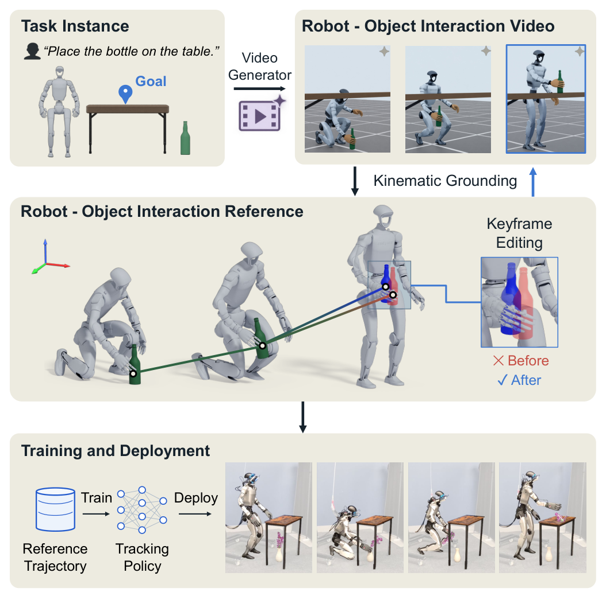
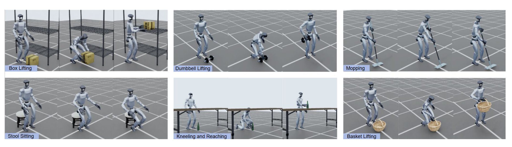

# KinoGen: Customizable Humanoid Loco-Manipulation References via Kinematically Grounded Video Generation

KinoGen 把视频生成当成全身动作参考的提案器，再用已知机器人运动学把视频还原为机器人、手部与物体状态。它解决的是参考轨迹的生产与定制：生成结果既要保留视频模型的行为多样性，又要落到目标机器人的关节和抓握接口。后续还需要训练跟踪策略，不能把生成的视频直接称为可部署控制器。

Qi Wu 等，2026。[arXiv:2610.20552](https://arxiv.org/abs/2610.20552)；[项目页](https://kinogen-humanoid.github.io/)。首次提交北京时间 2026-10-15 01:43:32。全文 9 页；未确认可用的官方训练代码或策略权重，网页模板与作者个人 GitHub 不作为代码发布证据。

## 为什么好看的视频仍不是控制参考

从视频中重建人体再重定向到机器人，容易把不适配的身体比例和接触几何一路传给控制器。KinoGen 反过来先在已知场景里渲染目标 G1，让视频模型一开始就看到它需要移动的机器人、物体和相机关系。这样降低了跨本体差异，却没有消除视频生成的穿透、脚滑或多视角矛盾，所以仍需显式重建与筛选。

_图 1：机器人渲染条件经过视频生成和运动学重建，得到可编辑参考，再用于策略跟踪训练与部署。_

## 从机器人渲染到可重建视频

已知机器人和物体模型、场景以及两台标定相机后，系统渲染两个 640×720 视角，拼为 1280×720 初始条件，交给 Seedance 2.0 生成约 5–10 秒、24fps 视频。手部只重着色为肤色以利用后续人手检测先验，几何仍是机器人手，不等于把人手关节直接当作机器人命令。

SAM3 产生机器人与物体掩码，每视角约 650 个表面点由 TAPNext++ 跟踪。Video Depth Anything 的尺度用已知地面和相机射线校准，估计时排除机器人及物体。多视角若出现明显手部不一致，流程拒绝该样本并换随机种子；这是一项筛选成本，不是生成器天然保证几何一致。

## 身体手部物体为何分阶段求解

全身先验来自适配 G1 的 Kimodo，先对噪声变量做约 200 步扩散噪声优化，在抽样的 12 帧上结合观察约束与先验约束。WiLoR 的人手结果只用于初始化浮动手部拟合，最终仍在机器人关节参数化里优化。每只 11 关节手用 3 个耦合坐标表示，不能宣称所有手指关节都独立恢复。

可以把参考状态写成 $q_t=(q_t^{\mathrm{robot}},T_t^{\mathrm{obj}})$，前者包含浮动基座与合法机器人关节，后者是物体刚体位姿。重建按手部、身体、物体依次进行：先根据轮廓、姿态先验与加速度拟合手部；固定手部坐标后，结合轮廓、二维跟踪、深度、地面、关节范围、时间平滑和腕部约束拟合身体；最后固定机器人，再拟合物体。流程末尾没有联合重优化全部变量。

其身体目标可概括为

$$
L(q)=\lambda_sL_{\mathrm{sil}}+\lambda_tL_{\mathrm{track}}+\lambda_dL_{\mathrm{depth}} +\lambda_gL_{\mathrm{ground}}+\lambda_jL_{\mathrm{joint}}+\lambda_pL_{\mathrm{prior}}+\lambda_aL_{\mathrm{smooth}}.
$$

这是对原文损失组的合并表示，不是额外提出的新目标。轮廓约束图像形状，跟踪约束时序对应，深度提供三维尺度，地面与关节项限制明显不合法运动，先验和平滑项抑制噪声解；各 $\lambda$ 是配方权重。它们能使参考更接近已知运动学与观测，但没有接触动力学求解，因此不能从损失下降推出力矩、摩擦或平衡一定可行。

> 图表占位：原文 Figure 2 的详细重建流程重要；当前候选错误映射到第 2 页正文，实际图在第 3 页，故拒绝插入。Figure 1 已提供通过审查的方法总览，此处保留详细图占位，避免使用错图。

## 关键帧编辑的零误差来自哪里

用户指定某一关键帧的目标物体位姿后，系统迁移物体与抓握手之间的变换，保留手指姿态，再对空闲手和双脚作逆运动学调整。编辑帧连同初始和结束帧交给 Ray3.2 做多关键帧视频生成，再重建新的整段参考。

关键帧状态受 $q_k=q_k^{\mathrm{goal}}$ 硬约束。这里 $k$ 是被编辑时刻，$q_k^{\mathrm{goal}}$ 是用户构造的可表达目标。终点位置误差为零主要来自这条约束，不是模型自行学到了完美放置；真正要检查的是过渡过程中是否出现穿透、脚滑与不可跟踪动作。

30 个目标按三个区域各取 10 个。线性修改末端虽然同样能达到零端点误差，三个区域的最坏穿透约 139.51/147.23/139.45mm；完整方法降到 19.32/2.72/20.99mm。结果说明再生成与重建改善了路径几何，但剩余非零穿透也说明没有获得严格无碰撞轨迹。

## 参考质量如何转成策略效果

论文在八个任务上以同一类 DeepMimic 状态策略跟踪不同来源的参考，Isaac Sim 使用 G1 与 ROHand。各来源使用相同 8192 个并行环境、6000 次 PPO 更新和 10 个随机种子。成功要求不跌倒且物体位置误差小于 0.2m；它是参考驱动的任务判据，不是任意语言指令下的端到端成功率。

| 参考来源 | 穿透 cm↓ | 脚滑 cm/s↓ | 接触一致 %↑ | 跟踪任务成功 %↑ |
|---|---:|---:|---:|---:|
| GenMimic | 3.17 | 9.95 | 13.57 | 31 |
| GenHOI | 10.55 | 6.52 | 43.91 | 11 |
| GRAIL | 3.06 | 5.11 | 69.40 | 42 |
| KinoGen | 2.30 | 4.09 | 91.16 | 57 |

接触一致性结合视频接触标注与小于 2cm 的几何距离，不是力传感器验证的真实接触。KinoGen 也并非所有指标最好：GRAIL 的平滑性数值 0.59 优于其 0.73。需要同时看几何、平滑与下游跟踪，不能仅用一项重建指标选参考。

_图 3：不同任务中的重建参考；这些示例展示动作覆盖，量化质量与跟踪能力仍以统一实验为准。_

去掉全身先验后，加速度指标从 0.37 升到 1.01，最大地面穿透从 10.5 升到 26.8mm，支持先验稳定身体重建的作用。去跟踪约束会使二维端点误差从 7.92 升到 9.89，但轮廓 IoU 仍约 0.65，地面穿透甚至略小于完整设置；不同损失优化不同几何目标，消融不能被简化成“所有模块都改善所有指标”。

## 真机演示与可复现范围

四项真机任务主要提供定性展示。部署策略由仿真全状态跟踪器蒸馏，输入本体状态和初始物体位姿，位姿来自第一帧 RGB-D 的 FoundationPose；不可见凳子使用初始仿真位姿。因而它不是部署期间持续感知全部物体变化的在线视觉策略，也没有足够真机成功次数支持泛化率结论。

最可复用的接口是“已知机器人渲染条件—可校准重建—硬约束编辑—独立跟踪验证”。我的分析是，迁移时要先检查场景模型、双视角标定、手部耦合和接触几何，而不是只换提示词。商业视频模型版本、拒绝重采样的成本与尚未公开的完整配方，也会影响复现；运动学合法、仿真可跟踪与真机稳定应分别验收。
