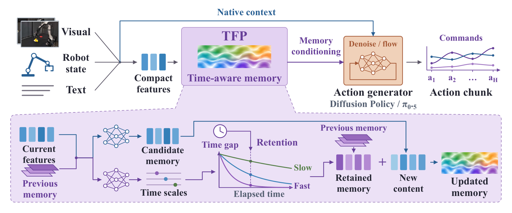
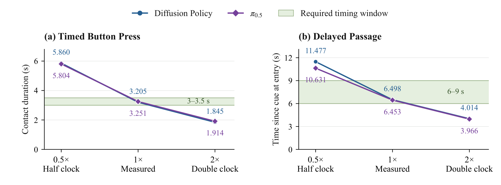
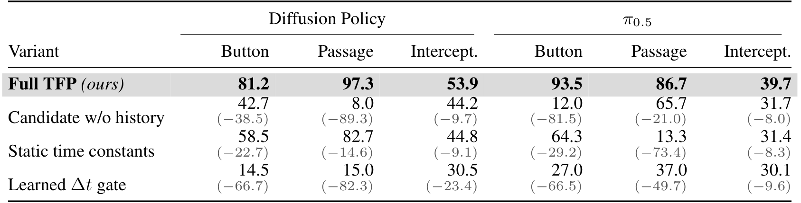
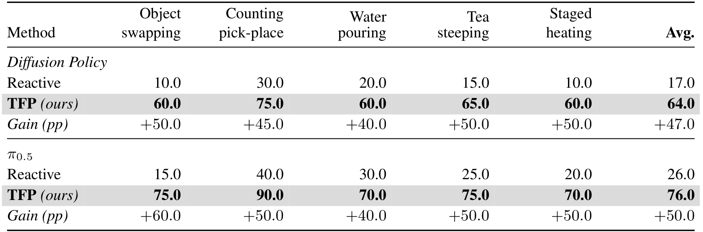

# Physical Time as a Missing Dimension of Robot Policy Memory Dynamics

一个策略若把“又调用了一次”当成“又过去固定时间”，降低查询频率或丢失查询就会改变它对事件持续时间的判断。Temporal Flow Policy（TFP）把测得的物理时间间隔放入记忆更新公式，在观察更新与动作求解之间建立一个显式时间接口。这是一种策略记忆机制，主要证据来自时间敏感任务中的受控干预。

Yushen Liang 等，2026；[arXiv:2610.20524](https://arxiv.org/abs/2610.20524)。首次提交北京时间 2026-10-15 01:24:13。全文 23 页，含实现与探针附录；尚未确认可用的官方代码和权重。

## 控制查询次数不能代替物理时间

按住按钮、等待信号后通过通道、遮挡后拦截移动目标，都要求记住事件以及事件发生后经过多久。固定步长递归网络可以在训练节奏下把调用次数当作时钟，但部署时查询从 10Hz 降为 5Hz，相同次数就代表两倍时长。把时间差作为普通输入特征虽然允许网络学习补偿，却不强制记忆的变化遵循这段真实时间。

作者的核心选择是把记忆视为在两个查询时刻之间演化的状态。观察决定“要写入什么”和“变化速度是多少”，时间戳决定“这次变化持续多久”。因此时间不是再增加一个任务标签，而是进入状态转移的积分尺度。

_图 2：观察和旧记忆预测候选与时间常数，测量时间差控制保留率，再将新记忆接入原策略条件。_

## 把记忆写成有时间尺度的积分

令第 $n$ 次策略查询的特征为 $x_n$，旧记忆为 $h_{n-1}$，实际时间差为 $\Delta_n=t_n-t_{n-1}$。两个独立预测头产生候选 $\hat h_n=\tanh f_h(x_n,h_{n-1})$ 和逐通道正时间常数 $\tau_n=f_\tau(x_n,h_{n-1})$，然后更新：

$$
k_n=\exp(-\Delta_n/\tau_n),\qquad h_n=k_n\odot h_{n-1}+(1-k_n)\odot\hat h_n.
$$

指数、除法与乘法均逐通道计算。$\tau_n$ 与 $\Delta_n$ 同为秒，$k_n$ 是无量纲保留率：间隔为零时保留全部旧记忆；间隔相对时间常数很长时趋向新候选。候选和时间常数不直接接收时间差，避免把“事件内容”与“经过时间”全部混在自由网络门控中。

这个形式来自常系数微分方程 $dh/du=(\hat h_n-h)/\tau_n$ 的精确解，但“常系数”只指本次转移里冻结候选与时间常数。冻结时有 $e^{-(a+b)/\tau}=e^{-a/\tau}e^{-b/\tau}$；如果中间重新观察并重算预测头，就不是同一个转移。因此论文的半群解释不能被说成对任意查询节奏的全局严格不变性。

## 训练与动作求解怎样保持因果

新记忆经投影 $M(h_n)$ 加到原策略条件 $c_{\mathrm{native}}$ 上，形成动作预测所用的条件。一次策略查询只更新一次物理记忆，随后扩散或流匹配的所有内部求解步都保持它不变。生成器的去噪时间是算法变量，机器人事件持续时间是物理变量，不能每做一步去噪就让记忆又演化一次。

训练仍使用策略原有的行为克隆目标，没有额外事件时间标签来监督记忆。训练段只读因果前缀；长序列用截断反向传播，在段间保留状态并截断梯度。回合边界置 $h_{-1}=0$；受控任务首查询使用 0.1 秒引导间隔，之后才用时间戳差。DP 有 128 个记忆通道，以 softplus 加下限保证时间常数为正；π0.5 用 256 通道并限制时间常数范围。这个差别也是复现时需要保留的配方信息。

## 哪些实验真的隔离了时钟作用

训练固定 10Hz，没有混合频率增强；测试在 10Hz、5Hz、抖动和丢查询四种节奏下保持物理任务窗口不变。按钮与通道每个种子各 50 次试验，拦截每个种子与节奏 300 个场景，主要比较使用三个训练种子。

| 跨三个任务、四节奏平均 | DP 主干 | π0.5 主干 |
|---|---:|---:|
| S4D 加时间输入 | 62.1% | 66.8% |
| TFP | 77.5% | 73.3% |

这些均值支持显式时间动力学在所测任务上更稳健，却不是每个单元格都领先。例如 π0.5 的按钮 5Hz 测试中，TFP 95.3% 低于 S4D 加时间的 98.7%。平均收益不能掩盖这个反例。

更直接的证据来自固定权重与真实任务节奏，只把输入时间差减半或加倍：前者使策略认为时间过得更慢，后者更快，对按钮保持与通道进入时间产生相应方向的变化。

_图 4：只改变时间输入后的事件时间偏移；DP 按钮部分中位数仅在符合条件的 20、38、36 次轨迹上计算，不能当作三组全部 50 次。_

π0.5 按钮和两个主干的通道任务，在 50 次配对试验中均出现预期方向的偏移。把测试时间输入固定为 0.1 秒，或每次查询清空记忆，都会明显破坏时间任务；但这些干预只能说明该模型在这些任务中依赖时间记忆，不能证明任意机器人任务都需要同一种时间机制。

_表 2：去历史、静态时间常数与自由时间门控等消融，检验结构化时间更新的贡献。_

以 DP 为例，完整模型按钮、通道、拦截的四节奏均值为 81.2/97.3/53.9%；改为静态时间常数降为 58.5/82.7/44.8%，自由学习的时间门控为 14.5/15.0/30.5%。这说明“知道时间差”与“用特定稳定形式处理它”在当前配方中不同；自由门控的训练困难也可能参与差距，不能据此排除所有其他时间网络。

## 真机与通用基准各支持到哪里

Galaxea A1 的五个真机任务各有 50 条示范，每种策略每任务测 20 次，包含加热和倒茶等时间条件。DP 平均从 17% 升到 64%，π0.5 从 26% 升到 76%。

_表 3：真机逐任务成功率；每任务每方法 20 次试验，有限样本不能替代多次独立训练的统计稳定性。_

真机对照主要是无记忆原策略，缺少同预算 GRU、S4D 等记忆基线，因此真机提升不能完全分解为“有历史”与“显式物理时间”的各自收益。时钟机制的因果证据更强地来自前述仿真干预，而不是只看真机总分。

LIBERO 40 任务上 TFP 为 98.7%，对照的原版 OpenPI 96.9% 来自官方已发表数字，不是本实验重新训练的同硬件基线；作者另复现的 GRU 与 S4D 为 95.6% 和 96.6%。LIBERO-Plus 仅测试 Noise、Light、Background 三类扰动，平均 93.7% 对复现无记忆策略 91.4%，不能把该数字称为完整七维扰动评测。

## 部署前要验证的时间接口

最可迁移的部分是状态接口：为每个回合维护固定维度记忆和上次查询时间戳，在真实查询边界更新，动作求解内部保持不变。额外记忆存储随回合长度不增长，约为 $O(d_h)$，但不意味着原视觉语言主干或动作求解成本消失。

我的分析是，可靠时间戳、正确回合复位和一致的单位，比再接一个时间嵌入更值得优先验证。暂停、相机延迟与控制进程重启若产生异常时间差，指数更新可能直接遗忘旧状态；论文没有证明仅靠这个机制能修复传感器过期、执行延迟或新任务时间尺度外推。这些仍需在目标机器人上逐项测试。
