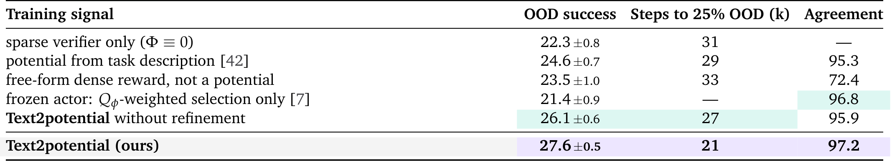

# CoDA: Co-Evolution of Data Engines and Action Policies

数据引擎若只会随机改场景，会把大量仿真预算花在策略已经会做或根本学不会的地方。CoDA 将策略失败转换为可执行的场景变化和训练信号，再用更新后的策略反过来检验这些变化。它的核心是一个有状态的研究循环：记住哪些环境已经试过、为什么失败、哪些规则能重用，而不只是让语言模型不断生成新任务。

[arXiv:2610.22362v1](https://arxiv.org/abs/2610.22362)；首次提交：北京时间 2026-10-16 01:59:02；[项目页](https://plan-lab.github.io/projects/coda/)。本次未确认独立公开代码或模型权重。实验均在仿真中，不能视作真机后训练已经验证。

## 数据引擎怎样从失败中得到可执行改进

场景写成 $s=(\tau,\sigma,\alpha)$：$\tau$ 表示任务，$\sigma$ 表示布局，$\alpha$ 表示物体属性。因子化 SDK 使生成器能明确改变某个因子，而不是输出无法检查的自由文本。场景需经过碰撞、稳定性、尺度等检查，并配有稀疏机器可验证成功判定器 $\nu$。非法场景不进入动作采集，但构造失败仍留下记录，避免下一轮重复生成相同错误。

图 2 中的数据引擎和策略通过执行轨迹连接。这里有两个不同的“评论器”：视觉语言评论器诊断失败，价值评论器预测动作价值。前者不直接输出控制动作，后者也不替代场景有效性检查。把二者混成一个模块，会误读数据如何进入训练。

*论文原图编号：Figure 2。因子化场景、持久记忆和策略后训练形成闭环；诊断模型和动作价值模型处在不同位置。*

## 因子诊断和三类记忆怎样约束生成

一次失败被整理为 $\psi=(\text{factor},\text{phase},\text{cause},\text{evidence})$，分别指出场景因子、任务阶段、原因与依据。作者不直接采信语言模型解释，而是在当前策略下生成有针对性的变化批次，并与改变其他因子的控制批次比较。只有定向变化确实更难，才把解释编译为可复用规则。这是操作性归因检验，不是穷尽所有混杂因素的因果证明。

记忆分三层：情节记忆保存环境程序、版本、执行结果和轨迹；语义记忆归纳跨轨迹的失败模式；程序记忆保存环境生成规则与训练规则。生成规则库控制怎样制造新环境，训练规则库控制怎样从子目标构造势函数。持久化的价值在于后续轮次能修正旧规则，而不是每次调用都从一段临时描述重新开始。

预算分配同时考虑当前困难度和学习进展。前者寻找能力边界，后者避免反复采样策略没有改善的死角；再保留随机探索与旧模式重放，防止只围绕最新诊断收缩。对策略完全不会的场景，还能通过规划器和成功判定器生成成功示范，提供初始可学轨迹。

## 文本势函数为何采用差分奖励

自由形式语言奖励可能把“接近物体”变成可以永远刷分的目标。CoDA 要求先把任务拆成累计完成的子目标，最终子目标与成功判定 $\nu$ 一致。在已完成阶段数 $k$ 的基础上，增加下一阶段内有界进度 $\phi_k\in[0,1)$，得到阶段势 $\Phi(s)$；终态为阶段总数 $m$。离散阶段防止只完成容易前缀，区间内进度使稀疏成功之前也有学习信号。

训练使用差分塑形

$$\tilde r_t=r_t+\beta\left(\gamma\Phi(s_{t+1})-\Phi(s_t)\right).$$

其中 $r_t$ 是原稀疏奖励，$\gamma$ 为折扣，$\beta$ 为塑形尺度。奖励鼓励势的变化，不是反复领取当前位置的势值。对长度 $h$ 的动作块，折扣相加后的中间势会抵消，剩下

$$\tilde R_{t:t+h}=\sum_{i=0}^{h-1}\gamma^i r_{t+i}+\beta\gamma^h\Phi(s_{t+h})-\beta\Phi(s_t).$$

这使动作分块 TD 更新可以在端点计算势，减少不必要的中间评估。成功终止需要按论文约定去掉终态势端点及后续自举，不能把非终止公式机械套到终态。固定有界势、正确终止和精确价值条件下，塑形的 $Q$ 与 $V$ 同样平移 $-\beta\Phi(s)$，因此优势保持不变。这是有条件的理论结论，不能覆盖不断修改势函数、近似价值与有限数据造成的所有误差。

## 价值引导收集如何转成原生策略更新

采集时从策略取多个动作块候选，由分类价值模型估计回报，并按 softmax 权重组合执行，区别于直接挑选价值最大的一个候选。记录实际执行动作及其结果，再训练价值与动作策略。价值模型在预设支持区间上预测分布，按实际动作块计算多步 TD，既学习成功也利用失败；失败的稀疏奖励可能为零，但塑形项仍然提供进展差异。

动作策略采用优势加权的原生模仿目标，可概括为 $\mathcal L_\pi=\mathbb E[\exp(\hat A/\lambda)\,\ell_{\rm native}(\pi;a,s)]$。其中 $\hat A$ 为当前动作价值减去多个候选平均价值，$\lambda$ 控制权重温度，$\ell_{\rm native}$ 是原策略的流或扩散训练损失。这样不要求计算复杂生成策略的显式动作概率；规划器示范使用单位权重。它不是让策略直接回归评论器输出，也不是只在部署时保留昂贵候选搜索。

最终部署直接执行更新后的动作策略，不保留视觉语言诊断、文本势程序或价值加权候选组合。由此，环境生成与采集可以很昂贵，而动作部署保持原生接口；但总训练成本仍需如实计算。

## 同预算结果与迭代规模效应

主要比较在四类环境、三个随机种子、相同生成预算下进行五轮。SFT 只使用原始数据，随机化和均匀生成检验自动造环境的基本收益，标量反馈与无记忆评论器进一步检验诊断信息和记忆的作用。

> **图表占位：Table 1 — 五轮同预算主比较**
> **建议位置：** 生成方式和反馈信息的受控实验之后。
> **放置原因：** 该表同时比较随机化、诊断和记忆，支撑核心机制链。
> **当前状态：** 保留占位；一次几何修复后仍残留外部标题片段，未使用不合格图片，正文依据全文转写。

| 五轮配置 | 平均成功率 |
|---|---:|
| SFT | 5.3% ± 0.3 |
| 域随机化 | 7.9% ± 0.4 |
| 均匀生成 | 8.5% ± 0.2 |
| 标量反馈生成 | 18.1% ± 0.5 |
| 评论器但无记忆 | 19.2% ± 0.7 |
| 完整 CoDA | 27.6% ± 0.5 |

这组结果支持信息更细的诊断和跨轮记忆有增量，但系统组合很多组件，不能把 19.2% 至 27.6% 的全部变化归因于某一种记忆结构。十五轮可到 42.1%，是更多轮次与资源下的结果，不宜用来与其他方法五轮配置直接计算同预算优势。

LIBERO-Pro 位置和指令扰动在十五轮分别达到 84% 和 76%，基础策略为 25% 和 1%；五轮对应 82% 和 72%。标准 LIBERO 约从 97.1% 到 97.4%，说明主要收益集中在生成变化相关的鲁棒性，而非所有原始任务显著提高；Object 套件也不是本文方法最优。

表 4 更直接检验训练信号：文本势 27.6%，稀疏奖励 22.3%，任务描述条件 24.6%，去掉修订 26.1%，自由形式稠密奖励 23.5%。到达 25% 成功的训练步数约为 2.1 万对 3.1 万，约减少 32%。只以价值筛选、冻结动作策略则为 21.4%，支持真正更新策略有额外收益。

*论文原图编号：Table 4。受约束的文本势、奖励替代与冻结策略结果，帮助区分收集动作变好和策略本身学到改进。*

## 复用这一循环前需要验证的成本

附录按每 1000 个接受环境报告约 740 万语言模型词元、66 GPU 小时和 25.1 仿真小时，包含环境生成、诊断及程序编译。自适应预算相对固定预算的约 830 万词元节省约 11%，但仍有显著额外计算。不能只报告最终策略推理便宜，而忽略整个数据循环的成本。

诊断也不是可靠真值：两名标注者对 100 条诊断的审查一致性约 82.4%，有约 18.2% 被反驳。其他诊断模型仍能得到约 24.9–26.1% 成功率，支持方法不完全绑定单个模型，但不消除系统性误诊风险。作者承认仿真、生成程序有效性检查和基础模型依赖等局限；本文没有真机迁移结果。

最可迁移的部分是“可执行因子—可检验诊断—有状态规则—受约束训练信号”的链条。复现时应版本化环境和势程序，记录无效生成、拒绝诊断和全部计算预算，分开衡量采集策略与最终部署策略。真实接触任务中的验证器不完整、场景建模成本和失败安全要求，仍需额外研究，不能从仿真收益直接推定。
