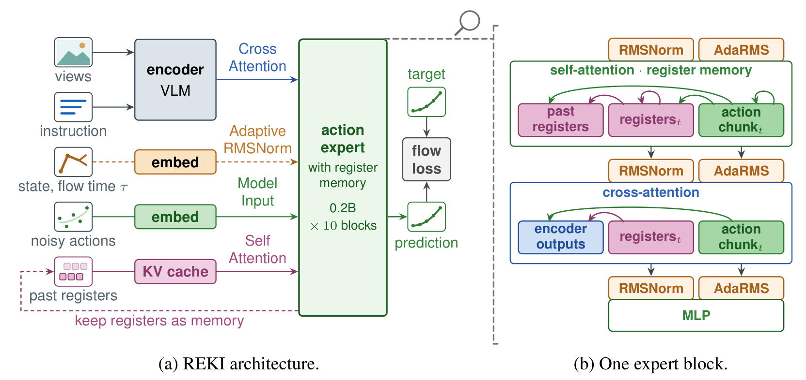
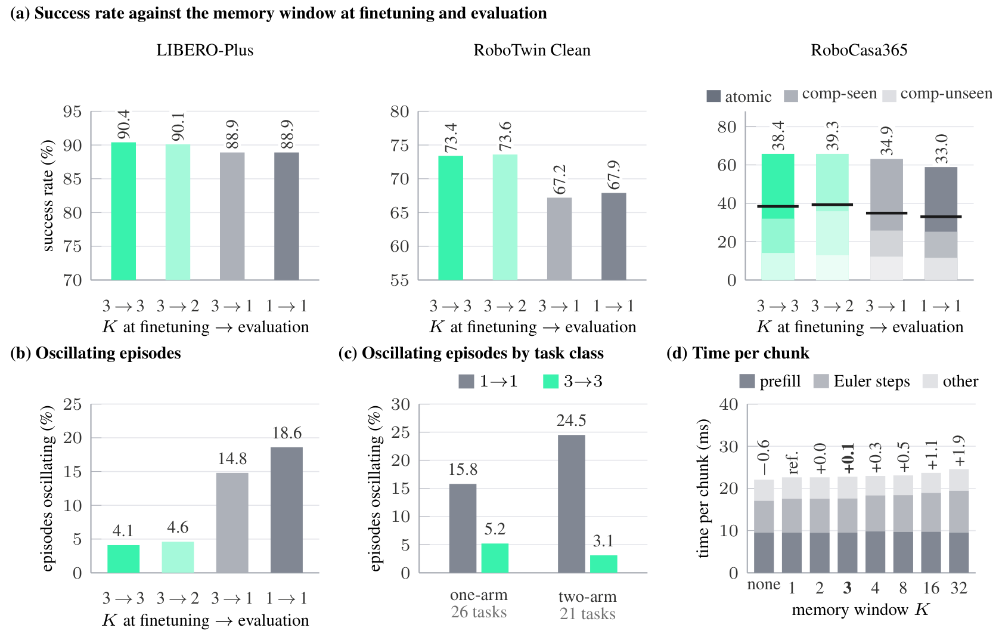
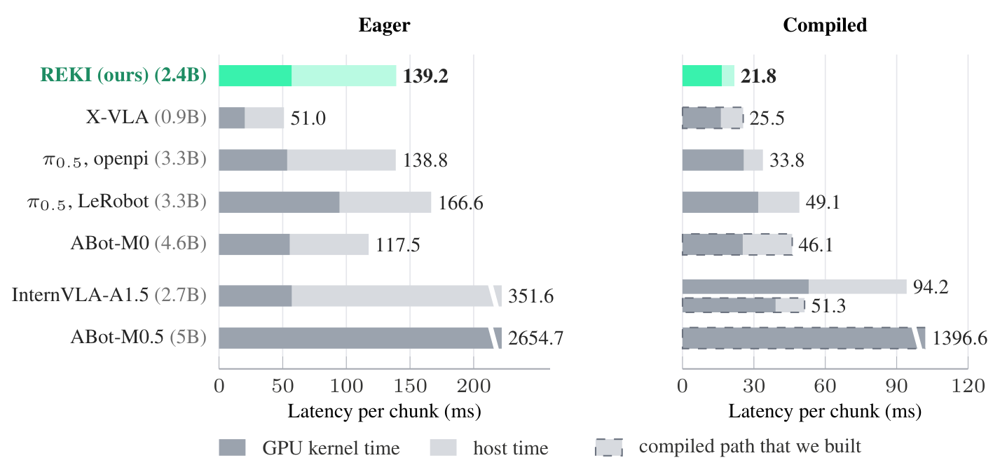
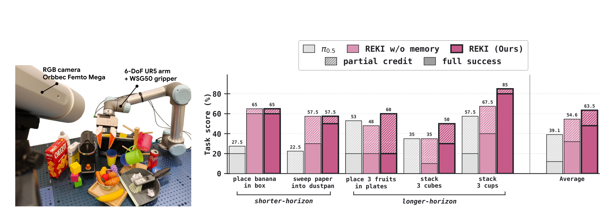

# REKI: Registering Knowledge in VLAs

单帧 VLA 即使能理解当前画面，也可能忘记物体刚才从哪里来、上次动作是否已经做过，进而在两个姿态之间来回摆动。REKI 把记忆放进动作专家：每帧提炼少量观测寄存器，跨策略查询保存其注意力键值。它的重点不是简单增加输入帧，而是让历史信息独立于当前动作噪声，能够在反复求解动作流时低成本复用。

[arXiv:2610.22178v1](https://arxiv.org/abs/2610.22178)；首次提交：北京时间 2026-10-16 00:34:06；[项目页](https://kyutai.org/reki/) / [代码](https://github.com/kyutai-labs/reki) / [权重](https://huggingface.co/kyutai/reki-2b)。代码 MIT，权重 CC-BY-NC-SA 4.0。

## 为什么把记忆放在动作专家里

把多帧图像全部重新送进视觉语言模型，会使视觉计算随历史增长。把过去动作混入缓存，又会让记忆随动作求解中的噪声状态变化。REKI 保持视觉语言主干处理当前帧，使用动作专家内部的观测寄存器汇总其输出，并对历史只读取这些寄存器。

模型总计约 2.4B 参数，包括 Qwen3.5-2B 与约 0.2B、10 层动作专家。当前各视角和指令先得到视觉语言特征 $E$，每帧 32 个寄存器跨注意力读取 $E$，再通过因果自注意力访问过去与当前寄存器。寄存器从不读取动作词元，也跳过状态与流时间的自适应调制；这样同一个观测的缓存不随动作噪声或当前物理状态输入变化。

*论文原图编号：Figure 3。观测寄存器和动作路径分开，历史只保存寄存器键值；这使缓存跨查询和动作求解步骤有效。*

## 寄存器如何形成可复用的历史

动作词元读取历史与当前寄存器，并在本动作块内部自注意力。训练用 $K=3$ 帧窗口、帧间约一秒；每帧都有对应的动作块监督。窗口内观测因果连接，各窗口独立，不通过长期展开反向传播。部署时保存最近两帧在各层的 32 个寄存器键值，新一帧加入后淘汰最老缓存，回合边界清零。

当前寄存器在第一次动作积分时计算，后续九次直接复用。缓存存储规模随保留帧数、寄存器数、层数和隐藏维度增长，不随历史原始图像数量无限增长。与此同时，历史寄存器本身在计算时已经读取更早寄存器，因此信息可能间接延续超过三帧。论文指出训练窗口和推理缓存之间有这种差别；不能把系统严格解释为“只包含过去两秒信息”，也不能假设它已验证任意长时记忆。

图 5 把训练窗口、测试读入历史和错误行为联系起来。对记忆模型测试时关闭历史，比直接训练单帧模型更有针对性：参数不变，只改变可用上下文，因而能检验模型是否真的读取记忆。

*论文原图编号：Figure 5。窗口和测试历史的比较揭示记忆使用情况，姿态摆动统计检验具体失败模式。*

## 数据和流积分的执行契约

不同机器人不强行映射到同一个关节布局。动作保留来源数据的本体约定，按分位数归一化到 $[-1,1]$，填充维度用损失掩码忽略；状态则通过布局对应投影进入动作路径。提示词提供本体、控制方式、频率及回合长度分箱，多视角加入角色嵌入，并进行视角打乱和丢弃。状态输入以 0.2 概率丢弃。这些接口与模型结构同样影响跨来源训练。

流匹配采用 $A_\tau=(1-\tau)A+\tau\epsilon$，目标速度为 $\epsilon-A$。其中 $A$ 为真实动作块，$\epsilon$ 为高斯噪声，$\tau$ 是噪声时间。推理从 $\tau=1$ 积分到 0，以 10 步 Euler 去噪。每个训练窗口共享观测编码并使用八份动作噪声采样。记忆只提供观测条件，积分过程中变化的是动作，不需要每步重算历史。

预训练只用公开机器人、第一视角人类与视觉语言数据，机器人和人类部分约 35 万回合、1.7 亿帧，另混入 10% 视觉语言样本。公开来源意味着可以审查数据配方，不意味着所有数据已统一许可、无需清洗或能低成本复现训练。

## 受控实验怎样定位记忆的收益

| 训练与测试配置 | LIBERO-Plus | RoboTwin Clean | RoboCasa365 |
|---|---:|---:|---:|
| 单帧训练、单帧测试 | 88.9% | 67.9% | 33.0% |
| 三帧训练、三帧测试 | 90.4% | 73.4% | 38.4% |
| 三帧训练、测试只留当前帧 | 88.9% | 67.2% | 34.9% |

三帧配置的收益在测试时移除历史后明显回落，支持记忆被实际使用，而非纯粹来自训练增强。进一步的姿态摆动诊断要求连续三个动作块发生方向反转：无记忆训练模型的发生率为 18.6%，记忆模型保留历史后为 4.1%，测试关闭历史则回到 14.8%；只留一帧过去观察也能达到 4.6%。这是一类具体行为指标，不是关节抖动能量或所有失败率。即使无记忆模型发生摆动的种子中，记忆模型也只成功约 45%，不能称为彻底解决此类任务。

跨模型主表多使用其他论文公开报告值，数据量、硬件和训练预算没有完全统一。REKI 的 LIBERO-Plus 90.4% 很强，RoboTwin Clean2Rand 为 65.8%；但 RoboTwin 分布内表现不及 InternVLA。RoboCasa365 平均 38.4% 也掩盖了未见任务组合只有 14.1%，低于 Xiaomi 的 32.1%。因此“参数规模较小且整体表现有竞争力”有支持，“所有泛化类别都领先”没有。

## 延迟优势与真机得分的真实口径

图 6 的测量条件为 H100、两张 $256\times256$ 图像、批量 1，统计从原始观测到反归一化动作，包括预处理与传输。REKI 使用 320 个动作块重复三次取中位数。即时执行为 139.2 毫秒，编译后 21.8 毫秒，其中 GPU 约 16.5 毫秒；记忆增加约 0.1 毫秒。低成本来自紧凑专家、编译与缓存共同作用，不能只归因于寄存器。

*论文原图编号：Figure 6。即时与编译模式差异显著，需保留硬件、输入和统计条件；柱高不是机器人闭环控制周期。*

同图其他模型也做了编译优化，但部分路径由作者实现。ABot-WM 使用两张 $128\times128$ 图像和 80 个动作块，输入与统计量并非严格一致。21.8 毫秒是动作块生成延迟，不能直接宣称物理机器人 46 Hz 稳定闭环；本文 UR5 真机回路为 15 Hz。

真机五项任务各 50 条示范、10 次评估，微调 3000 步、全局批量 360。REKI 产生 30 步动作块，π 模型为 50 步，执行时域仍有差别。图 8 的平均值为 REKI 63.5、去记忆 54.6、π 基线 39.1，柱形包含带斜线的部分完成分数，不能写成 63.5% 的完整任务成功率。三项长时任务从记忆得到约 12 至 17.5 个百分点得分改善，更适合支撑长程上下文有用这一结论。

*论文原图编号：Figure 8。任务照片与柱形比较共同展示真机评估；斜线部分表示不完整进展，应与完整成功分开。*

## 权重许可和部署需要保留的约束

官方代码涵盖数据、训练、推理、评估与部署，公开的主权重仓库本次可访问、未设访问门槛；没有下载检查点或在本机复现。代码和模型权重许可不同，使用时需要分别遵守。论文与 README 的 LIBERO 汇总还存在 97.5 / 97.6 的细微差异，未核对协议前不宜把末位小数当作结构优势。

最值得借鉴的是让可持久状态只依赖观测，并把它与多次动作求解共享。在实际机器人上，应明确缓存的回合归属、时间间隔、相机角色和状态投影，并测试断流、相机缺失与重置。更长记忆是否积累误差、不同查询频率是否改变表示、未见任务组合怎样改善，仍是现有结果之外的研究问题。
