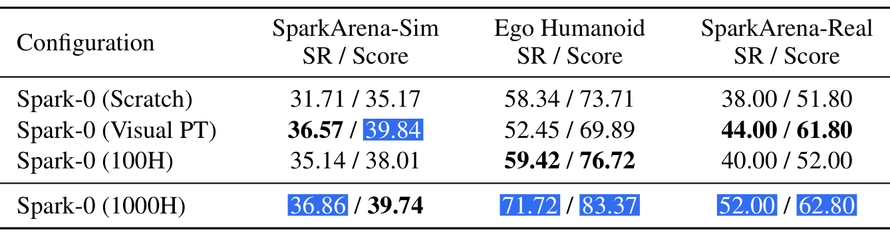

# Spark-0: Scaling Spatially Aligned Tactile Pretraining for Robot Dexterous Manipulation

视觉可以看到手靠近物体，却未必知道哪个指节承受了接触、物体是否开始滑动。Spark-0 把这个差距拆成两个问题：预训练时怎样让视觉特征理解空间接触，控制时怎样把触觉送入动作专家。它同时改变训练目标与运行期融合，因此阅读结果时必须区分“人类触觉预训练的收益”和“机器人在线触觉的收益”。

[arXiv:2610.22342v1](https://arxiv.org/abs/2610.22342)；首次提交：北京时间 2026-10-16 01:56:17；[项目页](https://xsparkai.com/Spark-0/)。项目给出的代码链接尚未在本次检查中验证为可运行实现。

## 接触数据为何需要空间对应

把一个触觉向量拼到视觉特征后面，模型仍要自行学习每个压力测量对应哪只手、哪块皮肤，以及图像中哪个接触点。HumanTouch 用同类手套覆盖人手与机器人，采集三视角视觉、手部运动与 60 Hz 触觉；总量 1000 小时、超过 100 类任务、32 名操作者。每手原有 460 个触觉单元，去掉 140 个容易受弯曲伪影影响的位置，保留 320 个。

空间对应首先用于监督。作者通过 MANO 手模型把接触位置投到头部视角，形成软接触图；冻结的 DA3 几何教师则提供稠密几何特征。接触图是训练标签，不是推理输入；几何教师也不跟随策略部署。这样，模型有机会从触觉教过的视觉表示中受益，即使某个来源没有运行期触觉。

## 从手套测量建立训练期监督

模型使用 Qwen3-VL-4B 与 36 层、宽度 1024 的动作专家。在第 25 层视觉语言表示上加几何和接触监督。几何项最小化投影后特征与冻结教师特征的余弦距离，可写为 $\mathcal L_{\rm geo}=\operatorname{mean}_v(1-\cos(P(f_v),g_v))$；$f_v$ 为第 $v$ 个视角特征，$P$ 是投影，$g_v$ 是教师输出。它让视觉保持空间结构，而不是要求动作专家直接预测完整三维场景。

接触项为 $\mathcal L_{\rm con}=0.1\mathcal L_{\rm focal}+0.1\mathcal L_{\rm dice}$。前者处理接触位置稀疏，后者约束预测区域与软接触图重叠。这两项和动作训练共同作用；文中没有把几何、接触和融合结构逐一独立消融，不能把最终收益全部归给接触图。

*论文原图编号：Figure 3。图中区分训练期接触与几何监督、触觉压缩和动作专家融合；辅助标签及教师不在推理时作为额外输入。*

## 触觉怎样进入动作而不淹没视觉

运行期每手分成手掌和五指六个区域。区域力使用最近 20 帧、约 333 毫秒历史；另一路编码当前触觉点的坐标和压力。两类分别压缩为 12 个词元，合计 24 个；原始触觉不经过视觉语言主干。动作专家交替进行跨注意力与自注意力，使动作、状态和触觉在保留各自结构的同时交换信息。

由于混合数据中触觉可能缺失，作者显式区分“未提供传感器”和“传感器读数为零”。对第 $q$ 类触觉表示使用 $\tilde e_q=m_q\gamma_q e_q+(1-m_q)e_{\rm empty}$，其中 $m_q$ 表示是否存在该模态，$\gamma_q$ 为学习尺度，$e_{\rm empty}$ 为缺失占位。若仅用零填充，两类情况会混淆，模型无法知道应当信任零压力还是忽略该通道。

融合还采用非对称门控：触觉查询读取状态或动作的注意力有 $-6(1-\sigma(g))$ 偏置，而状态与动作查询读取触觉不施加相同屏障。工程含义是先限制触觉分支被其他信息覆盖，同时让控制分支能够访问接触。区域力历史另经自适应归一化注入动作网络。训练中逐步将触觉捷径概率从 0 增至 0.1，临时关闭部分状态或动作的跨注意力读取，避免完全忽略触觉；推理不进行这项随机关闭。

## 动作流的训练与实时重规划

动作共有 58 维：双臂各 9 维末端表示与 20 维手部目标关节。状态的末端位姿使用头相机参考系，动作的末端部分则相对当前动作块起点；手部关节保持绝对目标。每次重新查询都要重设相对锚点，否则把连续动作块直接拼接会改变控制语义。

流匹配构造 $a_\tau=(1-\tau)\epsilon+\tau a$，其中 $a$ 为示范动作块、$\epsilon$ 为高斯噪声，网络学习速度 $a-\epsilon$。每训练样本取六份噪声，推理用四次 Euler 积分得到 50 步动作。积分步不是机器人控制步。部署时已执行 24 步、剩余 26 步就触发实时动作分块重规划，设置名义延迟 8 步，使推理与执行重叠。

预训练为 40 万步、96 张 GPU、全局批量 576。HumanTouch 的采样权重为 0.35，EgoDex 为 0.39，机器人触觉、其他机器人和仿真等来源占其余部分；小时数不能直接等同于训练曝光比例。后续微调 8 万步，仍保留教师对齐。因此复现要记录完整混合采样，而非只对齐“1000 小时”标签。

## 预训练收益在哪里显著又在哪里有限

表 4 最接近受控比较：相同视觉数据和预训练计算预算，改变触觉参与程度。表中 SR 为完整成功率，score 为部分完成得分；两者不能互换。

*论文原图编号：Table 4。四种配置在仿真、Ego 和真机上的平均成功率及完成得分，显示收益受评测来源影响。*

| 配置 | 仿真 SR | Ego SR | 真机 SR | 真机完成分数 |
|---|---:|---:|---:|---:|
| 从头训练 | 31.71% | 58.34% | 38% | 51.8 |
| 仅视觉预训练 | 36.57% | 52.45% | 44% | 61.8 |
| 100 小时触觉 | 35.14% | 59.42% | 40% | 52.0 |
| 1000 小时触觉 | 36.86% | 71.72% | 52% | 62.8 |

Ego 评测没有在线触觉，因此 71.72% 的结果支持触觉预训练可改善下游表征，而不只是多接一个传感器。真机所有配置在微调和运行时都使用触觉，因此 44% 至 52% 更接近预训练方式的差异。100 小时配置并未稳定胜过纯视觉；仿真 1000 小时相对纯视觉仅提升 0.29 个百分点，完成得分还略低。视觉预训练在 Ego 上低于从头训练，也提示数据混合和域差异不能忽略。

真机系统为 Marvin M6S 双臂和 WUJI Hand 2，五个任务各评估 10 次，合计 50 次。52% 是五任务的完整成功率，62.8 是分阶段得分。与 FTP 的 36% 成功率相比具有优势，但样本仍小，没有多次独立训练的不确定性估计。

> **图表占位：Table 3 — SparkArena-Real 主要结果**
> **建议位置：** 五项真机任务与部分完成得分的解释之后。
> **放置原因：** 该表区分任务差异、完整成功和分阶段进展。
> **当前状态：** 保留占位；当前候选实际为同页上方的另一张表，身份不符，未使用该图片。

依据真机表，1000 小时配置在试管、鞋、手机、碗、瓶任务的完整成功率依次为 0%、80%、50%、50%、80%。试管只有部分进展，没有任何方法完成全部三个试管；平均值不能掩盖这一失败。仿真七任务各 50 次，而 Ego 的 27 个见过与 66 个未见配置仍是该基准微调后的评测，不能称作完全零样本跨本体控制。

## 同构手套和规模成本的迁移边界

这项工作的可复用思路，是把接触位置变成视觉监督，把触觉是否存在变成显式条件，再用不对称融合保护控制所需的接触信息。它比简单拼接传感器多了清晰的数据与结构约束。

但人机共享手套和对应的手部几何也降低了对齐难度，换用不同触觉布局、不同灵巧手或没有 MANO 对应的接触面时，需要重做空间映射。96 卡预训练和复杂数据混合也不是轻量设置。现有证据支持组合系统与较大触觉规模的价值，尚不能判断哪一个辅助头贡献最大，或在更长时域、更多物体和不同传感器上是否保持同样收益。
