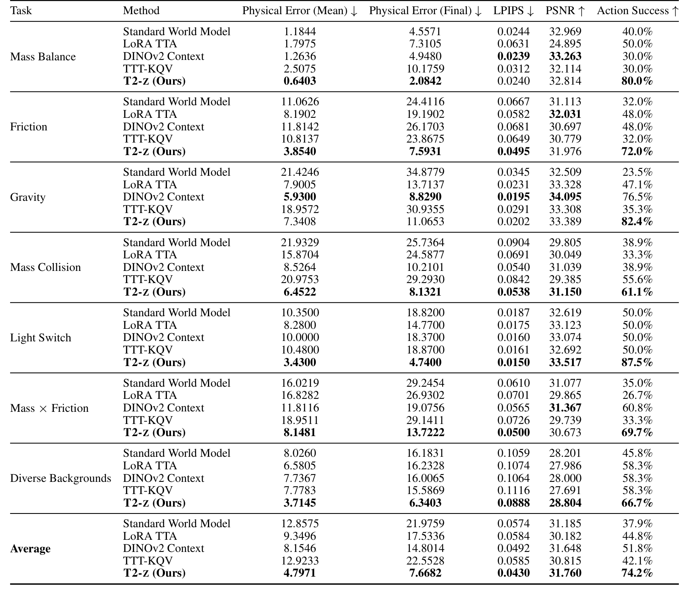
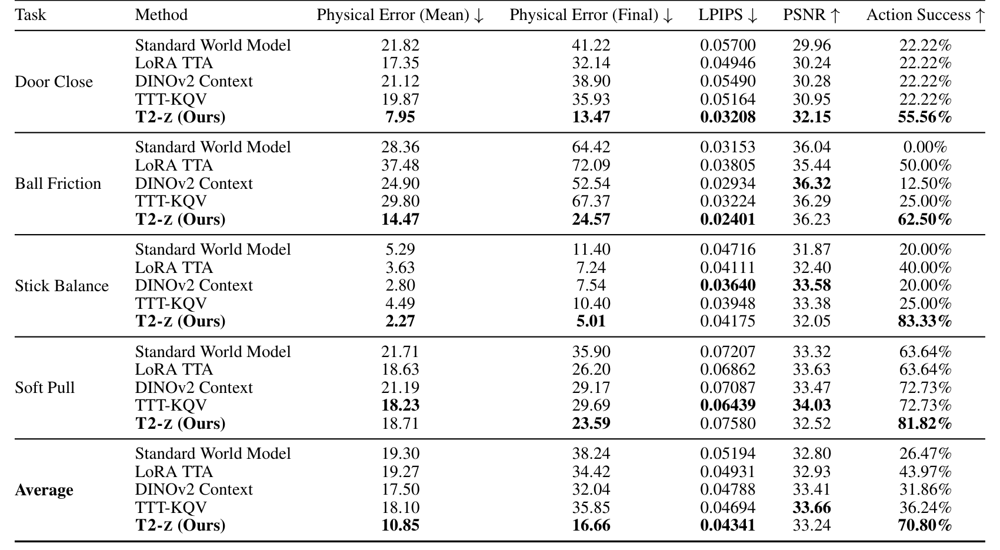
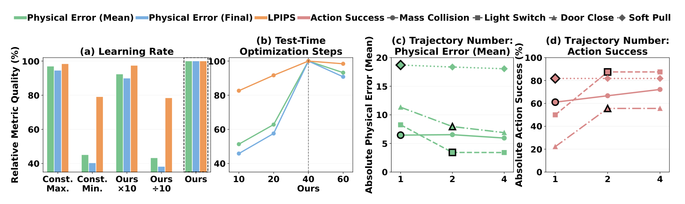

# T2-z: Test-Time Optimization of Environment Latents for Robotic World Models

机器人世界模型能预测一段动作后的画面，却不一定知道当前物体有多重、桌面有多滑。直接修改大模型参数代价高，完全不修改又可能把新环境当成训练分布里的平均环境。T2-z 在两者之间加入一个低维接口：共享模型负责可迁移规律，32 维环境变量负责从少量交互中吸收环境差异。理解这项工作的关键，是把它看成基于视频预测误差的隐式系统辨识，而不是免交互的物理属性识别。

[arXiv:2610.22364v1](https://arxiv.org/abs/2610.22364)；首次提交：北京时间 2026-10-16 01:59:11。以下依据论文方法、实验与附录；未确认可用公开代码。

## 共享模型为何需要一个环境接口

动作条件视频模型把当前观测和候选动作映射成未来视频。如果训练集混合不同质量、摩擦或重力，同一动作会对应多种未来。扩大模型可以覆盖这些结果，却没有自动解决“这次究竟处于哪个环境”的条件选择。作者让模型额外接收环境向量 $z$，并在训练时为每个环境保存自己的向量。它不需要用显式质量、摩擦标签监督，但也因此不能把向量的某一维直接解释成真实物理参数。

论文用 Wan2.2-TI2V-5B / BWM 初始化共享动作条件模型。图 3 将共享建模、环境变量训练和新环境适配连在一起：变化的是条件向量，世界模型主体在测试时冻结。这个设计把参数更新空间缩小，却没有消除通过模型反向传播的计算。

*论文原图编号：Figure 3。共享模型与环境变量分工，并在新环境仅优化变量；它解释更新对象的变化，不表示推理完全免梯度。*

## 训练时怎样分离共享动力学与环境变量

令 $x$ 为上下文观测，$a$ 为已执行动作，$y$ 为后续视频，$y_t$ 为流匹配训练中的带噪视频潜变量，$u_t$ 为目标流速，$	heta$ 为共享参数。核心目标可概括为

$$\mathcal L(\theta,z)=\mathbb E_{t,y_t}\left[\left\|v_\theta(y_t,t\mid x,a,z)-u_t\right\|_2^2\right].$$

这里的 $t$ 是去噪时间，不是机器人控制时钟。误差来自给定动作后的真实视频，因此 $z$ 获得的是“使当前环境视频更可预测”的监督，而非物理参数真值。实现上，模型参数固定时梯度仍经过模型传到 $z$；更新模型时则把环境向量视作条件。

每环境向量从 $U(0,1)$ 初始化。先进行 300 步模型热身，再交替执行 200 步变量优化和 200 步模型优化，模型学习率 $10^{-5}$，变量为 0.03。交替优化的目的，是避免共享模型与环境向量在同一阶段互相追逐，或让模型绕过这个条件接口。附录和消融比较了联合更新、不同变量设计及适配步数；它们支持特定训练分工有效，尚不能证明得到了唯一、可辨识的物理分解。

## 一次新环境交互怎样变成动作选择

到新环境后，先采集一至两条交互轨迹，再新建一个向量并固定 $	heta$。作者用 40 次梯度更新适配，学习率每 10 步依次为 3、1.5、0.5、0.15。较大初始步长搜索有效条件，较小后期步长细化；它是这套变量参数化和数据规模下的配置，不能未经验证迁移到任意主干。

适配轨迹和后续候选动作测试分开。模型对候选动作生成未来，再用任务特定规则评估预测结果，选择动作并在真实环境验证。比如棍子平衡任务的候选集中保证至少存在一个可平衡动作，模型从预测可平衡的集合随机选择；若一个也没预测出来则失败。软物体旋转用目标角度附近的正负偏转构造候选，依靠两侧预测进行判断。这些实验确实检验环境适配是否有助于决策，但不是任意连续动作空间中的完整规划器评估。

这里也能看到隐变量的限制：一条随机轨迹若没有激发影响目标任务的动力学，低维优化无从恢复相应信息。我的分析是，交互覆盖范围与隐变量容量同样重要；论文的条件可视化和主成分图能够显示环境结构，却不能单独证明无歧义的系统辨识。

## 结果中的误差和成功率不能互换

论文表 1 比较七项仿真任务，表 2 比较四项真机任务。各方法共享基础模型，并使用规定的少量适配交互。LoRA 在模型内部更新低秩参数，DINO 条件方法以观测特征推断环境，TTT 通过快权重更新；它们分别检验参数适配、摊销条件编码与内部记忆适配的替代路线。LoRA 的 50 次更新与变量的 40 次更新并不等于完全相同的梯度计算预算。

*论文原图编号：Table 1。表内同时包含各任务物理结果误差与成功率；不同任务误差单位不同，宜逐列解释。*

| 比较范围 | 未适配共享模型 | T2-z | 应如何解读 |
|---|---:|---:|---|
| 七项仿真平均成功率 | 37.9% | 74.2% | 跨任务等权平均，不是所有试验汇总 |
| 四项真机平均成功率 | 26.47% | 70.80% | 各任务小规模实验的平均 |
| 仿真摩擦任务成功率 | 32% | 72% | 对应像素误差约 11.06 降至 3.85 |
| 真机球任务成功率 | 0% | 62.50% | 新环境条件显著影响候选判断 |
| 真机棍子任务成功率 | 20% | 83.33% | 依赖前述候选动作集合协议 |

*论文原图编号：Table 2。门、球、棍子和软物体分别给出误差与成功率；软物体的视觉误差并非所有方法中最优。*

摘要的 11 项总体平均成功率为 33.73% 至 72.96%，可以作为其任务集合内的汇总。另一组“物理误差 15.20 至 7.00”混合像素、角度和灯状态误差，不能解释成厘米，也不宜当成统一物理精度提高百分比。

反例使结果更有信息量：重力任务中，DINO 方法像素误差约 5.93，优于 T2-z 的 7.34，但成功率为 76.5%，低于后者 82.4%。软物体任务 T2-z 像素误差 18.71，略差于 TTT 的 18.23，LPIPS 也没有普遍最好。这说明决策需要预测对动作选择有影响的差异，平均视觉误差只是一个代理指标。

## 哪些消融与成本支持这种分解

图 5 比较适配步数、环境条件与训练设计。40 步附近表现较好，继续增加步数并不稳定改善，有些条件在 60 步后反而下降。这支持保留适配验证和停止规则，而非把测试时梯度步数视为越多越好。直接更新更大的条件或联合训练未自动带来更强结果，也表明接口设计与优化调度共同影响收益。

*论文原图编号：Figure 5。四组曲线检验环境适配设计；最优步数和配置属于本文协议，不能外推成一般收敛保证。*

附录给出的 H200 单卡、一次适配加五次预测的计算用时为：标准模型 6.17 秒，DINO 6.08 秒，T2-z 18.09 秒，LoRA 32.73 秒，TTT 37.57 秒。预测采用 25 次去噪步。这些计时排除了加载模型、数据和 MP4 读写，也不含采集真实交互；因此“比参数适配便宜”有证据，“18 秒内完成完整真机适配流程”没有。

## 复现时需要控制的环境覆盖

最有复用价值的设计是给共享生成模型设置一个小而可优化的环境接口，并在完全相同的真实交互上比较参数、特征和隐变量适配。复现应先固定训练环境划分、动作与视频对齐、候选集合和判定器，再报告每任务原生单位误差与实际执行成功率。只看生成视频或混合平均误差，很容易漏掉真正影响动作的偏差。

论文证明了若干环境变化下少量交互的适配潜力。对于训练支持范围外的接触模式、无法由所采轨迹辨识的因素、需要长历史的部分可观测过程，以及自由连续规划是否同样获益，现有实验仍不足以给出一般结论。
