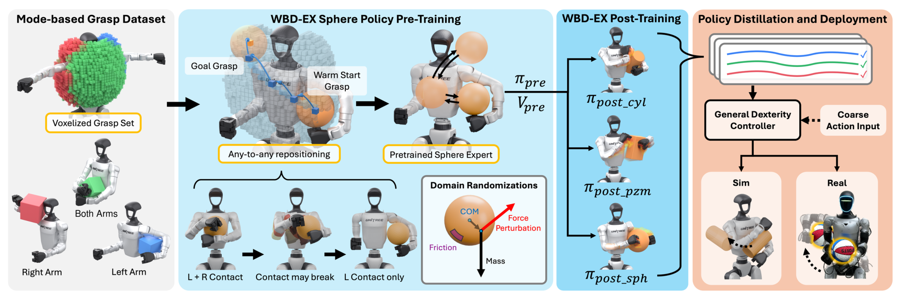
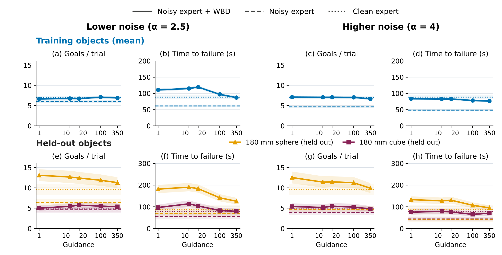

# Whole-Body Dexterity

搬动较大的物体时，人会把它抵在胸前、夹在上臂下，再逐步改变双手支撑。只追踪手的位置，机器人很容易失去这些身体接触。Whole-Body Dexterity 先生成稳定接触状态，再训练状态之间的重定位技能，最后让人用粗粒度动作引导一个已掌握接触稳定性的策略。它把接触安排从操作者的精细动作中部分抽离出来，但真机实验仍是人机协作。

[arXiv:2610.22184v1](https://arxiv.org/abs/2610.22184)；首次提交：北京时间 2026-10-16 00:40:48；平台为 Unitree G1。本文依据完整方法、实验和附录，未确认可运行公开代码或权重。

## 从双手抓握转向身体支撑模式

如果直接要求遥操作员逐关节保持接触，机器人与人体的几何差异会不断放大误差。作者先利用已知机器人和物体网格，离线搜索可支撑物体的身体姿态，并将这些状态作为强化学习的起点和目标。这样，策略处理接触细节，人提供移动意图。

图 2 给出四个阶段：稳定抓握生成、逐物体专家学习、示范收集和策略蒸馏。原始数据包含约 251 万个稳定抓握，15 类物体几何、尺度约 80–240 毫米。生成器支持更多身体附肢，但本文控制策略主要训练双臂和躯干，腿部抓持没有进入训练与真机验证。

*论文原图编号：Fig. 2。离线物理筛选先确定可训练的接触目标，专家轨迹再蒸馏成可交互控制器；腿部接触不属于已验证策略范围。*

## 离线抓握如何定义可达的接触目标

生成器从接触几何和力闭合条件构造候选，躯干划分多个空间区域，避免把整块胸部当作单一、过粗的支撑标签。候选先承受四倍重力及六轴扰动，再在一倍重力下检查物体漂移小于 10 厘米、旋转小于 45 度等条件，并结合网格距离与高度过滤。这里的“稳定”是这些有限仿真扰动下的筛选结果，不是所有外力的证明。

目标由两厘米体素位置与支撑模式组成。用 $\mathcal M=\{L,B,R\}$ 表示左侧、双臂、右侧模式，允许的转移包含 $L\leftrightarrow B\leftrightarrow R$，不允许直接 $L\leftrightarrow R$。从一侧换到另一侧必须先形成双侧支撑，这个离散结构把接触保持要求写进了目标采样，而非期待奖励自行发现全部可行接触过程。

“任意到任意重定位”也有范围：主要目标是物体位置和支撑模式，不额外给物体完整朝向或任意机器人关节终态。训练逐步把目标距离由 2 厘米扩到 8 厘米，并以 20% 概率采样保持任务，使策略先学稳定支撑，再扩大移动范围。

## 专家怎样学会移动而不掉物体

每个物体训练 PPO 专家，观察包含仿真可得的物体状态。奖励同时鼓励目标进展、接近目标后稳定保持，并惩罚掉落和接触丢失。若 $e_t$ 为目标位置误差，进展项使用裁剪的 $e_{t-1}-e_t$，每步幅度限制在约 2 厘米；保持项采用 $\exp(-e_t/2.5\text{cm})$。二者的区别在于：前者奖励正在靠近，后者即使已经到达也持续奖励停稳。

接触转换允许约 0.48 秒宽限，避免在切换的瞬间惩罚所有短暂失联，但目标模式中不活跃的手臂最终必须完全释放。保持奖励、模式约束和宽限时间共同决定策略会不会仅靠摩擦拖拽或一直双臂抱住物体；复现时不能只复制一个位置误差奖励。

训练随机化质量、质心、摩擦与外力。部分物体由球体专家热启动，减少重新学习接触技能的成本；这不意味着新物体无需训练。专家基准评测关闭外力扰动，但保留物理参数随机化，因此训练鲁棒性与评测难度并不完全一致。

## 蒸馏后的人机分工与几何输入

专家数据经筛选得到约 27.4 万条轨迹、8.73 亿帧。扩散模型学习条件运动关键点，逆动力学模型再将生成运动变成关节增量。部署只使用本体感觉历史和五维物体几何，包括排序包围盒三维尺寸的对数、体积对数与球形度。它不读取在线物体位姿，却不是完全没有物体信息；真实物体仍需测量或指定这些几何量。

遥操作员的粗动作对扩散采样施加引导，再从候选中选择与意图接近的运动。增加引导强度可以更积极追踪人的意图，同时偏离训练运动分布，因而可能损害接触稳定性。逆动力学输出的关节增量还有有界处理；论文的 $\pm2.5$ 是变换前的界，不应解释为直接允许每步转动 2.5 弧度。

*论文原图编号：Fig. 4。多组误差与引导强度的结果同时报告任务进展和失效时间，展示动作响应与稳定性的折中。*

## 仿真泛化和真机成功率分别说明什么

仿真蒸馏训练使用 13 类物体，把 180 毫米球和立方体保留在训练、验证及归一化之外。评测三个训练种子，每物体使用 256 个匹配初始抓握，单次上限 600 秒，并按抓握聚类计算配对自举 95% 区间。指标包括完成目标数与失效时间，不是无限期稳定性的保证。不同配置汇总下，平均失效时间在训练物体、保留球和保留立方体分别改善约 70%、158%、71%；更强引导并非处处更稳定。

真机则在全部 15 类物体上训练控制器，不能把上述保留物体条件直接套到真机。对照包括直接动作重定向 GMR 和通用全身控制器 SONIC。WBD 与 GMR 用 AMO 稳定下肢，SONIC 使用自己的下肢控制及三点 VR 输入；它们的全身控制组件不同，并不是只替换上肢网络的严格单变量比较。

> **图表占位：Table I — 真机身体重定位比较**
> **建议位置：** 两物体、两任务与完整往返成功率的解释处。
> **放置原因：** 该表是物体靠肩、腋下等重定位能力的主要定量证据。
> **当前状态：** 保留占位；没有取得身份和完整表体均通过审查的图像，按全文核对数值转写。

| 真机条件 | WBD 完整成功 | 协议 |
|---|---:|---|
| 篮球，肩部往返 | 9/10 | 每侧五次，完成完整往返 |
| 篮球，腋下往返 | 9/10 | 同上 |
| 15 厘米立方盒，肩部往返 | 10/10 | 同上 |
| 15 厘米立方盒，腋下往返 | 10/10 | 同上 |
| 货架到桌面的完整任务 | 7/10 | 搬取、腋下收纳、携带、取出和放置 |

五组共 45/50，为论文所说的 90%；GMR 为 9/50，SONIC 为 2/50。操作者是同一位练习超过八小时的专家，结果不能解释为无需训练的人类使用者或自主任务规划成功率。完成用时还只在成功试验上统计，会排除失败轨迹的时间成本。

> **图表占位：Table II — 货架任务分阶段结果**
> **建议位置：** 长时任务阶段与完整成功的比较之后。
> **放置原因：** 分阶段计数说明成功率损失发生在操作链的哪里。
> **当前状态：** 保留占位；未安全恢复原表图片，正文保留已核对的各阶段计数。

货架任务的五阶段完成次数为 10、9、9、9、7。前面成功搬取不意味着最终安全放置；最后阶段仍会掉落或失去接触。相比只展示一条长视频，这种阶段统计更能暴露接触策略仍未解决的部分。

## 走动演示背后的控制边界

论文展示站立和行走时携带物体，但下肢平衡由独立控制器承担。接触专家训练没有把全身动态平衡、落足与物体重定位作为一个联合强化学习问题求解。作者也将更丰富的接触和腿部参与留作后续方向。

复用这套方法时，优先保留稳定抓握筛选、支撑模式转移、训练课程与蒸馏过滤，而不是只复刻扩散网络。之后需要分别测试几何描述误差、真实摩擦偏差、操作者水平和下肢扰动。现有结果展示了身体作为接触资源的价值，但没有证明未知形状、任意姿态或自主全身搬运都已解决。
