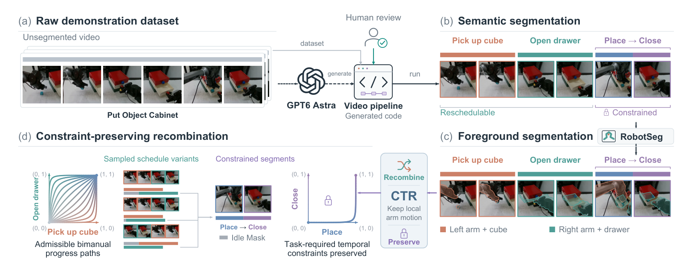
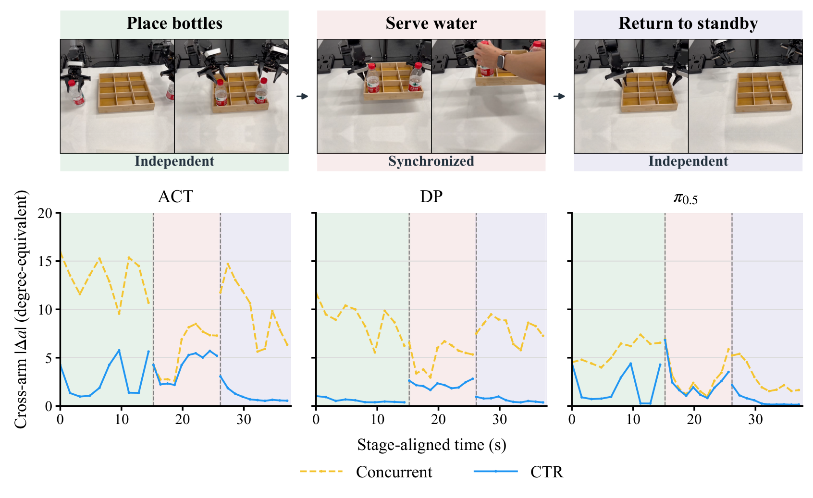

# Learn the Task, Not the Schedule: Reducing Spurious Cross-Arm Coupling in Bimanual Imitation Learning

同一双臂任务可以先左后右、部分重叠或同时执行，示范却往往只记录其中一种时间表。CTR研究的是这种窄分布如何让策略错误地依赖另一臂的进度，并用训练期约束保持的时序重组减少这种捷径。重点不是让两臂互不相关，而是在独立阶段少依赖、在必要协同阶段仍依赖。

原文：[arXiv:2610.26507v1](https://arxiv.org/abs/2610.26507)，北京时间2026-10-19 22:44:03首次提交。已读完整24页及后部实现、训练与反事实评估说明；抽取器未单列附录起点，但附录内容实际保留。论文的[代码入口](https://github.com/MINT-SJTU/CTR)当前返回404，尚不能按可运行开源实现复现。

## 示范的双臂时间表怎样成为捷径

以递水为例，两臂摆放瓶子和回到待命位置的阶段可以各自完成，中间服务阶段则需要同步。若所有示范恰好总是同时摆瓶，联合策略可以把右臂状态当成左臂下一动作的提示。这在标准初始状态下可能取得很高成功率，但一旦右臂被暂停、初始进度错位，左臂也会无必要地等待。

作者用所有满足物理和语义要求的调度集合$\Omega^*$定义哪些依赖是必要的：只有对所有可行调度都必须成立的关系才是任务要求。同一批窄时间表示范无法自行区分“确实需要同步”与“示范者习惯同步”。因此CTR不声称从观测数据自动发现因果约束，而是借助任务知识构造保守可行调度集合。

*论文原图编号：Figure 1。先建立并人工审查任务处理程序，再提取动作片段、前景与约束，最后扩大可调整阶段的双臂进度覆盖。*

图中的语言模型在任务设定阶段生成处理程序，程序经人工审查后批处理视频；不是每个部署控制周期调用模型，也不是逐视频人工重标。这个区别决定了实际新增成本主要位于数据构造与任务约束验证。

## 保留局部运动并打散可改变的相对时序

先把每臂示范分成有序片段。重组保留每段的持续时间、局部状态、动作以及自身观察，只改变它在整条联合轨迹中的开始时间。片段内部的源时间映射以原速度前进，插入空隙时则保持片段边界状态。对由先决条件、同步、持续支撑或共享空间排斥约束关联的片段，实验保守地冻结其记录中的相对时间偏移；其余时间自由度才用于采样。

可以把重组后的局部流写成$\tilde x_i(t)=x_i(\phi_i^s(t))$。$i$表示左或右臂，$s$是采样的合法调度，$\phi_i^s$把新时间映射回原示范时间。这里$x_i$代表状态、动作及局部观测组成的流；映射在活动片段中推进，在新插入的等待区间保持不动。它说明CTR不是生成新的臂轨迹或改变运动速度，而是重用已记录的局部内容。

腕部相机跟随各自源时间；主相机则需要在共同背景上合成两个时间点的机械臂与任务物体前景。RobotSeg等前景处理负责实现这一视觉对应，几何、接触与观测一致性过滤负责排除非法组合。重组观察仍是现实的近似，不能因为像素可拼接就断定两个动作在真实共享空间必定能同时执行。对于紧密耦合的片段，保持约束会限制可重排范围，也正是避免破坏必要协作的原因。

## 为什么合成等待不能成为模仿目标

为了填充不同开始时间，重组会引入原示范没有的等待。如果像普通专家动作一样训练这些等待，策略可能学会“到了某个画面就停住”，抵消扩大时间支持的目的。IdleMask因此只排除合成等待对应的模仿损失坐标，真实的保持物体、提供支撑及终态保持仍参与监督。

对动作预测损失，可用简化形式说明其作用：

$$
\mathcal L_{imit}=\frac{\sum_{t,j}M_{t,j}\,\ell(\hat a_{t,j},a_{t,j})}{\max(1,\sum_{t,j}M_{t,j})}.
$$

$M_{t,j}$是时间与动作坐标上的有效监督掩码，$\ell$是学习器自身的动作损失，$a$与$\hat a$分别是记录动作和预测动作。这是对掩码作用的实现解释，不替代不同模型的原生目标；论文不把所有辅助损失都一并屏蔽。分母控制有效监督量，避免等待比例变化直接改变损失尺度。

CTR生成的数据用于DP、ACT及π0.5训练，每个示范采样一到两个调度，匹配训练更新预算。部署后仍是普通观察到动作的策略，没有额外在线调度器。因此收益必须通过训练分布改善实现，不能归因为运行时显式任务图接管了决策。

## 反事实进度与暂停干预怎样检验选择性

实验包含四个仿真和四个真机任务，覆盖独立、共享空间排斥、协同和先决关系。对照有原始左先右后、串行、并行、三种典型时间表混合，以及更广合法支持的CTR。重要的是，这些重组基线也采用视觉合成；只有CTR额外使用IdleMask，因此还需要去掩码控制来分辨作用来源。

*论文原图编号：Figure 4。蓝线在两个独立阶段明显降低，但中间递水协同阶段仍保留响应，支持选择性减少无关依赖。*

动作探针固定一臂状态与观测，仅改变另一臂，统计预测动作差异。ACT在三个阶段的Concurrent敏感性为13.28、5.82、9.77，CTR为2.79、4.19、1.07，单位是文中的角度等效动作差。并非所有响应都被压低：中间协同阶段相对保留，才符合方法要区分必要与偶然依赖的目标。

真正闭环的证据来自六种双臂进度初态和外部暂停。原文表1的成功率每格50次，Worst SR是六初态中的最小值，不能当任务平均成功率。

| 任务与指标 | 混合时间表Mixed | CTR |
|---|---:|---:|
| 真机Sort Letters最坏初态成功率 | 56% | 76% |
| 真机Sort Letters右臂领先初态 | 56% | 96% |
| 仿真Put Object Cabinet最坏初态 | 48% | 56% |

> **图表占位：Table 1 — 六种双臂进度初态主比较**
> **建议位置：** 反事实进度与暂停干预怎样检验选择性
> **放置原因：** 需保留状态列及最坏成功率口径，避免把平均成绩混入结论。
> **当前状态：** 当前自动图表候选未提供独立完整表体；已从第7页核实上述数值，保留占位。

真机Sort Letters原始时间表在默认状态约90–92%，最坏状态却仅0–36%，说明默认测试可能掩盖脆弱性。另一项暂停实验对照分支与干预分支共享局部初态，只暂停对臂1–4秒。π0.5的4秒暂停向非暂停臂传递延迟，从Concurrent的2.56秒降至CTR的0.25秒，串行则为5.12秒；这不是任意任务都减少2.31秒执行时间，而是特定反事实干预的配对延迟差。

只扩大已见进度组合还不够。作者把联合进度区域$[0.2,0.3]\times[0.7,0.8]$从训练中移除，单臂各自的进度取值仍然见过。该区域Mixed成功率58%，CTR-hole74%，完整CTR76%，支持对一个保留组合区间的泛化；它不等于任意未见双臂状态都可恢复。

## 保留必要约束的代价和部署边界

主结果还报告真机必要约束违反率：关抽屉任务从窄时间表的98%降至0%，共享工作区任务从36%降至4%。这说明扩大自由调度没有要求策略完全忽略另一臂。但释放延迟分别从0.01增至0.27秒、0.09增至0.15秒，约束保守性有可测的效率代价。

实现控制也不支持“仅合成图像就足够”。只进行视觉合成的左先右后数据，在Sort Letters为90%到90%，Scan Object从68%到62%；去掉IdleMask后，CTR在这两项设置从94%到92%、70%到56%。

> **图表占位：Table 2 — 视觉合成与IdleMask的控制实验**
> **建议位置：** 保留必要约束的代价和部署边界
> **放置原因：** 控制比较帮助区分视觉处理、调度支持与合成等待监督的影响。
> **当前状态：** 自动候选未通过视觉质量门，拒绝插图；第8页文字与表内结果已核实并在正文保留。

默认任务与模型组合中CTR改善19/24项，Place Dual Shoes未改善，不能把结论写成所有双臂任务全面提升。作者承认分段、约束和视觉合成可能出错；任务特定约束也是迁移成本。我的分析是，首先应为自己的数据建立对臂暂停、进度错位与真实必要关系三个测试，再决定哪里适合重排。尚不能确定现有前景合成能否覆盖严重遮挡、双手共同持物和连续接触变化，这些场景需要重新验证可行调度，而不能直接套用独立阶段的增强规则。
