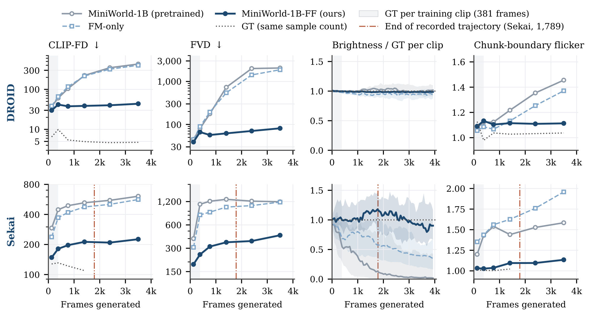
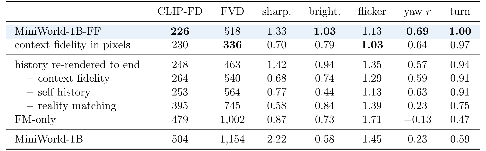

# Frechet Forcing: Training Long-Horizon Streaming World Models from Short Clips

流式世界模型不断把自己生成的片段放回历史，短训练片段中的小误差会在长生成中变成暗化、重复纹理和场景漂移。Fréchet Forcing直接约束部署采样器的自由rollout：保留动作条件生成能力，同时要求每条轨迹留在自身场景附近，并让输出帧具有真实图像统计。它主要验证长视频视觉稳定性，尚未证明这种生成器能提高机器人闭环任务成功率。

原文：[arXiv:2610.25666v1](https://arxiv.org/abs/2610.25666)，北京时间2026-10-19 10:12:39首次提交；[项目页](https://zhao-yian.github.io/Frechet_Forcing/)、[官方代码](https://github.com/zhao-yian/Frechet_Forcing)、[模型入口](https://huggingface.co/zhaoyian01/Frechet_Forcing)。全文27页，方法第5–10页，实验及分析第11–23页。官方标题使用Frechet，正文术语保留Fréchet。

## 短片世界模型为何在长rollout中偏离

MiniWorld-1B是块因果视频DiT，在Wan2.2 VAE潜空间以两个潜帧组成一块，给定历史KV和逐帧动作生成未来。部署采用每块8步的阶梯采样器，同时保留8个在途块与24块滚动KV窗口。注意范围没有超过预训练位置范围，所以作者关注历史内容中的误差积累，而非位置编码外推。

直接沿用流匹配，只约束记录片段中的去噪速度，不会惩罚模型在自由生成后访问的退化状态。教师蒸馏也不总有可信目标：外部视频教师可能不知道机器人动作，自身预训练模型又会同样漂移。作者因此用短真实片段的统计作参照，不要求每个长程生成帧都存在配对真值。

这不是不需要动作或真实数据。训练始终使用动作配对短视频和预训练模型，且仍保留流匹配监督。改变的是给长程误差提供梯度的方式，不是从无监督视觉质量中自动获得物理动力学。

## 三个训练信号怎样约束不同的失败

完整目标是$\mathcal L=\mathcal L_{anc}+\mathcal L_{ctx}+\mathcal L_{real}$，三项等权。生成锚定$\mathcal L_{anc}$把真实历史加噪到0.7并用原部署采样器重新生成，使上下文包含模型自身误差，再监督后续四块真实片段的流匹配。关键细节是把历史的最后一块恢复为真实数据：如果历史末端已经改画树冠或云层，后续干净真值就与前一块不一致，回归会教模型在接缝重新绘画。

恢复末块只解决局部接缝，前面仍保留自身误差，因此不退回完全干净历史。论文的受控比较中，恢复真实末块使前125帧的块边界闪烁指标从1.31降至1.07，接近自然视频约1；单纯降低历史噪声只能缓解，不能消除接缝问题。

场景保持项$\mathcal L_{ctx}$处理另一漏洞：全体生成帧的边缘分布正确，不表示某条森林轨迹始终还是原森林。作者对每潜通道取空间均值和标准差，连接相邻两个潜帧，得到既对外观也对短时间变化敏感的特征$\psi$；然后减去该短片对应真值窗口的平均特征。实现含义是让“相对自己场景的偏移”匹配真实视频内部偏移，而非把所有场景拉向一个数据集平均外观。

真实感项$\mathcal L_{real}$把末端生成潜块解码，经冻结DINOv2 ViT-B/14取CLS特征，与真实数据参考分布匹配。低阶潜统计可以被模糊或周期纹理投机满足，感知特征提供更强的语义结构约束。参考图像必须也来自VAE重建，并使用相同时间窗口与采样步长，否则模型会尝试补偿自身无法消除的VAE重建差。时序VAE还有预热状态，两侧都先额外解码一块再丢弃，确保评分帧的解码条件一致。

> **图表占位：Algorithm 1 — 三损失完整训练步骤**
> **建议位置：** 三个训练信号怎样约束不同的失败
> **放置原因：** 伪代码把锚定、自生成rollout、统计与梯度更新放在同一执行顺序中。
> **当前状态：** 自动候选未通过视觉质量检查，拒绝插入；按第10页原算法重述执行路径。

## 梯度窗口与统计窗口必须对齐

每次训练先从一个真实上下文潜帧自由生成40块，但只对最后8块保留梯度，进入KV的完成块停止梯度；其中最后4块解码用于真实感约束。这个截断限制显存与反传成本，前面无梯度的长前缀负责把模型带到部署中会遇到的状态。

不能为了统计样本更多就把全部40块都放入损失估计。若前32块偏暗、又没有梯度，优化会逼迫可更新的末8块过亮来抵消全序列偏差。作者的统计与梯度对齐分析支持只计带梯度尾部，而不是把“评估窗口越长越好”当默认规则。

两类分布约束都使用高斯特征分布之间的Fréchet距离：

$$
FD=\|\mu-\mu_r\|_2^2+
\operatorname{tr}\left(\Sigma+\Sigma_r-2(\Sigma_r^{1/2}\Sigma\Sigma_r^{1/2})^{1/2}\right).
$$

$\mu,\Sigma$是当前生成特征的均值与协方差，$\mu_r,\Sigma_r$是训练真实特征参照。第一项约束中心偏移，第二项约束分散与相关结构。它只是特定特征的一二阶统计距离，不足以证明两个复杂视频分布完全相同，更不能证明逐步接触结果正确。

单批量太小，协方差会不稳定。实现先跨GPU汇集特征，用衰减0.99的EMA维护一阶矩和未中心化二阶矩，只有当前批量参与梯度，再用二阶矩减均值外积得到协方差。这相当于约100步的统计记忆，不需要存储历史特征。分布损失还做停止梯度归一化$FD/\operatorname{sg}(FD)$，前向值虽约为1，反向仍有$\nabla FD/FD$。实现增加0.01稳定项并按GPU数缩放，不能只看损失数值不变就误判为没有梯度。

## 4000帧结果依赖怎样的参照协议

模型从253帧预训练检查点开始，每GPU一条381帧微调片段、8GPU，总225步，DROID约34 GPU小时、Sekai约36 GPU小时。自由训练rollout本身317帧，4000帧没有完整训练真值。两域均使用相同训练超参数，真实参考统计只从训练集计算。

DROID微调8958条成功长回合，保留2774条用于评估。但作者明确这些评估回合曾在预训练中出现，不能把它当完全未见场景泛化。长测试选32条可逆物体位移回合，将原视频与倒放交替构造约4093帧参考，排除倒水、擦拭、折叠等不可逆行为；反向动作考虑经验执行滞后。参考仍近似，因为放开物体后它不必精确回到原位。

Sekai为相机控制游戏视频，按源视频分训练与保留集。真实连续轨迹只到1789帧，之后拼接其他保留片段的相对相机运动，后段没有同场景逐帧真值。另有完整1789帧协议用于动作跟随和消融。二者不能互换。

*论文原图编号：Figure 2。深蓝完整方法在各帧区间较稳定；Sekai竖线以后超出记录轨迹，阴影表示微调真实片段只有381帧。*

| 最后区间约3000–4000帧 | 原MiniWorld | Fréchet Forcing |
|---|---:|---:|
| DROID CLIP-FD，越低越好 | 431 | 44 |
| DROID FVD，越低越好 | 2058 | 81 |
| DROID与回放真值PSNR(dB) | 8.9 | 21.5 |
| Sekai CLIP-FD | 609 | 226 |
| Sekai FVD | 1193 | 441 |

DROID的FM-only对照共享完整锚定、片段和225步，仅去两项分布损失，末段CLIP-FD401、FVD1873，接近退化基线。这更直接支持分布约束有效。Sekai的FM-only还使用历史末端重生成，因此不能把两域对照都解释为完全同样的单变量移除。32条rollout的配对自举500次支持主要指标差异；这不是机器人任务成功率置信区间。

动作跟随也保留了幅度不足的代价。Sekai在893帧分叉的左右转向100%方向正确，但只达到命令角度60%；3581帧分叉时97%方向正确、幅度49%。DROID的PSNR反映回放参照中的场景和机械臂保持，不是新指令下的闭环操作评估。

## 消融中的反例和用于机器人规划的缺口

*论文原图编号：Table 5。全部为1789帧协议末区间；第4–7行以重生成到底的历史为参照，部分移除是累计的，不能都当相对完整方法的单项控制。*

无场景中心化的边缘潜统计会把各轨迹拉向典型外观；全40块统计但仅尾部反传会诱发补偿偏差；只用低阶潜统计还可能让训练FD下降而未参与训练的CLIP-FD变差。这三个反例分别说明条件化、梯度作用范围和特征选择为何都不能省略。

表5的像素中心化版本甚至有更低FVD：336对潜版本518，闪烁1.03对1.13；但亮度只有真值0.79、清晰度0.70，转角44%低于潜版本60%。因此不能按一个总体视频指标宣布某种表征全面胜出。完整方法同样不是无伪影：额外96条DROID人工检查在4000帧约79%无可见伪影，约20%存在局部物体饱和或周期纹理，背景与总体指标可能依然稳定。

作者还承认Sekai在1800帧后FVD缓慢升高，稀有雪景可能向常见场景漂移，长期回到同一地点不保证外观相同；现实匹配仅逐帧，不能约束任意长时间身份一致性。两域、单模型规模的实验也限制外推。

我的分析是，若用于机器人规划，必须补充局部交互区域与物体状态的验证，而不是只接受总体CLIP-FD或FVD。统计稳定可以减少无意义视觉漂移，却仍可能把抓取物变成一个稳定的错误色块。尚不能确定这套微调是否改善候选动作排序、接触后果预测或真实策略成功率；动作幅度偏差和回放协议尤其不能替代这些实验。
