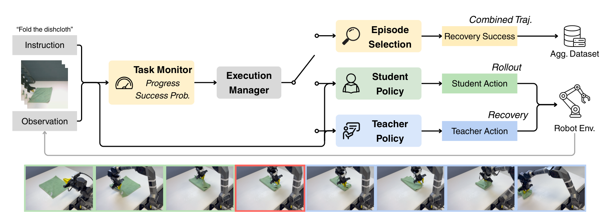
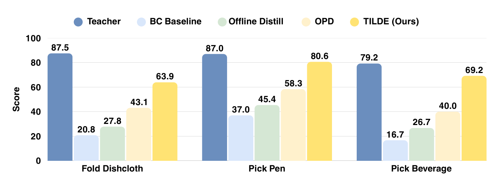

# TILDE: Teacher-in-the-Loop Distillation from Embodied Foundation Models

让学生在自己访问的状态上模仿强教师，仍可能漏掉关键经验：教师建议纠正之后，机器人会经过哪些恢复状态？TILDE让教师真正接管执行，把这些后续状态与原始示范、学生状态标签共同用于动作蒸馏。它把数据分布补齐，而不是要求学生复制教师的中间网络表示。

原文：[arXiv:2610.25376v1](https://arxiv.org/abs/2610.25376)，北京时间2026-10-19 00:26:20提交；[项目页](https://hku-sail.github.io/TILDE/)。已读完整23页，包括AutoDAgger状态机、评分规则和附录统计。官方完整PDF经续传取得，未以摘要代替全文。

## 为什么教师标签还不等于恢复经验

行为克隆只在专家示范状态学习，一旦学生动作偏差把机器人带到别的状态，就缺少监督。DAgger的基本思路是让学生访问状态、请专家标注，再聚合数据。在线动作蒸馏也能得到“此时应该做什么”，但如果这些纠正动作并未被执行，教师动作引起的下一步观察仍然没有进入训练集。

TILDE把这个缺口作为核心。教师是经过任务微调的预训练π0.5，并在整个流程冻结；学生默认使用相同架构，VLM由PaliGemma初始化，但动作专家没有机器人动作预训练。因此“无动作预训练”不等于模型完全随机初始化，教师的预训练和任务示范成本也仍然存在。

*论文原图编号：Figure 2。监控器决定学生继续还是教师接管，只有确认成功的恢复回合才把学生前缀和教师后缀共同加入数据集。*

图中的重点是执行之后的数据闭环：接管不只是生成一个动作标签，而是改变实际机器人状态，从而提供离线示范和未执行教师标签都欠缺的后续观察。

## 任务进度怎样决定何时交出控制权

AutoDAgger使用现成Robometer奖励模型，输入语言指令和有界图像历史，输出进度$p_t$与成功概率$q_t$。两者被裁剪到$[0,1]$。为了不把小幅抖动当作推进，参考进度只在$p_t$超过先前参考值加$\epsilon_p$时更新。只要出现有意义进度或$q_t>\theta_s$，就刷新“最近有效执行时间”。

失败触发条件是

$$
F_t=\mathbf1[\tau_t-\tau_t^{valid}\geq T_{fail}\ \land\ q_t\leq\theta_s].
$$

$\tau_t$是监控更新接收时间，$\tau_t^{valid}$记录最近一次有效执行证据，$T_{fail}$是允许停滞的时间，$\theta_s$是成功概率门槛。这个规则检测持续停滞，不要求奖励模型直接输出“现在接管”。附录还说明，两次监控更新之间执行管理器会按墙钟持续检查，达到超时便可触发，不必等待下一份模型结果。

部署使用8帧缓冲、最小1秒监控请求间隔、进度门槛0.05和成功概率门槛0.5；监控异步执行，不阻塞策略推理。$T_{fail}$与连续成功确认时间$T_{succ}$按任务和学生/教师分别设置，并非一个无需调参的普适阈值。布料折叠中的正常暂停尤其可能被误判。

接管时先停机器人、清空学生动作缓冲和观察窗口，教师新动作块就绪后才恢复执行；教师和学生各维护独立监控状态。只有连续成功预测持续达到$T_{succ}$才确认完成，中途低于门槛就重置计时。教师也可能失败，失败回合丢弃；学生直接成功的回合同样丢弃，因为这一阶段专门收集恢复数据。工程复用时，缓存失效与状态重置是机制的一部分，不能只复刻一个成功概率判断。

## 三类数据怎样进入学生原有动作损失

记$D_{demo}$为人类示范，$D_{roll}$为学生执行状态，$D_{rec}$为教师实际恢复轨迹。对状态$s$和语言$l$，教师输出动作块$A_T=\pi_T(s,l)$；学生原生动作生成损失记为$\ell_S$。蒸馏发生在动作空间：

$$
\mathcal L_{KD}(s,l)=\ell_S(s,l;\operatorname{sg}[A_T]).
$$

$\operatorname{sg}$表示停止教师梯度。动作专家可以采用不同架构或生成目标，仍把教师动作作为监督目标，不需要对齐中间特征。这里默认机器人动作空间已经一致，跨架构并不自动解决跨本体动作映射。

示范和教师恢复都有实际专家执行动作$A_E$，因此同时优化$\ell_S(s,l;A_E)+\lambda_{KD}\mathcal L_{KD}$；学生访问状态只优化$\lambda_{KD}\mathcal L_{KD}$。$\lambda_{KD}$控制教师标签权重。不能把学生在出错时实际执行的动作也当专家动作做BC，这正是分来源损失的意义。训练后学生在自己的前缀错误状态和教师纠正带来的后续状态都得到合适监督。

标准比较共享每任务30条经确认成功恢复的AutoDAgger回合。这样离线蒸馏、在线标签与完整TILDE的差别主要是可利用的数据来源和监督方式，而不是给最终方法额外无限互动预算。

## 真机评分和失败恢复分别支持什么

真机为AgileX PiperX平台，三任务初始人类示范分别200、100、100条，评估分别12、27、30次，物体和初态配置尽可能保持一致。论文主图报告阶段评分：每阶段0、0.5、1，奖励一次完成，也允许部分完成或重试后完成，再对阶段与试验平均并乘100。它不是完整任务二元成功率。

*论文原图编号：Figure 3。TILDE在三个任务都优于学生基线，但仍低于教师；最高约4.1倍是评分比值，不能改写成成功率提高4.1倍。*

| 方法 | Fold Dishcloth | Pick Pen | Pick Beverage |
|---|---:|---:|---:|
| BC | 20.8 | 37.0 | 16.7 |
| 离线蒸馏 | 27.8 | 45.4 | 26.7 |
| 在线学生状态标签OPD | 43.1 | 58.3 | 40.0 |
| TILDE | 63.9 | 80.6 | 69.2 |
| 教师 | 87.5 | 87.0 | 79.2 |

把恢复数据加入BC也会提高成绩；进一步对示范和恢复样本蒸馏，则为54.2、72.2、68.3分；再加入学生访问状态的监督得到完整TILDE。这支持两类新增分布互补，但Pick Beverage从恢复蒸馏68.3到完整69.2的额外差距很小，不能说所有任务都同样依赖两者。

附录给出的区间是96%自举置信区间。折布TILDE为38.9–87.5，样本量12使不确定性较宽；这一点比只展示63.9更能反映证据强度。标准化恢复测试另设12个错误状态：BC4/12，离线与OPD各5/12，TILDE8/12，教师9/12。这是对恢复能力更直接的检验，但只覆盖这一任务的小型错误状态集合。

跨架构实验用无动作预训练的SmolVLA学生、π0.5教师，在LIBERO平均成功率81.2%→89.6%，长任务LIBERO-10为64.6%→79.6%；离线蒸馏在LIBERO-10为63.8%。这些是仿真二元成功率，与真机阶段评分应分开阅读。

## 恢复速度、监控错误与一次聚合的边界

同新增30条回合时，AutoDAgger相较普通新增人类示范带来更高学生评分，说明失败附近数据更有针对性。但它并非在同样回合数下始终胜过人工接管：开启蒸馏的折布HG-DAgger为65.3分，AutoDAgger为63.9；后者扩大到60条达到65.3分。这是数据吞吐与单回合质量之间的取舍。

> **图表占位：Table 4 — 人工与自动接管恢复效率**
> **建议位置：** 恢复速度、监控错误与一次聚合的边界
> **放置原因：** 需要同时查看恢复时间、成功比例及下游评分，避免只摘加速倍率。
> **当前状态：** 候选实际截取了第8页上方表3，与目标身份不符，已拒绝；正文按源页和附录表15核实数值。

成功接管后的平均恢复时间，人工与自动分别为54.4→21.5秒、29.4→13.2秒、32.2→12.4秒，得到2.53、2.23、2.60倍。恢复成功比例则分别76.7%对73.3%、76.7%对66.7%、90%对90%，每任务额外30次接管试验。时间统计只覆盖成功恢复，不包含整轮学生执行、失败回合、重置与训练，因此不能当作完整采集系统吞吐倍率。

真实监控验证只含20条回合，10成功、10失败；8个真阳、1个假阳、2个假阴、9个真阴，准确率85%，精确率88.9%、召回80%。教师失败、误触发和漏判都会影响数据质量；“无需人工监控”不表示监控器可保证正确或机器人可从所有状态恢复。

作者明确只测试一轮采集后训练，多轮交替聚合尚未验证。我的分析是，复现应先验证自身任务的停滞阈值、动作缓冲清理和成功筛选偏差，再讨论增加恢复数据。尚不能确定持续迭代后监控器是否仍适用，或者更弱教师会不会把学生带向更窄的可恢复状态集；这些都需要独立对照，而不能由三项任务的评分倍率推出。
