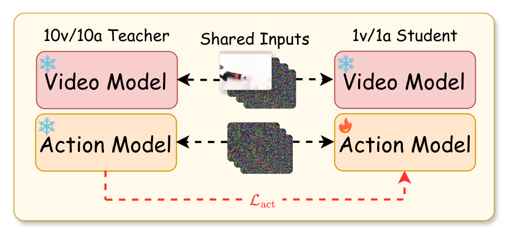
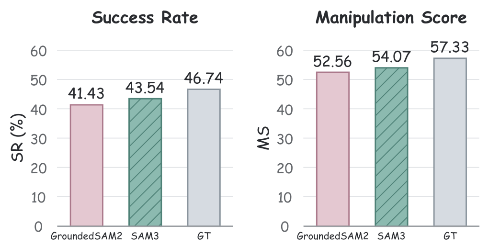

# TrajWAM: An Efficient Trajectory-Guided World Action Model for Dynamic Robotic Manipulation

动态抓取中的错误常发生在两个地方：模型忽略目标未来运动，或生成动作太慢，执行时目标已经离开。TrajWAM先从掩码历史显式预测目标轨迹，再让未来视频承载这条轨迹供动作专家读取；随后分阶段压缩视频和动作生成，避免只改采样步数破坏预测接口。

原文：[arXiv:2610.25763v1](https://arxiv.org/abs/2610.25763)，北京时间2026-10-19 12:21:22提交；[项目页](https://kevingeng3.github.io/TrajWAM/)。全文15页，含第9页起附录与各任务结果。本文关注主方法第3–5页、结果第6–7页及动作蒸馏基线的附录实现。

## 动态目标为什么不能只靠更快的反应

世界动作模型WAM把未来视频预测和动作生成放在同一系统，但场景级视频损失可能更重视占据大部分像素的背景，未充分刻画目标物体的运动。另一方面，反复视频去噪与动作去噪会增加时延，即使预测正确，也可能执行已过时动作。单纯缩短采样又会让动作专家读到不同分布的未来表征。

作者把目标运动作为显式条件，而不是希望它隐式出现在场景视频中。固定第三视角提供稳定参考，腕部相机跟着机械臂运动，可能看不到目标，所以只作为RGB动作观察，不提供掩码历史。对于移动放置目标，掩码预测的是接收区域；真机动态抓取则预测被抓物体。

*论文原图编号：Fig. 2。历史掩码预测未来掩码，经ControlNet注入视频；动作分支读取视频，而视频不读取动作词元。*

图中的信息方向值得保留：这是用未来视觉表征帮助动作，不是对每个候选动作生成条件反事实视频并规划搜索。把它直接称为动作条件模拟器会改变实际机制。

## 从四张历史掩码走到一个动作块

当前语言和第三视角先送冻结分割器得到目标掩码，历史缓冲按步数取4张、间隔4帧，2D U-Net一次预测8张未来掩码。模型用BCE和Dice损失各0.5训练，既监督每像素前景分类，也约束整个物体区域的重叠。输出是预测概率，不是提前读取真实未来。

预测掩码经视频VAE编码为轨迹潜变量$z_M$。ControlNet与Wan2.2-5B深度相同、宽度由3072减至512，逐层产生残差，经零初始化投影加入视频主干。可用原文第2式表达：

$$
\tilde h_v^j=h_v^j+Z_j(A_\phi^j(z_M,s_v)).
$$

$j$为视频层，$h_v^j$是原隐藏状态，$A_\phi^j$是轨迹适配块，$s_v$是视频流时间，$Z_j$是投影。零初始化使训练初期不骤然破坏预训练主干，随后逐步学习轨迹影响。注意力掩码允许动作词元读视频与动作自身，视频词元只能读视频。动作分支因此能利用受控未来，但不能反过来改变视频通路。

动作专家宽度为1024、深度保留。轨迹条件训练冻结视频主干、VAE和文本编码器，更新ControlNet、投影与动作专家。视频和动作分别采样噪声与流时间，使用噪声插值$x_s=(1-s)x+s\epsilon$，预测速度目标$\epsilon-x$；$x$是干净潜变量或动作块，$\epsilon$是高斯噪声。这是原生流匹配监督，视频目标和真实未来动作共同建立两条分支的接口。

部署每次预测32步动作、执行8步后重规划。真机采用Real-Time Chunking，分割器异步更新，策略读取最近可用历史而不等待当前帧SAM3。没有掩码时复用上一掩码，初始化缺失则退为零掩码；每回合清空历史。这样的缓存协议影响轨迹时效，不能只复制网络结构。

## 压缩视频之后必须重新对齐动作接口

视频加速先在不带轨迹适配器和动作分支的条件下进行DMD：冻结real-score，训练fake-score估计学生分布，用二者差异指导一步视频生成器。这一步改了中间表征分布，原多步ControlNet不能保证直接匹配。

于是第二阶段冻结快视频生成器，把慢ControlNet初始化为快适配器，以潜重建和条件对抗目标重对齐。判别器主干冻结，仅选定层的轻量模块和MLP可训练；参考真视频和生成视频使用相同噪声扰动。重建权重从0.1升到0.35，适配器与判别器按1:5更新。这里的“轻量”是相对视频主干，训练仍依赖多组模型。

最后固定快视频与轨迹适配器，让动作学生对齐慢教师最终生成的动作块，而非只对齐某个中间流速度：

$$
\mathcal L_{act}=\frac1B\sum_{b=1}^{B}
\frac{\sum_t m_{b,t}\,\|\hat a^S_{b,t}-\operatorname{sg}(\hat a^T_{b,t})\|_2^2/D_a}{\max(1,\sum_t m_{b,t})}.
$$

$B$是批量，$D_a$是动作维数，$m$排除补齐位置；$S$、$T$表示一步学生与每模态10步教师，二者接收相同观测、语言、轨迹和初始噪声。目标是在学生实际读到的一步视频表征下，仍产出接近教师完整rollout的动作，避免训练和部署接口不一致。

*论文原图编号：Fig. 4。教师与学生共享输入和噪声，各自产生视频表征，仅更新学生动作模型以匹配教师最终动作块。*

轨迹训练5000步，视频蒸馏5000步，适配重对齐1000步，动作蒸馏2000步，批量不同，不能把它们相加当作相同训练成本。训练使用H200，仿真执行用A800，所有延迟测量和真机采用单张RTX 5090 32GB。

## 真机与仿真分别验证了什么

DOMINO训练为35个动态任务、每任务50条示范，共1750条，统一Level 1动态系数0.1。主结果用SAM3观察历史，每任务100次，共3500次，报告二元成功率SR与连续操作质量分MS。

| 方法 | DOMINO SR (%) | MS | 策略推理延迟(ms) |
|---|---:|---:|---:|
| π0.5 | 9.63 | 26.17 | 59.1 |
| Fast-WAM | 21.97 | 37.27 | 183.7 |
| InternVLA-A1.5 | 29.30 | 42.50 | 552.2 |
| TrajWAM | 43.54 | 54.07 | 108.5 |

108.5ms并不是最快VLA，但在所比方法中提供更高动态成功率。SAM3另有平均69.1ms异步时延，不能把108.5ms当作包含摄像、最新分割、通信与机器人响应的端到端延迟。

真机两项任务为输送带抓取和转盘抓取，各200条示范。每任务3速度、4物体、每组合20次，合计240次；成功必须抓住并抬起物体。

| 方法 | 输送带成功率 | 转盘成功率 | 合并480次 |
|---|---:|---:|---:|
| π0.5 | 54.2% | 44.2% | 49.2% |
| Fast-WAM | 29.6% | 27.9% | 28.8% |
| TrajWAM | 77.9% | 70.4% | 74.2% |

> **图表占位：Table II — 真机逐速度与物体结果**
> **建议位置：** 真机与仿真分别验证了什么
> **放置原因：** 全表给出每格20次的计数，体现总体百分比来自哪些条件。
> **当前状态：** 自动图表计划未产生独立完整候选；第7页表体已核实，上表保留主要聚合值。

高速输送带与转盘的TrajWAM成功率65%和70%，比π0.5分别高37.5和35个百分点。这支持在所测运动与物体上的预判价值，但并非任意高速抓取或跨环境成功保证；两任务也不能代表所有动态操作。

## 消融中最需要保留的实现边界

在10任务子集上，只替换测试时轨迹条件，Static重复当前掩码20.9%，全黑32.0%，预测轨迹47.3%。错误静止提示比不提示更差，说明条件内容会实际影响策略，也提醒工程上不能把过期掩码简单当可靠未来。

另一个10任务子集里适配器重对齐42.2%→43.2%，是较小增益；不能用主榜大幅差距把这一单模块说成决定性因素。12任务动作蒸馏比较中，直接一步推理7.39%，CD18.42%，动作rollout蒸馏42.25%。子集不同，不能把这组数字与35任务主榜混为同一评估。

动作DMD为1.08%看起来很低，但附录明确其辅助网络由学生EMA更新，没有独立去噪优化器，区别于标准DMD的独立fake-score，也区别于本文视频蒸馏。这个结果只描述该实现，不能得出DMD普遍不适用于动作的结论。

*论文原图编号：Fig. 7。只替换观察掩码来源，固定轨迹预测器和下游策略，区分分割误差与轨迹预测误差。*

训练使用真值掩码，测试换GroundedSAM2、SAM3或仿真真值时分别41.43%、43.54%、46.74%，固定下游模型和轨迹预测器。它支持对所测分割来源的有限稳健性，没有证明目标丢失或强遮挡下仍可靠。我的分析是，应优先监控掩码年龄与未来轨迹误差，再评估一步压缩的收益。尚不能确定把目标运动与机器人互动强耦合、或存在多目标身份切换时，当前独立掩码预测是否足以提供正确未来；这需要超出输送带和转盘的新实验。
