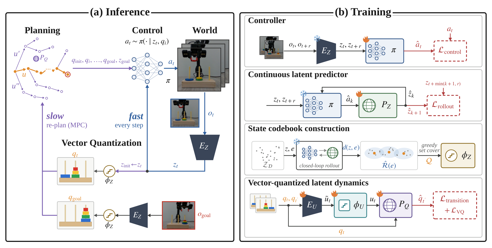
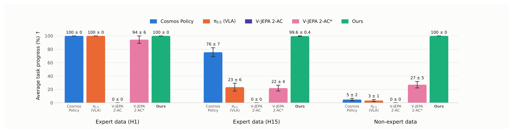
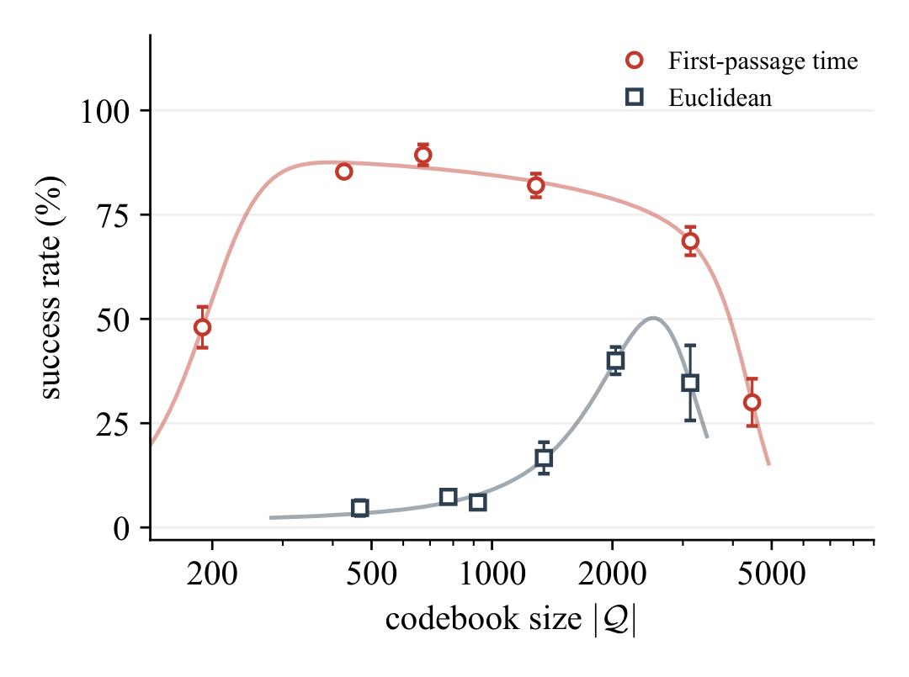

# Vector-Quantized World Model: Latent Feedback Motion Planning for Robot Manipulation

长任务规划的问题不只是能不能预测下一帧，还包括规划中的中间状态能不能被现有控制器执行。VQ-WM把这个接口显式化：状态之间的距离取决于控制器要调用多少次才能到达，而不是潜向量在欧氏空间中有多近。随后在离散状态图上做长程搜索，由连续视觉反馈承担局部执行。

原文：[arXiv:2610.25600v1](https://arxiv.org/abs/2610.25600)，首次提交北京时间2026-10-19 08:06:44。本文依据完整9页正文，主要方法在第3–5页、实验与边界在第5–7页。

## 为什么视觉距离不能决定一个子目标是否能执行

视觉世界模型通常把图像编码成潜状态，再预测动作作用后的变化。直接用潜空间距离选子目标很自然，但编码器未必把接触、抓取顺序和控制器能力编码成相同的几何结构。两个汉诺塔画面可能只有一个盘的位置不同，却需要先移开其他盘，才能实现这次变化。即使规划器预测的状态视觉合理，低层控制器也未必能从当前状态到达。

作者把长任务拆成两种时间尺度。高层在向量量化后的状态码本上搜索，低层仍以真实图像连续纠偏。码本状态不是任意均匀划分的视觉聚类中心，而是围绕低层控制器的吸引域选取。这使一个高层跳转具有更接近执行意义的解释：控制器有望在有限调用次数内完成这一段。

*论文原图编号：Fig. 2。右侧先训练控制器与连续预测器，再构造状态和动作量化；左侧把离散搜索结果交给视觉反馈控制。*

图中画出了MPC重规划的可能接口，但实验采用每回合一次高层规划。不能由示意图推断论文已经验证在线反复重规划带来的鲁棒性。

## 从连续控制器构造有方向的首次到达时间

冻结的V-JEPA 2编码器把观测映射为$z$。目标条件控制器$\pi$读取当前潜状态与目标潜状态，输出物理动作；训练目标是模仿同轨迹中面向未来状态的动作。未来偏移$r$从$0$到$R$采样，$r=0$对应保持当前状态，避免控制器只会接近目标却不会停留。

连续潜预测器$P_Z$用当前潜状态和动作预测下一潜状态。其训练不是独立的一步回归：把控制器朝向目标的动作反复送入预测器，监督闭环滚动结果；到达轨迹中的目标时间后，监督状态保持在目标处。这种训练与之后用预测器评估控制器的调用方式一致。

对从$z$到$z'$的查询，预测轨迹从$\hat z_0=z$开始，逐次计算$\hat a_k\sim\pi(\cdot\mid\hat z_k,z')$和$\hat z_{k+1}=P_Z(\hat z_k,\hat a_k)$。核心估计是

$$
d(z,z')=\min\{k\in\{0,\ldots,R\}:\|\hat z_k-z'\|_2^2\leq\epsilon\}.
$$

这里$R$是允许的控制器调用预算，$\epsilon$是潜空间到达容差；若预算内未达到阈值，距离设为无穷。这个量称为首次到达时间，工程上就是在学到的闭环模型中数步数。它有方向：从一个盘布局到另一个布局的代价未必与反向相同。它也依赖已训练的控制器和连续模型，因此是可达性的估计，不能当作真实系统的可达证明。

接下来，对数据中的候选状态$e$估计$R$步吸引域$\hat{\mathcal R}(e)=\{z:d(z,e)\leq R\}$。实现通过局部近邻滚动和记录轨迹中的前驱状态近似这一集合，而不是对所有状态对都精确仿真。贪心集合覆盖每次加入能覆盖最多尚未覆盖数据状态的候选，最终得到码本$Q$。这控制的是训练状态覆盖，不保证覆盖未见物体、相机或任意接触状态。

## 量化状态和动作之后怎样搜索与执行

状态码本解决“去哪里”，离散动作码本解决“图中有哪些边”。状态对经动作编码器映射到潜动作，再按欧氏距离量化到动作码本$U$。离散转移模型$P_Q(q'\mid q,u)$用交叉熵学习下一代码状态，同时用向量量化的承诺项和停止梯度约束潜动作。这一部分的欧氏量化用于动作编码，不能误写成整篇都禁止欧氏距离。

推理时先编码当前和目标图像。初始代码选择最容易从当前状态抵达的$q$，即最小化$d(z_{init},q)$；目标代码则最小化$d(q,z_{goal})$。两个方向相反的写法很关键：起点要能进入规划图，终点要能离开规划图抵达真实目标。若连续控制器已经能在预算内直接完成，则绕过高层搜索。

图的每条候选边来自枚举$u\in U$并取$P_Q$的最大概率后继，随后广度优先搜索较少离散跳转的路径。它没有把完整转移不确定性传给风险规划器，最少跳转也不等于最短物理执行时间或最低能耗。真机汉诺塔还用未见转移类别排除缺乏数据支持的边。

执行阶段持续用最新视觉状态和下一个代码状态查询控制器，并按模型估计的首次到达步数切换子目标；最后朝向真实目标潜状态。低层是视觉闭环，但不能说每次子目标切换都通过真实物理状态检测确认到达。论文报告RTX 5080上为约5分钟真机执行序列规划不足1秒，这描述离散规划开销，不是完整感知控制流水线时延。

## 仿真结果与真机任务进度的不同口径

仿真主比较覆盖CubeEasy、CubeHard和CubeScene，但三者目标时间偏移和执行预算不同，不能横向把数值当同难度任务。CubeHard从保留轨迹中选择需要抓取的窗口，动作预算30步；CubeScene以多个物体的状态共同判断目标。下表是原文表1的成功率均值，数值只在各列内部比较。

| 方法 | CubeEasy (%) | CubeHard (%) | CubeScene (%) |
|---|---:|---:|---:|
| LeWM | 74.0 | 32.0 | 42.7 |
| H-JEPA | 76.7 | 60.0 | 40.7 |
| VQ-WM | 84.7 | 73.3 | 75.3 |

VQ-WM三项分别报告±2.5、±0.9、±5.0的波动。Walker的图像输入结果是22.0%，增加本体感觉后为97.3%；论文强调的大幅优势包含这一传感器配置，不能把97.3%写成纯视觉控制能力。

真机使用WidowX AI处理四盘汉诺塔，完整求解需要15次盘移动。每个条件有6组初末布局、每组3次，即18次试验。专家数据包含完整解轨迹；非专家数据只有至多5次移动的短子任务。这里的“play”由符号规划器、Cutie棋盘状态以及预定义笛卡尔拾放过程自动收集，并非完全无任务知识的随机探索。

*论文原图编号：Fig. 4。纵轴是平均任务进度；短子任务训练下VQ-WM为100±0%，Cosmos Policy为5±2%，两者不可直接称为同口径二元成功率。*

完整专家训练的H15条件中，VQ-WM平均进度99.6±0.4%，Cosmos Policy为76±7%，π0.5为23±6%；非专家短任务条件中分别为100±0%、5±2%、3±1%。这些结果支持在已覆盖局部转移上组合长序列的价值。摘要使用了成功率措辞，但此主图明确标为任务进度，笔记保留图中实际统计口径。手工提供子目标的V-JEPA 2-AC在短任务条件下为27±5%，也说明有子目标本身并不足够，还需要执行和抽象之间的对齐。

## 代码本消融与复用时的覆盖边界

为隔离量化距离，作者在MuJoCo汉诺塔中固定编码器、控制器和训练协议，只比较首次到达时间与欧氏距离。数据有104条覆盖所有合法盘移动的轨迹；每个点用3个种子、每种子50条评估轨迹，目标最短路径长度1–15步。

*论文原图编号：Fig. 5。首次到达时间在较宽码本范围内优于欧氏距离，但两端都下降，码本越大并不必然越好。*

首次到达时间的较好设置约90%成功率，欧氏距离较好设置约40%。约250–2000个代码状态较稳定：过小会合并不能互相执行的布局，过大则每类转移样本减少，损害离散预测器。这个受控比较比单看真机总成绩更直接地支持“控制器可达性应该影响量化”。同时，全合法移动已被训练覆盖，不能把结果解释成从未见局部物理转移中发现新技能。

我的分析是，复用时最先验证的应是三个接口：控制器的到达误差能否被$P_Z$可靠估计；训练覆盖是否包含所需局部转移；离散边的最大概率近似是否会隐藏低概率灾难。作者明确把重规划频率、多任务扩展列为后续工作。尚不能确定在相机变化、物体增加、接触失败累积时，原码本和控制器还能保持同样的可达关系。这里最有用的贡献是规划抽象与控制能力的耦合方式，而不是一个脱离数据覆盖即可保证长任务成功的通用规划器。
