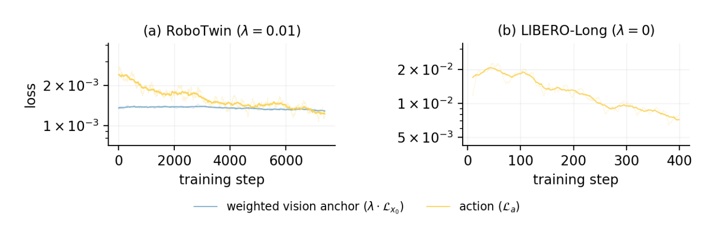
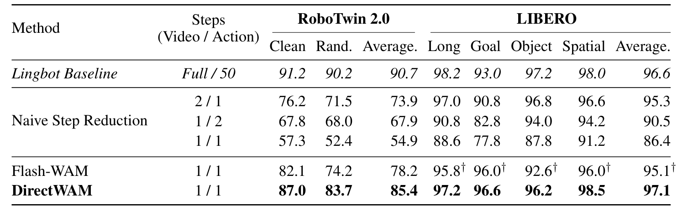
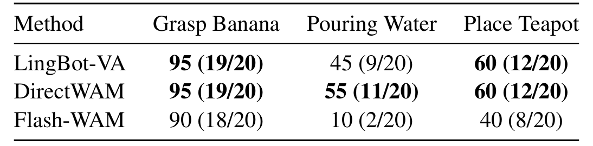

# De-Diffusing WAMs: Action-Sufficient Direct Prediction for Robot Control

视频世界模型可以提供未来，再由逆动力学模型读出动作，但两个扩散过程会反复去噪，部署代价很高。DirectWAM保留“未来→动作”的显式级联，把迭代过程改为两个确定性前向。关键不是简单删步，而是让未来预测器通过动作专家接收监督，学会保存控制真正需要的信息。

Shaoyi Zheng、Zhongtao Jiang等，ByteDance与纽约大学；[arXiv:2610.28122v1](https://arxiv.org/abs/2610.28122)，v1提交北京时间2026-10-20 20:30:58。本文依据完整20页PDF，方法第3–6页，主要结果第7–9页，训练和诊断附录第12–20页。未找到可确认的公开代码或权重入口，论文结果尚未独立复现。

## 删掉采样之后为什么控制会崩

级联WAM先用历史图像、过去动作和语言预测未来潜变量，再用动作分支读取它。未来在这里是中间表示，而不是最终交付的视频。作者选择LingBot-VA作为实验实例，把视频噪声随机性和多步计算作用分开：固定动作噪声，只改变视频噪声；或者固定同一视频噪声贯穿回合，再观察控制是否改变。

视频变化传到动作后明显衰减，RoboTwin中的归一化距离比约0.025。固定噪声和四次未来平均未检出明显成功率变化，差值区间包含零、显著性检验$p\ge0.12$。这只表示在这些样本和噪声干预下没有检出影响，不是严格等效检验，更不能推断多模态动作选择从不需要随机性。作者还选取30个高分叉上下文做八次rollout，动作轨迹中位离散约0.86cm、动作范围的2%；这是有针对性的诊断集合，不是所有机器人情境的随机总体。

去掉随机变化并不等于可以直接截断计算。主表中，RoboTwin完整教师90.7%，视频和动作各一步的朴素截断降至54.9%。初始机制扫描及总览图出现57.6，是另一评测设置，不能用它替代主表分母。剩下的差距说明多次前向承担了有用映射，必须用训练把它压进一次计算。

*论文原图编号：Figure 1。上方分离噪声与迭代计算，下方保留视频潜变量到动作的路径；动作损失反向穿过冻结动作专家，改变未来预测器。*

## 把未来表示交给动作专家检验

只对未来潜变量做均方误差，会把所有方向当成同等重要；但某些小偏差恰好改变抓取位置，另一些大偏差只是背景。作者用冻结动作映射的局部雅可比诊断这种不均匀性。若动作函数是$A(z,h)$，$z$为未来潜变量，$h$为历史条件，在当前$z$附近计算$J=\partial A/\partial z$。把32个采样动作输出方向经$J^\top$拉回潜空间，正交化得到$Q$，投影为$P=QQ^\top$。

对于两个未来表示的差$\Delta z$，只替换$P\Delta z$即可测试局部动作敏感分量的作用。这里的$P$因上下文而变，不是一个全局固定动作子空间，也不一定恢复雅可比主奇异向量。它用于诊断，不是DirectWAM训练时必须运行的额外模块。

真正训练目标采用最终动作：设$F_\theta(h)$为一步未来预测，$G_\psi(z,h)$为一步动作专家，示范动作为$a^\star$，示范未来潜变量为$z^\star$，则

$$
\mathcal L_{ASD}=\mathbb E\|G_\psi(F_\theta(h),h)-a^\star\|_2^2,
\qquad
\mathcal L_{train}=\mathcal L_{ASD}+\lambda_v\mathbb E\|F_\theta(h)-z^\star\|_2^2.
$$

第一项经过动作函数衡量未来是否足够支持正确控制，第二项是可选视觉锚定，$\lambda_v$控制其强度。工程上，不必让学生复现教师每一步去噪轨迹，而是对最终输出回归；冻结$G_\psi$的参数仍允许梯度穿过它流向$F_\theta$。这避免两个模块共同漂移、通过不稳定内部暗号降低训练误差，但它也意味着“充分性”相对于这一个已选动作解码器和训练分布。

## 先教动作读取未来再改变未来预测器

两个模块不能一开始一起自由训练。阶段一冻结视频专家，在真实示范未来条件下训练一步动作专家，建立可用的未来到动作接口。阶段二冻结动作专家，改用学生自己预测的未来；最终动作误差指导视频分支。这样解决的是teacher forcing下会读真未来、实际部署却读错误未来的接口偏移。

### 机制流程

1. 用示范历史和真实未来潜变量训练一步动作专家，使它直接回归最终动作，而非中间去噪速度。
2. 冻结动作专家，让一步未来预测器接收历史、语言和固定部署噪声，产生它自己将要交付的未来表示。
3. 把预测未来送进冻结动作专家，以示范动作误差反传，必要时用视觉锚定保留未来重建约束。
4. 部署时未来与动作各前向一次，提交动作块，再以新观测滚动执行；不再做随机视频或动作采样。

RoboTwin阶段一8000步约3.5小时，阶段二6500步约6小时，$\lambda_v=0.01$；LIBERO-Long分别600和400步、合计约21分钟，锚定系数为零。论文给出单张80GB GPU及有效batch设置，但未可靠给出具体GPU型号，不能据理论峰值替它补成H100。

*论文原图编号：Figure 6。RoboTwin动作损失下降时加权视觉锚定大致稳定；LIBERO-Long即使没有视觉损失也能降低动作误差。这是目标函数曲线，不是成功率曲线。*

图中支持动作改善不必伴随同幅度视觉重建改善，但不能证明视觉质量完全没变、锚定项没有优化作用，或全部收益只发生在某个固定子空间。

## 同预算结果与模型侧时延

主实验覆盖RoboTwin50任务、每任务50回合；LIBERO每任务100回合，其他小消融常用每任务10回合，不能将样本量统一成主表预算。对保留相同级联的一步模型，训练目标提供直接比较。

*论文原图编号：Table 2。视频/动作步数、Clean与随机化环境，以及四个LIBERO子集均保留；匕首标记是引文结果，不能按匹配checkpoint理解。*

RoboTwin教师90.7%、朴素一步54.9%、Flash-WAM78.2%、DirectWAM85.4%，说明动作监督明显缩小截步损失，但并未追平完整教师。LIBERO平均97.1%，教师96.6%、Flash95.1%；Flash的LIBERO来自原论文引用，没有对应权重重测，架构、训练和随机性差异不完全可控。Direct在LIBERO-Object的96.2也低于教师97.2，不是每个子集都更高。

推理在500次预热后统计500次中位数，教师5042ms、Direct180ms，约28倍。这是单GPU模型侧延迟，不是包含相机采集、通信、控制器和安全处理的端到端机器人速度，也不能据此声称整机任务快28倍。

*论文原图编号：Table 3。保留成功次数与总试验数，比只写百分比更能看出小样本边界。*

Galaxea A1夹爪配外部D435与腕部D405，每任务50示范、20测试。香蕉Direct和教师均19/20；倒水11/20对9/20；茶壶均12/20。Flash为18/20、2/20、8/20，Direct对这个一步基线更稳，但对教师的两次倒水优势不足以支持普遍超越。真机没有复杂灵巧手、动态碰撞或长程组合任务的广泛验证。

## 局部替换实验支持到哪里

附录把视觉监督学生未来$z^V$替换为Direct未来$z^A$，保持下游动作函数不变。在64个上下文中，全替换使示范动作L2误差0.257→0.216；只移入局部敏感分量、约1.9%的差向量能量，误差到0.224，恢复约80%的可用改善。同能量随机方向只恢复1–2%。这个比例先聚合误差再相除，不是逐上下文比值的中位数，更不是消除80%的全部动作错误。

闭环干预也有对应证据：只传1.4%的差异能量，成功率78.2→87.3%，全替换87.0%。这支持改变方向比总表示距离更重要；不同探针、参考未来和数据集合仍须分开。教师参考诊断中，小分量只恢复16.3–34%的可用动作改善，补空间也仍有用，不能称剩下99%的特征都与动作无关。

视觉评测提供另一限制：Direct的PSNR31.79、SSIM0.949优于25步教师30.37、0.938，但FID5.9差于2.8、KID2.06差于0.56，LPIPS也不是全面最优。我的分析是，方法真正重新定义了部署所需的未来质量：对动作解码足够，同时保留可检查的显式预测，并不承诺生成分布最逼真。

复现应先固定同一教师、相同动作坐标和采样预算，验证朴素截步差距，再分别开关动作充分损失和视觉锚定。进一步需要把相同转换用于不同级联架构、多模态分叉任务和更长真机序列，检验随机性弱影响这一前提是否仍成立。当前证据只能支持所检验模型家族，尚不能确定对所有视频世界模型、联合动作视频模型或安全关键任务都有效。
