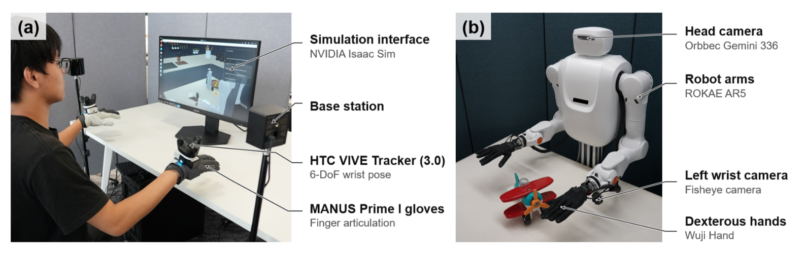
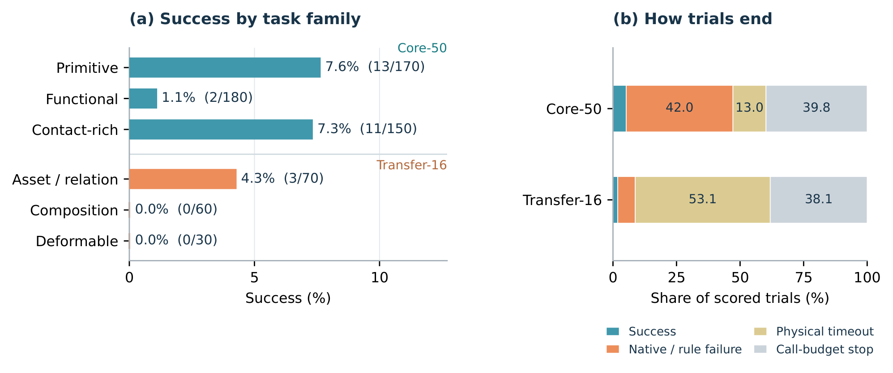

# HandsOn: A Large-Scale Simulation Benchmark for Generalizable Dexterous Manipulation

灵巧手策略可以完成几个演示任务，却未必能在另一物体、另一组合或更紧的时间预算下复现。HandsOn的价值在于把示范、原生任务判据和执行时长绑定起来，提供一个可诊断的失败分布。平台兼容多个机器人，不等于论文数值已经证明跨本体泛化；这一区别贯穿整篇评测。

Tianwei Luo、Yiming He、Hongjin Wu等，清华、北邮、NatureWill与北大；[arXiv:2610.26765v1](https://arxiv.org/abs/2610.26765)，v1提交北京时间2026-10-20 01:22:48，PDF封面的13日不替代实际提交时间。[官方代码](https://github.com/TsinghuaC3I/HandsOn)当前可见configs、handson、scripts、taskdev等目录。以下依据完整56页PDF，方法与协议第6–14页、结果第14–22页，以及后续接口与数据附录。

## 一个灵巧操作分数究竟应该测什么

只看机器人碰到目标，会把“尝试动作”和“完成操作”混为一谈。HandsOn沿用任务原生的可执行谓词：对象关系、状态变化、保持条件或顺序必须满足，不能把短暂接触都算成功。主指标是完整任务二元成功；对多阶段任务另报告最长合法阶段前缀的有序进度。

Core-50用于从统一训练数据学习后重新rollout。Transfer-16只评测，没有目标任务示范，包含六项技能组合、七项资产或关系变化、三项可变形物体任务。它在测已学技能能否重组、能否跨实例条件，而不是训练集上的示范复播。平台支持五种机械臂、六种手与约200个资产，但本文所有量化实验固定ROKAE AR5-08、第一代Wuji手、PhysX；Newton兼容和多机器人接口是平台能力，不能直接充当跨配置成功率。

*论文原图编号：Figure 1。左侧展示资产与任务，右侧为固定配置下的Core-50宏平均成功率；误差条和下方数据量共同限定这个排行榜的意义。*

## 遥操作数据怎样进入冻结的任务协议

训练语料来自模拟环境中的人类遥操作，手套记录手指，VIVE记录腕部，再重定向到手指关节。MANUS提供21个手部关键点、映射到Wuji的20个关节。至少十名操作者经过约1050个采集会话，留下18,000条精选轨迹、6,053,555个时间步；15,178训练、2,822验证。三个视角形成54,000段视频，但不是54,000次独立交互，合计约56小时。

原生采集有54个任务ID、52个配额组，最终Core评测为50个任务，排除Chinese Chess；这些计数作用不同，不能简单相减推断缺失数据。每组采用500/300/100等不同配额，短任务更容易采集，分布不是未经选择的随机家庭劳动。

*论文原图编号：Figure 4。手部和腕部测量进入仿真重定向，任务完成还要经过独立质量检查；采集硬件不意味着训练来自真实机器人。*

协议把操作者、审核者和仲裁者分开，用任务卡记录目标证据和代码版本。小规模试采要求至少98%的标注一致性，盲审约20%，再复审5–10%。成功检查器一旦改变，受影响轨迹要隔离并重放，而不是无声修改标签。这样的版本约束比“人工看过成功视频”更适合复现；但标签一致性只保证当前判据一致，不保证所有真实接触状态都被判据捕捉。

## 为什么物理时间预算能改变排行榜

所有执行动作推进1/30秒物理时间，策略推理暂停期间仿真不前进。作者先从未插值的专家示范计算任务时长P75，冻结后再评测。若第$i$个任务的示范长度分位值为$q_i$帧，则

$$
H_i=3q_i/30,\qquad B_i=\lceil30H_i\rceil.
$$

$H_i$是允许的物理秒数，$B_i$是动作数上限。P75取排序后索引$\min(n_i-1,\lfloor0.75n_i\rfloor)$，$n_i$为有效示范数。实现时必须用原生帧数，不能先重采样再算，否则预算会悄悄改变。非可变形Transfer任务没有自身示范，采用预声明原子任务P75之和作为代理；三项Flex预算固定240/180/180秒。这不是实际组合专家轨迹的P75。

原生成功谓词在每个已执行动作后检查，即使位于动作块中间也可立即停止；剩余动作不再执行。最后一个预算动作达到成功仍计成功。无效环境和策略失败分别登记，不能靠减少有效暴露次数提高分数。

| Core-50模型 | 3倍P75宏平均成功率 |
|---|---:|
| OpenWAM | 29.1% |
| FastWAM | 26.4% |
| π0.5 | 24.9% |
| DM0.5 | 21.4% |
| LingBot-VLA | 19.7% |
| HY-Embodied | 18.9% |
| Motus | 18.1% |
| Spatial Forcing | 12.4% |

八个训练型模型每任务约100次rollout。OpenWAM单纯回合bootstrap区间28.0–30.1%，同时重采样任务和回合后扩为22.8–36.0%。后者更能反映任务选择的不确定性。模型更新数、预训练数据不同，因此这是共享评测合同下的已选检查点比较，不能把差距全归到架构。

收紧到一倍P75时，π0.5为14.6%、OpenWAM8.3%；放宽到三倍后排名反转，28组两两关系中12组翻转。这提示部分模型需要更多尝试或调整。曲线来自三倍预算rollout的时间前缀，不是另行训练出紧预算策略的反事实结果。DP的9.7%使用较早目标采样协议，只有部分任务可匹配；不能将它视作与八个模型完全同设置的能力下限。

## 从Core成功到Transfer有序进度

最高的单任务模型拼接成一个事后oracle，Core也只有35.4%，说明失败并非只来自选错一个模型。第三物体工具使用约2.9%成功、精密配合约2.2%，但任务族有重叠，不能把分组百分比相加。

Transfer-16更难：OpenWAM完整成功约0.4%，而有序进度12.9%；后者覆盖15个有阶段评分的任务，Gen02被排除。若任务有$K_i$个阶段、回合完成的最长合法前缀是$L_e$，则$P_e=L_e/K_i$。越过中间必要条件后的后续接触不会补计前缀。这有利于识别“开始正确但无法收尾”，也限制了对可恢复非线性任务的表达。

**图表占位：Table 6**  
建议位置：本节Transfer结果解释处。  
放置原因：区分任务组的完整成功和阶段进度，避免把接近目标当作成功。  
当前状态：自动裁剪候选被质量门拒绝，未嵌入；保留占位并根据正文核对0.4%成功与12.9%进度。

三项可变形任务仍未解决。平台的工具、柔性对象与重组任务确实拉开了“会执行局部运动”和“能完成新任务”的差距，但还不能据此确定失败由视觉表征、手指控制还是训练分布哪一个单独导致。

## GPT6失败如何受接口和预算影响

GPT-6通过`move_eef`直接指定掌部位置、姿态和每手20个关节，接收三视角RGB、测量状态与执行反馈，没有任务专用抓取原语或触觉。底层有只读运动学路径插值，但没有障碍物模型；工具调用返回“命令执行完毕”不意味着物体抓住。仿真在模型推理期间暂停，所以实验也不是实时算力检验。

*论文原图编号：Figure 7。按任务族拆分表现，并展示失败终止类别；调用预算占比对解释低成功率尤其关键。*

Core为26/500、5.2%，Transfer为3/160、1.9%，合计29/660。660次中260次由调用预算终止，150次物理超时、221次原生失败或规则终止。因而低成功率既包含运动控制问题，也包含接口和交互预算影响；它描述当前直接控制harness，不能等同于模型在带技能库、接触反馈或层级规划时的能力。不同训练模型与GPT的输入、调用方式和试验数也不同。

## 复用平台时需要补齐的真实接触证据

作者承认，附录真实机器人录像只是定性证据，尚需固定试验预算、成对仿真真机实例、共同可执行谓词和失败统计，才能报告物理成功率。腕部相机会被已抓物体遮挡，最需要判断的按钮、柄部和接触点恰好不可见；触觉扩展需要传感器布局对齐和经过验证的接触模型，而不是往观测里简单多加一条通道。

我的分析是，最值得复用的是冻结任务卡、检查器和时间合同，再同时报告成功、进度与终止原因。跟进实验可以先固定同一模型，跨PhysX/Newton和一个新手型做配对测试，观察排名是否保持；再给GPT同样任务加入可复用抓取技能，匹配物理时间和调用预算，隔离模型推理与接口设计。尚未完成这些验证前，平台兼容性、仿真成功与真实通用操作仍是三个不同证据层级。
