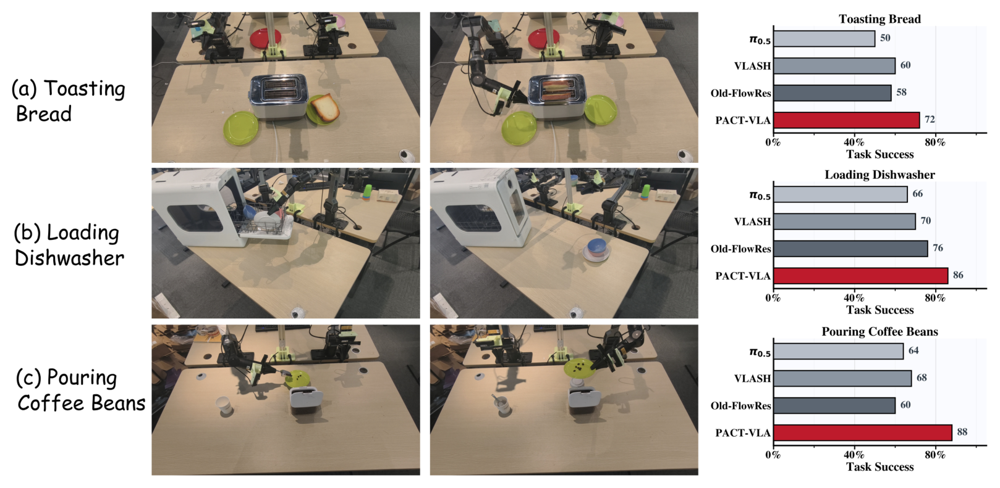
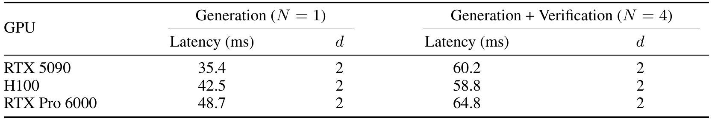

# PACT-VLA: Speculative Action-Chunk Verification with Pre-Commit Observations

异步VLA在生成新动作块时，机器人仍执行旧动作，场景也继续变化。因此模型完成推理时，最初观测已经过期。PACT-VLA把昂贵生成提前做，把最终选择推迟到执行前：固定多个候选，用更晚的观测重新判断哪个还符合当前策略。它改变提交时机和验证信息，不更新策略参数，也不在验证后重生成动作。

Yixiang Zhu、Ruilong Wu、Yonghao Chen等；[arXiv:2610.28019v1](https://arxiv.org/abs/2610.28019)，v1首次提交北京时间2026-10-20 19:08:41。本文依据完整16页PDF，核心方法第3–6页、结果第7–9页、实验与分支诊断附录第13–16页。未找到可确认的官方公开代码或权重入口；以下数值为论文报告，未做独立机器人复现。

## 计算期间世界已经向前走了一步

动作块是一次查询输出的连续控制序列。异步执行把生成与执行重叠，降低停顿，但模型在时刻$t$读到的图像不包含计算期间的扰动。RTC等方法通过约束将来要衔接的动作前缀减轻错位；预测未来状态的方法则仍依赖旧观测，无法知道后来真实发生了什么。

PACT保留$N$个候选，不在推理起点就做最后选择。若新块将在$t+d$提交，取$t+d-1$观测作验证条件，在提交前一控制拍完成打分。这里$d$是离散控制延迟，不是扩散流时间。$d=1$时验证观测仍是$t$，没有获得更晚的信息，因而不能预期同样收益。

*论文原图编号：Figure 2。候选生成和新观测分支部分重叠；最终只从既有动作块中选一个，并在约定时刻提交。*

如果所有候选都不合适，验证并不能创造新动作。候选生成本身可以使用RTC，PACT也不是必须替换原来的延迟补偿器，而是在它之上延迟决策。

## 候选不变为何还需要最新观测

“多采样一次”与“晚一点判断”是两种不同干预。为了区分它们，论文比较单候选异步、多个随机候选、旧观测FlowRes和新观测FlowRes。最有解释力的是候选数量、检查点和执行合同都相同，只改变验证观测的对照；与不同检查点VLASH的比较则包含其他差异。

### 机制流程

1. 原冻结策略读取$t$时刻观测，在旧块继续执行时生成$N$个完整候选，候选生成可带RTC前缀约束。
2. 提交前一拍取得较新观测，共享视觉语言预处理得到条件KV，并与尚未完成的生成重叠。
3. 对固定候选加入公共验证噪声，在$M$个流时间点批量查询冻结速度场，计算掩码与动作位置加权的FlowRes。
4. 选择残差最小的整个动作块，在既定时刻提交；执行过程中不再反复重选同一候选池。

候选生成和验证使用的噪声相互独立，验证时不同候选共享噪声与流时间，减少比较中无关的随机差异。验证分支可以共享前缀缓存，但“复用缓存”仍需要为晚观测做视觉语言处理，不表示附加计算消失。

## FlowRes怎样给固定动作块打分

流匹配策略学习从高斯噪声到动作序列的速度场。为避免符号反向造成误解，论文定义$\tau=0$为动作、$\tau=1$为噪声：

$$
x_\tau=(1-\tau)A+\tau\epsilon,\qquad u=\epsilon-A.
$$

$A$是长度$H$、动作维度$d_a$的候选块，$\epsilon$为同形状验证噪声，$u$为这条直线插值对应的目标速度。原模型的$v_\theta(x_\tau,\tau\mid o,l)$在较新观测$o$和语言$l$下预测速度；如果候选仍像该策略在当前条件下会输出的动作，速度残差应较小。

按论文的残差求和定义，评分展开为

$$
E_n=\sum_{i=1}^M
\sum_{j=0}^{H-1}w_j\|m\odot[v_\theta(x^{(n)}_{\tau_i},\tau_i\mid o,l)_j-(\epsilon^{ver}-A^{(n)})_j]\|_2^2,
\qquad n^\star=\arg\min_nE_n.
$$

$n$标记候选，$i$标记验证流时间，$j$标记动作位置；$w_j$选择和加权块内位置，$m$屏蔽不参与比较的动作维，$\epsilon^{ver}$在候选间共享。这里在流时间与动作位置上累加残差，比较时保持相同掩码与权重。实现应保留论文动作维掩码及位置权重，不能把填充维也当真实关节。

这个残差衡量与冻结策略的局部流场一致性。策略有系统错误、候选不覆盖正确动作或观测不足时，残差低也可能失败。没有校准过的奖励或价值标签，因此不能把$E_n$直接改写成成功概率，也没有安全保证。

## 延迟实验与真机结果的对照边界

Kinetix使用12个关卡，动作块长8、$N=4$，每关每延迟2048次rollout，即24,576次；主文容易误读成全关总共2048，附录给出了正确层级。报告对关卡不加权平均，延迟1–4时RTC77.8%、PACT85.8%；延迟4时RTC62.2%、PACT77.2%，朴素异步48.9%。$N=1$恢复RTC到约0.7个百分点以内，说明多候选和验证确有参与收益。

LIBERO使用π0.5和GR00T N1.7，$N=8$，四套每套每延迟500回合。长延迟下有效，但最短延迟有反例：

| 模型与延迟 | 单候选基线 | PACT |
|---|---:|---:|
| π0.5，d=1 | 94.2% | 93.9% |
| π0.5，d=4 | 60.0% | 63.5% |
| GR00T，d=1 | 93.4% | 92.8% |
| GR00T，d=4 | 51.2% | 56.4% |

GR00T在$d=4$的随机八候选52.2%、旧观测FlowRes52.6%，PACT56.4%。不过这些完整rollout是独立运行，不能宣称每回合候选池和随机种子完全相同。

为更干净地隔离选择，附录另做Kinetix固定候选单步分支：每关每种子保存1024个决策点、12关、3种子，$N=4$、八次续跑。旧观测61.07%、PACT61.62%，只增加约0.56个百分点，随机61.18%。这不否定完整回合收益，但说明“单个固定选择”的效果不能直接写成延迟4完整策略的15个百分点；后者包含反复选择后改变未来轨迹的累积。

*论文原图编号：Figure 4。每方法每任务50次试验；三项任务结果与平均值一起读，避免把平均成功率当所有任务共同水平。*

真实PiperX双臂使用三台D435i、30Hz、50步动作块、十步流生成，半队列处重查询。训练有675段示范、9.19小时，按任务微调动作专家40k步，PACT不额外训练。朴素异步三项50/66/64%，平均60%；旧观测同N4为58/76/60%，平均64.7%；PACT72/86/88%，平均82%。VLASH平均66%使用不同检查点，最干净的观测时机对照仍是旧观测64.7对新观测82。论文没有给这些真机百分比的置信区间，小样本差异仍需独立重复。

## 毫秒增加为什么没有增加控制拍数

30Hz每拍33.33ms。部署关心能否在某一拍前提交，因此实际离散延迟近似为$d=\lceil T/33.33\rceil$，其中$T$是所测推理路径时长；只有负载、缓存和流水线合同相同，这个换算才成立。

*论文原图编号：Table 4。新增验证提高毫秒开销，但所测三种GPU仍落在两拍内；这不是零计算代价。*

RTX5090单候选P99为35.4ms，四候选加验证60.2ms；H100为42.5对58.8ms，RTX Pro6000为48.7对64.8ms，均向上取整为两拍。5090时间线包含23.2ms预处理、24.9ms生成、晚观测约25.2ms预处理与1.7ms评分，部分重叠后总60.19ms；共享GPU资源竞争已经影响实测，不能简单把各段相加，也不能推广到隔离计算资源。

我的分析是，这项方法利用的是截止时间内的剩余计算空间。模型更大、摄像机更多或负载稍高，64.8ms就可能跨过66.67ms门槛，失去“不加一拍”的条件。部署前应复现P99而非平均时延，固定同候选池比较观测时机，再扫描延迟和候选数。尚不能确定的是，残差在大幅分布偏移或所有候选皆错时有无可靠拒绝机制；当前研究展示选择收益，并未解决安全回退或动作覆盖问题。
