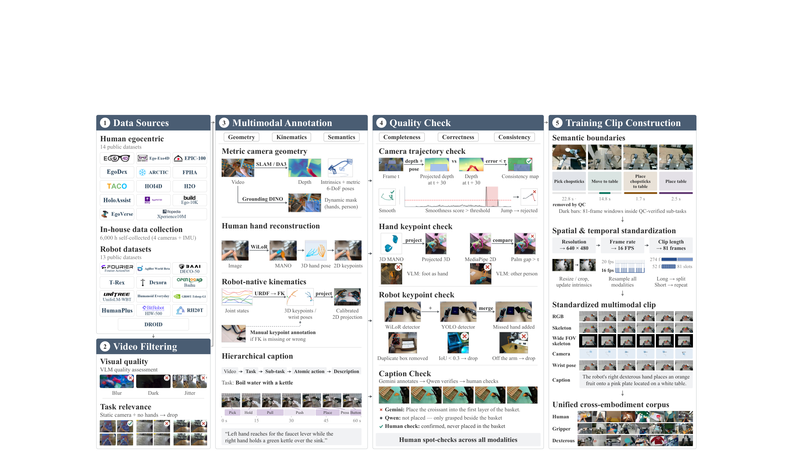
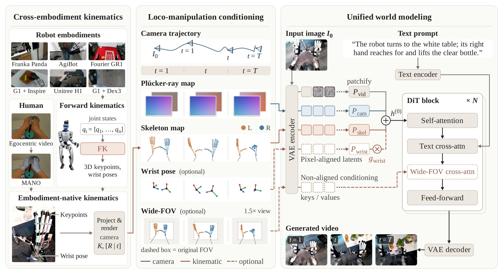
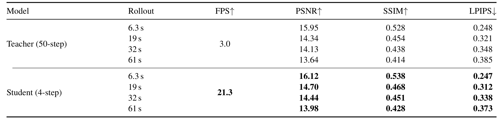

# Ropedia W0: Scaling Loco-Manipulation World Models across Embodiments with Human Experience

人类视频能提供大量操作经验，但人体关节和机器人动作空间不一致，移动相机又把视角变化与物体变化混在一起。Ropedia W0用未来相机轨迹和投影骨架作为共同条件，让视频模型学习“这段运动将导致怎样的视觉未来”。它首先是运动学条件世界模型；规划和动作策略是后续使用路径，不能把视频预测本身当成自主控制。

Tianqi Liu、Hanfei Zhao、Qifeng Liang等，NTU、Ropedia、Duke、UCSD、清华；[arXiv:2610.26855v1](https://arxiv.org/abs/2610.26855)，v1首次提交北京时间2026-10-20 01:59:55。[项目页](https://ropedia.github.io/ropedia-w0/)与[代码](https://github.com/Ropedia/ropedia-w0)提供资源入口。以下依据完整54页PDF；方法在第4–11页，实验第11–18页，附录第27页起。

## 人类视频怎样成为机器人可用的条件数据

直接混合人机视频的问题，是同一个动作标签在不同身体上没有共同的数值意义。作者保留视觉生成底座，把条件转成图像可见的几何：相机怎么走、手和身体关键点投到哪里。训练使用10,000小时人类与3,000小时机器人视频。人类部分包含14个公开来源和约6,000小时内部采集，机器人来自13个公开数据集；这些数字不表示完整训练语料都已开放。

人类手部通过WiLoR和MANO估计，机器人原则上用关节状态与正向运动学投影。但缺少内参、关节定义或标定不准确时，机器人图像还需要人工关键点标注和校正。因此“统一接口”的代价包括几何清洗，不能概括为无标注迁移。相机重建结合SLAM、深度估计与动态掩码，避免把移动人手当成静态场景。描述文本由模型生成后再筛查，几何重投影和时间平滑质量也要过关。

*论文原图编号：Figure 2。人机来源经过相机、骨架和文本处理后汇合；关键是输出条件与视频时间对齐，而非只把文件格式转成统一容器。*

标准训练窗口为81帧、640×480、16fps，不能和原始长视频时长混算。另建的Xp-Teleop有27段长录制、约1小时、543个动作片段，覆盖30种技能。G1配Inspire手，两个操作者分别负责移动与手部，数据保留失败和恢复。因此它适合检验长程预测，却不是单人自治策略的成功示范集。

## 沿相机射线和骨架生成未来

输入是首帧、文本，以及未来相机姿态和骨架投影。相机位姿先转成每像素的Plücker射线。若相机原点为$o_t$，像素$u$的归一化世界射线方向为$d_t(u)$，其六通道表示是

$$
c_t(u)=[o_t\times d_t(u);\ d_t(u)].
$$

前半项是射线相对原点的矩，后半项是方向。这样，相机运动不是一个与图像空间脱节的位姿向量，而是能和视频潜变量对齐的空间条件。方向由内参反投影并经旋转变换得到；输入位姿的尺度与标定错误仍会传入模型。

骨架则把人体关键点或机器人FK结果投到相机平面，以统一可见运动学结构。不同机器人保留不同的关节布局，不要求把它们全部重定向到同一低层动作维度。视频、相机、骨架分别编码并投影，输入隐状态为

$$
h^{(0)}=P_{vid}(z_\tau)+P_{cam}(z_{cam})+P_{skel}(z_{skel}).
$$

这里$z_\tau$是带噪视频潜变量，其余两项分别是条件潜变量；$P$把它们映射到同一隐藏维度。新增条件投影零初始化，减少接入条件时对原视频能力的突变。它的工程含义是给预训练视频路径增加可学习的几何偏置，而非另起一个机器人专用视频网络。腕部姿态只在存在标注时通过可用性门控接入；扩展视场条件不与原像素直接对齐，使用额外交叉注意力。

*论文原图编号：Figure 4。相机与骨架共同条件化视频预测；右侧展示从人类预训练、人机混合到后训练和蒸馏的顺序。*

### 机制流程

1. 从人机视频中重建相机、提取或校正骨架，获得与RGB同步的条件序列，送入统一数据处理。
2. 将首帧和文本连同未来运动学条件编码，DiT输出给定运动下的未来视频潜变量。
3. 先做人类预训练，再以人类/机器人50:50混合中训练；按需要进行目标数据集后训练，并将慢模型转成四步流式生成器。
4. 用候选动作投影得到条件并生成未来，交给外部价值模型排序；或者用这套权重初始化WAM，再以动作监督训练真正的策略。

最后一步仍需要外部动作提案、价值函数或策略训练。未来骨架已知，不等于模型能自动决定“应该往哪里动”。

## 从长视频底座到四步流式预测

模型有稠密5B和A14B两个配置；后者约27B总参数、每次约14B激活，不能把A14B写成14B总参数。人类预训练提供运动与操作先验，人机中训练学习机器人条件的域匹配。之后Causal Forcing建立自回归路径，非对称分布匹配蒸馏把视频采样降到四步；真实分布教师冻结，伪分布分支在线更新，最后用长rollout训练和有界KV缓存、注意力锚点减缓漂移。

*论文原图编号：Table S1。5B在GR1上比较完整50步和四步学生；质量指标与推理吞吐应连同具体设置读取。*

作者报告640×480单GPU吞吐21.3fps，完整采样约3fps。附录同时给出125帧片段约2秒生成、计入VAE解码约6秒，首块约1.4秒。吞吐来自摊销后的批量生成，不能当21.3Hz闭环控制或低于50ms首帧响应。长视频演示达到分钟级，也不保证长期对象状态一直正确；需要外部记忆和重新定位仍是作者承认的限制。

## 跨数据集迁移的证据与零样本口径

最能支撑人类预训练价值的不是单一最好分数，而是同架构视频底座与人类预训练底座在相同机器人后训练比例下的比较。第12–14页和附表S7报告：

| 数据集与后训练比例 | 公开视频底座PSNR | 人类预训练底座PSNR |
|---|---:|---:|
| GR1内部数据，1% | 16.04 | 20.85 |
| EgoDex，1% | 13.42 | 20.57 |
| HumanoidVerse，1% | 12.43 | 19.05 |
| GR1内部数据，全量 | 19.41 | 21.74 |

这些结果支持少量机器人数据下更好的视觉迁移，但没有完全隔离额外训练小时、更新数与数据内容。人类数据规模曲线在一轮训练内观察，也不应解读为无条件的数据规模定律。

**图表占位：Table S7**  
建议位置：本节同架构预训练比较之后。  
放置原因：保留不同后训练数据比例的成组对照，避免只引用最好一项。  
当前状态：未取得可用的完整表格候选，保留占位；关键数值已从全文核对并重排为上表。

一个中训练检查点在八个本体上评测，不针对目标数据集后训练时，5B/A14B平均PSNR为19.83/21.98，对匹配机器人混合训练的Cosmos为19.02。“零样本”指目标数据集未参与后训练；同类本体可能通过其他数据源见过。作者另外区分seen/unseen任务和场景，不能把这些维度合并成“所有机器人未见”。

去掉骨架后A14B平均PSNR下降3.8dB、5B下降1.8dB；去相机平均只下降0.3/0.1dB，但八个本体中六个相机基本静止，移动子集下降约1.3dB。这个差异说明平均分会掩盖条件真正作用的场景。人类预测也不是中训练后所有指标都改善：A14B预训练PSNR19.77，中训练19.34；中训练提高机器人适配，可能付出人类域指标的代价。

## 规划和策略初始化仍需要什么

模型生成的rollout被用于策略排名，相关系数约0.984和0.996，但只有五个或四个策略点。零MMRV与高相关支持当前小集合排序一致，不能保证新策略家族或接触失败模式下仍可靠。规划实验依赖外部价值函数筛候选：仿真平均任务进度92，对随机53、最佳固定策略85；G1真机为55，对26、45。这是进度评分，不是完成任务的二元成功率。

以相同FastWAM训练方案初始化动作策略，LIBERO全量从96.95至97.0，LIBEROPlus从50.06至56.82，收益主要出现在更强扰动。但少样本某设置中相机变化18.32降到10.94、噪声28.36降到21.99，不能笼统声称鲁棒性全面提升。真机WAM初始化的56.7对33.3和50同样是进度。

我的分析是，共同几何条件减少了动作维度不一致造成的接口损失，但它没有显式编码接触力、摩擦与物体动力学。复用前应先重现骨架/相机条件消融，再固定动作提案和价值模型检验世界模型单独贡献。尚不能确定的是，几何标注质量下降时能否保持这些收益，以及小样本策略排序能否覆盖生成模型最容易“看起来成功”的失败场景。

资源状态以本次核验为准：[5B预训练与中训练权重](https://huggingface.co/ropedia-ai/Ropedia-W0)确有文件，[Xp-Teleop](https://huggingface.co/datasets/ropedia-ai/Xp-Teleop)含轨迹索引；A14B和benchmark后训练权重等仍在待发布列表。代码Apache2、模型CC-BY-NC4.0、数据CC-BY4.0，使用时应分别核对许可。本笔记未执行训练或真机复现。
