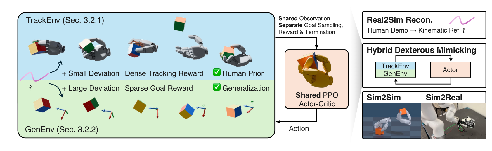
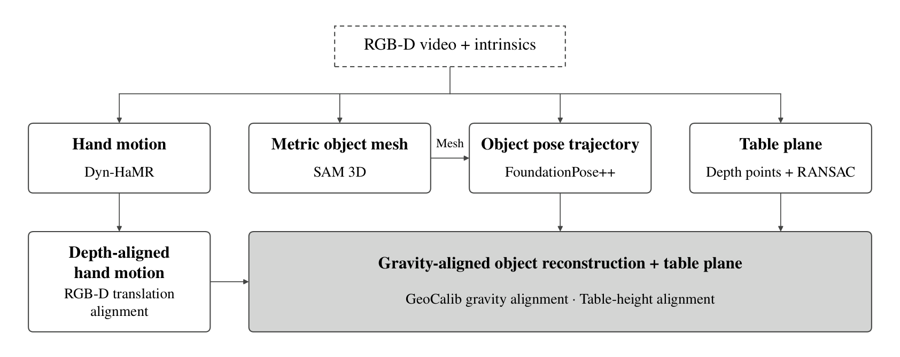
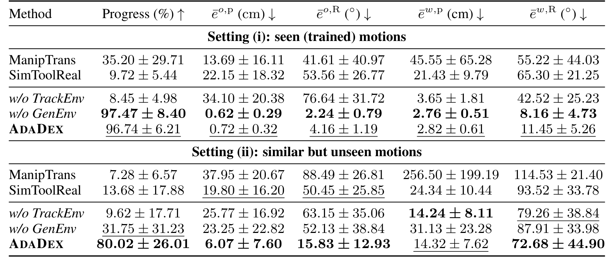
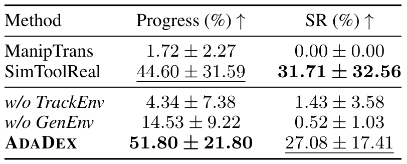

# Learning Adaptable Dexterous Skills via Hybrid Dexterous Mimicking

只追踪一段人类手物动作，策略容易只会重放；只优化物体到目标，又可能学到不自然、缺少功能意义的手指策略。AdaDex把这两个训练问题放进共享actor的不同环境群：一群保留示范技巧，另一群迫使策略偏离参考去完成新目标。它学习的是可适应技能，而不是把几秒视频直接扩成一个无条件通用策略。

Yuxuan Kuang、Jiashun Wang等；[arXiv:2610.28628v1](https://arxiv.org/abs/2610.28628)，v1提交北京时间2026-10-21 01:59:32；[项目页](https://yuxuank.com/AdaDex/)已访问。以下依据完整20页PDF，核心方法第3–7页，结果第7–10页，重建与实现附录第14–20页。未确认公开训练代码和权重，未独立复现机器人实验。

## 一段人类动作怎样兼顾技巧与新目标

输入参考含人类腕部位姿、MANO手参数和物体位姿，通常几秒、60Hz，另需封闭对象网格。它可以来自动捕，也可以通过RGB-D重建。参考在训练中决定初始化、目标和奖励；测试时不再逐帧输入参考，只需要当前状态与目标流。

actor读取手指关节、腕位姿及速度、物体位姿、BPS形状编码，目标是腕与物体的两个SE(3)位姿。BPS用固定空间点到网格的距离形成定长形状向量。作者称actor没有特权仿真输入，但它仍需要网格和物体姿态；真实部署要通过视觉估计提供这些量，不能称无需对象感知。

动作由6自由度腕增量和绝对手指关节目标组成，经过滤波与PD执行。这个目标接口可接参考、视频规划器或高层VLM路点；路点来源本身的正确性不是低层技能训练自动解决的。

*论文原图编号：Figure 2。两环境共享观察、动作与actor，但初始化、目标、奖励和终止不同；右侧为参考重建及迁移接口。*

## 两个环境群如何塑造同一个actor

TrackEnv从参考随机时刻初始化，加入小位姿噪声，目标取短期前瞻参考。对象位置、旋转、腕部和手部关键点采用指数误差奖励，另有参考接触与平滑、扭矩、关节限位、桌面穿透惩罚。偏离参考过大就终止，逼迫其学会接近方式、指尖换步和释放时机。

GenEnv同样从参考附近开始，但初态和目标加更大SE(3)扰动，均匀采样参考阶段。对象达到位置/姿态容差给稀疏成功奖励，腕部仍有密集目标引导与常规正则，却没有手指追踪项。因此“稀疏奖励”只指对象成功项，不是全部训练信号都稀疏。

两群用同一PPO actor更新，混合目标可写为

$$
J(\theta)=p\,\mathbb E_{track}\sum_t\gamma^t r_t^{track}
+(1-p)\,\mathbb E_{gen}\sum_t\gamma^t r_t^{gen}.
$$

$p$是TrackEnv占比，$\gamma$折扣，两个期望分别对应不同初始化和目标分布。实施含义是把两种rollout汇入共享更新，而非把每个状态同时套上互相冲突的密集追踪和任意目标奖励。GenEnv扩大访问范围，TrackEnv持续约束共享actor不要丢失手指技巧。

### 机制流程

1. 将单段人类手物参考和网格重定向到机器人手，得到初始化的腕、手指与物体状态。
2. 同时运行TrackEnv与GenEnv；前者紧贴参考，后者使用大扰动目标，统一actor以目标条件选择动作。
3. 非对称critic额外读取接触力、物体速度等仿真量和参考；GenEnv将参考置零，训练优势估计，但部署不增加这些输入。
4. 真实执行时用本体历史、对象估计与目标闭环输出腕/指目标，或仅开放环重播仿真动作；两者证据要分开登记。

TrackEnv还按参考分段成功变化自适应抽样，优先训练仍在学习边界的片段。GenEnv不使用同样的自适应抽样；它在每次达标后换新目标，一个回合可串联多个转移。环境终止、初态扰动和目标抽样共同定义泛化范围，不能只复制混合奖励公式就认为复现完整。

## 从普通视频到可追踪参考的几何链路

从RGB-D得到可用参考并非一步网络输出。Dyn-HaMR估计手运动，SAM3D构造对象网格并以深度尺度替换不可靠单目尺度，FoundationPose++追踪对象，深度点加RANSAC估计桌面。随后手部平移与深度对齐、重力轴对齐、桌面高度修正，形成共享世界坐标的手和物体轨迹。

*论文原图编号：Figure 7。网格、对象位姿、手运动和桌面分别估计后几何对齐；这些前处理是从自然视频进入技能学习的实际成本。*

参考噪声会体现在接触时机、指尖位置和对象运动上，论文对重建参考采用更宽容的失败条件。重建基准的有效帧统计也只对成功输出有效重建的帧计算，不能从较低误差推断所有帧都被可靠恢复。

## 泛化强项和十目标成功率反例

定量核心是22DoF Arti-MANO浮空手：GRAB中12种对象，每对象选一条参考训练，另两条相似动作测试，每动作128次rollout。AdaDex与ManipTrans按参考各训一个策略，SimToolReal则从其预训练checkpoint按对象微调，训练来源不完全相同。

跟踪进度是首次对象位置误差超5cm或旋转超20度的时刻占总长度；误差指标另沿完整轨迹、无终止统计。因此进度高不等于完整动作二元成功，误差均值也不是只在成功前计算。

*论文原图编号：Table 1。进度、对象误差与腕部误差分列，未见动作方差较大，不能把一个均值当稳定保证。*

已见参考中AdaDex96.74±6.21%，纯追踪97.47±8.40%，略有折中；未见相似动作中AdaDex80.02±26.01%，纯追踪31.75±31.23%，ManipTrans7.28%、SimToolReal13.68%。这直接支持GenEnv在保持示范拟合同时提高离参考适应。无TrackEnv仅9.62%未见进度，说明目标奖励并没有自动发现同样技巧。

*论文原图编号：Table 2。两个指标的最优模型不同，AdaDex没有全面胜过专门目标到达对照。*

随机目标从6–10cm平移和25–45度旋转生成，每回合连续十个，达到5cm/20度算一次完成。AdaDex平均目标进度51.80±21.80%，高于SimToolReal44.60±31.59%；但十个全完成成功率为27.08±17.41%，低于31.71±32.56%。较高平均进度与较低全成功可以同时成立，不能把前者写成“更可靠完成任意长目标链”。

另有九段实验室自然RGB-D重建参考，跟踪进度80.53%对ManipTrans31.70%；这里允许连续十步超过阈值才失败，防止短时重建抖动触发，因此不能和严格逐步的GRAB进度直接比较。原始重建参考也没有可靠真值，结果主要说明对该参考的可追踪性。

## 浮空手评测与真机闭环之间的距离

Isaac Gym策略可零样本闭环导入MuJoCo，真实展示包括锤子功能抓握、倒杯、扫帚换指与立方体重定向。开放环实验以30Hz原速重播仿真关节目标，验证动作具有物理可行实例；闭环则用FoundationPose、对象网格、RGB与Fast-FoundationStereo深度估计实时对象状态，另有RMA编码本体历史。不能把开放环录像自动归为闭环鲁棒性。

高层下游任务由VLM编码代理给路点，证明技能接口能够被规划层调用，但论文没有系统报告所有硬件、对象、扰动条件的真实成功率。我的分析是，应先复现两环境移除消融与随机十目标指标分歧，再在同网格和状态估计器下扫描目标扰动；否则几何估计改善会和策略泛化混在一起。尚不能确定新对象网格错误、接触参数变化或更长目标链时混合先验是否仍足够，也不能由几个秒级参考推出统一跨技能模型的规模结论。
