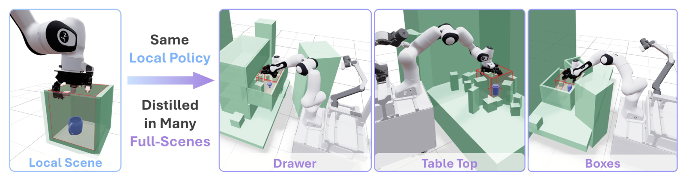
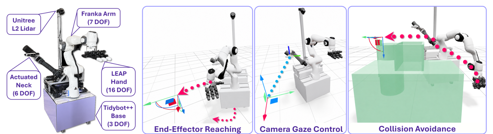
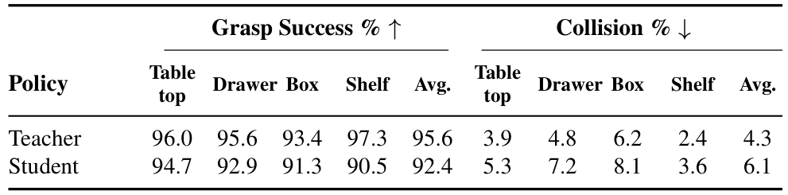

# COWBOY: A Scalable Sim-to-Real Framework for Learning Contextual Whole-Body Manipulation

同一个杯子放在桌面、抽屉或架子里，所需底盘位置、视线和抓取方向都不同。COWBOY把这种场景适应与局部接触分开求解：用可批量执行的全身控制器处理接近和避碰，用三种局部RL专家学习接触，再把组合教师蒸馏成只依赖机载观察的单一策略。核心价值是把局部技能复用到大量完整场景，而不是让一个高维RL策略从零同时学会所有事情。

作者Jiahui Yang、Jason Jingzhou Liu、Ray Muxin Liu、Andrew E. Wang、Kenneth Shaw、Deepak Pathak和Ruslan Salakhutdinov，Carnegie Mellon University。[arXiv:2610.28948v1](https://arxiv.org/abs/2610.28948v1) · [PDF](https://arxiv.org/pdf/2610.28948) · [项目页](https://cowboy-manip.com)。UTC首次提交为20日，北京时间为2026-10-21 05:59:10。本笔记基于33页全文，包含p.15起完整附录；未独立训练、测试硬件或复现论文成功率，尚未确认可用训练代码与权重。

## 全局接近和局部接触为何要分开学习

移动抓取有两类难点。远距离阶段要选择底盘位置、避免手臂提前伸到极限，并持续看见目标；近距离阶段才涉及手指接触、物体几何和提起动作。直接用完整场景点云训练高维RL，奖励要同时覆盖两种问题，采样又容易花在尚未到达物体的状态。

COWBOY先给全局接近一个结构化接口：末端SE(3)目标和相机look-at点。环境感知WBC（whole-body controller，全身控制器）输出协调的底盘、手臂、相机运动。随后只在物体附近训练局部专家，观察和动作以末端坐标表达；只要局部几何约束相容，专家可以嵌入不同完整场景。这个“局部区域相容”条件很重要：不能把一个从上方进入开口箱子的专家随意放进有顶棚的架子，再期待全局控制器自动补足技能。

*图注：Figure 3 同一局部技能嵌入不同完整场景，据论文原图；详见相邻正文的机制或协议解释。*

图3中的局部区域被放进抽屉、桌面和箱体，外部场景由WBC处理。场景生成不是完全任意组合：先按对象和交互类型选专家，再生成与该专家局部约束兼容的场景家族。未见完整场景泛化由这些组合训练支持，而非仅凭改变背景图片获得。

三种实例化专家分别为top-down、side-grasp和constrained side-grasp。前者在有侧壁、上方开放的区域抓取；第二种针对细长物体侧抓；第三种在带顶板的架子中侧向取出。它们都用Isaac Gym中的非对称actor-critic PPO。actor观察61维局部状态，包括手关节、指尖、物体和局部区域几何，critic另有完整机器人和世界坐标信息，共106维。这里的actor本身也有仿真特权几何，不能直接部署；它是后续视觉蒸馏的教师组成部分。

每个专家输出22维动作：3维末端平移、3维旋转和16维手指命令。末端增量转换为目标后仍由WBC执行，手指直接给关节目标。奖励包括接近、目标距离、提起、curl和动作正则；局部RL没有显式碰撞惩罚，因为作者把避碰交给WBC。这个分工降低了奖励难度，但不意味着碰撞率为零（Sec.3.2、Appendix D）。

## 单一末端目标怎样驱动底盘、手臂和视线

机器人为TidyBot++全向底盘、Franka臂、LEAP Hand，以及承载D435的6DoF ARX相机臂，共32DoF，另有底盘L2 LiDAR。WBC的配置变量只包含底盘、Franka与ARX关节，LEAP手指不参与fabric根状态。这样，接触专家能独立输出手指命令，而身体运动共享同一个可批量控制器。

*图注：Figure 2 机器人与全身控制任务，据论文原图；详见相邻正文的机制或协议解释。*

图2右侧的末端、视线和避碰项不是串行规划模块，而是在同一控制步合成的任务空间行为。对任务映射 $x_i=\phi_i(q)$，速度为 $\dot x_i=J_i\dot q$，每项指定度量 $M_i$与力项 $f_i$。拉回到机器人配置空间后，合成方程为（Eq.1、Appendix B）：

$$
M=\sum_i J_i^\top M_iJ_i,\qquad f=\sum_i J_i^\top(f_i+M_i\dot J_i\dot q),\qquad \ddot q_{\rm raw}=-M^{-1}f.
$$

$q$为机器人配置，$J_i$为任务Jacobian；$M_i$决定当前状态下任务的方向性权重，$f_i$给出期望行为，$\dot J_i\dot q$补偿任务映射变化。上式解释了为什么可以批处理：每个环境有同形状的张量，任务拉回是批量矩阵乘法，合成是归约和根求解。作者还对原始加速度做fabric energization，再积分为底盘速度及关节位置命令；只实现上式还没有复现整个控制器。

远处时，base attractor根据末端目标的平面投影引导底盘并使朝向面向目标；靠近时其度量平滑减弱。end-effector attractor则在目标进入手臂局部工作区时增强，避免远处就把手臂拉直到关节极限。虽然底盘吸引项消失，末端Jacobian仍含底盘自由度，因此近处底盘并没有被冻结（Sec.3.1、Appendix C.2–C.3）。

相机通过SO(3)姿态吸引项对准look-at点，弱姿态正则处理冗余；关节限位项随边界距离增强。避碰把机器人近似为球，场景近似为长方体、胶囊和球，Warp批量距离查询产生排斥方向。它是一种反应式近似控制，不是带完整未来约束的MPC。论文选择fabrics的理由是固定计算图适合大量环境，不是在理论上证明QP或MPC不能批处理，也不是对所有控制库的统一性能排名。

实现报告60Hz、最多4096环境、摊销到单环境每步0.03ms。这个数是批量运行的有效单位成本，不能解读为真实机器人所有感知控制链路只有0.03ms延迟，更不能把4096乘上60Hz就当作包含传感器渲染的完整训练吞吐。

## 局部专家怎样变成只看部分点云的全身策略

教师rollout先从距离物体0.2–2m处由WBC接近切换目标，进入局部专家的初始化分布后才开始接触。top-down切换点位于物体上方0.2m；架子则根据开口和专家方向设置外侧切换点。教师在接近和交互两个阶段都使用WBC，完整场景的特权几何也一直可用。

为了消除部署时对完整几何的依赖，学生在自己的rollout状态上取得当前教师标签，进行在线DAgger（Dataset Aggregation，聚合学生访问状态上的教师监督）。它不是只回放一批成功专家轨迹。最初10k梯度步执行教师动作，随后10k步线性降到零；之后执行学生动作但继续查询教师。

*图注：Figure 4 多教师监督与点云学生，据论文原图；详见相邻正文的机制或协议解释。*

图4中教师输出动作提供监督，学生只读取机载点云、机器人状态和目标估计。学生输出已经是32维全身命令：底盘3维、Franka7维、LEAP16维、ARX6维。它不在部署时再经过那个使用完整几何的教师WBC；保留的低层关节控制也不能与教师WBC混为一谈。

Appendix E进一步说明观察构建。深度相机和LiDAR各提供1.5m半径、1024点的底盘附近裁剪，以及0.5m半径、512点的物体附近裁剪，合计3072点；全部转换到Franka-base坐标系。PointNet set abstraction产生128个点云token，另有Franka、ARX、LEAP关节、手目标残差和目标位置5个状态token。每token124维再加4维type embedding，宽度128；Transformer为6层encoder、6层decoder、8头，前馈宽1024。

手目标残差 $q_{\rm target}-q$保留了命令与实际手关节位置的差异，可以间接反映接触；它不是力传感器，也不能由此推导出接触力。辅助目标位置头最多预测1cm尺度的增量，并自回归回馈下一步物体裁剪中心。该query只能看点云和旧目标，不能看动作query，避免把动作输出当成位置线索。训练目标为动作MSE加0.1倍目标位置MSE，动作教师标签先转换成学生的归一化32维空间，不能直接拿专家22维输出做回归。

部分可见性也进入训练。系统先从网格采样完整点云，再经视角相关z-buffer或角度first-return生成深度和LiDAR点云，并抑制稀疏采样边界的背景漏出。它牺牲连续网格渲染的逼真度以换取速度与显存。单A6000、1024环境，212×120深度和32768点LiDAR分别花0.07s与0.25s；这是两种批处理的耗时，不是60Hz真机上的逐帧网络推理时延（Appendix F）。

## 91%真机成功包含哪些任务和感知条件

真实评测覆盖24种场景，每场使用同一组20个固定物体，再从100物体池取5个随机物体，各评测3个朝向。按协议计算为24×25×3=1800回合；其中100个随机池物体不等于每个场景都测试100种。主文报告约91%平均抓取成功，成功要求物体离初始位置提起至少10cm且无碰撞。桌面、抽屉和架子等空间变化较大，但仍以抓取为主，不是任意长时任务完成率。

感知条件在Appendix E.6写得更具体：每次尝试先提供能得到有效初始SAM3检测的prompt，mask反投影后的点云质心作为初始目标。之后策略60Hz自回归更新，SAM3在3Hz返回有效检测时覆盖估计。初始化后的检测失败计入成功率；没有证据说明无法得到有效初检的对象也包含在分母内。因此91%不能写成“任意语言指令、不经目标初始化即可自主抓取”的端到端指标。

*图注：Table 2 教师与学生的留出仿真结果，据论文原图；详见相邻正文的机制或协议解释。*

表2学生平均成功92.4%，教师95.6%，碰撞率分别6.1%和4.3%；架子成功90.5%对97.3%，差距比桌面更大。碰撞排除与目标物体的有意接触。这里的成功定义与真机额外无碰撞要求不能混写；较高成功率本身也不构成零碰撞保证。

作者还与端到端点云RL和ManipGen比较：各场景均值为0、63.1和92.4。端到端RL去掉障碍可达96%，说明这个零分只对应作者有障碍任务及已试验训练方案，不能证明端到端RL原则上不可能。ManipGen有对象专属专家、AIT*规划和VLM中间目标选择，而COWBOY专家跨对象训练并整体蒸馏，包含多处系统差异，不是仅将相同策略换一个网络的受控实验。

## 消融揭示了哪些迁移瓶颈

**图表占位：Table 3**  
建议位置：本节传感器与可见性消融处。  
放置原因：它把仿真成功与真实成功并列，揭示完整几何训练的迁移失败。  
当前状态：p.9完整源页和数值已核对，未取得独立匹配图像候选，保留占位。

| 重新训练的学生观察变体 | 仿真成功 | 真实成功 | 真实碰撞 |
|---|---:|---:|---:|
| 无主动视线 | 78.8% | 46.7% | 8.2% |
| 无LiDAR | 75.2% | 71.1% | 31.7% |
| 完整点云训练，无传感器渲染 | 94.4% | 0.0% | 11.3% |
| 完整COWBOY | 92.4% | 91.1% | 3.9% |

这个反例比单报91%更有解释力：仿真里完整点云可略高于部分观察，部署却完全失效。策略必须在训练时面对遮挡与传感器视角，不能把特权几何当成更好的真实观测。无LiDAR的高碰撞则支持全局几何对底盘避碰的价值。无主动视线变体同时改变教师相机姿态和学生所见数据，不是冻结同一策略后只关掉马达的瞬时干预。

**图表占位：Table 4**  
建议位置：本节全身控制器对教师质量的比较处。  
放置原因：分开衡量WBC教师质量与学生感知蒸馏，避免把两类消融合并归因。  
当前状态：原候选混入左表且末行裁切，唯一几何修复后底部仍有外部表题碎片，按修复上限保留占位；表体数值已核对。

| 教师WBC | 成功率 | 碰撞率 | 手臂manipulability | 限位裕量 |
|---|---:|---:|---:|---:|
| Weighted IK | 43.6% | 41.4% | 0.039 | 1.51rad |
| Fabrics无避碰 | 74.8% | 32.6% | 0.067 | 1.87rad |
| 完整Fabrics | 95.6% | 4.3% | 0.072 | 1.99rad |

前两者差异支持底盘与手臂的接近协调，后两者支持身体排斥项。manipulability用Franka臂Jacobian的Yoshikawa指标，限位裕量为关节到较近边界的距离均值；它们不直接度量整机真实安全。这里评的是教师控制器，不能将其4.3%碰撞率替换为学生的6.1%，更不能当成真机3.9%。

## 复现预算与功能抓取的边界

每类局部专家用单A6000、8192并行环境训练约36小时；学生蒸馏用8张A6000约60小时，使用AdamW、BF16、梯度裁剪和学习率warm-up。训练还随机化物体、摩擦、质量、关节参数和观测动作噪声，并用目标瞬移迫使学生恢复。这里的zero-shot指仿真训练后不再做真实任务微调，不是无目标检测、无系统标定或零工程投入。

论文存在需要复现者核实的规模口径差异：主文写8192蒸馏环境，Appendix E.5写8GPU每rank512环境，即4096；评测设置写8192，结果文字和表题又写8000。本文分别保留这些原始口径，不自行假定缺失配置；部署复现应向作者确认实际配置和评测清单。真实消融给出百分比，但其每项重复次数与不确定性没有在已读文字中得到同等明确的展开，不能用主协议1800回合替它填充分母。

作者明确指出，单靠场景和形状不能决定功能性抓取：同一个对象可能为倒水、递交或放置需要不同抓法。我的分析是，COWBOY可复用的贡献在于把已知几何控制先验作为可扩展教师，再通过部分观察DAgger把它转成部署行为；扩展到开门、工具使用或不同底盘仍需对应局部专家、兼容场景生成与传感器训练。下一步最值得检验的是不依赖人工有效初检时的完整成功率，以及更长任务中连续技能切换后的误差累积。
