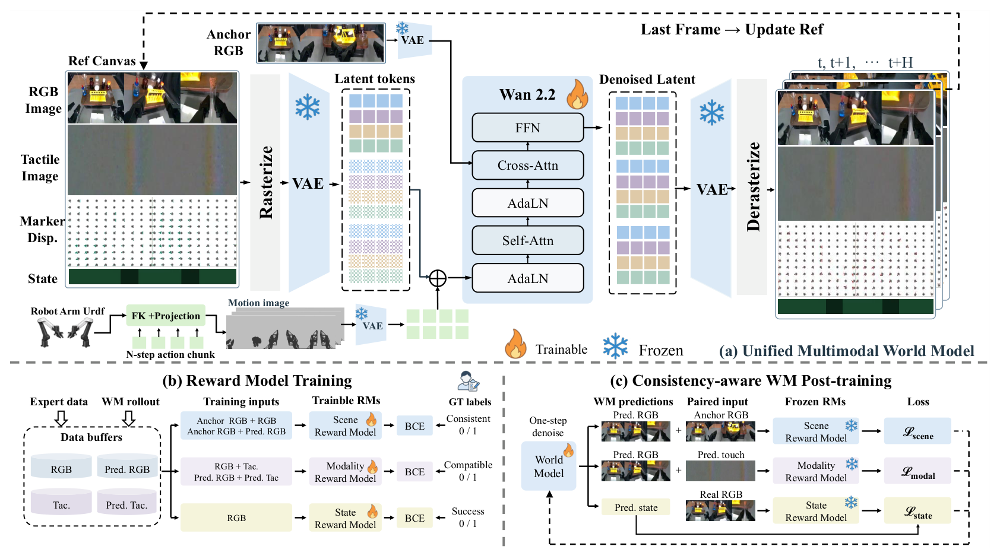
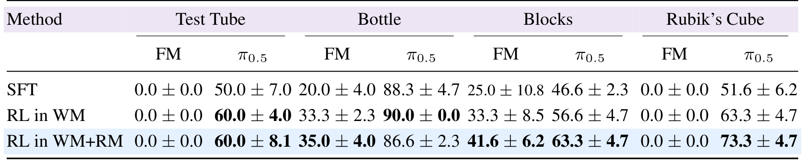

# Physical Canvas: A Vision Tactile World Model For Robot Policy Evaluation And Learning

看起来合理的机器人视频可能在接触发生时给出错误后果，进而误导策略评测和强化学习。PhysCanvas把触觉图像、marker位移与任务完成状态都放入视觉画布，并把“场景是否保持”“模态是否相容”“真实结果是否复现”分开监督。核心要求是预测正确的成功与失败，而不是只生成更像成功的视频。

Zebin Xing、Yuhang Zheng、Yupeng Zheng等；[arXiv:2610.28613v1](https://arxiv.org/abs/2610.28613)，v1提交北京时间2026-10-21 01:54:03。[项目页](https://zebinx.github.io/PhysCanvas_HomePage/)已核实，未确认公开训练实现或权重。本文依据完整34页PDF，主要方法第4–7页、实验第7–10页，以及数据、奖励和闭环接口附录；结果未在本机独立复现。

## 接触预测为何不能只看RGB分数

物体是否夹住、瓶盖是否仍受力，往往不能从一帧RGB判断。光学触觉的纹理变化与marker位移提供了另一组接触证据。如果世界模型只把背景和机械臂画对，却在接触解除后继续预测压力，策略会收到自相矛盾的状态。

作者用ARX AC One双臂、三个相机和四个Xense指尖垫，覆盖试管放置、拧瓶盖、积木搬运、魔方操作。世界模型训练有3805段真实策略rollout，包含成功和自然失败，每任务另80段留出；不是仅学习专家成功示范。真实策略试验与这个离线预测留出集是不同评测预算，不能混作同一批样本。

预训练视觉VAE对光学触觉有一定可迁移性：零触觉微调的Wan VAE在USB触觉重建上PSNR35.51、LPIPS0.0139，UniT为31.72、0.0210；但SSIM0.9539低于UniT0.9613。这个比较支持共用编码器的可行性，不证明所有触觉物理量都能无损编码。

## 把触觉与动作放进共同的画布

三RGB视角横向拼接，模态沿纵向排列。触觉相机使用相对传感器参考的差分图，并非相邻视频帧差；700个marker在每垫35×20网格上记录XYZ位移，相对回合首帧减去参考，再固定尺度裁剪映射到RGB。归一化尺度是缓存单位的0.06，不能随意当成物理位移上限或毫米标定。

任务状态也渲染成图像块：颜色区分任务，低频纹理区分成功与未成功。它是辅助预测目标，不直接送给下游策略，以免把预测答案当作策略输入。动作则从关节位置与夹爪命令通过URDF正向运动学、相机标定投影为运动图，和RGB保持同样裁剪、分辨率和视角顺序。

*论文原图编号：Figure 3。初始RGB锚固定，当前参考随chunk更新；动作图在共享VAE后空间对齐注入，三个奖励模型在训练后被冻结。*

记$z_{\tau,i}$为带噪画布token、$z_i^a$为对齐动作token，$S_{state}$为状态块位置，条件注入为

$$
\tilde z_{\tau,i}=z_{\tau,i}+M_i z_i^a,\qquad M_i=\mathbf{1}_{i\notin S_{state}}.
$$

$i$覆盖时空token。绕过状态块的直接动作相加，是为了让完成状态更多经其他模态和共享注意力推断；它不禁止动作通过注意力间接影响状态，也不是消除信息泄漏的完整证明。

### 机制流程

1. 同步真实RGB、触觉差分、marker位移与完成标签，转换共享画布；动作按同一相机几何转为条件图。
2. 冻结Wan VAE，微调Wan2.2-TI2V-5B；以初始RGB作固定锚、最新画布作参考，预测下一段多模态观测。
3. 先训练三类奖励并冻结，再用保留flow matching的混合目标做世界模型一致性后训练。
4. 冻结模型与状态奖励，从真实初态开始让策略消费生成观测、重新出动作，得到评测rollout或GRPO更新数据。

训练连续四个chunk，每段八个未来帧，末帧作为下一段参考；部署五步flow采样，递归可继续到任务结束。固定初始锚与更新参考分工不同，前者稳定场景身份，后者携带最新接触状态。64张PPU-ZW810E训练300epoch约三天，不能因为复用了视频底座就省略训练成本。

## 三个奖励分别约束什么错误

Scene Reward Model比较初始与未来RGB，判断是否发生不应有的对象或布局变化；Modality Reward Model比较RGB、触觉与位移是否表达兼容接触，训练负样本包括错配触觉和人工标注生成失败；State Reward Model只用真实轨迹训练，判断当前RGB是否满足任务成功条件。三个都是基于ResNet-18的轻量网络，训练后冻结，按轨迹拆分数据而非随机拆帧。

状态监督尤其容易误读。对生成RGB输出的成功logit为$\hat\ell$，真实RGB经同一奖励模型阈值化得到目标$y$，则

$$
\mathcal L_{state}=\mathbb E\,\mathrm{BCEWithLogits}(\hat\ell/T_{state},y).
$$

$T_{state}$调节logit温度。目标$y$可以为零：真实失败就应预测失败，不是始终最大化成功概率。场景与模态则对每个预测都应一致，因此使用$\mathcal L_q=-\mathbb E[\rho_q(h_q(x_0,\hat x))]$，$q$是scene或modality，$h_q$挑选相应输入，$\rho_q$是冻结网络分数。梯度经过VAE解码器和冻结奖励网络回到生成器；参数冻结不代表切断输入梯度。

M0用AdaLN全局注入动作，M1改为空间对齐运动图，M2/M3/M4依次加场景、状态、模态监督。这是递增消融，不能把M0到M4全部改善都归给单一奖励。

**图表占位：Table 3**  
建议位置：本节递增消融解释之后。  
放置原因：同时保留视觉、触觉事件与位移误差，揭示多指标取舍。  
当前状态：原候选被视觉质量门拒绝，保留占位；关键结果已从全文核实。

模态监督让Contact MAE从0.02491到0.02278，位移Active MAE从4.666到4.083，但Event F1从0.4550降至0.4455。触觉像素、接触事件时机、位移幅度不是同一构念，不能概括为触觉所有方面都提高。t-SNE的模态重叠也只能作表示诊断，不能直接证明跨模态因果理解。

## 相关性提升与真实策略收益

ACT、FM与触觉增强π0.5分别在M2和M3中rollout，每任务–策略配对有三批、每批20个不同时段真实场景。四任务Pearson的算术均值从0.602到0.885，均值$R^2$从0.413到0.791；Rubik原本已近天花板，收益主要来自其他任务。高相关不等于斜率正确、绝对成功率校准良好，也不是88.5%的回合判断准确率。

**图表占位：Figure 8**  
建议位置：本节逐任务相关性讨论处。  
放置原因：四任务的提升幅度不同，散点与理想对角线能限制平均相关的解释。  
当前状态：原裁剪混入表格，唯一几何修复又裁掉任务面板标题，按修复上限保留占位；不插入缺失科学标注的图片。

真实策略学习结果提供更直接的任务后果：

*论文原图编号：Table 4。均值与总体标准差来自三次运行，按任务和策略分列，不能只看一个宏平均。*

| 策略 | SFT | M1中RL | M4中RL |
|---|---:|---:|---:|
| FM，四任务均值 | 11.2% | 16.6% | 19.1% |
| 触觉π0.5，四任务均值 | 59.1% | 67.5% | 70.8% |

两种RL都用冻结状态奖励评分，差别是模拟器从M1换到一致性后训练的M4。“WM+RM”不能被解释为只有第三列才使用奖励模型。FM的试管与魔方仍为零，π0.5的Bottle从M1中RL90%回落至M4中RL86.6%；想象训练改善平均值，但不保证逐任务单调。

## 复现时必须保留的感觉和奖励接口

FM/ACT按任务分别训练，π0.5是共享多任务检查点，预训练与动作参数化不同，所以三家族不是架构受控比较。它们实际触觉输入是marker位移，当前RGB和14维关节状态按10Hz同步；画布虽然也生成触觉图像，不能据此说策略同时用了所有模态。FM/ACT预测32步并整块执行，π0.5预测16步，归一化和块长改变都可能影响闭环。

我的分析是，本文最可复用的设计是把“忠实复现失败”与“场景/模态应始终一致”分成不同目标。仍需独立奖励器或盲评检验生成器是否学会利用同一评分器的盲点，并跨对象、传感器与动作分布重测。四任务、一个平台以及有限真实评测不能保证任意接触任务的可用性；仅凭视觉质量或相关性也不足以批准真实机器人策略更新。
