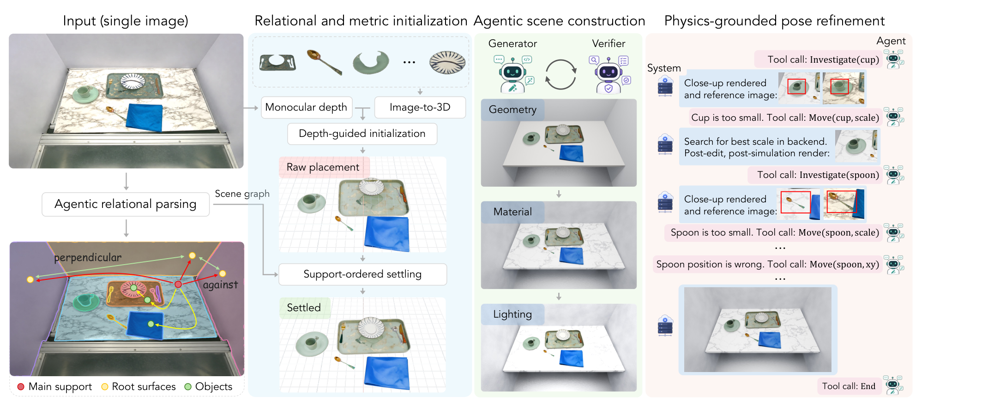
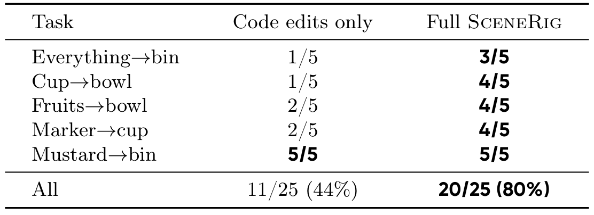
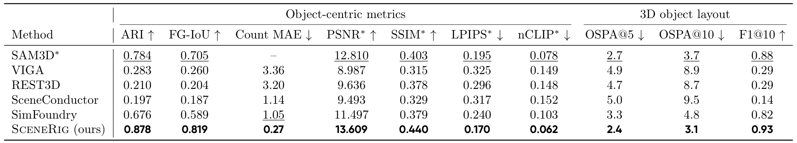
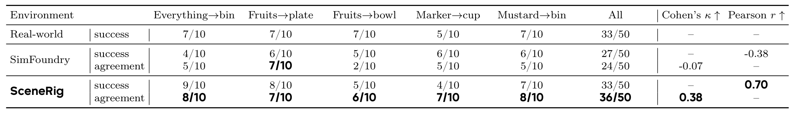

# SceneRig: An Agentic System for Simulation-Ready 3D Scene Reconstruction from Single Images

一张重建渲染图可以与输入很像，但苹果和盘子被融合成一个网格、容器偏移几厘米，都会让机器人在仿真中执行错误动作。SceneRig把对象身份、支撑关系和物理接受条件放进重建循环，用工具确定改动幅度，让agent负责诊断而不凭空猜坐标。论文的价值因此要同时看图像与实际控制命令的后果。

Rundong Luo、Yunong Liu、Di Cao等，Luma AI与Cornell；[arXiv:2610.28585v1](https://arxiv.org/abs/2610.28585)，v1提交北京时间2026-10-21 01:39:42。[项目页](https://red-fairy.github.io/SceneRig/)和[实现](https://github.com/Red-Fairy/SceneRig)已核实；仓库在9月创建，不是21日首次公开代码。本文依据完整37页PDF，核心方法第4–6页、实验与机器人应用第7–10页，以及姿态与评测附录；未执行安装、重建或机器人独立复现。

## 仿真可用的场景还缺哪些约束

纯图像相似可以奖励不正确的结构：把桌子贴进背景、把两个接触物体并成一块，都可能保留源视角轮廓，却破坏拾放和碰撞。给原始重建统一跑一次重力沉降也不够，对象可能翻倒或滑到错误位置，只是从“不稳定的错误”变成“稳定的错误”。

SceneRig保存持久对象ID和显式支撑图。若$O$是可移动物、$R$是桌面墙面等根表面，则

$$
G=(V,E),\qquad V=O\cup R,\quad E=E_{sup}\cup E_{surf}.
$$

$E_{sup}$记录对象的直接支撑，$E_{surf}$记录根表面的结构关系。每个节点保存几何、外观、碰撞/物理参数和公制变换。这个图决定先放谁、移动支撑后哪些子物体要重放置，不只是给语言模型看的描述性标签。

*论文原图编号：Figure 2。对象身份与支撑关系贯穿重建；最终agent调用Investigate和Move，以测量和仿真结果判断修改是否应保留。*

## 先固定实体和支撑再让agent编辑

VLM列出物体、根表面和关系，MolmoPoint按实例描述定位，SAM3候选掩码经检查修复遗漏、分裂和合并；遮挡严重时可先移除前景遮挡再分割。SAM3D重建对象网格，MoGe-2估计相机和公制点图；如果有已标定RGB-D，就直接替换估计深度和内参。

主支撑平面给出重力对齐坐标，令桌面位于$z=0$。对象按父先子后的支撑顺序进入PhysX沉降，再用ICP调整平移、尺度与偏航后重测。这降低把整个场景一起放入物理引擎造成的漂移，但碰撞几何与物理参数仍是估计，不是从一张图恢复真实摩擦和质量的唯一解。

### 机制流程

1. 从图像恢复持久实体、掩码和支撑图，结合估计或实测深度建立公制对象与相机。
2. 支撑有序沉降后进入共享Blender场景，按结构、根材料、灯光分阶段编辑，独立verifier检查源图对齐。
3. 每个对象至少Investigate一次，agent决定改哪一类参数，Move有界搜索具体幅度；物理检查与评分通过才保留自动候选。
4. 最终联合重力模拟、烘焙与USD导出后，在同一机器人标定和控制合同下评估策略或重播命令。

结构阶段先通过确定性`check_rules`检查根放置、支撑和穿透，再交视觉verifier；材料阶段只改根表面的外观，灯光阶段只改照明和曝光。持久场景避免每轮从空文件重建，但也意味着早期误判可能继续影响后续，不能把分阶段约束当作全局正确性证明。

## 有界Move怎样接受或撤销一次改动

直接要求agent“移动0.05单位”缺少量纲依据。Investigate返回输入/当前渲染的配对裁剪、支撑信息与几何测量，agent先判断物体偏小是尺度错误还是深度错误。Move处理水平平移、统一缩放或偏航，执行从粗到细的有界搜索；平移与缩放用轮廓加深度，偏航再比较居中轮廓与DINOv2特征。

常规有界候选只有对齐改善时才模拟，再检查翻倒、漂移及新增/恶化穿透。可把接受逻辑概括为

$$
\mathrm{keep}=\mathrm{physics\_valid}\ \land\ (S_{after}\ge S_{base}).
$$

$S$是对应工具的接受评分，$after$指沉降后的结果，$base$为原状态。这个表达强调应验证“物理作用之后”的位置，而非只看尚未沉降的最好轮廓；失败恢复原状态。移动支撑时还要更新依赖对象，否则局部修正会留下浮空子节点。

当有界动作不足，Edit允许直接改场景代码，返回模拟和诊断，由agent选择保留或撤销；它不是与Move完全相同的自动接受门。初始化阶段也有预算，达到上限未获verifier通过时可能向后续交付best-effort状态。因此系统最终输出仍需独立验证，不能因为用了规则工具就描述为所有中间阶段都严格拒绝失败。

这套设计最重要的比较，是移除有界Move、保留Edit、其他组件和物理反馈不变：若结果显著下降，才能支持“具体工具搜索比只让模型改代码更有用”。

*论文原图编号：Table 11。两版本使用相同25段命令、标定和仿真；仅代码编辑11/25，完整工具20/25，其中Mustard任务相同。*

## 图像指标之外的机器人证据

重建基准有80场景，其中44个来自仿真、具备对象与三维真值。布局评测先拟合一个全局尺度，再计算厘米单位OSPA和10cm匹配F1；它因此衡量尺度对齐后的相对布局，不等于未经校准的绝对公制误差。

*论文原图编号：Table 2。实例恢复、对象外观与三维布局分别测量，SAM3D原姿态与完整场景重建的比较对象也不同。*

SceneRig的F1@10为0.93，SimFoundry0.82；对象数MAE0.27对1.05，OSPA@10为3.1对4.8cm。80个场景全部通过五秒稳定测试，定义是每对象位移低于50mm且最终速度为零。这个100%只适用于固定测试，不证明任意接触动作后稳定，更不是精确动力学辨识。REST3D的全图SSIM较高也没有带来更好布局，说明图像整体指标会受背景左右。

机器人评估更接近目标，但输入条件也更强：每回合使用去掉机器人手臂的头相机图、实测公制深度、标定内外参，再将场景对齐到机器人。标题的单图方法能处理RGB，应用数值并不是纯单目估计链路的最终性能。

π0.5与LingBot-VLA2.0各五任务、每任务十回合，共100个真实回合。两重建法在每回合用同一真实检查点、仿真器和全局配置。回合成功/失败一致率69%对54%，配对McNemar检验$p=0.017$；Cohen’s$\kappa$差0.29，95%区间约0.08–0.50。跨十个策略–任务点的成功率相关$r=0.92$对0.84，是另一层聚合指标。

*论文原图编号：Table 6。成功总数相同仍可能在不同回合成功，因此success与agreement必须分开读。*

π0.5的真实与SceneRig模拟均33/50成功，但只有36/50个回合的结果相同；单策略五任务相关仅0.70，不能把合并两个策略后的0.92套给每个策略。成功总数相等不表示模拟器准确预测了每个初态。

另收集25段成功遥操作示范，五任务各五段，在两个重建场景中重播相同测量关节和夹爪命令，不查询策略、不适配轨迹。SceneRig成功20/25、SimFoundry9/25，前者覆盖后者所有成功回合，精确McNemar$p=0.001$。这是开放环命令转移的验证，不是让策略在25个新场景自适应完成任务，也不能拿80%当真实部署成功率。

## 稳定与重播都不等于完整物理恢复

共享GPT-6 Astra骨干的harness对照中，SceneRig仍优于直接Blender编码的Codex及VIGA，支持工具接口的贡献；更强模型主要改善外观，对布局改善较小。默认实验用Claude Opus5，不应把跨骨干结果全当默认配置性能。

作者限制为单刚体对象，不能恢复关节结构和变形；复杂室内遮挡、多接触与深度歧义仍难处理，SAM3D缺PBR材质也限制外观。我的分析是，物理稳定门能排除一类明显坏场景，却不能识别所有“稳定但行为错误”的摩擦、质心和隐藏几何。下一步应在保持标定和控制命令不变时扫描物理参数，并将视觉偏好与独立操作成功分开验收。

复用时还需固定分割与重建模型、仿真器版本、坐标单位、对象ID以及USD转换检查，保留每次接受/撤销证据。当前实现确有main、lib、isaac和脚本，但存在代码不表示依赖、API资产或真实系统已经安装验收。尚不能确定的是，一般房间、多关节物体与更复杂接触任务能否保持同样的一致率提升。
