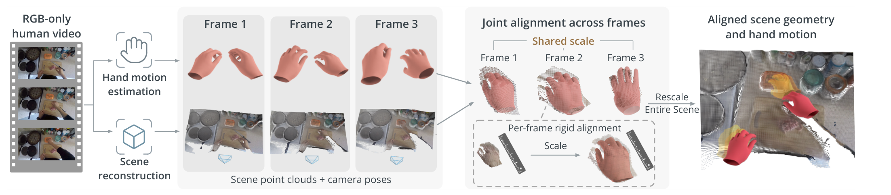
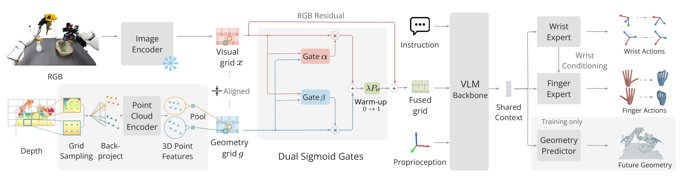

# Reconstruction-Augmented Visuomotor Pre-Training of 3D-Grounded Bimanual Dexterity from RGB-Only Human Videos

双手操作不只需要复现手的轨迹，还要知道两只手为什么在这个位置接近、交接或接触物体。SpatialDex把人类视频中的场景和手放回同一个三维尺度，再让策略同时学习动作与场景变化。值得复用的是这条监督链：重建几何既作为输入，也作为未来预测目标；手腕先决定接近轨迹，手指再据此决定接触动作。

论文：Xingyi He、Zhiwen Qiu、Adhitya Polavaram、Yunhao Cao等，Cornell University；2026-10-21首次提交。[arXiv:2610.29716v1](https://arxiv.org/abs/2610.29716v1) · [PDF](https://arxiv.org/pdf/2610.29716) · [项目页](https://spatial-dex.github.io/)。本文依据9页全文，提取覆盖全部页面，没有检测到附录。尚未确认公开训练代码与权重；本文也未独立训练或复现机器人实验。

## 人类视频的几何为什么必须和手动作一起校准

如果把单目深度直接接到手部重建结果上，会同时遇到两个问题。第一，场景重建只有相对尺度，而MANO手模型提供近似米制尺寸；二者不一致时，手的位置、物体距离与深度图会对同一动作给出矛盾监督。第二，第一视角相机在动，机器人实验使用固定相机；未来视频像素的移动混合了相机运动和真正的交互运动。

SpatialDex先沿用HaWoR恢复MANO手网格和腕轨迹，再用VGGT-Omega恢复场景深度与相机位姿。它把估计手网格投影成mask，用相机内参反投影mask内的深度点，再将这些点与手网格对应。关键区别在于：不是每帧独立求一个尺度，而是汇集跨帧、跨双手的对应关系，联合估计一个视频共享尺度及逐帧刚体变换。这个尺度同时用于深度和相机平移，才使几何与手动作维持同一度量单位（Sec. III-A，p.3）。

*图注：Fig 2 视频级共享尺度与逐帧坐标对齐，据论文原图；详见相邻正文的机制或协议解释。*

图2把尺度共享与逐帧刚体对齐分开画出。前者减少局部遮挡和某帧估计波动对尺度的影响；后者处理每帧坐标关系。共享尺度仍然借用了手尺寸先验，不能修复手模型本身的系统尺寸错误。

训练时，每个未来深度点集和腕轨迹还会用相机位姿转换到当前相机坐标系。手指关节则保留在各自手的局部坐标。这样，同一预测窗口的目标表达的是相对于当前观察的操作后果，而不是把相机摆动也学成腕运动。工程上，坐标变换顺序和相机平移的尺度必须一致；只缩放深度而不缩放相机平移，会重新引入跨帧矛盾。

## 怎样让几何进入已有VLM而不冲掉视觉先验

现在考虑一帧部署输入：当前RGB-D、标定、本体状态和语言指令。RGB进入PaliGemma的视觉编码器；深度在每个图像patch内按网格采样，用内参反投影为相机坐标系下的三维点。坐标保持米制，不做丢失距离尺度的归一化。Sonata联合编码所有有效点，再根据原始patch归属做平均池化，得到与视觉token一一对应的几何网格 $g$。无有效深度的patch输出零几何特征，RGB通路仍然存在。

直接拼接或相加会让未经训练的几何分支干扰已有语义表示。论文采用双门控残差（Eq.1，p.4）：

$$
f=x+\lambda P_o(\alpha\odot x+\beta\odot g),\qquad
\alpha=\sigma(F_\alpha([x;g])),\quad
\beta=\sigma(F_\beta([x;g])).
$$

$x$为视觉网格，$P_o$把更新投影回视觉维度；$F_\alpha,F_\beta$是MLP，$\sigma$是sigmoid，$\odot$为逐元素乘法，$[x;g]$为通道拼接。两个门不要求和为1，因此不是在RGB和几何之间做概率竞争，而是分别控制二者对残差更新的贡献。外层仍保留原始 $x$，使新分支可以逐步加入而非立即替换视觉先验。

$\lambda$在预训练前20,000步从0线性升至1，然后固定。实现上，这是控制新分支进入主干的时机，而不是把几何数据逐渐变准确。消融中去掉warm-up，六任务均值由73.1%降到68.2%；这个证据支持渐进注入在当前训练设置的作用，不能泛化为所有融合模型都必须采用相同步数。

*图注：Fig 3 几何输入、训练期预测与腕指专家，据论文原图；详见相邻正文的机制或协议解释。*

图3中底部几何分支和上部RGB分支在同一token网格汇合。右下未来几何预测器只用于训练，而右侧腕、指专家属于动作输出路径。把两者区分清楚，才能理解部署节省了什么、仍然依赖什么。

## 先预测腕再预测指，几何只在训练时预测

有了几何输入，动作损失仍可能让模型走强RGB通路的捷径。论文因此从共享上下文 $c$预测未来各patch的三维点集，以显式要求表示保存空间结构。对未来偏移 $\delta$、patch $i$，预测为 $\hat P^i_{t+\delta}=F_{\rm geom}(c,i,\delta)$，目标由同样的采样与坐标变换生成。损失按有效点集的对称Chamfer距离平均（Eq.2–3）：

$$
\mathcal L_{\rm forward}=\frac1{H N_{\rm patch}}
\sum_{\delta=1}^{H}\sum_{i=0}^{N_{\rm patch}-1}
 d(\hat P^i_{t+\delta},P^i_{t+\delta}),
$$

$$
d(A,B)=\frac1{|A|}\sum_{a\in A}\min_{b\in B}\|a-b\|_2^2+
\frac1{|B|}\sum_{b\in B}\min_{a\in A}\|b-a\|_2^2.
$$

$H$是预测跨度，$N_{\rm patch}$是单帧patch数，$A,B$为预测和真实有效点集。双向最近邻项防止只覆盖目标的一小部分；它匹配几何集合，不要求恢复每个点的物理身份，也不提供接触力或刚体动力学保证。主实验配置报告未来几何偏移 $\delta=16$，不能仅凭一般公式认定实现对每个偏移都使用相同采样密度。

动作则按腕和指的难度及具身差异拆开。人类腕运动更容易估计和跨具身迁移，手指受遮挡、关节拓扑和接触约束影响更大，因此让手指看见双腕的未来计划，而不只看当前观察（Eq.4）：

$$
p(A_w,A_f\mid c)=p_w(A_w\mid c)\,p_f(A_f\mid A_w,c).
$$

$A_w,A_f$分别包含两只手的整段腕、指动作。两个专家均为扩散Transformer，先采样双腕轨迹，再用这段轨迹和共享上下文生成手指动作。这是预测动作之间的条件分解，不是把真实未来腕轨迹作为部署输入。预训练和微调都联合优化腕去噪损失、加权手指去噪损失及上述几何损失：$\mathcal L=\mathcal L_w+\lambda_f\mathcal L_f+\lambda_g\mathcal L_{\rm forward}$。两个权重控制目标间取舍，本文不补写原文未明确的数值。

预训练使用1M段人类视频，来自Something-Something v.2、EPIC-Kitchens-100、Ego4D和Ego-Exo4D，32张A100约72小时，总batch256。目标机器人仍需示范微调：传感器深度沿相同编码路径，具身专属投影和归一化层转换动作，缺失维度mask掉。部署移除未来几何预测器和人类视频重建流程，但继续读取RGB-D与标定。动作块长16，去噪5步，在5Hz下先执行8步再规划（Sec. III-C、IV-A，p.5）。

## 主榜提升与匹配预训练对照分别说明什么

仿真每任务100条训练示范，九任务跨Allegro–Franka和Wuji–Tianji，其中前四个Allegro任务为单臂。每方法、任务评测三seed，每seed50回合；成功判据为允许时间内完成任务。真机为六项Wuji–Tianji任务，每任务50条示范、每方法10次测试。不能把所有九项仿真都称为双臂任务。

**图表占位：Table I**  
建议位置：本节仿真主榜协议之后。  
放置原因：保留九任务与不同具身的分组均值，避免被总均值掩盖失败任务。  
当前状态：已检查p.6完整源页并核对表体，但提取器未提供独立匹配候选，保留占位。

| 对照 | 九任务仿真均值 | 真机六任务成功次数 |
|---|---:|---:|
| ACT | 41.1% | 22/60 |
| iDP3 | 23.8% | 8/60 |
| π0.5 | 59.8% | 26/60 |
| VITRA | 36.5% | 22/60 |
| SpatialDex | 76.3% | 49/60 |

**图表占位：Table II**  
建议位置：本节真实成功次数比较处。  
放置原因：显示每项只有10次尝试及六任务真实分布。  
当前状态：已核对p.6全文与原表；无独立可审查候选，保留占位。

真机49/60对应81.7%，π0.5为43.3%，提升约38.3个百分点；不是相对提升38.3%。SpatialDex逐任务为8、8、9、8、7、9次成功。公开checkpoint的方法用相同下游示范和初始化测试，但预训练语料和计算并未全部匹配，主榜不能把差值单独归给几何设计。每任务十次也不足以证明跨环境稳定优势的精确幅度；论文没有给出这一结论所需的完整置信区间。

更有归因价值的是Table III。它选取六项仿真任务，保持人类视频、腕指目标和预训练预算一致，比较运动预训练与完整几何预训练；下游微调时各变体都采用相同RGB-D架构、示范、目标和优化计划，新引入几何模块初始化匹配。因此这里的58.9→73.1可以解释为“预训练时额外引入几何输入与几何目标这一组合”的收益，不能再细拆成某一个模块的全部效果。

**图表占位：Table III**  
建议位置：本节匹配预训练和组件比较处。  
放置原因：它将数据预训练、尺度对齐、输入、监督与腕指分解分开检验。  
当前状态：p.6完整表体已核对，未取得独立匹配图像候选，保留占位。

| 六任务变体 | 平均成功率 |
|---|---:|
| 不做人类视频预训练 | 45.6% |
| 同视频、同预算运动预训练 | 58.9% |
| 逐帧独立对齐 | 63.8% |
| 无forward dynamics损失 | 65.1% |
| 单一腕指专家 | 67.8% |
| 无腕轨迹条件 | 69.3% |
| 完整SpatialDex | 73.1% |

去掉未来几何损失仍保留几何输入，损失8.0个百分点，支持额外监督确有作用；“RGB-only input”变体仍保留未来几何监督却仅36.8%，说明仅有预测目标不能替代实际几何观察。逐帧对齐损失9.3个百分点，双专家和腕条件分别提供不同控制因素。这里的73.1与主榜76.3分母不同，不能作为模型重跑不稳定的证据。

## 迁移代价、失败任务与可复用设计

主榜也给出必须保留的反例：Pick Bucket为79.3%，低于π0.5的84.0%；Bimanual Assembly虽从5.3%升到16.7%，绝对成功率仍很低。真机最难的Sweep Trash为7/10，仿真同名任务是另一个任务。总体提升不等于所有精细接触已解决。

作者明确承认手估计、手尺寸、相机运动和场景重建误差会进入监督，共享尺度只能缓解，不能消除。部署深度质量和新机器人示范仍是前提。我的分析是，最适合迁移的是“尺度统一→米制几何编码→受控注入→任务相关预测→动作条件分解”的设计链，而不是把RGB视频直接称为可执行机器人数据。复现应先验证三维坐标和动作单位，再做同视频、同预算、同RGB-D微调的对照；如果换成无深度平台或新的手型，需要重新检验感知接口与动作适配，本文没有提供零样本保证。
