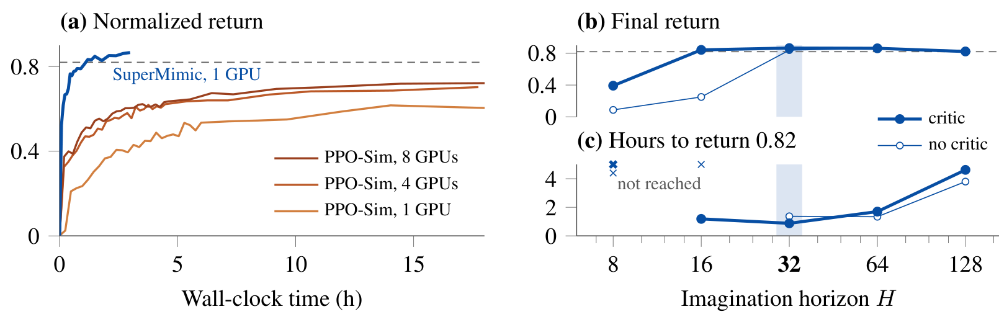
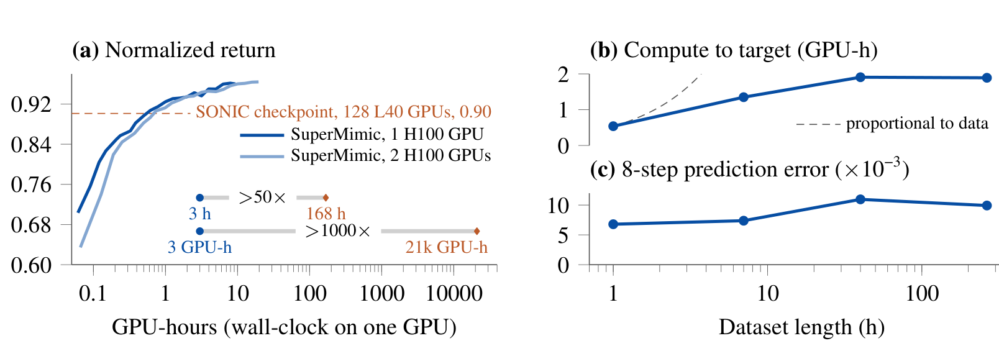
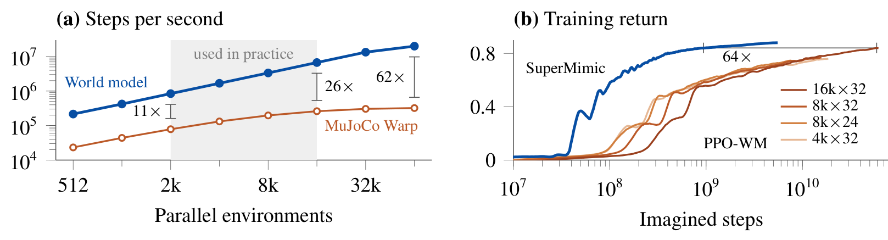

# SuperMimic: Scaling Humanoid Whole-Body Control with One Differentiable World Model

大动作库上的人形跟踪并不需要为每段动作重新学习身体动力学。SuperMimic把这一共享结构变成训练接口：从普通刚体仿真器采集转移，学习可微代理，再沿想象轨迹对策略求梯度。它同时获得更快的rollout和较低方差的策略更新；论文专门用两类消融把这两个收益分开。

Qiayuan Liao、Yiyang Shao、Junfeng Long等；[arXiv:2610.28480v1](https://arxiv.org/abs/2610.28480)，北京时间2026-10-21提交，[项目页](https://supermimic.github.io)。以下依据完整19页PDF，方法第4–6页、实验第6–9页，数据过滤和评测附录第15–19页。未确认可下载的训练代码或权重，本笔记未做训练或真实机器人独立复现。

## 为何把所有动作当作同一个动力学问题

模型无关PPO把环境视为黑箱，通过大量有噪动作与回报估计更新方向。动作库从走路扩到翻滚和舞蹈后，控制行为更多，但同一G1的惯量、关节与接触规律仍在重复。学习一套共享动力学，可把不同动作的转移都用来提高同一个代理模型。

这不是让MuJoCo本身变成可微。转移数据来自MuJoCo Warp的刚体前向仿真，神经代理提供预测和雅可比，actor通过代理的梯度优化想象回报。梯度对代理模型是解析的，对真实机器人回报并不自动无偏；模型误差和训练分布仍会影响优化方向。

*论文原图编号：Figure 2。采集、拟合世界模型、冻结模型更新策略轮流进行；冻结权重仍允许梯度穿过动力学传向actor。*

### 机制流程

1. 当前目标条件策略在刚体仿真中执行加噪动作，把实际执行动作、状态和每回合域随机化上下文存入固定容量回放池。
2. 抽取八步窗口，从记录初态开始沿已执行动作自回归，拟合状态转移以及奖励、观测和终止预测。
3. 从回放状态开始，在冻结代理中想象32步，重新加入传感器噪声；对短期回报和critic尾值反向传播，更新actor并训练critic。
4. 新策略回到原仿真器采集，把访问分布变化带回模型训练，循环提高覆盖，而非先离线训练一个模型后永远冻结。

动作是归一化关节设定值，目标默认来自参考动作，也可换成速度接口；跟踪奖励沿用BeyondMimic，但移除了自碰撞惩罚，复现时应保持这个差别。回放保存加噪后的实际动作很关键：如果误存未加噪命令，模型会把探索噪声误认为无法解释的动力学。

## 采集与想象必须保留不同的信息边界

代理以完整状态和仿真上下文$\xi$为条件，例如摩擦、标定偏移和躯干质心。已知随机源被显式条件化，世界模型因此可以保持确定性；无噪观测先由模型预测，外部再添加传感器噪声。部署actor只读取带噪本体观测和目标，不需要直接获得仿真上下文或真实接触力。

世界模型以$k=8$步自回归拟合。简化写出论文的目标为

$$
\mathcal L_{WM}=\mathbb E_{\mathcal B}\sum_{j=1}^{k}
\left[\|\hat s_j-s_j\|^2+(\hat r_j-r_j)^2+\|\hat{\bar o}_j-\bar o_j\|^2+\mathrm{BCE}(\hat d_j,d_j)\right].
$$

$s,r,\bar o,d$分别是状态、奖励、无噪观测和终止标签，帽号表示预测，$\mathcal B$是回放池。某个头如果由解析函数计算，就不添加相应学习损失。实施时要从真实窗口初态出发，让后续状态由模型自己递推，而非每一步都偷用真值。这训练了模型处理自身短期误差，但不构成任意长预测稳定的理论证明。

终止头输出概率而非硬开关，使生存权重$\hat c_{t+1}=\hat c_t(1-\hat d_{t+1})$保持可微。由此倒地风险能沿梯度影响先前动作，而不会在离散终止点直接切断全部信息。

## 怎样让短期梯度看见长期恢复收益

仅最大化有限窗口内的跟踪分数，可能学到短时不跌倒却一直踉跄的策略。作者用critic估计想象窗口之外的收益：

$$
\hat J(\theta)=\mathbb E\left[\sum_{t=0}^{H-1}\gamma^t\hat c_t\hat r_{t+1}
+\gamma^H\hat c_HV_\psi(\hat s_H,g_H,\xi)\right],\qquad H=32.
$$

$\theta$是策略参数，$\psi$是价值网络参数，$g_H$是末端目标，$\gamma$为折扣，$\hat c$累计生存概率。BPTT穿过动作到下一状态的雅可比，把未来回报对早期动作的敏感度送回actor。critic用想象转移上的GAE回报训练，目标在该次拟合时固定；它不是从真实硬件获取的长期价值标签。

这使模型只需在短想象尺度足够准确，同时用尾值缓解截断。八步拟合和32步优化的窗口并不相同，复现时不能无声把二者都改成同一长度。数据采集使用4096并行环境/每GPU、回放每环境1000步，reset混合均匀、低回报优先和历史困难度，避免已经学会的动作挤掉困难片段。

*论文原图编号：Figure 4。左侧比较匹配任务的仿真PPO，右侧观察有无critic及想象时域；训练回报和全库checkpoint评测回报不是同一统计量。*

无critic在$H\le16$时训练失败；有critic的16步可接近无critic的32步，默认32步最快达到0.82。把64延长到128步近乎使达标时间三倍，并降低最终回报。更长rollout不自动更好，既增加计算和显存，也扩大代理误差传播范围。静态T姿态推扰下，有critic约0.5–2.4秒恢复；无critic即便轻推也持续踉跄。这比只看名义跟踪回报更能说明尾值的作用。

## 计算效率的三层证据

最醒目的对比是单H100约三小时超过SONIC发布checkpoint的回报，而SONIC报告128张L40训练七天。训练循环成本包括采集、世界模型与策略更新，但不含事后checkpoint评测。SONIC训练611小时动作，SuperMimic用264.56小时公开子集；两者GPU峰值性能也不同。因此GPU小时倍率是跨系统报告的参照，不是相同硬件、数据和实现下的纯算法加速。

*论文原图编号：Figure 3。左侧对照发布checkpoint，右侧观察数据量增大时的目标计算量和八步误差；两种论证需要区分。*

更强的控制证据来自LAFAN1的40片段、2.45小时数据：PPO-Sim共享观测、奖励、终止、域随机化、actor/critic规模与评测合同。SuperMimic单GPU1.2小时达到0.82，PPO-Sim在18小时预算内未达标，最终一/四/八GPU回报约0.60/0.70/0.72。并行环境数仍不同，PPO超参沿用BeyondMimic，这不是对所有可能PPO调参的穷尽。

*论文原图编号：Figure 5。左侧测同一50Hz控制步的前向速度，右侧在世界模型中比较解析更新与PPO，分别说明吞吐和样本更新效率。*

常用并行规模下代理比MuJoCo Warp快十倍以上，64k环境最大约62倍。PPO-WM也使用这个快速模型，但达到其最好训练回报所需想象步约是SuperMimic的64倍。因此收益不能全归为“换了一个更快仿真器”。这些图未报告训练种子方差，作者称重复训练稳定，读者仍缺少误差条判断小幅差距的可靠性。

## 零失败和真机示例各自证明什么

142,220原始动作经名称与可行性筛查，留下129,514个平地可执行参考。过滤删除楼梯、箱子、椅子等外部支撑动作及明显悬空、穿地参考。两方法在同一个筛选训练集上每动作从首帧确定性跑一次，无随机化、无观测噪声，但各自保留训练时的增益和动作尺度，失败采用SuperMimic终止合同。

| 策略 | 筛选训练动作失败数 |
|---|---:|
| SONIC发布checkpoint | 179 / 129,514 |
| SuperMimic，1 H100×3小时 | 25 / 129,514 |
| SuperMimic，2 H100×9.8小时 | 0 / 129,514 |

零失败说明该训练动作集的覆盖，不是未见动作泛化，更不是带噪真实环境的失败概率为零。真实G1展示跳步、侧滚、90度翻转及原地360度翻转，证明具有物理部署实例，但没有给出大规模真实试验失败率。

作者明确限制为仿真转移学习、平地且无物体交互。下游速度编码器在672种指令响应中650种误差更低，但每策略一个种子，且速度奖励只更新编码器、不更新共享decoder；所谓并发训练未被证明优于事后接入。我的分析是，最值得先复现的是PPO-WM和critic推扰消融，再改变域随机化强度检查代理梯度是否仍可靠。尚不能确定地形、外物接触和真实系统误差会如何改变这一效率优势。
