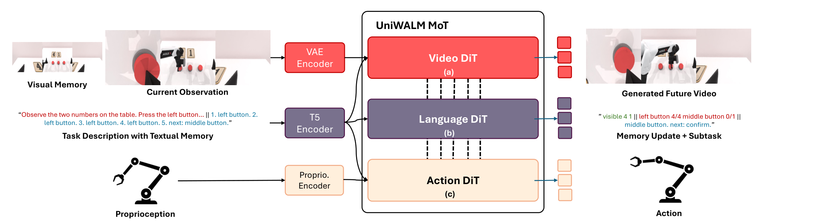
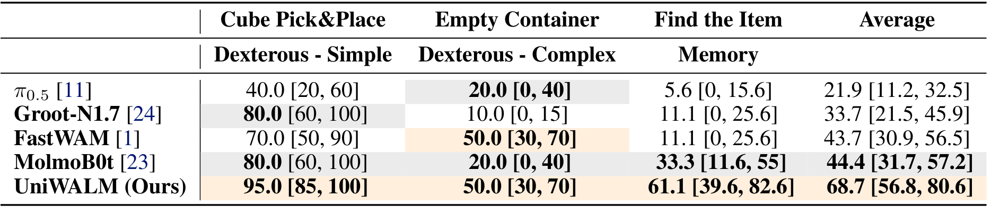
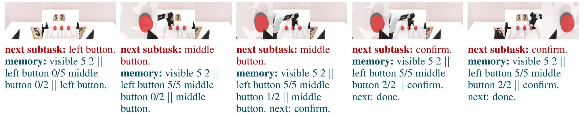

# UniWALM: Unified World Action Language Model for Embodied Robot Control

动作策略可能看得懂当前场景，却忘记已经按了几次按钮、试过哪种组合。UniWALM把语言从固定条件扩展为生成目标：语言与动作同步去噪，输出的子任务和文本状态再进入下一次查询。它想让任务层预测与逐帧预测共享表征，但训练中的联合视频生成和部署时实际运行的路径需要分开理解。

Rahul Sajnani、Diego Romeres等；[arXiv:2610.28626v1](https://arxiv.org/abs/2610.28626)，v1首次提交北京时间2026-10-21 01:59:04。本文依据完整25页PDF，主要机制第4–7页、结果第8–12页，记忆实现和失败附录第17–25页。未核实官方公开代码与权重，未运行训练或真机复现实验。

## 语言为什么需要进入动作生成内部

WAM让视频与动作共同学习，视频监督可以表达局部几何和运动，却不容易用下一帧图像保存“左按钮已经按四次”这样的符号状态。另加一个自回归规划器可以输出子任务，但动作要等待它生成，而且规划器和动作模型未必共享表征。

UniWALM在Wan2.2视频DiT旁添加动作与语言DiT，三者均30层，分别以自身QKV投影后把token拼接做统一自注意力，再对指令和本体状态交叉注意力。动作专家约1B、语言专家约0.5B，从头初始化；视频模型和指令T5编码器仍有预训练，所以“无预训练语言生成/推理模型”不表示整个系统从零学习语言或视觉。

*论文原图编号：Figure 2。语言、视频与动作专家在训练中交换特征；部署关闭未来视频输出，当前观测仍通过视频路径编码。*

语言采用离散扩散，对真值文本按噪声时间随机替换token，以交叉熵恢复目标，不是先逐token生成长思维链再开始动作。视频和动作则回归flow速度，训练总目标为

$$
\mathcal L=\mathcal L_{video}+\mathcal L_{action}+\alpha\mathcal L_{lang}.
$$

前两项使用速度误差的$\ell_1$范数，第三项是离散token交叉熵，$\alpha$调节语言监督强度。实现时三种输出对共享表示同时施加梯度；语言的子任务监督提供时间更长的任务信号，动作损失把它约束到实际执行。主实验同时改变语言、FMC和LoRA，不能仅凭总榜把所有收益归给语言。

## 同步生成与跨步记忆是两件事

单次查询会输出语言，不代表跨步保存了记忆。UniWALM明确把生成串“子任务∥文本记忆”重新作为下一步prompt；这才形成历史循环。RMBench额外保存一张回合起点视觉锚，并在动作向量末尾增加一维完成信号$\beta$。只有子任务完成时才提交记忆，防止中间动作反复改写已完成计数；$\beta$随动作损失共同监督。

### 机制流程

1. 当前RGB、本体状态、任务指令和上次文本进入三专家共享注意力，联合产生动作块、子任务及新记忆候选。
2. RMBench使用固定初始视觉锚与完成通道，在子任务边界更新文本；锚保存图像布局，文本保存计数、尝试和阶段。
3. 训练动作专家时混入局部扰动的纠偏flow目标，并用LoRA调整大视频骨干，保留其视频先验。
4. 部署关闭未来视频输出，动作与语言同步去噪执行；下一步重消费语言，真实实验不启用视觉锚或完成通道。

最后一点是重要协议差别。真实Find-the-Item为了与基线输入一致，没有锚帧和$\beta$，记忆只来自生成文本；RMBench的34.5%则是在锚、文本、完成门控结合下得到。不能把两个结果描述为完全相同的一套记忆配置。

## 纠偏流匹配怎样改变训练路径

常规flow用$ x_t=(1-t)x_0+t\epsilon$连接干净动作$x_0$与噪声$\epsilon$，目标速度为$\epsilon-x_0$。FMC先对动作加扰动$\epsilon_1$，构造$x_t^p=(1-t)(x_0+\epsilon_1)+t\epsilon$，要求一次反向步长$\Delta t$后回到干净轨迹对应点：

$$
v_{corr}=\frac{x_t^p-x_{t-\Delta t}}{\Delta t}
=(\epsilon-x_0)+\frac{1-t}{\Delta t}\epsilon_1.
$$

$t=1$是噪声端，$\Delta t$是纠偏步长。新增项直接抵消偏离，不只是照常从扰动样本去噪；当扰动为零时恢复标准目标。训练以概率0.5在$t\ge0.5$启用纠偏分支，避免接近干净端时注入偏差过强。它没有增加部署网络容量或采样次数，但这仅指FMC本身，不能推广为添加语言专家也没有推理开销。

FMC是动作生成空间的局部恢复，不是机器人跌倒后的真实恢复数据收集，也不是用于减少采样步数的一致性蒸馏。其稳定性和收益仍依赖扰动尺度、纠偏时间与训练分布，不能保证分布外任意错误都会回到正确动作。

## 哪些实验隔离了语言和记忆收益

MolmoSpaces使用221K轨迹，五任务各1000个OOD回合；三个组合放置任务对FastWAM平均提高约14.8个百分点，但短抓取Pick/Pick-RandCam低于部分MolmoBot模型，303步预算可能不利于更慢的执行轨迹。平均“更会推理”不能替代每任务时间合同。

38K Pick&Place子集的逐步消融更便于归因：相同基础模型31.0%，加语言35.9%，再加FMC38.9%，再用LoRA41.0%。这是递增方案，说明整套设计的不同环节都有效；不能把主榜全数据68.0%和这个单任务41.0%当同条件结果比较，也没有隔离自回归与扩散语言解码范式。

RMBench每任务50示范、100回合，四个记忆任务均值34.5%，FastWAM13.3%，Mem-0带关键帧28.5%；同期WLA-0更高。UniWALM不使用每任务特权历史关键帧，但仍有初始锚，因此“更少输入”不能改写为“没有视觉记忆”。

**图表占位：Table 5**  
建议位置：本节Press Button记忆消融处。  
放置原因：分开文本、视觉锚与训练时长，避免把100k训练收益全归给模块。  
当前状态：未得到独立完整表格候选，保留占位；数值由原文核实如下。

30k更新时，仅锚约1%、仅语言15%、两者18%；两者延长到100k为51%。从18到51包含训练预算变化，不能与前面等预算模块差异混算。RMBench使用单独训练的检查点，100k更新约36小时、10个H100节点；主MolmoSpaces训练报告12个节点、每节点8张H200、44小时。这也不是一个检查点未经任务训练就完成所有基准。

*论文原图编号：Table 2。两项灵巧任务各20次，记忆任务18次；百分比旁保留95%区间，小样本不确定性不能忽略。*

Find-the-Item遮住物品后再查询，FastWAM2/18、11.1%，UniWALM11/18、61.1%，后者区间约39.6–82.6%；MolmoBot6/18、33.3%。Cube Pick&Place达到19/20，Empty Container10/20与FastWAM相同。跨任务平均68.7%是任务宏平均，不能作为58个回合的简单成功占比。

## 部署成本与记忆正确但动作错误的边界

未优化计时中，生成32步动作、十步去噪时，无语言76ms、有语言123ms；完整配置另报告20步推理，不能把十步时延套到全部实验。部署没有生成未来RGB，是沿用视频训练先验的动作与语言策略，不是每次都先完整模拟未来再决策。

*论文原图编号：Figure 12。文本记忆已读作中间按钮2/2，实际动作仍额外执行一次；生成记录正确不足以保证物理执行正确。*

作者报告完成信号时机偏移、相似观测下子任务混淆、复杂物体抓取与推理速度四类限制。我的分析是，最值得复现的是等预算Press Button消融，并把文本状态与物理谓词逐步对齐：更新早晚一拍会把一个正确计数器变成错误控制器。还应对文本误写后的恢复、长期记忆压缩和新任务字符串做测试。当前证据支持特定任务上的共享语言监督与记忆收益，不证明任意语言推理能力或长程任务普遍可靠。
