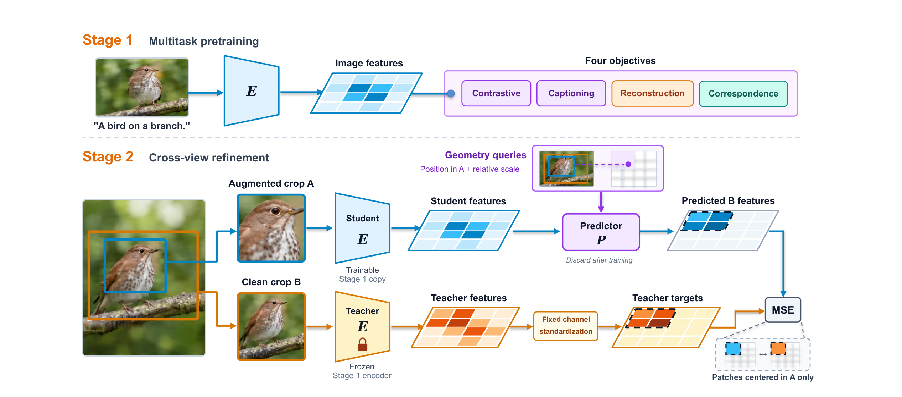
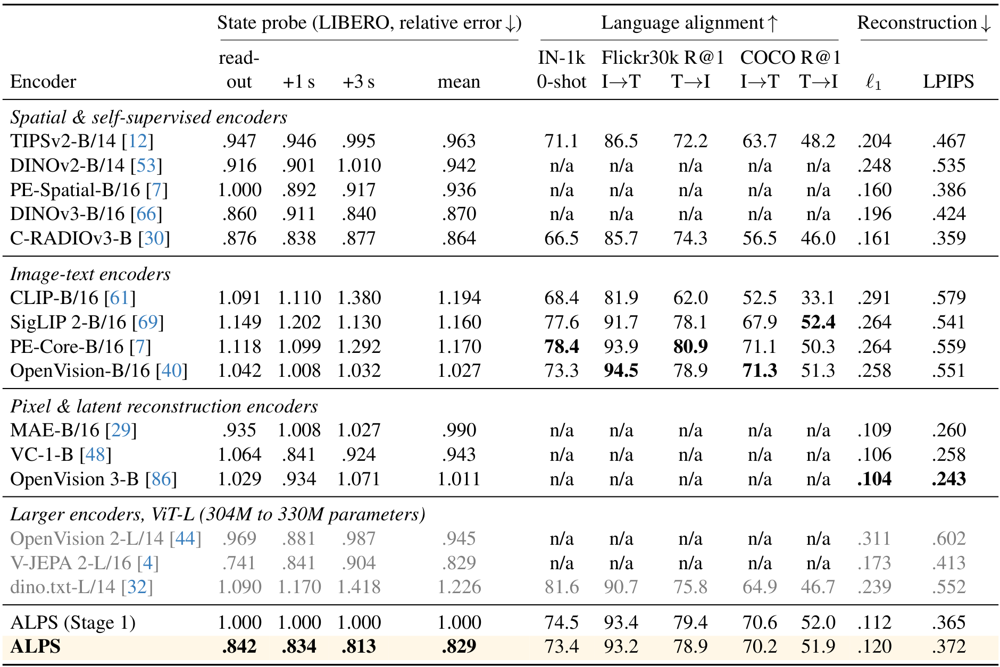
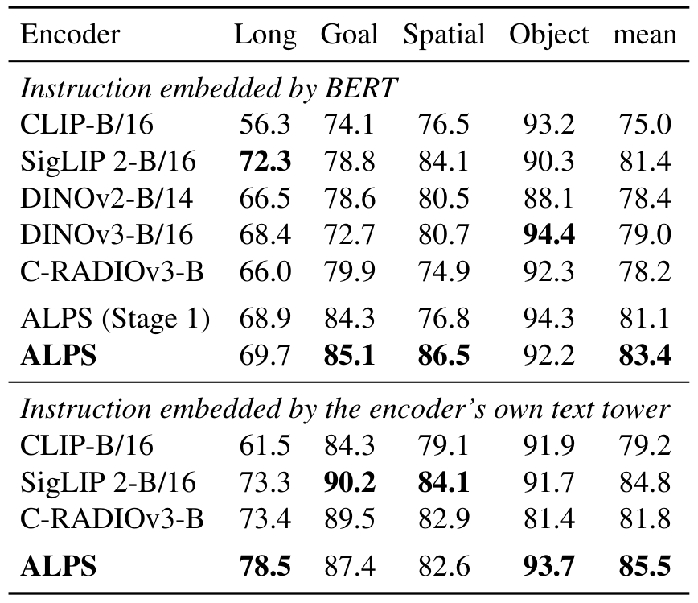
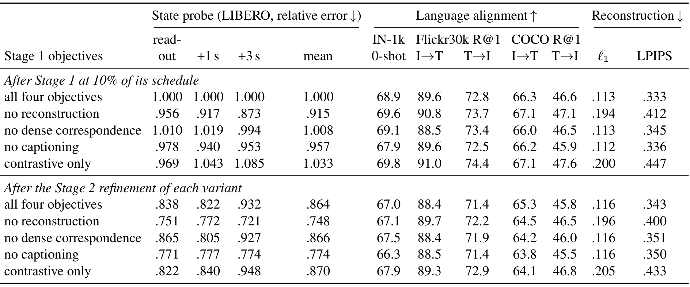

# ALPS: Visual State Encoders for World Models

世界模型在视觉词元 中预测未来，编码器丢失的信息会成为后续规划的天花板。ALPS 希望同一组冻结 patch token 既携带物理状态，又能对齐语言，还能解码为图像。它把问题前移到视觉预训练，通过静态图文多任务学习和跨裁剪细化，提供下游动态模型可使用的状态接口。

中文题名：面向世界模型的视觉状态编码器。方法论文；作者 Yanqing Liu、Letian Zhang、Chengzhi Liu、Zijun Wang、Jieru Mei、Hongliang Fei、Yuyin Zhou、Cihang Xie。[arXiv:2610.30120](https://arxiv.org/abs/2610.30120)，北京时间 2026-10-22 首次提交；[项目页](https://ucsc-vlaa.github.io/ALPS/)、[GitHub](https://github.com/UCSC-VLAA/ALPS)、[权重入口](https://huggingface.co/UCSC-VLAA/ALPS)。依据 35 页全文及补充材料；没有独立训练或机器人复现。

## 世界模型首先受限于视觉状态

语义编码器可以知道“杯子在桌上”，却未必精确保留杯子相对夹爪的位置；重建编码器保留像素，却不一定形成方便语言指令和动力学预测使用的表示。作者将状态可读出、语言可查询、像素可恢复视为三个互相约束的接口。ALPS 本体是 ViT-B/16 编码器，不是已经学会动作条件动力学的完整世界模型。

一张图进入编码器后形成 patch tokens，下游可以分别连接小状态探针、机器人行为克隆策略、动态预测器或评估解码器。实验刻意冻结视觉编码器，观察每种接口能提取什么；因此状态探针的准确度、策略成功和规划表现不能互相替代。

## 四种目标为何需要共同训练

第一阶段从头训练图像与文本编码器，同时优化图文对比、描述生成、像素重建和跨裁剪稠密对应。网络描述与合成描述的随机句子分别进入对比目标，避免两段描述互为假负样本；完整合成描述用于描述解码器。重建覆盖干净和带噪 latent，组合 L1、SSIM 和梯度项，稠密对应则监督局部位置匹配。

论文的目标可概括为

$$
\mathcal L_1=\mathcal L_{\mathrm{itc}}+\mathcal L_{\mathrm{cap}}+w_{\mathrm{rec}}\mathcal L_{\mathrm{rec}}+0.25\mathcal L_{\mathrm{dense}}.
$$

四项依次对应图文对齐、描述生成、像素恢复和局部对应，$w_{\mathrm{rec}}$ 为重建权重，低分辨率阶段取 2，较高分辨率阶段取 1。这样设置是为了让同一表示接受不同接口的约束；它不保证四项都能同时改善状态指标，后面的消融正好检验这种取舍。

数据来自 DataComp，128 像素阶段累计 12.8B 次样本呈现，224 像素阶段再呈现 1.0B 次。累计呈现次数不是不同图像数量。训练完成后丢弃描述生成、重建和稠密对应头，保留编码器与文本接口。所谓没有外部视觉教师，是没有外部视觉特征蒸馏；合成文本仍携带生成描述的模型的间接知识，不能写成完全没有外部先验。

*图 2：第一阶段建立三类接口，第二阶段只在同一图像的重叠裁剪区域匹配冻结教师特征。*

## 跨裁剪教师怎样改善状态

第二阶段复制第一阶段编码器作为学生，同时固定第一阶段教师。教师读取干净裁剪，学生读取经过光度增强的裁剪。四层预测器除学生词元外，还读取教师裁剪块中心在学生裁剪坐标系内的位置和相对尺度，预测对应教师特征。这里的几何是二维裁剪位置与尺度，不是三维状态监督。

核心损失可用实现等价的形式表达为

$$
\mathcal L_2=\frac1{|\Omega|}\sum_{j\in\Omega}\left\|P(E_s(A),q_j)-\operatorname{std}(E_t(B)_j)\right\|_2^2.
$$

$E_s$ 是可训练学生，$E_t$ 是固定教师，$P$ 是预测器，$q_j$ 含二维位置与相对尺度，$\Omega$ 只包括中心落在 A 内的 B patch。$\operatorname{std}$ 使用预先统计的每通道标准化量，不是不断更新的 EMA 教师。至少要求 16 个有效 patch，不足时重采样，最多十次后使用相同裁剪。这一掩码很关键：模型没有被要求猜测不可见的新区域，更没有直接学习未来视频。

第二阶段采样五百万张单图，来自整理后的图像编辑数据，但不用编辑对或编辑指令作训练目标；不使用真实视频，允许少量合成视频帧与仿真图混入。batch 1024、4883 步，编码器学习率 1e-5，预测器 1e-4。最终丢弃预测器并保留第一阶段文本头。工程上得到的是冻结视觉状态编码器，仍要单独训练动作条件预测器。

## 冻结接口如何分别接受检验

状态探针读取 16 帧特征，当前状态读出不需要未来动作，+1 秒和 +3 秒预测则提供未来动作。探针是约 2.5M 参数的两层网络，测量 object/spatial 六种设置的相对位置误差，以第一阶段 ALPS 为 1。表 1 的 0.829 是归一化误差，不能称 0.829 厘米。

*表 1：不同接口同时比较；n/a 表示缺少发布的文本头，不是语义能力为零。*

ALPS 综合相对状态误差 0.829，对照 C-RADIOv3 0.864、DINOv3 0.870；较大 V-JEPA 2-L 也为 0.829。后者当前读出更强，ALPS 较长预测更好，因此不能宣称每个状态子项都最好。绝对聚合误差 ALPS 1.280 cm，V-JEPA 2-L 1.277 cm，也支持这种接近而互补的解释。

像素恢复给每个冻结编码器训练相同类型的轻量 SDXL latent 适配器，19000 张训练、1000 张验证图像。ALPS L1 为 0.120、LPIPS 为 0.372，低于许多非重建编码器，却不及 MAE 的 0.109/0.260 或 OpenVision 3 的 0.104/0.243。评估解码器属于另一个训练接口，不能把这张表理解为编码器自带无成本渲染。

LIBERO 每任务 50 段示范，在冻结视觉词元 上训练 transformer 行为克隆策略。BERT 指令下 ALPS 平均 83.4，对照 SigLIP 2 为 81.4；原生文本头为 85.5 对 84.8，仅 0.7 个百分点。主表是同一训练策略的三次评估，不是三个独立训练种子；补充材料另外做的独立训练重复不能与主表方差混用。

*表 2：固定视觉接口下的策略表现；BERT 与各模型原生文本头是两组协议。*

世界模型实验另外训练匹配动态预测器并用 CEM 规划。ALPS 在 PushT 90、Wall 92 与最强对照持平，Granular Chamfer 0.176 最好；Rope 0.750 却弱于 C-RADIO 的 0.558，Reacher 78.7 也低于 DINOv3 的 86。语言策略与世界模型规划是分开的实验，尚未展示一个统一语言条件规划器覆盖所有任务。

## 多接口收益伴随真实取舍

第一阶段 10% 预算消融是最容易被摘要隐藏的反例。经第二阶段后，保留所有目标的状态误差 0.864，移除重建反而降到 0.748，但像素 L1 从 0.116 恶化到 0.196。移除描述生成目标 也能改善该状态分数。作者保留全配方，是接受少量状态代价换取像素和语义接口，不是所有辅助任务都提高状态精度。

*表 5：每个变体只使用第一阶段十分之一预算；跨指标取舍比单列最优更能解释全配方。*

稠密对应在全局状态和检索分数上的作用不大，却提高直接 patch 匹配：第一阶段完整目标 37.4%，去除后 31.4%；第二阶段 40.8% 对 38.2%。这说明检验某个训练目标应选择它直接约束的接口，不能用不敏感的指标否定其全部价值。

## 从仿真表征到机器人还缺什么

论文展示静态图文训练可以支持动作条件预测所需的信息，但没有真机实验，主要研究一个 ViT-B 规模，跨编码器预训练计算也不完全匹配。作者承认单图训练对时序任务有局限。我的分析：ALPS 适合作为可替换的视觉底座，先用匹配下游训练验证状态、语义和像素三项，而不是直接假定它会提高任何 VLA。

尚不能确定的是，精细接触、遮挡历史和真实传感器噪声下，这种冻结状态接口能否保留同样的取舍；还需要控制训练预算并在真实闭环上验证。复用时应同时保留原始 patch tokens、文本头与单独训练的解码接口，明确每项指标对应哪个训练阶段。
