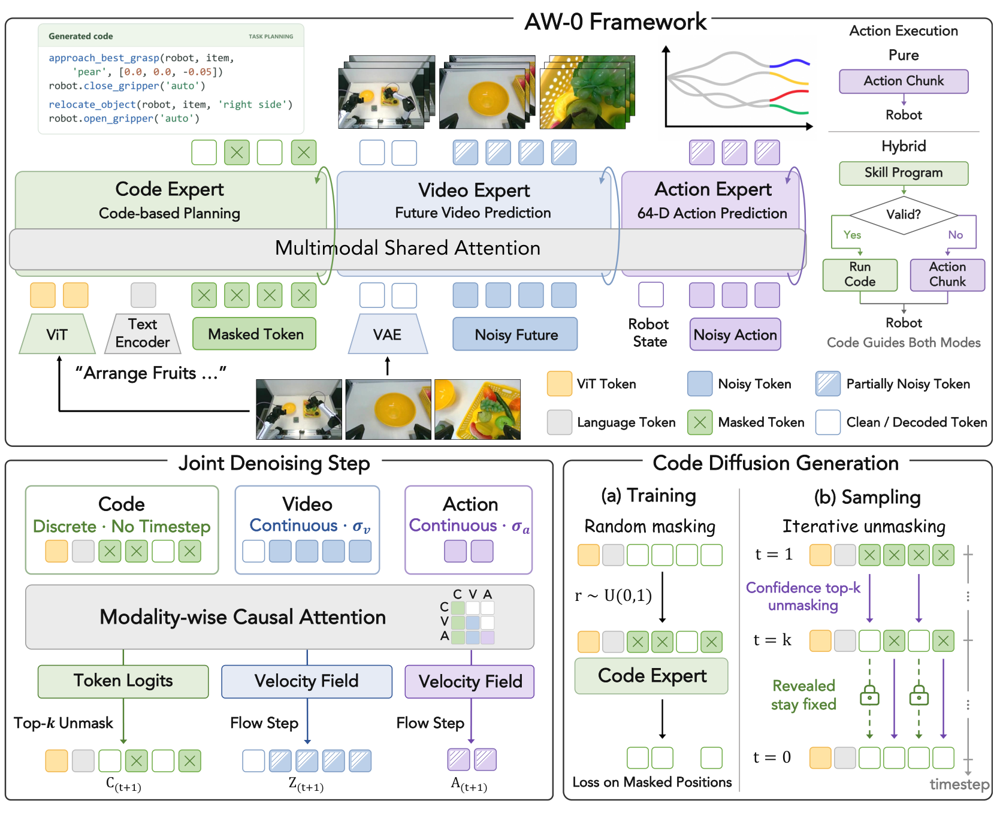
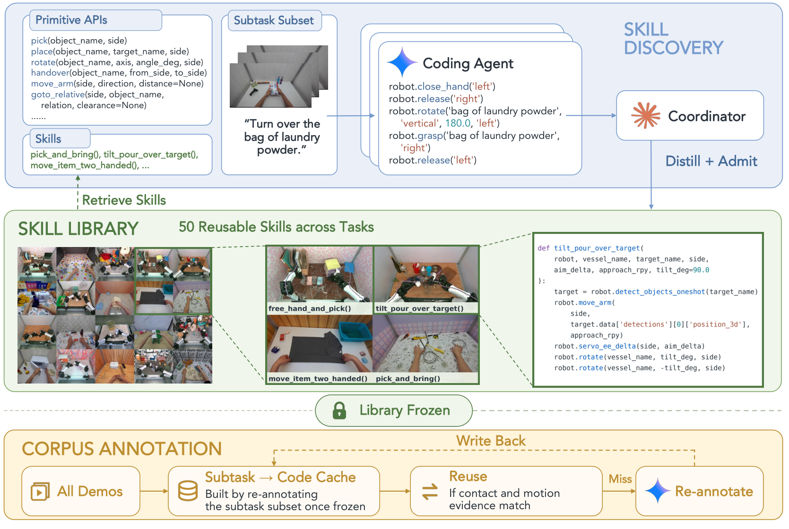
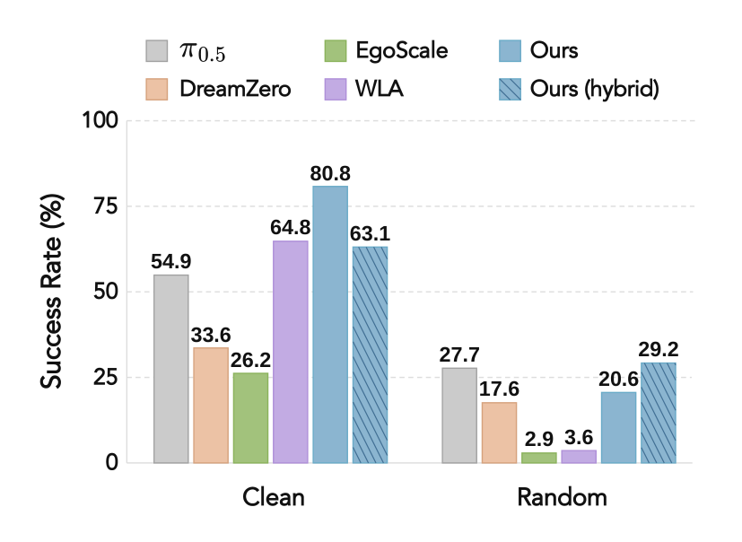
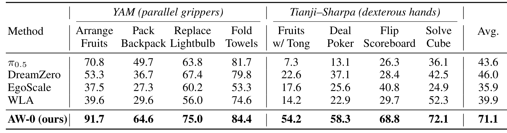
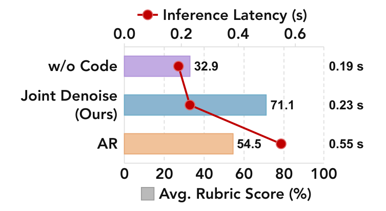

# Agentic World Action Models

一个动作模型可以准确预测手臂接下来怎么动，却未必知道当前处于任务哪一步。AW-0 把可解释的技能程序、未来视频和连续动作放进同一个生成过程，让程序成为动作的条件，而不必每次都先完整生成程序再调用另一个控制器。理解这项工作，关键是区分“代码参与规划”与“机器人真的执行代码”两条路径。

论文类型：方法论文；中文题名：智能体式世界动作模型。作者：Zhuoyang Liu、Dantong Niu、Botong Zhang 等。来源：[arXiv:2610.30136](https://arxiv.org/abs/2610.30136)，2026-10-22 北京时间首次提交；[项目页](https://agentic-wam.github.io/)。以下依据全文 50 页，包括配置、评分规则和混合执行附录；没有独立复现实验。

## 为什么让代码参与动作生成

直接视觉动作策略把任务意图压进连续隐状态，长任务中很难显式追踪“抓住、移动、放开”的依赖。先生成完整程序再执行则暴露另一个问题：程序串行解码增加等待，而且高层计划可能与低层接触状态脱节。作者选择同时生成三种粒度：代码表达子任务，视频提供可能的物理演化，动作给出可执行控制量。代码因此首先是一种结构化监督和条件接口，不是默认的机器人程序解释器。

以摆水果为例，输入包括多视角 RGB、语言指令、当前机器人状态以及此前的程序记忆。视觉编码提供物体与场景信息，历史代码帮助确定任务进度。模型从带掩码的代码画布、带噪声的视频 latent 和动作初始化开始，在同一轮迭代中更新三种输出，最终默认执行动作 chunk，再重新观测。图 2 的右上角另外画出可选 Hybrid 路径，不能把它与默认路径混为一谈。

*图 2：三专家共享注意力，代码、视频与动作联合去噪；右侧区分直接动作与混合程序执行。*

## 三种模态怎样在同一去噪步协作

骨干采用 Mixture-of-Transformers：不同模态保留自己的参数与表示，通过共同注意力空间通信。模态间使用块因果顺序 $C\rightarrow V\rightarrow A$，其中 $C$ 是代码、$V$ 是视频、$A$ 是动作。代码不读取未来视频与动作，视频读取代码，动作读取二者；每个模态内部允许双向注意力。这里的因果是信息可见性约束，并不意味着逐个未来动作自回归采样。

论文第 3 页把目标写为

$$
p_\theta(C_0,Z_0,A_0\mid O_t,L,S_t,M_t).
$$

$C_0$ 是最终程序，$Z_0$ 是未来视频 latent，$A_0$ 是动作序列；$O_t$、$L$、$S_t$、$M_t$ 分别是当前观测、指令、机器人状态和历史程序记忆，$\theta$ 是模型参数。下标 0 表示去噪终点。这个条件分布把三种输出绑定在同一决策上下文中；实现时仍要为离散代码预测词元 logits，为连续视频和动作预测流速度，不能把三者都当语言词元。

代码专家以 SDAR-1.7B 初始化，冻结词嵌入、归一化、前馈网络和词表相关部分，训练用于跨模态协作的投影和调制；视频专家来自 Cosmos-Predict2.5-2B，改用冻结 Wan2.2 VAE 并重新初始化相关输入输出投影；动作专家从头训练。视觉塔为冻结 Qwen3-VL-2B 视觉编码器，合并层可训练。三专家共 28 层，共享注意力宽度 2048，动作残差宽度 1024。不能把这种继承多个预训练组件的设置理解为从零学习全部知识。

训练中的代码独立随机掩码，视频和动作采用流匹配。为了兼顾预训练视频先验与控制所需的较干净视觉特征，视频噪声提议分布混合预训练分布与均匀分布，视频用重要性权重补偿，代码和动作用裁剪并归一化的相应权重。视频、代码、动作损失系数分别为 1、0.5、1。工程含义是：共享一次注意力调用，不等于三种模态必须使用同一种噪声或监督。

推理用 128-token 代码画布，逐步揭示高置信位置，已揭示位置保持固定，同时积分视频与动作。程序记忆压缩为可学习槽，训练时还混入预测历史以缓解部署偏差。动作统一为 64 维，覆盖双侧末端姿态、手指和夹爪，不适用的通道补零；RoboTwin 单独使用 14 维设置。末端动作相对 chunk 首帧，手指与夹爪采用绝对量，因此状态归一化和坐标约定都属于复现接口。

## 程序监督从哪里来

程序标注不是从动作中自然出现的。离线管线先让编码智能体依据基础 API 和少量子任务示范发现技能，再由协调者整合，最终冻结 50 个可复用技能，其中 YAM 23 个、人类示范 27 个。随后才批量标注完整语料。缓存复用要求接触和运动证据相符，不能只按相似语言复用；未匹配的片段重新标注并写回缓存。

*图 3：技能发现、冻结技能库和全语料程序标注是离线步骤，不能读作部署时自动扩展技能库。*

语料共 248642 段、2913.22 小时，其中 YAM 73101 段、1919.30 小时，人类 175541 段、993.91 小时。人类单头部视角复制到三个输入槽，不是三个独立摄像机观测。真机每任务 100 段示范微调 20 epoch；RoboTwin 用 50 任务各 50 段干净示范。我的分析：结构化程序监督的收益与这套标注、技能库和数据覆盖共同存在，不能把结果归因于“只增加程序词元”。

## 从联合输出到机器人执行

默认模式执行连续动作，代码只通过注意力影响动作。Hybrid 则先对代码进行阶段、依赖、语法、白名单与非空操作检查，通过才尝试执行；没有尝试代码时可以使用动作 chunk。一旦程序开始执行后抛出异常，同次预测的动作被丢弃，机器人重新观测并规划，而不是直接接着执行可能已过时的动作。这一点影响故障恢复和状态一致性。

附录中的真机混合模式只在 YAM 上验证。仿真混合模式还采用了不同来源的程序动作数据，因而它和默认模式的差异没有隔离出纯粹的执行器收益。有效代码也不等于物理操作成功：物体接触、几何定位和技能覆盖仍可能失败。

## 成绩的分母决定结论

RoboTwin 每任务在 clean 和 random 条件各评估 50 次。AW-0 得到 80.8% / 20.6%，平均 50.7%；π0.5 为 54.9% / 27.7%，平均 41.3%。平均分较高掩盖了随机条件下 π0.5 更强，不能称为所有分布都领先。Hybrid 为 63.1% / 29.2%，平均 46.2%，也不能用这一组数据宣称混合执行必然优于默认模型。

*图 4：clean 与 random 的差距很大，阅读平均值时必须同时保留两种条件。*

真机覆盖 YAM 平行夹爪与 Tianji–Sharpa 灵巧手共八任务，每任务 3 个训练种子、每种子 16 次，即 48 次 rollout。表 2 的指标是细粒度 rubric 部分得分，均值 AW-0 71.1、DreamZero 46.0、π0.5 43.6、EgoVLA 35.9、WLA 39.9。71.1 不能写成“任务成功率 71.1%”；例如完成中间阶段也可能获得部分分数。

*表 2：逐任务与跨任务 rubric 分数；两种本体提供覆盖，评分仍是部分得分协议。*

匹配代码消融中，无代码 32.9、先自回归代码 54.5、联合去噪 71.1。RTX 5090 上相应延迟为 0.19、0.55、0.23 秒，包含视觉编码、联合去噪、视频解码和动作后处理。联合方法把串行代码等待压低，同时保留结构条件，但换灯泡任务联合 75.0 仍低于 AR 的 79.2。使用 ViT 观测条件 71.1 对 VAE 条件 55.6，进一步说明视觉接口本身也是重要变量。

*图 6：联合去噪在本机测量协议下兼顾 rubric 得分与延迟；延迟包含视频解码。*

## 复用时先固定技能与执行边界

作者展示的失败包括篮筐边缘抓取、袋子拖拽倾倒、灯泡位姿误差、夹具闭合与交接滑落。这些是具体的接触与感知瓶颈，程序可解释性并没有消除它们。模型当前也没有在线学习新技能。

我的分析：最值得迁移的是“程序表征与动作共同生成、执行结果后重观测”的接口，以及程序执行异常时拒绝沿用同次动作的恢复规则。复现应分别固定程序标注、技能覆盖、视觉条件、动作坐标和评分 rubric，再比较注意力顺序。尚不能确定的是，技能库之外的新接触模式能否受益，以及在匹配数据下 Hybrid 对其他本体是否仍有效；全文尚未提供足够证据。
