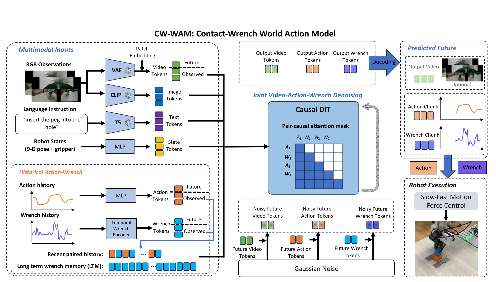
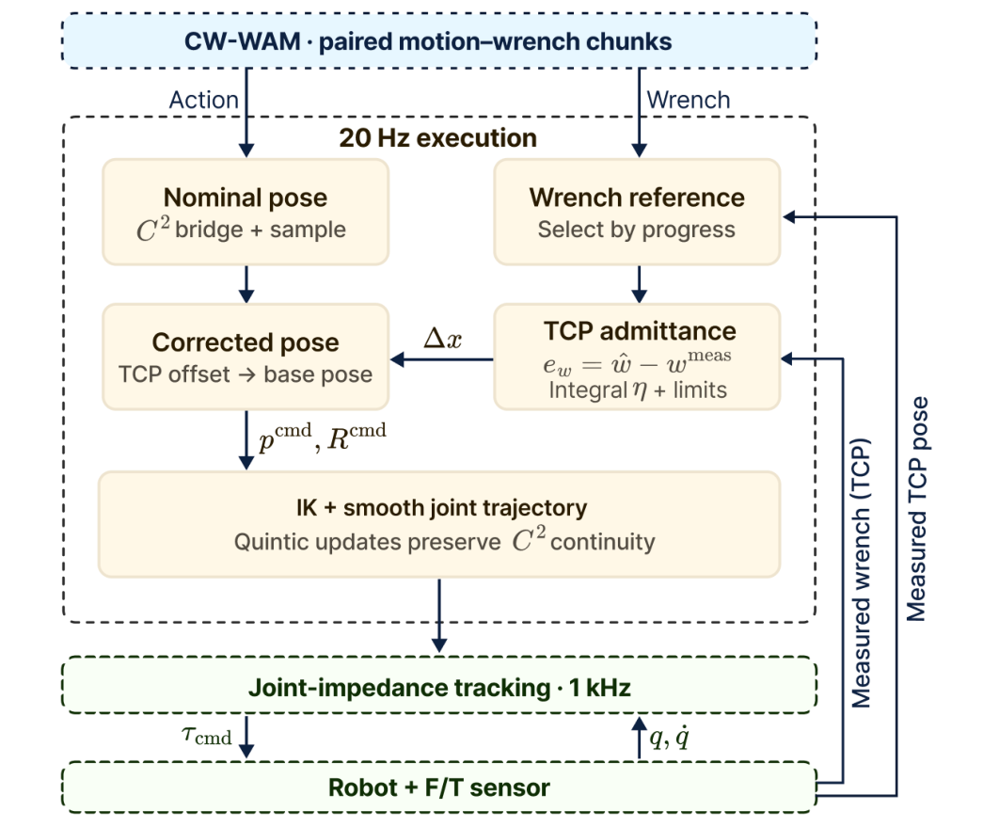
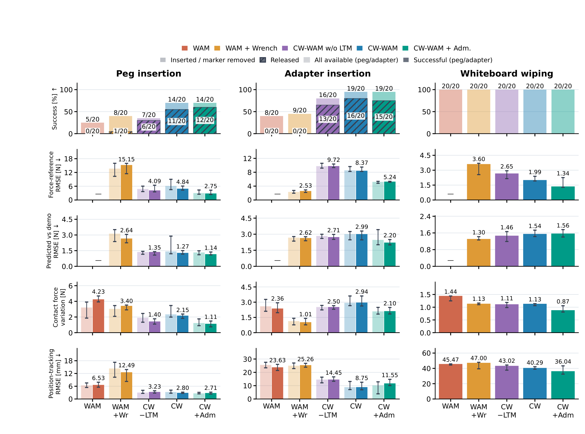

# CW-WAM: A Structured Contact-Wrench World Action Model for Force-Sensitive Manipulation

插孔时，摄像机看到的位置接近正确，并不意味着手上施加的力合适。CW-WAM 把未来运动和未来接触 wrench 成对预测，再把低频模型输出交给高频反馈控制。它的重点不是让生成模型直接替代伺服环，而是把“准备怎样动”和“预期遇到怎样的力”连接起来。

中文题名：面向力敏感操作的结构化接触力旋量世界动作模型。方法论文，作者 Houzhu Ding、Xinda Qi、Luqi Wang、Ming Yang，Ant Group；[arXiv:2610.30117](https://arxiv.org/abs/2610.30117)，北京时间 2026-10-22 首次提交；[项目页](https://cw-wam-project.github.io/)。已阅读 8 页全文，以下结果均来自论文，无独立机器人复现。

## 接触操作缺少怎样的状态

同样的末端位姿可以对应自由运动、刚碰到表面或已经卡住。wrench 是三维力和三维力矩组成的六维量，它给出视觉难以识别的接触反馈。仅把力历史塞入视频动作模型还不够：未来每个动作应该和执行该动作后的反作用力对应，而且部署时不能等待大型网络以伺服频率查询。

作者用三视角 RGB、机器人状态、近期动作与力历史构造预测条件。实测力先做偏置和工具重力补偿，在 TCP 坐标系表达，力矩原点位于 TCP；150 Hz 信号通过 10 Hz 因果二阶 Butterworth 滤波，与 15 Hz 的 RGB、状态、动作时间对齐。这里的坐标与时间戳处理直接决定监督是否描述同一次接触，属于算法必要条件。

## 把运动与力组织成成对未来

架构沿用 DreamZero 风格的 Wan2.2-TI2V-5B 视频动作骨干。三幅图合成为 160×320 输入，VAE、OpenCLIP 和 UMT5 冻结，训练 DiT 与模态投影。近期历史覆盖 24 个 15 Hz 间隔，每个间隔关联动作及最多 16 个高频力样本，带相对时间和有效掩码；长期力历史覆盖 150 个间隔、约 10 秒，并与近期历史重叠，而非两个互不相交的窗口。

未来词元 组织为 $[A_1,W_1,A_2,W_2,\ldots]$。下三角配对注意力允许 $W_i$ 读取对应的 $A_i$，而 $A_i$ 不读取尚未得到的同对 $W_i$；二者都能读取此前的对。所有未来词元 在每个去噪步同时更新，因此物理顺序约束不等于自回归逐步 rollout。

*图 2：短历史、长期力记忆和未来动作力配对共同进入世界动作模型。*

动作有效通道是 10 维：末端位置 3、旋转表示 6、夹爪 1；wrench 是 6 维。论文采用共享噪声级的流匹配：

$$
x_\sigma^m=(1-\sigma)x^m+\sigma\epsilon^m,\qquad u^m=\epsilon^m-x^m.
$$

$m$ 表示视频、动作或力模态，$x^m$ 是干净监督，$\epsilon^m$ 为独立高斯噪声，$\sigma$ 是噪声强度，$u^m$ 为目标速度。网络预测该速度并用有效通道掩码计算均方误差，部署时用四步 Euler 积分得到两帧未来视频 latent 与 24 对动作力参考，即 1.6 秒。控制时不需要解码 RGB。

有效通道归一化是一项不可跳过的对照：如果沿用 32 维补零通道平均，动作与力的有效梯度会被稀释。结构改进应相对有效归一化基线解释，而不只比较最弱的补零实现。训练总计 50k 步，8 张 H20、batch 8、学习率 1e-5，任务平衡采样。

## 低频生成如何接上高频控制

RTX 5090 上模型一次查询约 0.5–0.6 秒，包含观测、推理与后处理，不含网络通信。chunk 顺序执行，等待新预测时保持末端名义位姿，接触状态下导纳仍工作。新的 chunk 通过自适应时长的 $C^2$ 桥接续接，匹配位置、速度和加速度。不能把外层控制的 20 Hz 写成模型生成频率。

*图 3：20 Hz 位姿与力参考修正，接上 IK、五次平滑轨迹和 1 kHz 关节阻抗控制。*

导纳把力误差转成可控的位姿偏移。论文先把预测与实测力转换到同一名义 TCP 坐标系及原点，再用

$$
e_w=\hat w(\phi_w)-w^{\mathrm{meas}},\quad M\Delta\ddot x+C\Delta\dot x+K_a\Delta x=-S(e_w+k_I\eta),\quad \dot\eta=e_w-\lambda\eta.
$$

$\hat w$ 是预测 wrench，$w^{\mathrm{meas}}$ 是测量值；$\phi_w$ 是与实际 TCP 位姿匹配的轨迹进度，不得倒退或超过计划进度。$\Delta x$ 是六维微小位姿偏移，$M,C,K_a$ 是虚拟惯性、阻尼与刚度，$S$ 选择任务相关轴，$k_I$ 是积分增益，$\eta$ 为泄漏积分状态，$\lambda$ 控制泄漏。负号来自上述误差定义，复现不能随意替换方向。

系统采用半隐式 Euler 积分，并限制加速度、速度和偏移，进行抗积分饱和，再将修正位姿送入 IK。每 50 ms 重新规划 0.5 秒的分段五次关节轨迹，由 1 kHz 带重力与摩擦补偿的阻抗环跟踪。擦拭只选择法向力，插孔对部分轴设置较小权重，因此手调增益与轴选择也是部署成本。

## 预测表与真机成功分别说明什么

数据共 450 段示范：插孔 213、适配器 97、擦拭 64、载荷 76。预测评估使用 22 个留出 episode 的 37324 个窗口，先按窗口、episode 再按任务等权汇总；置信区间采用训练模型固定后的 10000 次配对 episode bootstrap，不是跨训练种子不确定性。

**图表占位：Table II**  
建议位置：预测误差对照与结构消融之后。  
放置原因：该表区分归一化、配对注意力和长期记忆对预测的影响。  
当前状态：已核对原文数值；没有匹配的独立完整图像候选，保留文字与占位。

有效通道归一化使力 RMSE 从 3.15 降到 3.03 N，位置从 26.32 降到 25.50 mm；结构模型无长期记忆为 2.84 N / 19.92 mm，全模型为 2.79 N / 20.69 mm。因此长期记忆改善力预测，却没有改善这项位置误差；不能称所有指标单调提升。

真机每个接触任务 20 次，载荷任务每种条件 10 次，重置位于示范分布内。基础 WAM 插孔成功 5/20，全模型 14/20；适配器由 8/20 到 19/20，释放由 0/20 到 16/20。加导纳后插孔仍 14/20，适配器仍 19/20，后者释放反而为 15/20。擦拭简单图案各方法都 20/20，复杂六图案全模型墨迹清除率 85.9%，这个指标也不是任务成功率。

*图 4：成功率与接触质量分别呈现；同样成功次数仍可能对应不同力轨迹。*

## 力跟踪收益和外推边界

成功子集中的插孔力 RMSE 4.84→2.75 N，擦拭 1.99→1.34 N，说明导纳的直接收益是参考跟踪质量。适配器搜索时更高的接触力也可能伴随更高成功，因而力更小不自动等于策略更好。全体样本和成功子集需要分别解释。

论文在四个任务和已见分布上支持结构化运动力接口，没有给出未见任务、物体和跨机器人泛化证据。我的分析：移植时最先要复核的是 F/T 补偿、TCP 力矩原点、进度对齐和 chunk 衔接；只复用网络结构而改变这些接口，预测误差与控制方向都可能失去原有含义。尚不能确定的是，减少手调增益后能否维持性能，以及更频繁的网络通信延迟会怎样改变接触稳定性。
