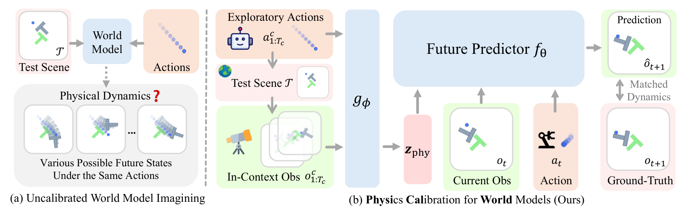
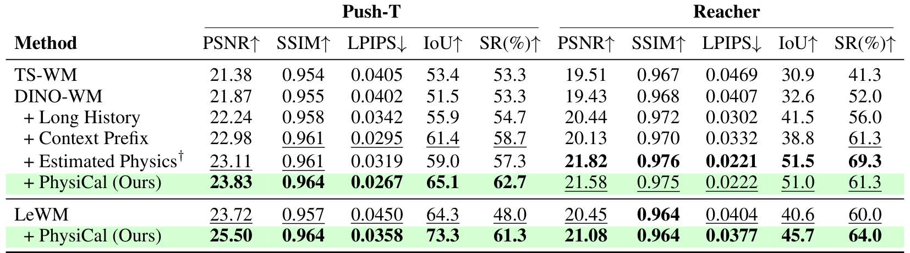
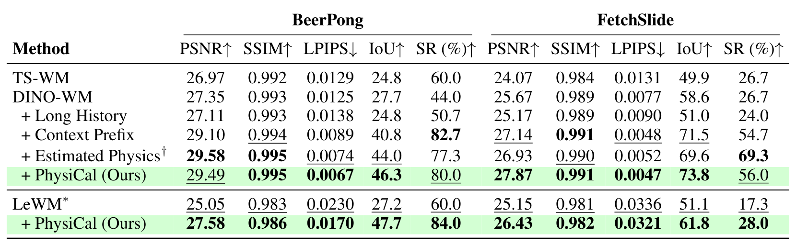
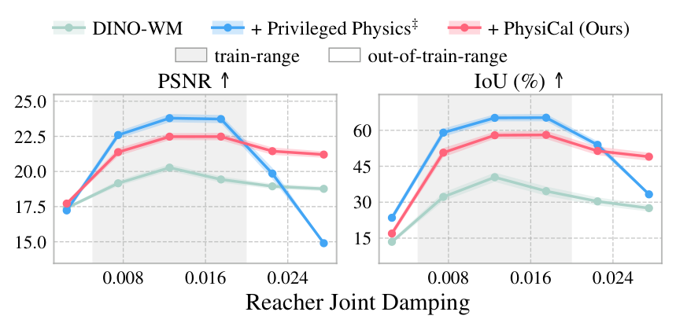

# PhysiCalWorld: In-Context Physics Calibration for World Models

一个 T 形物体看起来相同，重心却可能不同；同样的推力会产生不同运动。PhysiCalWorld 用当前实例的一小段交互推断紧凑条件，让世界模型在不更新权重的情况下调整预测。它解决的是“这一个场景的动力学是什么”，而非只从静态外观猜一个通用物理参数。

中文题名：世界模型的上下文物理校准。方法论文；作者 Yunhao Luo、Wentao He、Yinpei Dai、Hyelin Nam、Hongze Fu、Joyce Chai、Nima Fazeli、Jeong Joon Park。[arXiv:2610.30125](https://arxiv.org/abs/2610.30125)，北京时间 2026-10-22 首次提交；[项目页](https://physical-world.github.io/)。依据 36 页全文与附录，包括实现、控制阈值和耗时；没有独立模拟或真机复现。

## 同一张图为什么对应不同动力学

常规世界模型从短视觉历史与动作预测未来。短历史未发生足够接触时，质量、阻尼、摩擦等隐藏属性没有机会体现在图像中，模型只能平均不同实例的动态。把更多历史直接塞进预测器可能缓解问题，但每次候选动作 rollout 都重新处理长序列，规划成本很高。

作者将用于辨别实例物理的上下文与用于预测当前状态的短历史分开。一段先前的接触交互先编码为固定长度描述符，后续所有候选动作共用；当前短历史继续提供对象位置与运动。这要求上下文含有真实的信息，例如受力后的偏转、滑动或阻尼响应，任意一段无接触视频并不能保证校准。

## 用一次交互建立实例条件

训练数据按物理配置分组，随机取同组另一 episode 作上下文，目标 episode 提供动态预测监督。上下文和目标不共享目标未来帧，但“同组具有同一物理配置”本身是数据条件。无需直接监督质量与摩擦数值，不代表无需任何物理分组信息。

模型取 12 帧按模型间隔采样的交互及对应动作，经 ResNet、空间 softmax 提取 64 个关键点，动作嵌入到 10 维，必要时加入 pusher proprioception。每步形成 512 维表示，四层八头 Transformer 用可学习 CLS 聚合，再由 MLP 得到 64 维描述符。上下文编码器需要从接触反应中学习区分实例，而不是返回一个必然可解释的质量或摩擦估计。

*图 2：先将同实例交互压缩为物理描述符，再条件化当前动态预测与规划。*

## 描述符怎样进入动态模型与规划

方法可概括为

$$
z_{\mathrm{phy}}=g_\phi(C),\qquad
\hat h_{t+1}=f_\theta(h_{t-K+1:t},a_{t-K+1:t},z_{\mathrm{phy}}).
$$

$C$ 是同一物理配置的上下文图像动作序列，$g_\phi$ 是上下文编码器，$z_{\mathrm{phy}}$ 为 64 维描述符；$h$ 是视觉状态，$a$ 为动作，$K$ 为当前短历史长度，$f_\theta$ 是动态预测器。训练最小化未来 latent 预测均方误差，联合优化 $\phi,\theta$。物理相关差异只有在它影响预测时才会进入描述符，所以它的可分结构不等于物理参数可辨识性证明。

附录实现比概念图更具体。DINO-WM 将描述符广播到每个空间 patch 和时间位置，再沿通道拼接；LeWM 将其与 192 维状态 latent 拼接，动作仍通过 AdaLN-zero 进入因果预测器。不能把论文的“物理词元”一律理解成增加一个独立 attention 序列位置。DINOv2 视觉编码冻结，LeWM 使用其对应可学习表示设置。

默认当前历史 $K=3$，Long History 对照使用 15 帧；Context Prefix 则把 12 帧上下文直接放到原序列前部。Estimated Physics 从同一上下文监督预测真实物理参数，Privileged Physics 在训练与推理都直接获得真实参数。这些对照分别检验长历史、上下文内容和显式物理监督，强度不同。

测试时先编码一次上下文并缓存。规划器用相同描述符评估多条候选动作 latent rollout，CEM 迭代更新候选分布，执行后更新当前短历史。假设物理配置在这一阶段保持稳定；若物体换了、表面摩擦变化或负载改变，缓存条件可能过时。无需参数微调不等于无需采集交互。

## 规划收益需要看哪些强对照

四个环境全部为仿真：PushT 改变 T 块重心，Reacher 改变关节阻尼，BeerPong 改变桌面碰撞阻尼，FetchSlide 改变质量、摩擦与拖曳。采用 135 个训练、15 个测试物理配置，测试每配置五个 episode，即每环境各 75 个开环与规划评估。成功率还依赖任务阈值，例如 Reacher 最大关节误差 10 度、FetchSlide 平面距离 3 cm，不能脱离阈值比较。

*表 1：短历史、长历史、原始上下文前缀和物理监督对照；规划 SR 与视觉误差不是同一个指标。*

在 DINO-WM 上，PushT 规划成功率 53.3→62.7%，Reacher 52.0→61.3%。但 Reacher 的 Estimated Physics 达 69.3%，Privileged Physics 更高，说明紧凑隐式描述并非处处优于显式物理。PushT 中某个隐式配置超过 oracle 对照，也不能证明模型比真实参数更懂物理，因为预测器与优化接口的误差仍然存在。

*表 2：BeerPong 和 FetchSlide 的物理变化验证；更强对照中存在优于 PhysiCal 的项目。*

DINO-WM 的 BeerPong 44→80%，FetchSlide 26.7→56%。与此同时 Context Prefix 的 BeerPong 为 82.7%，Estimated Physics 的 FetchSlide 为 69.3%。LeWM 对应改进包括 PushT 48→61.3、Reacher 60→64、FetchSlide 17.3→28；BeerPong 使用的是 TC-LeWM，60→84，不能统一标成普通 LeWM。结果支持跨两类预测器可用，但不支持“所有任务优于全部对照”。

## 外推与效率各自覆盖多大范围

图 8 只把 Reacher 第一关节阻尼推到训练范围外，第二关节固定，以 PSNR 与 IoU 衡量开环预测。PhysiCal 在部分外推点比真实参数条件模型下降更缓，这提示从交互提取条件可能避开显式参数分布外输入的问题。它没有测量四环境统一的 OOD 规划成功率，更不等于真机未知物理泛化。

*图 8：灰色训练区间与白色外推区间；纵轴是开环图像与区域指标。*

附录 A.9 在 PushT 测得上下文编码 2.30 ms，10 帧 rollout 26.31 ms，对照 Context Prefix 91.44 ms。一次完整规划 PhysiCal 32.67 秒，对照 prefix 323.09 秒、基础模型 32.66 秒。CEM 使用 300 候选、30 elite、30 轮、25 控制步及五模型步设置，规划总时间与单次 rollout 不是同一个量。

这种效率优势来自一次编码、多次复用，主要节省大量候选上的长前缀计算。统计包含一次编码，却没有把真实机器人采集上下文的时间和风险算进去，不能写成“2.3 ms 就完成真实场景校准”。

## 把方法迁移到真实场景的条件

作者指出真实环境难以自然获得同物理配置分组，信息不足的上下文也无法稳定推断隐藏属性。我的分析：复现应先锁定分组采样、上下文与目标 episode 分离、描述符拼接位置和缓存生命周期，再比较规划预算。若改变预算或使用目标未来片段作为上下文，结果就失去原实验含义。

尚不能确定的是，描述符能否区分多个同时变化且视觉上不可辨识的参数，或在持续变化的接触材质中何时应刷新。四个仿真环境和单关节阻尼外推提供了可检验起点，但没有覆盖真实传感器噪声、柔性物体和开放环境。适合迁移的是实例条件与当前状态分离的接口，而不能直接外推为通用物理识别系统。
