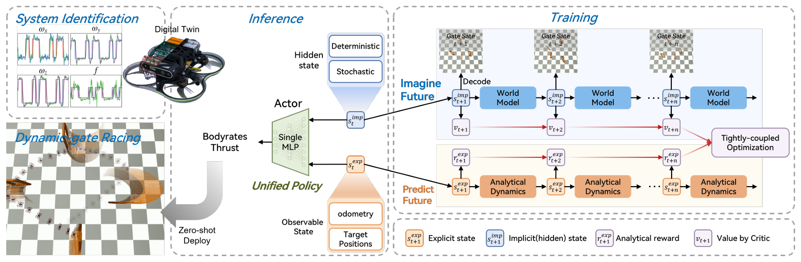
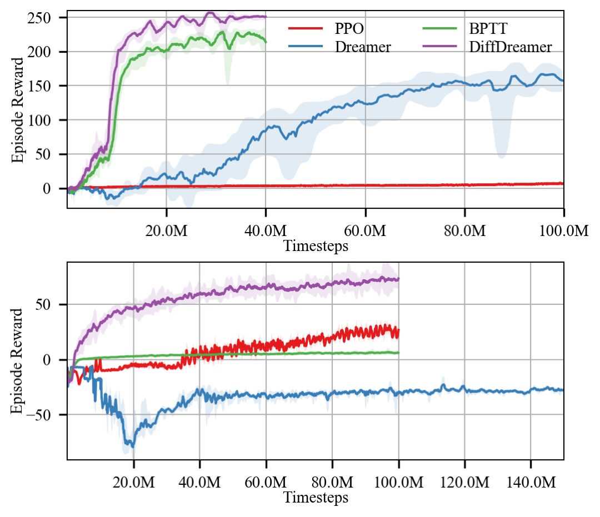
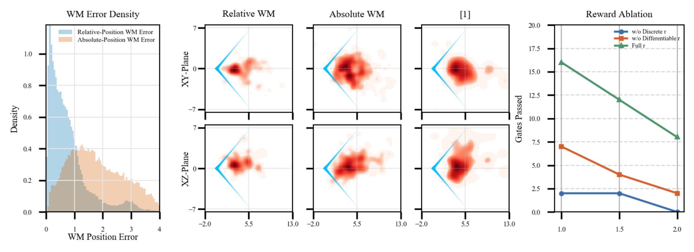

# DiffDreamer: Coupling World Models with Differentiable Simulation for Agile Quadrotor Control

飞行器既要预测移动门会去哪里，又要准确控制自身加速度。DiffDreamer 将两种工作分开：学习世界模型处理外部运动与历史，可微仿真推进已知的飞行动力学，再用同一个 actor 产生同步驱动两条路径的动作。它研究训练中的梯度与状态接口，并非让一个视频生成器直接输出飞控指令。

方法论文，中文题名：将世界模型与可微仿真耦合用于敏捷四旋翼控制。Fanxing Li、Yuxiang Huang 等；[arXiv:2610.31617](https://arxiv.org/abs/2610.31617)，北京时间 2026-10-23 首次提交。依据 8 页全文；文档带 RA-L 页眉，未据此额外推断录用状态。未找到可确认的论文配套代码，无独立飞行复现。

## 为何不把全部动力学交给世界模型

Dreamer 式方法在 latent 中学习整个环境转移，既要理解门的运动，又要近似飞行器快速刚体动力学。后者有可辨识物理模型，全部交给学习会增加偏差；纯可微控制虽然能精确优化运动，却难处理部分可观测外部运动和离散穿门事件。作者在训练时将隐式预测与显式物理同步起来，利用二者不同的可用信息。

以动态门竞速为例，输入包括最近两扇门的相对位置与飞行器里程计。RSSM 维护确定与随机 latent，编码历史外部运动；显式状态包含位置、速度、四元数和角速度。actor 同时读取两者，输出总推力与机体系角速度 CTBR，而不是位置航点。当前方法的任务输入是结构化位置与状态，不能把它写成已验证端到端像素感知飞行。

*图 1：同一个动作同步推进学习 latent 与解析物理，部署前仍要辨识真实飞行器参数。*

## 同步状态和梯度路径

学习路径的 RSSM 从 replay buffer 训练，负责外部动态与历史特征。物理路径使用 VisFly 的 PyTorch 可微刚体模型，在同一动作序列下推进位置、速度、姿态与角速度。因此两种状态表示的是同一预测时刻，不应由各自独立采样的动作驱动。

actor 的信息接口写为

$$
a_t\sim\pi_\theta\bigl(\cdot\mid\operatorname{sg}(s_t^{\mathrm{imp}}),s_t^{\mathrm{exp}}\bigr).
$$

$s^{\mathrm{imp}}$ 为 RSSM 隐状态，$s^{\mathrm{exp}}$ 为显式物理状态，$\theta$ 是 actor 参数，$\operatorname{sg}$ 表示 stop-gradient。前向计算仍然使用外部运动特征，但在每次 actor 调用处阻断从该 latent 输入反传的路径；显式状态输入保持可微。不能把“耦合”读作所有变量都无条件端到端反传。

优化 actor 时世界模型与 critic 参数保持固定。这不等于它们在整个训练期间永远冻结；世界模型仍从不断收集的经验更新。实现中需要区分训练阶段、参数冻结与张量 detach，三者控制的是不同事情。

## 把稀疏事件与运动奖励分开

穿门成功是离散事件，接近目标、抑制角速度等运动项可微。critic 只估计不可微任务奖励的未来回报，光滑运动奖励由仿真直接反传。论文目标为

$$
\mathcal L(\theta)=-\lambda_{\mathrm{imp}}\sum_t\gamma^t\hat V_t-\lambda_{\mathrm{exp}}\sum_t\gamma^t r_t^{\mathrm{diff}}.
$$

$\hat V_t$ 是仅对应离散任务奖励的 critic 估计，$r_t^{\mathrm{diff}}$ 是解析运动奖励，$\gamma$ 为折扣因子，两个 $\lambda$ 调整路径权重。最小化负回报，使离散任务价值与可微运动代价共同影响 actor，避免 critic 再去近似所有本可精确求导的运动项。

这条路线依赖可微动力学与奖励在局部可信。真实质量、惯量和执行器响应需要辨识，接触或强不连续会让梯度难以利用。世界模型也不是能预测任意目标的神谕；外部运动模式仍由训练随机化定义。

## 仿真协议支持了哪些收益

训练比较 DiffDreamer、DreamerV3、PPO 和 BPTT，各五个独立随机种子，统一观测、奖励和目标轨迹、速度、初态随机化，固定辨识后的物理参数。BPTT 没有学习 latent 预测路径；DreamerV3 在 latent 中建模整体。图 5 显示环境步数上的收敛，不是等 wall-clock 或等算力证明。

*图 5：五训练种子的均值与标准差；横轴是环境时间步，而非实际训练耗时。*

跟踪评估十组随机轨迹，距离误差 DiffDreamer 0.381±0.282 m，Elastic Tracker 0.793±0.404 m，BPTT 0.835±0.532 m，DreamerV3 1.003±0.556 m。水平和垂直误差是目标投影在图像中的归一化偏差，不是米。表中标准差跨随机轨迹和时间步统计，不等于五训练种子方差。

**图表占位：Table I**  
建议位置：跟踪误差与单位解释之后。  
放置原因：需要同时保留三种误差与统计协议。  
当前状态：已核对原页数值；没有独立完整表体候选，以文字保留比较。

动态门评估五组环境，每组循环四扇移动门，以 512 仿真步内通过门数为指标。最大门速 1、1.5、2 m/s 时，DiffDreamer 为 16、12、8，MPC 为 12、4、1，PPO 为 14、8、3。门数可超过四，因为重复穿过门序列；不是“16/4 成功率”。

**图表占位：Table II**  
建议位置：动态门计数与速度协议之后。  
放置原因：区分不同速度下的通过次数及各基线。  
当前状态：独立表图未匹配，保留 512 步预算与关键数值。

## 消融隔离程度与真机边界

去掉离散穿门奖励后，门数变为 2、2、0；去掉可微运动奖励为 7、4、2，支持两项都必要。里程计与相对状态消融同时去掉里程计并改成绝对位置重建，结果下降，但没有完全隔离“里程计”与“相对表示”两种改变。

*图 6：左侧表示误差与目标分布，右侧奖励拆分；各对照修改范围需分别解释。*

真机为 3.5 英寸四旋翼、Jetson Orin NX 和 Betaflight，策略机载超过 100 Hz 输出 CTBR。外部 motion capture 同时提供飞行器与目标、门的状态，参数经过辨识，推力限制用于受控室内试验。成功轨迹提供概念验证，未报告足以证明广泛可靠性的独立真机成功率。

作者明确只验证四旋翼，纯机载感知和感知噪声鲁棒性未测试。我的分析：值得复用的是同步动作、状态分工和奖励分工，迁移前先检查哪些状态可信、哪些回报可微。未知的是接触机器人、显著模型失配或外部状态估计延迟下双路径是否仍有效；不能把这组飞行结果直接外推为通用具身训练框架。
