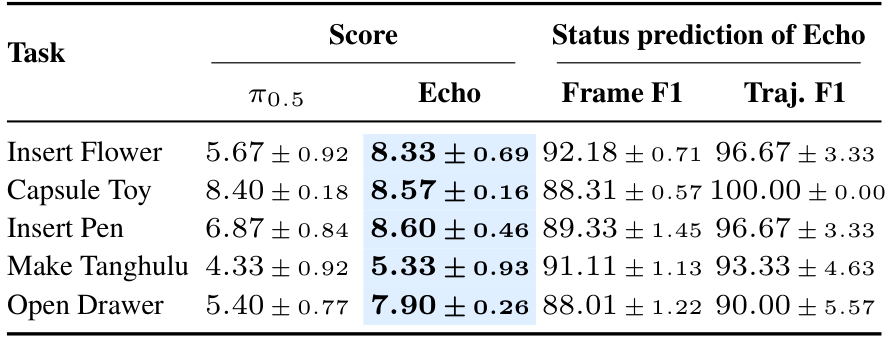
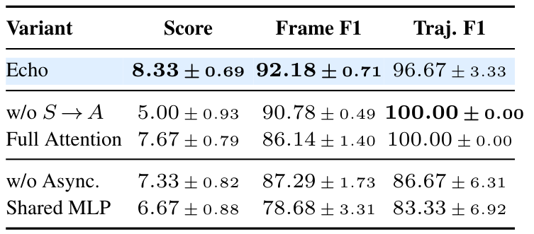
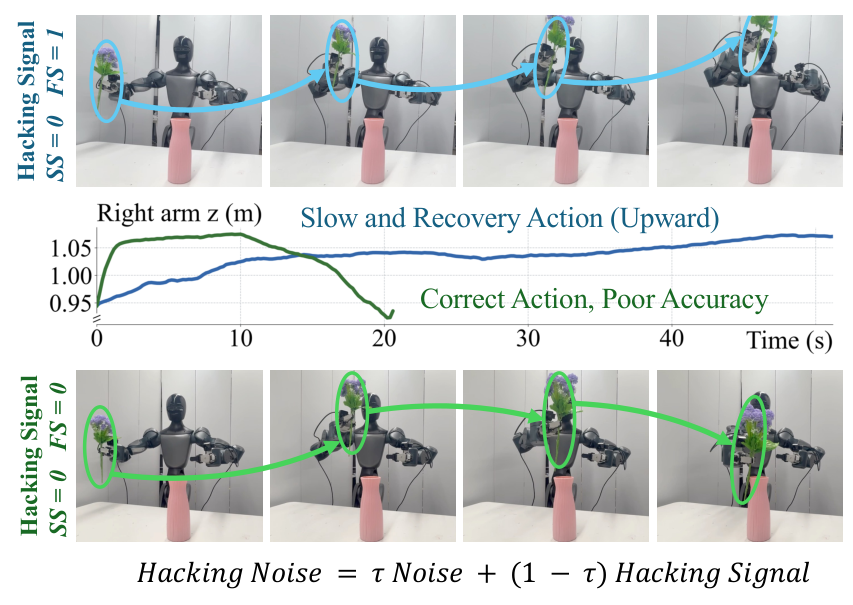

# Echo: Coupled Action and Task Status Signal Denoising for Vision Language Action Models

机器人不仅要产生下一段动作，还要知道应该继续、已经成功，还是需要纠错。Echo 将停止与失败表示成两个与动作同长度的信号，在一次 VLA 查询中共同生成，并让信号较早去噪完成，作为后续动作更新的条件。它把执行状态从外部告警转成策略可以使用的内部接口。

方法论文，中文题名：视觉语言动作模型中动作与任务状态的耦合去噪。Yufeng Liu、Bohao Fan 等，SJTU、Spirit AI、THU 等；[arXiv:2610.31569](https://arxiv.org/abs/2610.31569)，北京时间 2026-10-23 首次提交；[项目页](https://lyfeng001.github.io/Echo/)。依据 21 页全文及附录，无独立机器人复现。

## 为何状态判断应该进入动作生成

只输出动作的策略可能在完成后继续运动，也可能在夹空或插入受阻时沿原轨迹重复。外部监测器可以指出失败，但还要将判断转换成恢复动作。作者希望同一模型既预测状态，也学习“此时适合纠错”的动作分布。这里不是只给动作向量增加两个输出数，而是改变状态与动作之间的信息流。

输入为三视角 RGB、机器人状态和子任务指令，骨干是 π0.5。一个长度为 $H$ 的动作 chunk 之外，还生成停止信号 SS 和失败信号 FS。最终对每个信号的整段预测取均值，再与阈值比较：低 SS 表示继续；高 SS、低 FS 表示成功；高 SS、高 FS 表示终端失败。低 SS、高 FS 则可表示尚需继续处理的可恢复失败。默认两阈值均为 0.5，信号不是经过概率校准的安全保证。

*图 2：四类轨迹构造监督，动作与状态双向交互，但停止与失败信号之间禁止直接注意力。*

## 四种轨迹如何定义监督

成功示范提供正常动作；终端失败 rollout 提供最终失败；人工接管前片段提供可恢复错误；接管后的恢复示范提供纠错动作。多子任务边界仍需人工标注并配指令，因此“无需逐帧进度标注”不等于不需要人工监督。

训练动作只来自成功与恢复示范，失败动作全部排除，避免学习错误运动。成功轨迹末端补齐最后有效动作，停止目标在 padding 处变为 1；终端失败的 SS 和 FS 都在末端 padding 处置 1。接管前片段末端不是任务终止，所以 SS 仍为 0。恢复片段可能只完成局部修正，其 padding 动作与 SS 不受监督，避免过早停止。

FS 的处理尤其重要：终端失败和接管前片段只有片段级标签，不知道错误何时发生，因此不对无 padding 的 chunk 强加失败起点；在包含末端的 chunk 中才用边界构造监督。恢复片段的失败目标均值则随恢复进度下降，将纠错前后状态连接起来。这是近似时间监督，不是逐帧物理失败真值。

## 让状态先于动作去噪

动作、SS、FS 分别投影为三组词元，采用分离 MLP 和输出投影，共享 Transformer。动作能看两个信号，信号也能看动作，但 SS 与 FS 不能直接互看，以减少彼此复制。三组还读取共同的视觉、语言和状态前缀。

在线性流匹配中，噪声时间从 1 积分到 0。Echo 为信号使用

$$
\tau_q=\max\left(0,\frac{\tau_A-\tau_{\mathrm{clean}}}{1-\tau_{\mathrm{clean}}}\right),\qquad q\in\{S,F\}.
$$

$\tau_A$ 是动作噪声时间，$\tau_q$ 是对应信号的时间，$\tau_{\mathrm{clean}}$ 是动作仍有噪声而信号已经到达干净端点的时刻。真机设为 0.5，因此动作走到一半时两个信号就完成去噪并冻结，后续动作更新可关注较干净的状态。设为 0 则退化为同步去噪。实现要给每组词元单独的时间嵌入和监督掩码，不能只改变最终阈值。

损失是在三个分支上对目标速度 $\epsilon-x_0$ 做带掩码的平方误差，$x_0$ 是干净动作或信号，$\epsilon$ 为高斯噪声。掩码取决于上述数据类型，失败轨迹不会贡献动作模仿损失。真机采样比 Success:Failure:Pre-intervention:Recovery 为 20:1:2:20；chunk 长 60，查询频率 5 Hz。RTX 4090 测量从 115 到 120 ms，属于约 5 ms 的增量，而不是整套机器人闭环延迟。

## 真机分数与状态指标怎样阅读

五个任务每模型每任务 30 次，平台为双七自由度手臂加腰腿的轮式人形，底盘固定，三个 RGB 相机。每次最长五分钟。完成分为 0–10，并按碰撞、夹空或果实掉落扣分；它不是二元成功率。表 2 的插花 5.67→8.33、插笔 6.87→8.60、开抽屉 5.40→7.90，反映任务质量与成功共同变化。

*表 2：完成分与 Macro-F1 分开统计，误差是 30 次试验的标准误。*

Frame F1 逐帧衡量 ongoing、success、failure；轨迹 F1 在真实结果起点后 15 帧，即 3 秒窗口内判断，任何失败预测优先于成功预测。它对窗口和阈值敏感，不应解释成精确的失败发生时刻。动作基线与 Echo 使用相同成功、恢复动作监督及训练步数，但 Echo 额外使用失败数据作状态监督，不能称训练信息完全相同。

## 消融与干预支持怎样的机制

插花去掉信号到动作注意力，分数由 8.33 降到 5.00，而状态指标仍较强，说明监测准确本身不够，动作必须使用信号。同步去噪分数 7.33，分支共享 MLP 为 6.67；允许 SS 与 FS 互看也会损害细粒度状态识别。

*表 5：任务完成和状态识别不是同一个优化目标；某些变体轨迹 F1 高，完成分却更低。*

强制 SS=0、FS=1 会诱发向上恢复动作，FS=0 更偏向任务运动，说明信号确实可以改变动作生成；持续强制失败不等于可靠的闭环纠错策略。插花 OOD 分数从 2.00 到 8.00，而 ID 由 9.33 降到 8.67，结果并非处处提升。终端失败样本从 50 增到 250，提高 Frame F1，却没有带来单调任务分数收益，符合它们只提供状态监督的设计。

*图 5：固定状态改变了右臂动作；这是机制干预证据，不是所有失败都能恢复的证明。*

## 仿真协议与部署边界

补充仿真采用三类数据、150 个固定 LIBERO-Recovery 场景，每模型 4500 次试验，成功率 32.67→34.76%。只训练一个 seed，三个评估随机种子改变试验扰动；不能把它写成三个训练种子。仿真不使用独立接管前类别，恢复轨迹停止监督也与真机不同。Echo 继续运行完整 520 动作用于观察信号，状态信号没有终止 rollout；89.97% 是 ongoing/success 的逐帧准确率，未单独衡量终端失败时机。

我的分析：值得复用的是按轨迹来源构造监督、区分停止与失败语义、让干净状态进入动作的接口。系统仍依赖人工恢复示范及任务边界，安全性不能由 F1 代替。尚不能确定的是跨本体、未知错误或外部规划器组合是否仍保持收益；论文只说明组合在架构上兼容，未验证某个具体组合系统。
