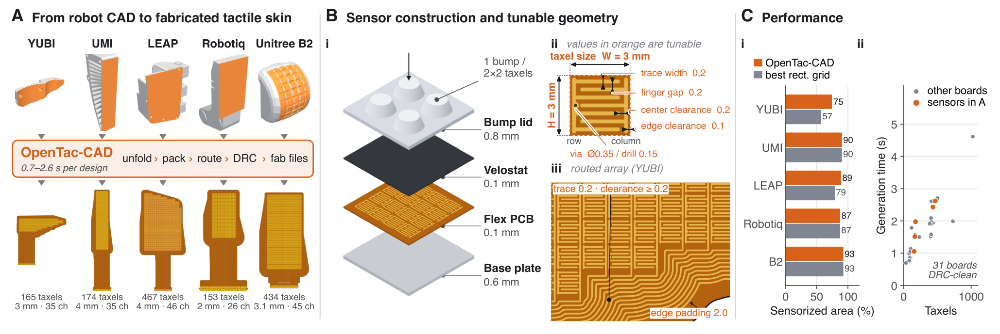
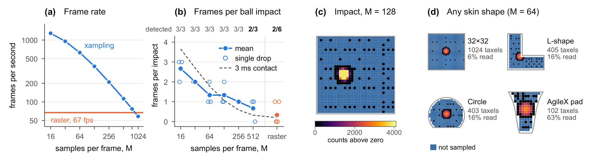
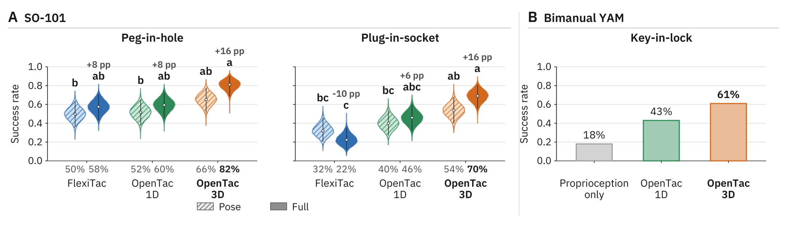

# OpenTac: An Open Ecosystem for Customizable, Scalable, and Transferable 3D Tactile Sensing

将触觉覆盖到不同手指、夹爪与机器人表面，困难不只在传感材料，还在布线、机械对准、读出顺序和控制接口。OpenTac 共设计柔性压阻皮肤与剪切凸点，用统一几何 manifest 连接制造、仿真、跨皮肤映射和自适应采集。其价值是完整接口，而不是凭“3D 触觉”名称就能保证迁移。

系统与方法论文，中文题名：可定制、可扩展及可迁移的三维触觉开放生态。Ariel Slepyan、Geeta Chandra Raju Bethala 等，JHU 与 MIT；[arXiv:2610.31661](https://arxiv.org/abs/2610.31661)，北京时间 2026-10-23 首次提交；[项目页](https://opentac.github.io/)、[GitHub](https://github.com/opentac/opentac)。依据 14 页全文及官方页面；没有制造硬件或重跑策略。

## 触觉可定制需要共享什么接口

矩形压力阵列容易接线，却未必能覆盖不规则指腹和脚底。把阵列切成不同形状后，电气行列顺序与空间邻近关系也可能不同。OpenTac 将每个 taxel 的物理中心、扫描索引、脚印和机械分组写入 manifest，使后续工具使用真实几何，而不是假定电线顺序就是空间图像顺序。

*图 1：制造、读取、仿真和跨传感器映射共同使用传感器描述；各模块的验证范围并不相同。*

给定二维轮廓或可展三维表面，编译器产生柔性 PCB、凸点盖和制造文件。文本入口由智能体把需求转换成轮廓与参数，再交给确定性编译器；它不是任意曲面都可自动制造的证明。双曲面不可无失真展开时会检测并报告，选定表面仍需满足可展性。

## 凸点怎样把剪切转成差分读数

每个柔性凸点覆盖一组局部 taxel，常用 2×2 布局。法向压力使四个单元一起响应，切向作用让凸点偏斜并形成左右或前后压力差。若减去基线后的读数为 $z_{uv}$，$u,v\in\{-1,+1\}$ 表示相对凸点中心的方向，则

$$
h_z=\sum_{u,v}z_{uv},\qquad h_x=\sum_{u,v}u z_{uv},\qquad h_y=\sum_{u,v}v z_{uv}.
$$

$h_z$ 是共模法向响应，$h_x,h_y$ 是两轴差分剪切响应，不是未经校准的牛顿力值。可再用仿射映射将三项标定为 $F_x,F_y,F_z$。凸点分组与方向符号由 manifest 给出，装配对准影响差分含义；材料、pitch 和增益也改变灵敏度及饱和区间。

4×4 凸点片对 OptoForce 的样本内标定得到三轴 $R^2$ 为 0.95/0.93/0.96，RMSE 为 0.11/0.16/0.15 N。它是标定拟合结果，不是未知接触、不同温度或长期漂移下的独立精度保证。

## 从机器人几何到制造与仿真

CAD 流程先展开与铺设 taxel，再在 PCB 两面分别处理行列布线。路径沿轮廓和已布铜线的偏移边界生成，并检查净距，无法避免的交叉提前检出。31 块不同形状板全部制造并通过功能检查；五个重点表面从轮廓到制造文件耗时 0.7–2.6 秒。文本智能体九次设计会话中位时长 6.5 分钟，因此不能把编译时间当成完整自然语言设计时长。

*图 3：形状覆盖、凸点结构与编译成本；规则矩形区域并非总有覆盖收益。*

相同 pitch 下 YUBI 覆盖 75% 对矩形基线 57%，LEAP 89% 对 79%；接近矩形的区域两者相同。提升来自几何匹配，不是无条件增加触觉分辨率。

论文的 OpenTac-Sim 对凸点描述为 MuJoCo 中线弹性四面体 FEM、底部固定，再映射到电极脚印；光滑皮肤另用 Winkler 泡沫层近似。当前只支持与刚体交互的稳定仿真。值得注意的是，核对时官方网页将凸点描述为五自由度柔顺关节近似，与论文 FEM 描述不同；本次未运行代码确认对应实现，不能合并两者宣称同一个物理模型已被验证。

## 跨皮肤转移和稀疏采集分别做什么

跨皮肤模块根据接触位姿对齐、源目标 taxel 的物理面积重叠与各自标定映射法向接触场。只有目标覆盖接触时才能保持力总量，输入还需要已知接触位姿。5290 个预测的形状 F1 中位数为 0.750，对照两种 resizing 为 0.714、0.634；它评估阈值后的接触形状，不证明力值、剪切或控制策略完成 sim-to-real 迁移。

Xampling 则利用接触稀疏且时间连续的假设，每帧预算 $M$ 中约四分之一搜索全区域，其余追踪活跃区域。1024 taxel 全读只有 67 帧/秒，而 $M=16$ 达到 1286 个部分帧/秒、约 19.2 倍；每次只读取 16 个单元，不能说 1024 单元全阵列达到千赫兹。

*图 13：采样预算、更新速度和冲击检测共同呈现；蓝色区域是没有被采样的 taxel。*

约 3 ms 网球接触试验中，全读检出 2/6，预算 16–256 各检出 3/3，样本数很小；这支持捕捉短接触的可能性，不是任何稀疏接触都不会漏检的统计保证。接触变得稠密时，复杂度退化到接近全读。

## 控制与策略实验的证据强度

SO-101 两个插入任务使用 ACT，输入触觉与关节角，不用视觉；每策略 100 示范、50 次评估。各皮肤都有 pose-only 基线，因为凸点同时改变摩擦和接触力学。OpenTac-3D 在插孔由对应基线 66% 到 82%，插座 54% 到 70%；法向皮肤并非同样有效。该对照比只把不同硬件最高分相减更有解释力。

*图 11：每种传感器保留自己的 pose 基线，凸点引入的力学变化不可忽略。*

YAM 钥匙任务的图中最高柱标 61%，正文写 62%，且说明 25 次试验，数值口径存在不一致。本笔记不将其中任一值当作精确可复现实验计数，只保留增加剪切信息更好的定性结论，需作者澄清。

Dexmate 保持纸杯 40 秒的载荷实验每条件 20 次，3D 触觉 held 16/20，F/T 和 1D 各 9/20；滑移量分别约 2.6、5.5、5.8 cm。它说明特定反馈控制中剪切信号有帮助，不代表所有本体和操作任务都应使用同一种策略。

## 材料漂移与实现差异

十小时耐久测试前两小时读数逐渐变化，随后较稳定，作者建议预热或使用相对读数。跨形状映射目前主要是平面法向接触，仿真与真实接触仍受材料和刚体假设约束。我的分析：最值得复用的是几何 manifest 与装配、读取和控制共享坐标的设计；移植前应先验证标定漂移、凸点对准及读取预算。

尚不能确定的是，官方网页与论文的不同仿真近似怎样对应公开版本，以及 YAM 指标的准确计数。上述差异不妨碍关注系统，但不应被“全栈开放生态”的标题掩盖。硬件、代码目录可获取与制造、仿真和策略复现通过，应分别报告。
