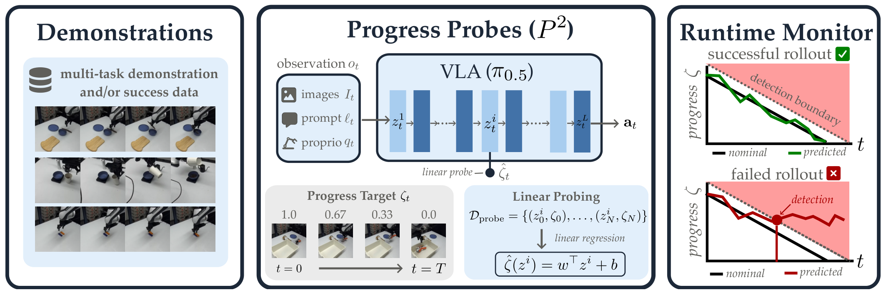
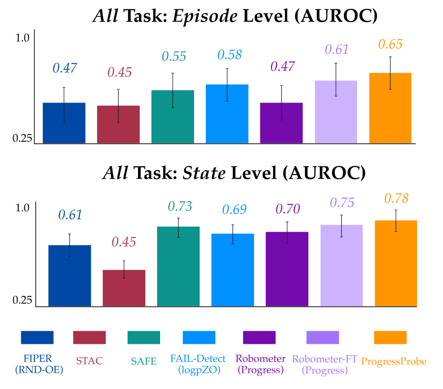

# Progress Probes P²: Lightweight Runtime Monitoring for Vision-Language-Action Models

策略已经算出的内部特征，是否足以判断机器人停滞？Progress Probes 用成功示范中的归一化剩余时间训练线性读出，再比较实际与名义进度。它提供轻量运行监测，不训练恢复动作，也不自动把告警变成安全停止。

方法论文，中文题名：视觉语言动作模型的轻量运行时进度探针。Atiksh Bhardwaj、Edward W. Duan 等，CMU 与 Cornell；[arXiv:2610.31613](https://arxiv.org/abs/2610.31613)，北京时间 2026-10-23 首次提交。依据 8 页全文，无独立机器人复现；未核实公开代码仓库。

## 把策略内部进度变成监测信号

外部 VLM 可以看执行视频判断任务，但额外视觉编码和推理会增加成本。作者从 π0.5 的 PaliGemma 视觉语言骨干读取激活，尝试判断它是否隐含“现在走到了哪里”。若成功轨迹通常平稳推进，偏离预期的进度就能作为异常信号。该假设依赖任务节奏，慢速但仍可成功的策略也可能落后。

*图 1：成功轨迹自动产生进度标签，线性探针读取现有策略激活，再与名义轨迹比较。*

输入仍是图像、本体感知和语言，策略照常产生动作 chunk。探针只旁路读取中间层特征，不修改策略参数和动作。与专门训练失败分类器不同，它不要求训练集中有失败样本；失败数据仍用于评估，因此“训练不需要失败标签”不能理解为整篇实验不涉及失败标注。

## 从成功轨迹构造探针

成功轨迹长度为 $T$，时间 $t$ 的标签为

$$
\zeta_t=1-\frac{t}{T},\qquad \hat\zeta_t=w^\top z_t^i+b.
$$

$\zeta_t$ 是剩余进度，从 1 降到 0，方向与常见完成百分比相反；$z_t^i$ 为第 $i$ 层激活沿词元维均值池化后的向量，$w,b$ 是线性回归参数。通过成功示范逐帧前向计算后拟合探针，不必请人工逐帧判断完成阶段。这个标签是时间代理，假设相同任务阶段在不同示范中的时间比例有可比性，而不是物理完成度真值。

仿真策略先用 10 任务、共 5000 段数据微调；监测评估只选成功率非零的六任务。探针使用其中每任务 50 段、共 300 段成功轨迹，80/20 训练验证划分，验证集校准阈值。真机策略与探针使用六任务各 60 段，共 360 段示范。复现要固定读取层、池化方式、任务长度统计和校准划分，而不能拿测试失败调阈值后再报告泛化。

## 滞后分数如何触发告警

若成功轨迹平均长度为 $\mu_T$，名义剩余进度为 $1-t/\mu_T$。监测分数为

$$
s(\tau_t)=\hat\zeta_t-\left(1-\frac{t}{\mu_T}\right),\qquad T_\delta=\inf\{t:s(\tau_t)>\delta\}.
$$

$\tau_t$ 是到当前为止的观测动作历史，$\delta$ 是校准阈值，$T_\delta$ 是首次告警时间。预测剩余进度较大意味着比名义节奏慢，所以只惩罚正向滞后，不惩罚提前完成。实际评分只需要当前激活加时间统计，不是显式使用全部历史的时序模型。

这种设计可捕获卡住和明显偏离，却不必然捕获短时夹空后快速恢复、微小洒落或任务本身允许的等待。告警触发后是停止、重试还是交给人，需要另一个控制决策；本文的 AUROC 评估没有证明哪种处置会提高任务成功。

## 仿真比较需要同时看准确度和时间

六任务各 100 次 rollout，共 600，成功失败各半；人工标记失败起点及此后帧。Episode AUROC 用全轨迹最大分数，State AUROC 用逐帧分数，二者不能互换。P² 仿真分别为 0.909 和 0.788，SAFE-MLP 为 0.930 和 0.894；后者额外使用 300 段失败数据。轻量探针有价值，但不是全部准确度最佳。

**图表占位：Table I**  
建议位置：仿真准确度与速度对照之后。  
放置原因：该表区分监督信息、episode/state 指标和增量延迟。  
当前状态：已核对全文数值；缺少匹配的独立完整表体候选，保留文字比较。

A6000 测得探针增量延迟 0.026 ms，SAFE-MLP 0.12 ms，Robometer 550 ms。这里复用了已经算出的 VLA 特征，不能把它当作整个机器人推理只需 0.026 ms。未见任务实验枚举六选三共 20 种划分，P² 的 episode/state 为 0.900/0.794，SAFE-MLP 为 0.896/0.866，依然存在指标取舍。

**图表占位：Table II**  
建议位置：检测时机与误报约束比较之后。  
放置原因：高 AUROC 并不保证早检测，必须固定误报率比较时刻。  
当前状态：未取得独立完整表图，以下保留原文协议和数值。

在 5% FPR 下，P² 到 75% 轨迹时 TPR 为 0.54，结束时为 0.64，检测时刻均值为轨迹的 0.60；SAFE-LSTM 为 0.53，微调 Robometer 为 0.56。探针并非最早，未检出的失败也不能被均值掩盖。检测时刻只在检测发生的失败上定义，应与检出率一起阅读。

## 真机结果及外推限制

Franka Research 3 配 DROID 相机，六任务覆盖袋子搬运、倒豆、放刀、堆块与取勺；评估 120 段 rollout，成功失败各半。图 4 的 P² 真机 episode AUROC 约 0.65，state 为 0.78。真机 episode 明显弱于仿真 0.909，所以不能只引用最好的分数宣称全程可靠。

*图 4：episode 与 state 的差距显示监测指标依赖聚合方式，柱状图不是任务成功率。*

真机未见任务平均 state AUROC 0.81，支持部分跨任务共性。作者同时指出倒咖啡豆等细小区域随机失败难以检测，内部激活可能变化不足。只验证 π0.5 的视觉语言骨干，其他 VLA 家族和连续动作专家是否提供同样信号尚不明确。

我的分析：适合先将它作为已有策略的低成本旁路诊断，保存告警时刻与失败类型，再评估处置策略。线性可读出进度证明表示中存在有用信息，不证明该信息对原动作生成具有因果作用，也不是安全认证。尚需验证的是可变速度、长时间等待和开放任务下名义时间统计是否仍成立。
