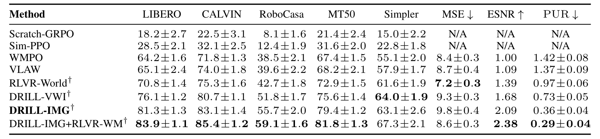
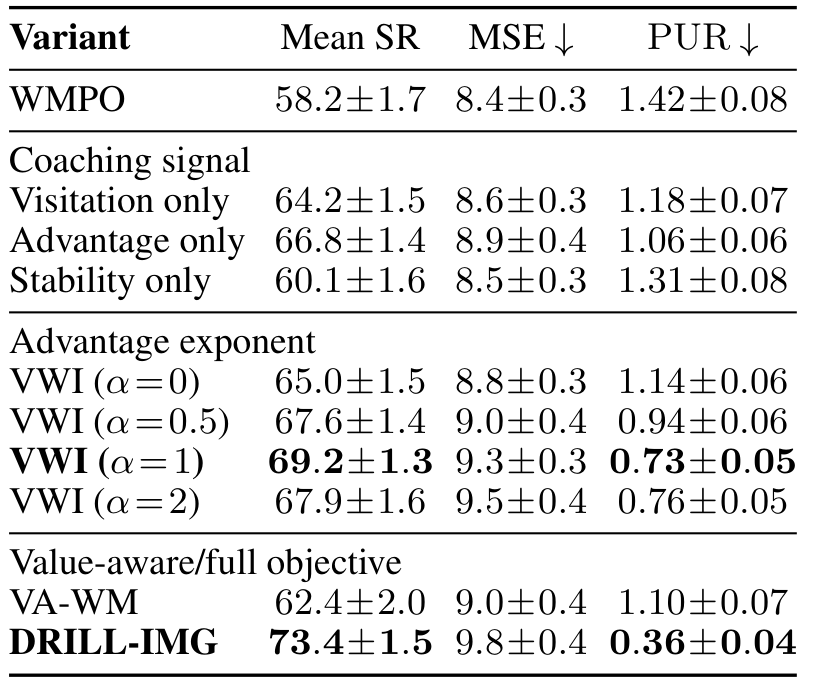
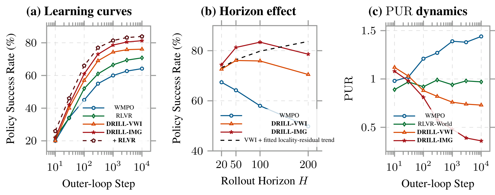

# DRILL: Training World Models to Improve Policies, Not Predict Pixels

用视频世界模型训练机器人策略时，预测更像下一帧，并不保证模型里的策略梯度更有用。DRILL 将世界模型的目标改成：策略在想象中更新一次后，能否在目标环境里取得更高回报。论文提供便宜的局部代理 VWI 和较昂贵的元梯度 IMG，核心取舍是用多少环境交互和反向传播，换取多步学习信号。

Zhaolu Kang 等，[arXiv:2610.30814v1](https://arxiv.org/abs/2610.30814)，北京时间 2026-10-22 14:40 首次提交，属于 10-24 日报的补充窗口。依据 38 页[全文 PDF](https://arxiv.org/pdf/2610.30814)，重点核对第 3–9 页机制与实验、第 21–30 页实现和对照。论文称代码及检查点将公开，本次未核实到可下载的官方实现；附有 NeurIPS checklist 不等于已获会议录用。

## 预测像素怎样变成策略学习信号？

常规流程交替做两件事：用示范拟合世界模型的下一帧，再让 VLA 在模型里试动作并做强化学习。问题在于，背景纹理也能占据大量像素误差，策略真正依赖的接触、放置和阶段转换却可能只占很小区域。误差更低的模型甚至可能让策略沿着错误方向更新。

设策略参数为 $\theta$，世界模型参数为 $\phi$，$\widehat J_{\mathrm{GRPO}}$ 是模型内轨迹给出的组相对策略优化目标。一次内层更新及外层目标写成

$$
\theta^+(\phi)=\theta+\eta_\theta\nabla_\theta\widehat J_{\mathrm{GRPO}}(\pi_\theta;W_\phi),
\qquad
\max_\phi J_{\mathrm{env}}(\pi_{\theta^+(\phi)}).
$$

$\eta_\theta$ 是策略步长，$W_\phi$ 生成动作条件下一观察，$J_{\mathrm{env}}$ 是更新后策略在目标环境的期望累积回报。外层评价环境在本文是仿真器，并非真实机器人；它不能让世界模型自己为自己打分。冻结的视觉语言奖励模型负责想象轨迹中的评分，GRPO 通过同组轨迹的相对优势形成策略更新。

*图 1：先在世界模型中做策略更新，再把策略改进信号反馈给模型；VWI 与 IMG 是两种不同成本的外层估计。*

按实际执行顺序，系统从离线示范锚点、指令和观察历史开始，在当前模型里生成长度为 $H$ 的轨迹；用组内回报形成优势，得到策略候选 $\theta^+$；随后更新世界模型，并把候选策略保留到下一轮。模型学习的是“怎样提供有益的训练环境”，因此允许部分像素指标变差，但不能据此免除对模型失真和策略利用漏洞的检查。

## VWI 用带符号的权重近似下游方向

DRILL-VWI 不额外向环境采样，它利用已有想象轨迹，为示范锚点的预测误差选择更新方向。忽略实现中的裁剪与归一化，局部代理为

$$
\mathcal L_{\mathrm{VWI}}=
\mathbb E_{(o,a,o')\sim D_{\mathrm{demo}}}
\left[\overline w(o,a)\,\|\widehat o'(\phi)-o'\|_2^2\right],
\qquad w=\widehat{\widetilde d}(o)\,\operatorname{sgn}(\widehat A)\,|\widehat A|^\alpha\,s(o).
$$

$o,a,o'$ 是示范的观察、动作和下一观察，$\widehat{\widetilde d}$ 估计当前策略在模型内的访问密度，$\widehat A$ 是组相对优势，$s>0$ 在模型不确定时压低权重，$\overline w$ 是裁剪、批内归一化并停止梯度后的系数，默认 $\alpha=1$。实现只对预测误差求导，不对密度、优势和置信度继续反传。

最容易误读的是优势的符号。负优势会给负系数，局部更新可能主动远离某些像素预测，因此这不是普通非负样本重加权，也不是全局有下界的拟合目标。图 1 将三类 coaching signal 画成加权示意，而正文式 (6) 和附录算法采用以上乘积、带符号形式；复现应以公式与算法为准。

访问密度由冻结编码器的 256 维归一化 latent、FAISS 近邻缓冲估计，默认 16 个邻居。理论联系要求高斯观察头固定方差、单步内访问分布近似不变、停止优势梯度，并要求策略分数收缩与优势方向局部兼容。它只恢复 IMG 的局部单步分量；多步轨迹项、示范与在线分布不匹配都留下残差，不能说 VWI 与完整元梯度严格等价。

## IMG 怎样把仿真器反馈传回世界模型？

DRILL-IMG 每次将更新后策略放进目标仿真器，采集 30 条轨迹，估计 $G=\nabla_{\theta^+}J_{\mathrm{env}}$。链式法则要求计算内层策略梯度对世界模型的影响。实现把 $G$ 停止梯度，形成标量 $G^\top\nabla_\theta\widehat J_{\mathrm{GRPO}}$，再对 $\phi$ 求导；这种向量与导数的收缩避免显式保存巨大的混合 Hessian。

默认想象长度 $H=50$，只为 $K=2$ 步保留可微图，其余步骤在无梯度模式下展开。附录报告，相对完整时间反传，这使相应展开激活占用约减少 25 倍，但这不是整个训练总显存的等比例下降。外层梯度范数裁剪到 10，HVP 累积用 float32，作者观察到 bf16 累积可能静默发散；外层更新还冻结归一化统计。

截断确实带来偏差。收敛分析假设偏差上界为 $B\rho^K$ 且 $0<\rho<1$，证明的是固定当前策略的外层子问题收敛到驻点邻域，不能扩展成策略与模型共同变化时的全局保证。低维 gridworld 与 Meta-World MT10 审计中，$K=2$ 相对完整元梯度的方向余弦约为 0.74 和 0.71；该小模型实验支持浅展开的可行性，不证明十亿参数模型拥有完全相同的梯度质量。

## 成功率、MSE 和控制预算应分别比较

主实验以 π0-3B、1.2B Ctrl-World 在 LIBERO-Long、CALVIN ABC→D、RoboCasa、Meta-World MT50、SimplerEnv 上评估，主结果为 5 个种子的均值和标准差，消融用 3 种子。附录另在 OpenVLA-7B 上复验前三项任务，不能写成两种骨干都跑完全部五项。所有量化结果均为仿真。

*表 1：π0-3B 主结果，成功率以百分比计；均值±标准差来自五种子，MSE 的单位为千分之一。*

五任务平均，IMG 相对 WMPO 提高约 13.1 个百分点，相对 RLVR-World 提高约 7.9 个百分点，同时下一帧 MSE 从 8.4 升到 9.8，约差 17%。LIBERO-Long 成功率由 64.2±1.6% 升到 81.3±1.3%，但 SimplerEnv 上 VWI 为 64.0±1.9%、IMG 为 63.1±2.6%，统计上没有 IMG 优势。目标对齐优于只追求像素精度，并不意味着更复杂估计器处处更好。

Sim-PPO 从相同 VLA 检查点和示范预热出发，接收与 IMG 相同数量的仿真 episodes，是环境交互量对照；它没有匹配想象计算、墙钟或梯度步数。另一个增训 WMPO 的计算对照在 LIBERO 最多达到 65.1±1.9%，支持收益不只是多做世界模型更新，但不能据此声称所有资源维度均已控制。

*表 6：三个任务上的目标消融，全部结果是三种子均值±标准差；单因素版本用于诊断局部代理的各项作用。*

在三个任务的消融平均中，WMPO 为 58.2%，仅访问密度为 64.2%、仅优势为 66.8%、仅置信度为 60.1%，三项结合的 VWI 达到 69.2%，IMG 为 73.4%。固定旧策略的权重后只达到 64.9%，提示跟随当前策略更新 coaching signal 比一次性静态加权重要。VWI 的 $\alpha=1$ 好于 $\alpha=2$ 的 67.9%，也与线性有符号局部近似相符；不能把这个有限扫描推成通用最优超参数。

## 时域、诊断成本与尚未验证的外推

*图 3：学习过程、想象长度和 PUR 的联合诊断；中图显示长时域带来额外收益，也最终受到想象误差限制。*

IMG 相对 VWI 的差距从 $H=20$ 的 1.8 个百分点增至 $H=100$ 的 7.5 个百分点，但 IMG 自身从 $H=100$ 的 83.4% 降到 $H=200$ 的 78.6%。$H=5$ 时差为 −0.2±1.1 个百分点。论文把趋势联系到多步残差，但没有隔离出普遍的平方时域规律。对短任务或拿不到额外仿真交互的场景，VWI 更符合预算。

PUR（策略效用残差）测量像素下降方向与下游回报上升方向是否一致。令 $g_M=\nabla_\phi\mathcal L_{\mathrm{MSE}}$、$g_J=\nabla_\phi J_{\mathrm{env}}$，则 $\mathrm{PUR}=1+\cos(g_M,g_J)$。接近 0 意味着降低像素误差有助回报，接近 1 表示近乎正交，接近 2 表示二者冲突；梯度为零时该余弦没有定义。作者用独立随机子空间有限差分估计 $g_J$，避免直接复用 IMG 的 HVP 作为裁判，但一次 PUR 测量需 128 个方向、双边差分、每边 30 条仿真轨迹，共 7,680 条，每 500 次外层迭代才测一次。它是昂贵的诊断，不能称免费在线反馈。

附录预算约为 17,040 H20 小时，其中 IMG 外层新增约 3,840 小时；每外层约比 VWI 贵 1.4 倍。作者声称会发布代码和检查点，但当前公开可复现性仍待确认。真机感知噪声、执行延迟和 sim-to-real 尚无数据，部分附录资产描述也需在实现发布后核对。我的分析是，最值得迁移的是“按策略学到什么评价世界模型”的实验标准；实际选择 VWI 或 IMG，应同时固定环境交互、计算和任务时域，不能用更高的成功率掩盖额外的外层采样成本。
