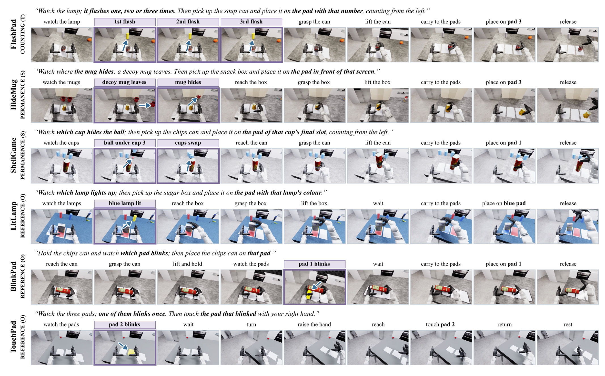
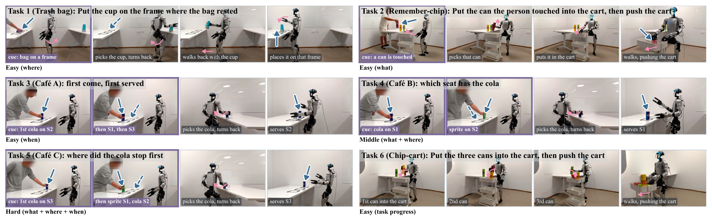

# Memory before Goal: Role of Pre-History Memory for Humanoid Loco-Manipulation

机器人转身去取物体时，刚才亮过的灯、被人碰过的罐子和先后出现的顾客可能已经离开视野。只靠当前图像的策略会丢掉决定目标的证据。本文将这种“先看线索、后执行选择”的任务单独建模，并用物体事件筛选历史，再把记忆直接接入动作专家。理解它的关键是同时检查两件事：是否真的记住线索，以及记住后能否完成操作。

Chenyuan Chen、Ran Ding、Lechen Zhang、Zewen He、Yoshihiko Nakamura，MBZUAI。[arXiv:2610.31166v1](https://arxiv.org/abs/2610.31166) 于北京时间 2026-10-22 20:24 提交；[项目页](https://memory-before-goal.github.io)与[官方仓库](https://github.com/crystalccy1/MemoryBeforeGoal)提供补充材料。仓库于 10-23 17:20 创建，本篇属于补充窗口精读。阅读覆盖 8 页全文，截至检索时 README 仍标明代码、模型 coming soon，不能把公开数据入口当成完整实现已开源。

## 让线索消失，才能测出机器人究竟记住了什么

长轨迹并不天然需要记忆：当前画面或指令可能一直泄露正确答案。作者构造 HuMeGo 的 6 项仿真和 6 项真机任务，让线索在决策前消失，候选答案在二选一或三选一中均衡，并让指令与决策前运动不携带答案。这样，策略无法仅凭“最后总是去左边”绕过历史。

*图 2：六项仿真任务中，计数、物体恒存及指代线索短暂出现，后续动作必须依赖此前的观察。*

例如 FlashPad 先闪灯一至三次，再要求把罐子放到相应编号的垫子；ShellGame 要记住球所在杯子的最终位置。仿真主要通过场景变化移除线索，真机则利用机器人转身造成视野变化。评估除了最终任务成功率，还报告 记忆决策准确率：是否选择了由线索指定的答案。前者混合了记忆与操控失败，后者帮助判断究竟是哪一段链条断了。

仿真每任务有 100 个训练场景和 90 个测试场景，种子不同，但布局取值范围与材料属于同分布。L0 改视觉和干扰物，L1 再改照明，L2 再加空间扰动。因此“随机化鲁棒”不等于跨未见物理机制或开放世界泛化。平均轨迹为 1,155 步、约 23 秒，线索仅占轨迹的 0.8%–14.7%，各任务所需保持时间中位数为 13.5–22.5 秒，均匀采样容易漏掉短事件。

## 从物体事件留下少量关键历史帧

WholeBodyMem 先决定留下什么，再决定如何让动作使用它。冻结 SAM3 跟踪每任务预先指定的 1–2 个相关物体，提示在评估前固定，允许离线 LLM 辅助生成；它不是在线自动理解任意新任务并发现所有相关对象。

每次只使用当前及过去图像，置信度低于 0.35 的跟踪被忽略。相机移动用背景相似性补偿，随后检测出现、消失、重现、移动和形状变化事件。移动阈值为图像对角线的 3%，形状变化以 IoU 低于 0.65 判定；物体消失时保存最后可见帧，避免把消失后的空画面当记忆。事件按消失/重现优先级、再按置信度排序。

帧集合始终保留首帧、中间帧、当前帧，再加最多 4 张事件帧；与已选帧相距不到 5 个跟踪帧的候选会被跳过。因此实际为 3–7 帧，均值 5.4 帧。和固定 7 帧相比，报告的 词元 降幅为 22.9%，这不是包括跟踪器开销的端到端加速。若 SAM3 从未识别到重要线索，后面的记忆模块无法恢复不存在的证据。

## 历史如何进入动作专家而不挤占当前观测？

图 3 的左侧负责历史整理，中间是动作专家，右侧连接全身控制。作者保留当前观测与语言的主干路径，另开 独立记忆交叉注意力，让去噪中的动作 词元 主动读取历史。这样可以把历史信息直接作用于动作表示，而不要求冻结 VLM 从更长上下文中重新推理。

*图 3：物体事件产生历史记忆，独立交叉注意力经 FiLM 调制动作专家；决策头再把记忆中的线索关联到当前目标。*

冻结的 Qwen3-VL-2B 为每个选定帧提供原生特征。每帧保留 77 个视觉 词元，加入时间和空间位置编码，通道从 2,048 投影到 1,536。固定 7 帧对照使用 539 个视觉 词元；另有最多 14 个物体 词元，来自 mask 内特征池化并编码时间、中心、框、面积、可见性和物体槽位。记忆每次调用缓存一次，供 6 层 DiT 和去噪过程共享，而非逐层重新跑视觉主干。

在每层中，30 个 动作词元 通过多查询交叉注意力读取记忆：6 个 查询头，每头 256 维，共享一组 key/value。读出用于 FiLM，即用历史控制当前动作表示的通道缩放与平移：

$$
\widetilde A=\mathrm{RMSNorm}(A)\odot(1+\gamma)+\beta.
$$

$A$ 是该层动作 词元，$\gamma,\beta$ 是由记忆读出映射得到的逐通道调制量，$\odot$ 表示逐元素乘法。RMSNorm 先稳定尺度，$1+\gamma$ 让小初始化接近原动作通路，$\beta$ 再允许历史产生偏移。相关映射初始化标准差为 0.002；它调制而非替代当前观测的 joint attention。物体 词元 通过第二条注意力支路进入，输出投影零初始化，使新增支路从保守状态开始学习。

只知道“蓝灯亮过”仍不等于知道当前该去哪个垫子。决策查询 再读取记忆、物体 词元 和 空词元，输出候选答案分布 $w$，决策阶段用标签交叉熵监督。$w$ 一路经零初始化映射进入 AdaLN 时间条件，另一路在当前垫子区域施加 $\log w_k$ 的注意力偏置。这个局部偏置只有在最大决策权重和可见 pad 权重均至少为 0.6 时启用，以减少尚不确定时的过早引导。

总体训练目标为 $\mathcal L=\mathcal L_{\mathrm{flow}}+0.5\mathcal L_{\mathrm{decision}}$：前项训练动作 flow matching，后项把历史证据约束为任务答案。仿真按任务训练 40,000 步，batch 128、bf16、AdamW 学习率 $10^{-4}$，预热 1,000 步后余弦下降，dropout 为 0.1。它没有展示一个策略同时覆盖所有任务的统一泛化结果。

## 同预算仿真消融支持什么结论？

仿真演示由 Dex3 脚本抓取、cuRobo 和 AMO 组合生成，筛掉未持住物体或未看清线索的轨迹；MuJoCo 负责 2 ms 物理步，控制和重放 RGB 为 50 Hz，Isaac Sim 渲染 640×360 图像，状态 32 维、动作 36 维。过滤后的演示适合学习可完成的任务，但真实感知与失败恢复仍可能不同。

普通 14 项 SIMPLE 任务每等级 10 次，6 项记忆任务每等级 30 次，共 540 次记忆任务试验。主要基线 Ψ0 没有历史，均匀记忆基线 将 RoboMME 的均匀历史读取改到本任务，固定 7 帧、539 个原生视觉 词元。它控制了“多看历史图”这一主要因素，比只和无记忆策略比较更有解释力。

| 设置 | 记忆任务成功率 | 普通 SIMPLE 成功率 |
|---|---:|---:|
| 无记忆 Ψ0 | 29.1% | 70.2% |
| 均匀记忆基线 | 44.4% | 76.9% |
| 完整 WholeBodyMem | 72.6% | 86.9% |

完整模型记忆决策准确率为 93.7%，高于操作成功率，说明选对目标后仍可能操控失败。普通任务的收益主要与头部移动造成的目标丢失和进度遮挡有关，不能仅归结为长期线索推理。

**图表占位：Table IV（第 7 页，消融实验）**。状态：没有独立完整表格候选；已核对完整原页，关键数值保留如下。

同样固定 539 个视觉 词元，改用事件选帧但去掉物体 词元 和决策头，成功率达到 60.4%，相对均匀采样提高 16.0 个百分点；再加物体 词元 为 65.7%，加决策头且固定预算为 70.4%，允许自适应帧数后为 72.6%。这支持“选中短线索比单纯扩大历史容量更重要”。但后续是逐步加入模块的消融，不能把差值机械分摊成任意模型上独立可加的因果效应。

把历史直接作为冻结 VLM 的上下文、移除独立 记忆注意力 后，成功率降为 25.9%，甚至低于无记忆的 29.1%。该消融基于非自适应版本，改变了注入路径等条件。它证明此处的动作侧读取更合适，没有证明所有 VLM 长上下文记忆都会失败。

## 真机可行性和复现边界

真实实验用 29 自由度 Unitree G1、Dex3 灵巧手、D435 头部相机和 RTX 5090 服务器。每任务 15 条遥操作示范，共 90 条，按任务训练 5,000 步。这里的动作接口是 64 维 SONIC motion 词元 加 14 维手部目标，不能直接套用仿真的 36 维动作。策略生成 30 步 chunk，执行前 24 步，再重规划，通过 SONIC 以 50 Hz 接入全身控制。

*图 4：六项 G1 任务分别测空间、物体、时间、组合记忆及任务进度，转身使先前线索离开当前视野。*

**图表占位：Table V（第 7 页，G1 真实实验）**。状态：没有独立完整表格候选；已核对原页六任务计数及试验分母。

| 真实任务 | Ψ0 | WholeBodyMem |
|---|---:|---:|
| Trash bag | 4/10 | 9/10 |
| Remember-chip | 3/10 | 10/10 |
| Café A | 4/10 | 9/10 |
| Café B | 3/10 | 9/10 |
| Café C | 3/10 | 8/10 |
| Chip-cart | 5/10 | 8/10 |
| 合计 | 22/60，36.7% | 53/60，88.3% |

这组结果表明任务所需历史能够接入真实全身动作链，但真机只比较 Ψ0 与完整模型，没有 均匀记忆基线 对照，不能直接把 51.7 个百分点的总差归因于事件选帧。每任务每策略只有 10 次，论文没有给出跨训练种子区间，仍需更广泛重复试验。

相机输入为 30 Hz，论文另写 SAM3 每 24 个相机帧运行一次，约 1.25 Hz；这与控制器执行 24 个 50 Hz 动作不是同一个时间轴。50 Hz 是动作执行接口，不是整套感知、记忆、去噪网络的推理频率，全文也没有完整端到端延迟和截止时间分布。

我的分析是，最值得复用的实验设计是让指令和决策前运动不泄露答案，同时保留决策正确率、操作成功率和同 词元 预算对照。方法上则应先检查跟踪器是否覆盖真实线索，再评价记忆读取。代码与模型仍待发布，当前无法从公开入口完成原样复现；跨任务迁移、跟踪开销及复杂接触失败恢复也仍不能确定。
