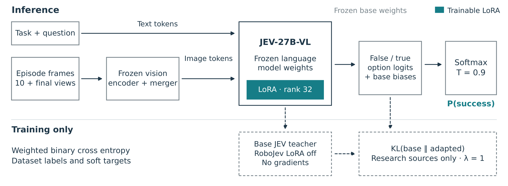
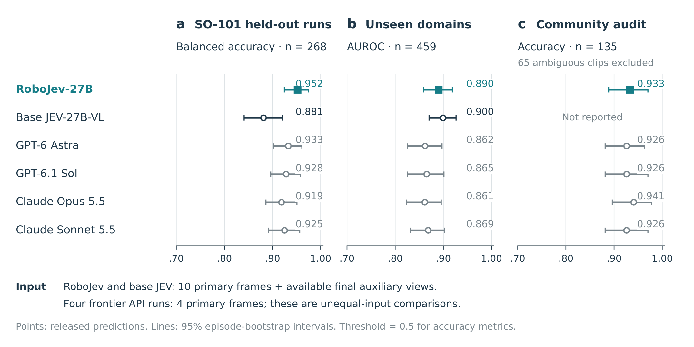
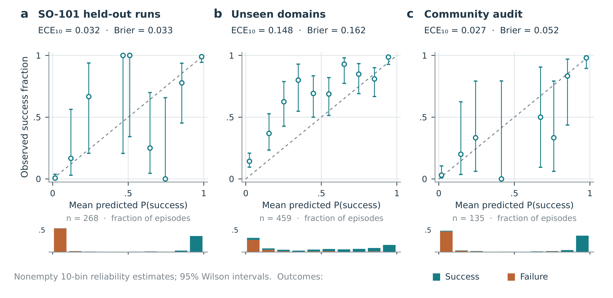

# RoboJev: An Open Vision-Language Judge for Robot Success Detection

机器人执行完一条指令后，怎样低成本判断它是否成功？RoboJev 把这个问题做成一个开放的视觉语言判别器：从轨迹中抽取少量图像，只读出“成功/失败”两个答案的概率，再用机器人数据适配已有模型。它最有说服力的结果是相同输入下相对底座的近域提升；域外实验则提醒我们，适配后的概率和准确率都不会自动泛化。

Josef Chen，独立研究者。本文依据作者发布的 15 页[固定版本 PDF](https://huggingface.co/josefchen/RoboJev-27B/resolve/b1873c298b85344afa1b249d473f0766122bd5f2/paper/RoboJev.pdf)，并核对[模型卡与权重](https://huggingface.co/josefchen/RoboJev-27B)及[客户端仓库](https://github.com/josefchen/robojev)。首次论文文件于北京时间 2026-10-24 09:45 公开，权重已于 10-23 22:13 发布；没有查到作者给出的 arXiv 标识。附录位于第 10–15 页，数据账本、划分、区间与成本说明一并纳入阅读。

## 终局成功判别需要什么观测？

抓到物体不一定完成了“放进抽屉再关上”的指令，最后一帧也未必能证明中途发生过的事件。因此模型接收任务文字、从尝试开始到结束均匀抽取的 10 张主相机帧，以及每个辅助相机的最后一张图。历史帧补充过程证据，额外终帧补充被遮挡的最终状态，但仍属于稀疏观察，短暂掉落、再抓取或接触事件可能落在采样间隙。

这一定义决定了输出的用途：它判断整个 episode 是否完成任务，不提供每一步的进度，也没有把成功概率定义成可累加的逐步奖励。对数据筛选或终局反馈，这个接口足够直接；若用于策略优化，奖励是否可被利用、是否导致投机行为，还要另做闭环实验。

## 把成功概率压缩到两个 logit，再约束适配漂移

图 2 的上半部分可以按一次调用的顺序阅读。视觉编码器和 merger 冻结，任务文字与图像 词元 送入 JEV-27B-VL，只有语言侧 rank-32 LoRA 可训练。作者先合并底座已有的 decision adapter，再叠加 RoboJev 适配器；所以“底座”不是未经任务适配的通用视觉模型。

*图 2：上半部是终局概率的推理路径，下半部是仅训练时使用的标签损失与底座 KL 锚定。*

模型在回答位置取 false 与 true 两个 词元 的 logit，而不生成长解释。设输入为 $x$，两类 logit 为 $z_0(x),z_1(x)$，读出为

$$
p(y=1\mid x)=\frac{\exp((z_1(x)+b_1)/T)}{\sum_{c\in\{0,1\}}\exp((z_c(x)+b_c)/T)}.
$$

这里 $y=1$ 表示成功，$b_c$ 是继承的类别偏置，$T$ 是验证集拟合的温度，发布值为 0.9。工程上只需提取两个指定 词元 的分数，加偏置、除温度后 softmax；它不是对整个词表概率直接取 true。温度改变置信度，不凭空增加视觉证据，也不能保证换域后的校准。

适配的风险是社区机器人数据把模型推向狭窄分布，损害原先的研究数据能力。训练目标因此同时约束标签拟合和输出漂移：

$$
\mathcal L_i=w_i\,\mathrm{CE}(y_i,q_\theta(x_i))+
\lambda a(x_i)\,\mathrm{KL}(q_0(x_i)\Vert q_\theta(x_i)).
$$

$q_\theta$ 是适配后的二分类分布，$q_0$ 是关闭新增 LoRA 的底座分布，并停止梯度；$w_i$ 是标签项权重。指示函数 $a$ 只对 RBM、ViFailback、DROID 等研究来源启用锚定，社区数据及 Armnet 不启用，$\lambda=1$。因此这不是对所有来源统一蒸馏。KL 让底座对研究样本的判断成为软约束，标签项仍允许适配纠正错误；实现时注意 $w_i$ 只乘交叉熵，不能顺手乘到整个损失。

全程训练一轮，学习率为 $5\times10^{-5}$。适配强度从 0、0.25、0.5、0.75、1 中用验证集选择：在各来源相对底座 AUROC 下降不超过 0.005 的约束下，优先社区 AUROC，最终取 1。无锚定版本的域外 AUROC 为 0.847，锚定版本为 0.890，支持保留底座行为的设计动机；这仍是单次训练比较，不是多种子稳定性结论。

## 混合监督如何形成，哪些留出真正独立？

拟合数据共 52,598 个 episodes：RBM 28,170、Armnet 1,388、教师标注社区数据 10,216、社区成功数据 3,718、ViFailback 4,962、DROID 4,144。经过增强、重复采样后，一轮有 102,172 个训练示例，后者不能作为独立轨迹数宣传。每来源做类别均衡，权重截断在 0.25–4，单类别来源权重为 1；截短正轨迹与错配指令制造的负例权重为 0.5，因为这些合成标签可能有噪声。

社区软标签来自高置信教师共识：Astra 与 Sol 同时给出至少 0.9 或至多 0.1 的成功概率，若有 Opus 结果，还需二值判断一致，再平均共识分数。测试 owner 留出，106 个测试 owner 被排除出训练。这样的监督有成本优势，但教师也是后面的 API 对照，不能把学生接近教师直接解释成与教师无关的独立验证。

人工标注共有 927 条，其中社区 200 条里 65 条含糊样本被排除，最终 862 条计分：SO-101 268 条、未见域 459 条、清晰社区样本 135 条。社区由单人标注，没有标注者一致性统计。32.5% 的社区样本含糊，说明最终准确率针对可判定子集，不代表任意公开视频都能可靠给出二值真值。

SO-101 的 8 项任务中，80 条来自两个完全留出任务，其余 188 条主要考察 session 留出。域外数据跨 8 个实验室/机器人域标签，不能把标签数改写成独立机构数。论文明确披露开发过程中看过测试 benchmark，因此这些结果也不能当成严格盲测或预注册评测。

## 同输入底座有收益，跨域和 API 比较要收窄结论

判别任务同时报告 AUROC 和 balanced accuracy（BA）。前者关注成功分数的排序，后者平均两类召回率，减少成功/失败比例不均的影响，二值阈值为 0.5。图 3 各列使用的指标不同，不宜直接把三列条形长度当同一种收益。

*图 3：近域 BA、域外 AUROC 与清晰社区子集准确率；图内保留了不同输入预算及 episode bootstrap 的说明。*

| 评测子集 | RoboJev | 匹配输入底座 | 解释 |
|---|---:|---:|---|
| SO-101，268 条，BA | 0.952 | 0.881 | 近域适配显著受益 |
| SO-101，268 条，AUROC | 0.993 | 0.979 | 排序也改善 |
| 两个全任务留出，80 条，BA | 0.925 | 0.9125 | 增益小于整体，Astra/Sol 为 0.9625 |
| 未见域，459 条，AUROC | 0.890 | 0.900 | 没有域外排序提升证据 |
| 未见域，459 条，BA | 0.782 | 0.794 | 固定阈值下也低于底座 |

附录给出的 SO-101 配对 BA 增益为 +7.08 个百分点，95% 区间为 [3.04,11.45]。域外 AUROC 差值则是 −0.0092，区间 [−0.0218,0.0026] 跨零。新的区间采用按标签分层的 4,000 次配对 episode bootstrap，种子为 20261024；它衡量这批 episodes 的抽样变化，没有覆盖新训练种子、新域或域内相关性。

主要受控证据来自与底座对照：727 条共有样本的图像和提示字节匹配。API 模型只看 4 张主相机帧，RoboJev 看 10 张加辅助终帧，Robometer 又采用完整视频，因此不能据此建立等预算通用排名。SO-101 相对 Astra 的 BA 差值只有 +1.91 个百分点，区间 [−1.56,5.21] 跨零。社区清晰子集准确率为 93.3%，Opus 为 94.1%，也没有全面领先。

## 概率校准与实际部署预算

若要用概率筛数据或决定人工复核优先级，仅有排序正确还不够。图 5 将预测概率与实际成功比例对齐；ECE 是按概率分箱的校准误差，Brier 是预测概率与二值真值的均方误差，数值越低越好。

*图 5：同一个发布模型在 SO-101、域外与清晰社区子集上的可靠性图、样本分布及 Wilson 区间。*

SO-101 的 ECE 为 0.032、Brier 为 0.033，域外分别为 0.148 和 0.162。温度在验证集拟合后，跨域校准仍明显变化。我的分析是，复用时应先采集目标域的小规模人工标签，检查 false positive 与概率可靠性，再决定阈值；把 0.9 直接解释成任何场景都有九成成功率，超出了证据。

H100 上串行单条推理中位耗时 0.257 秒，按每小时 2.69 美元租金折算约每千条 0.192 美元。这个数不含下载、解码、排队、GPU 空闲与资源分配成本；API 墙钟时间也不在受控硬件上，不能据此声称端到端固定倍数加速。论文对 68,555 条、501 小时目录的约 4.9 GPU 小时是推算，并非已全部评分的实绩。发布的 bf16 检查点约 55 GB，目标硬件为 80 GB 级显存。

客户端提供 LeRobot 终局奖励接入，但论文没有报告用它训练出的策略是否更好，也没有测量指令改写敏感性。长时任务、腕部视角及稀疏采样仍会产生失败。数据来源还存在部分许可缺失与社区资源不再公开的问题，权重开放不等于训练数据整体可复现。最可复用的贡献是终局判别接口、匹配底座的对照方法和校准审计；用于奖励学习的闭环收益仍有待验证。
