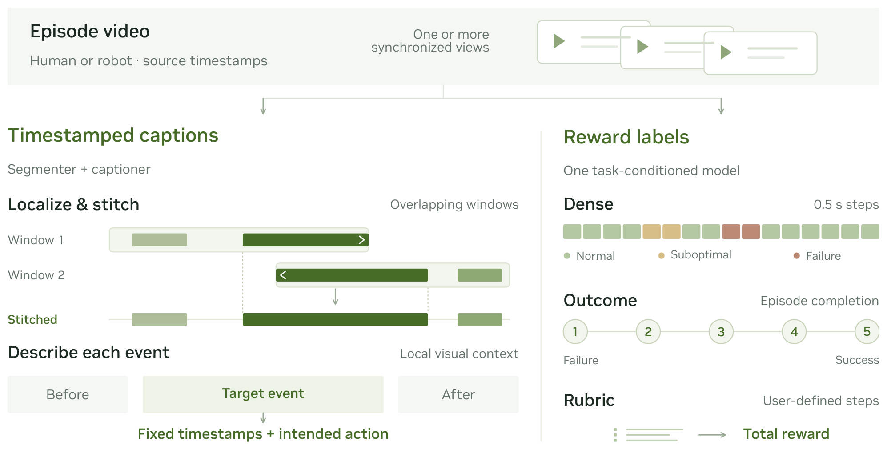
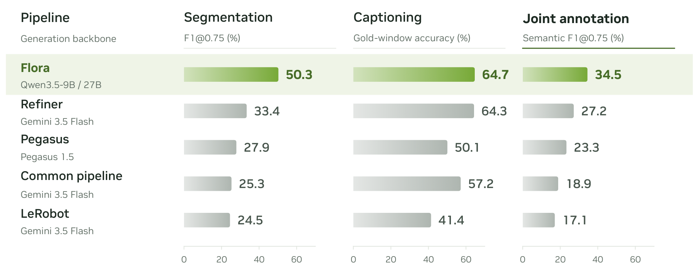
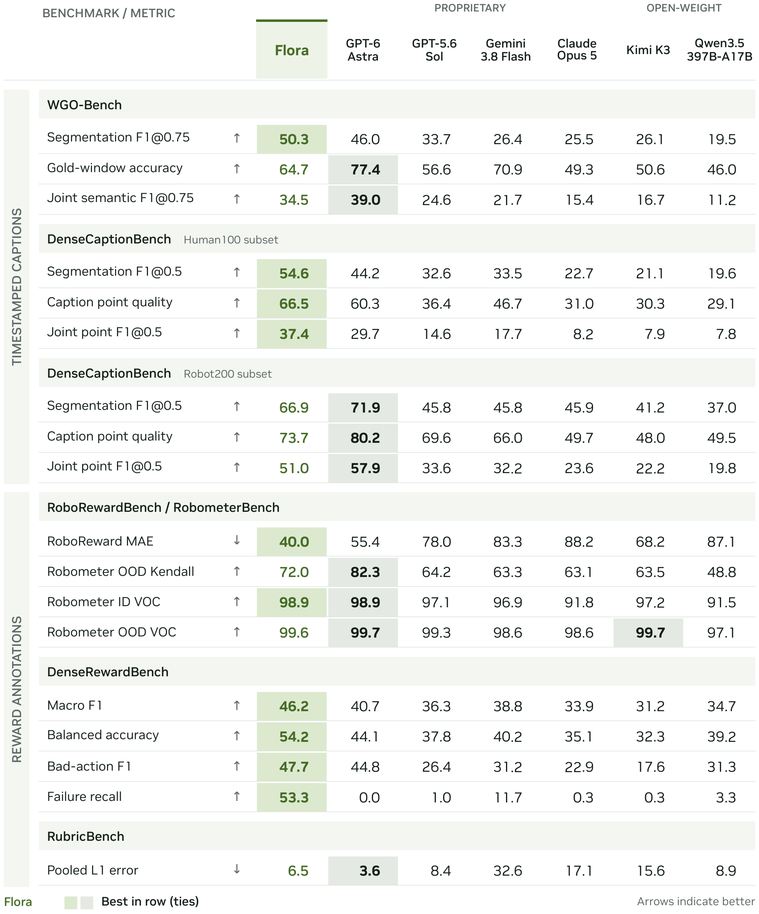
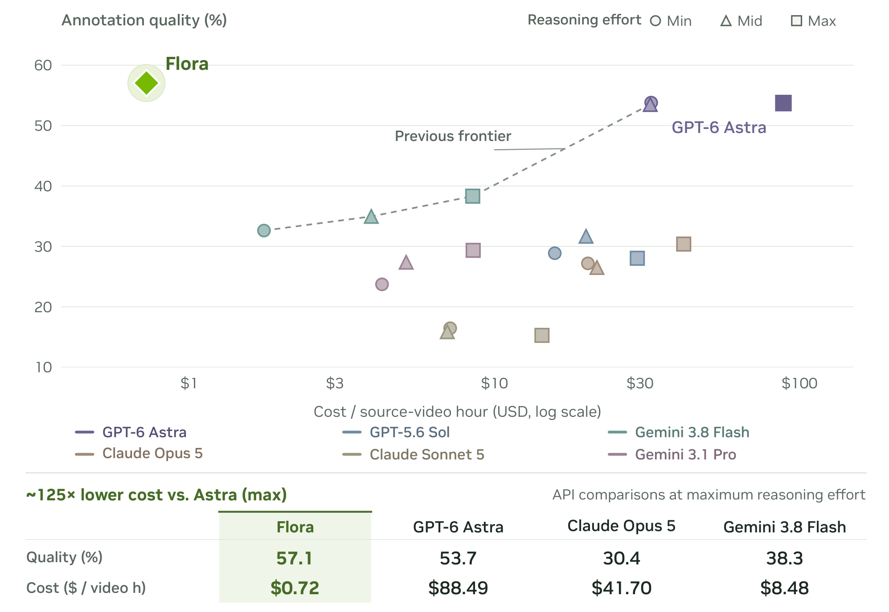

# FLORA: An Open Model Suite for Scaling Robotics Data Engines

机器人数据引擎需要知道视频里每段动作何时发生、机器人想做什么，以及这次尝试做得怎样。把所有问题交给一个通用多模态模型，往往把时间边界、动作意图和执行质量混在一起，也使离线标注成本难以控制。FLORA的思路是把它们拆成专用模型，再用统一的时间轴把结果接回完整轨迹。

Sicong Leng、Yunze Man、Zhiqi Li 等，NVIDIA，[arXiv:2610.31779v1](https://arxiv.org/abs/2610.31779)，首次提交为北京时间2026-10-23 02:16:17。本笔记核读37页全文与相关附录；当前PDF封面日期为10月26日，不能据此称为10月25日新论文。[官方项目](https://research.nvidia.com/labs/gear/flora/)与[模型集合](https://huggingface.co/collections/nvidia/flora)可作为实现入口，资源首次公开日期未逐项确认。

## 把长视频标注拆成三种职责

假设一条多相机轨迹里，机器人拿起杯子、尝试放到架子上，又因为碰撞收回手。首先需要时序分割模型找出动作区间；其次描述模型说明每段的动作意图；最后奖励模型判断成功、失败或执行质量。“试着把杯子放上架子”可以是准确描述，即便杯子最后掉落。把失败从意图描述里剥离，才有可能同时训练动作语义和质量筛选。

*图6，源文第8页：分割、描述和奖励模型的专门化路径。*

分割器基于Qwen3.5-9B，用秩32、缩放系数64的LoRA训练语言侧注意力与前馈层，视觉部分冻结。描述器为27B，监督微调更新语言模型和多模态合并模块、冻结视觉编码器；强化学习阶段进一步冻结合并模块，仅更新语言模型。27B奖励模型采用监督学习，同时更新语言、合并与视觉部分，视觉学习率较低；混合数据训练一轮，不做额外类别重加权。因而“FLORA全部组件都通过强化学习训练”并不准确。

图6的价值是说明模型分工如何对应监督，而不是证明三种模型一起部署就一定提高策略成功率。论文没有直接给出使用这些标注前后的下游机器人策略增益实验；“用于GR00T数据流程”不能替代这一因果对照。

## 窗口边界如何拼接为连续事件

长视频必须切成窗口才能推理，但动作可能跨越窗口。FLORA为每个窗口保留左右上下文，只把中间核心区的结果发回全局时间轴；预测区间同时带有左右延续标记。局部时间换算成绝对时间后，只有重叠关系和延续标记相容的片段才拼接。并发的不同动作保持分开，不能因为时间交叠就强行合成一个事件。之后通过错位窗口细化边界，减少同一切点重复出现的系统误差。

描述阶段接收固定动作区间、最近的前后非重叠事件，以及同步多相机拼图和相机角色说明；参考答案描述不在输入中。这样描述模型可以利用上下文解释动作，却不能自行移动事件边界来提高得分。

*图4，源文第5页：联合质量既取决于分割，也取决于描述与流程选择。*

分割强化学习的奖励为

$$
r_{\rm seg}=0.45F_{0.5}+0.15F_{0.75}+0.25P_{0.5}+0.15B.
$$

$F_{0.5}$与$F_{0.75}$是在时间交并比阈值0.5、0.75下的F1，$P_{0.5}$是精确率，$B$是包含端点及延续标记惩罚的边界项。两个重叠阈值兼顾粗粒度识别与严格时间定位，精确率项抑制过量切段。GRPO用组均值作基线但不除标准差，并通过KL项约束偏离监督模型；检查点使用独立验证而非测试基准选择。

描述强化学习使用$2M/(R+M+F)$，其中$R$是参考事实总量、$M$是被支持且覆盖到的事实量、$F$是事实错误量。这样不只奖励覆盖，也惩罚幻觉，并允许部分正确。上述奖励依赖评审与参考标注质量，不能视为无噪声的物理真值；实际复现还要保留论文附录中的匹配与评审协议。

## 奖励输出为何不等于在线安全判断

奖励器有三个不同接口。完整轨迹的结果评分使用1至5分，最多64帧，取五个分数字词的概率期望并归一化到0至1：

$$
\hat y=\frac{\sum_{k=1}^{5}kp_k-1}{4}.
$$

$p_k$为分数$k$的概率。这个期望保留模型的不确定程度；它并非“成功概率”，也不能直接作为完成进度。轨迹排序、失败识别与成功轨迹的进度单调性需要分别验证。

稠密奖励把每0.5秒标为失败、次优或正常，用16秒窗口以4 fps采样64帧，窗口每10秒移动。非最后窗口丢弃末尾4秒，以减轻右边界判断不可靠的问题；重叠位置使用最近的保留组，平局优先窗口内部，再选较早窗口。输出包含最差等级、32个等级数字和异常区间理由。解析失败时回退为全正常并标记异常，因此调用端必须处理这个标记，否则可能漏报失败。

这些窗口可以看到当前时刻之后的帧，属于回顾式离线标注。我的分析是，直接将它接成在线安全监视器会改变可用信息和延迟假设；需要单独训练或评测因果版本。量表奖励则按任务步骤及可获分数累计，满分归一为1；相机分别评分而非沿用描述器拼图。作者采用9次采样并从分布中选代表值，而部分基线只采样一次，所以不能把质量差异当作严格匹配计算预算的结论。

## 质量提升取决于哪一种评测

WGO基准有100条轨迹：25条人类、50条DROID与25条Galaxea。主评测在时间交并比0.75下按三个子集等权平均，不是把全部轨迹混合后一次计算。分割分、给定真实区间的描述分、联合分分别回答不同问题。

*表1，源文第3页：FLORA并非在所有标注与奖励指标上占优。*

| 指标 | FLORA | Astra | 需要保留的解释 |
|---|---:|---:|---|
| WGO分割 | 50.3 | 46.0 | 时间定位提高 |
| WGO真实区间描述 | 64.7 | 77.4 | 已知正确边界时描述仍落后 |
| WGO联合分 | 34.5 | 39.0 | 分割收益没有抵消全部描述差距 |
| DenseReward宏F1 | 0.462 | 0.407 | 三类平均改善 |
| OOD轨迹排序Kendall相关 | 0.720 | 0.823 | 排序仍有更强对照 |
| Rubric归一L1乘100 | 6.5 | 3.6 | 这里越低越好 |

图4中的Gemini 3.5细化流程联合分27.2低于FLORA的34.5，但附录换成Gemini 3.8后达到36.4，超过FLORA。把FLORA流程内的模型替换成Gemini 3.8则只有16.4，说明专用权重与流程适配有作用，却不能宣布任何模型沿用该流程都更强。

内部DenseCaptionBench由300条完整轨迹构成，人类、夹爪与灵巧手各100，采用时间交并比0.5。人类联合分37.4对29.7较好，机器人200条上51.0对57.9较差。它补充了本体覆盖，但内部数据并不等于完全公开可重现的基准。

奖励结果也有类似边界。RoboReward的2831条轨迹上，误差表以100倍展示，FLORA的40.0表示原始1至5量表上的0.400平均绝对误差，不是40%失败率。进度一致性98.9/99.6在只含成功轨迹的条件下计算，简单线性时间也可很高，不能用来证明失败检测。

DenseReward包含40条留出双臂轨迹、4861个按1 Hz评估的时间步，其中3942正常、619次优、300失败。宏F1从0.407到0.462，失败召回率0.533，对照Astra为0，其他所列基线最高0.117；但正常步骤约11%被误报失败。4861是时间步数，不是4861次独立机器人试验。Rubric用40条轨迹、10项任务；Astra有一条未回答，协议对缺失结果有操作性处理，且双方采样次数不同。这些设置共同限制了跨指标的一句式排名。

## 约125倍成本差的计算前提

*图2，源文第2页：横轴成本包含不同计价与吞吐假设，需结合附录D解释。*

图2比较固定50条轨迹，其中20条人类、15条夹爪、15条灵巧手，总时长4483.54秒，即1.24543小时。质量汇总三个任务指标和三种本体，FLORA为57.1、Astra为53.7；未四舍五入差值约3.3。参考版本没有做到完全一致。10,000次轨迹自助采样估计的是轨迹采样不确定性，不包括评审模型、生成随机性与服务调度的全部波动。

API侧采用10月4日公开价格，7062次尝试中6956次有用量记录、106次未计价，因此报告值是已知用量小计。FLORA本地成本也不是对这50条轨迹直接计时后的账单，而是假设8张GB300、每GPU每小时10美元，沿用较早生产负载下每秒1.23495条轨迹的吞吐；该负载含660个窗口和890个描述，不是对当前强化学习检查点对完整重测的吞吐。

计算式为$C=pgN/(3600HS)$。$p$是每GPU小时价格，$g$是GPU数，$N$是轨迹数，$H$是被标注视频小时数，$S$是每秒处理轨迹数。用50和1.24543代入得到每视频小时0.7224美元，情景范围0.5102至1.2600美元；对照Astra为88.4922美元，中心比值约122.49，宣传时约写成125倍。范围来自场景假设，不是置信区间；训练、存储、评审及额外服务成本并未全部纳入。

作者另述512张GB300每天处理20万小时的生产规模。这是作者部署报告，不能当成任何用户都能复现的通用速度。对本地工程而言，应先在自己的轨迹长度、相机数量、窗口重叠和并发下量出$S$，再代入单价，而非直接套用0.7224。

## 复用时需要保留的边界

FLORA最可迁移的部分，是把动作意图、时序定位和执行质量做成独立接口，再用明确的窗口拼接协议保持一致。它同时提醒我们：一个看似漂亮的平均分会掩盖描述质量、排序质量与误报之间的权衡。部署时应保留解析失败标记、相机协议、评审版本、每类召回率及正常步骤误报率，再用人工抽查建立适合本体的验收集。

本次完成全文与图表核读，没有运行模型或复现标注吞吐。尚不能确定自动标注在固定数据预算下能带来多少下游策略收益，也不能确定将离线奖励改为因果推理后会损失多少精度。它们需要新的受控实验，不能由当前标注分数推算。
