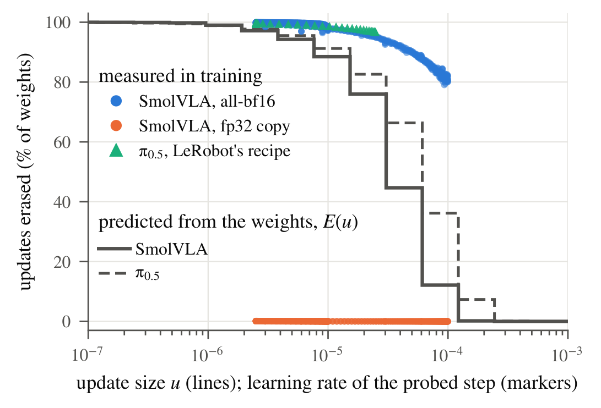
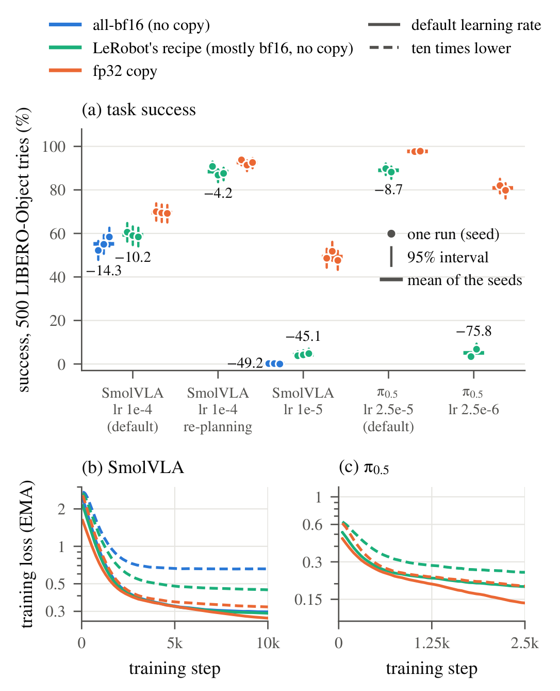

# Full-Weight VLA Fine-Tuning Without an fp32 Master Copy Silently Erases Most Updates

VLA微调可以正常反向传播、正常输出损失，却几乎没有把梯度产生的小增量写进参数。本文研究的失败点在优化器写回：如果长期保存的可训练参数就是bf16，而没有fp32主副本，舍入会吞掉低于数值间隔的更新。它是一项数值诊断与受控实验工作，核心价值是把训练配方问题定位到具体存储路径。

Shubham Singh，UT Austin，[arXiv:2610.31859v1](https://arxiv.org/abs/2610.31859)，首次提交为北京时间2026-10-23 03:45:06。核读6页全文；论文没有附录。作者表示代码、日志及项目记录可申请获取，本次未验证公开代码仓库，也未执行训练复现。

## 计算精度和参数存储精度是两件事

混合精度常见的安全做法，是用bf16进行矩阵乘法等计算，但以fp32保存可训练参数与优化器状态。临时参与计算的低精度值会刷新，微小增量仍可在高精度存储里累积。危险路径则把持久参数本身设成bf16，优化器每一步直接覆盖它；即便梯度非零，最终保存值也可能完全不变。

对普通归一化bf16数而言，8位有效精度使邻近可表示数的距离大约落在$|w|/256$至$|w|/128$之间。最近舍入下，低于约$|w|/512$的变化一定无法越过半间隔，某些位置直到$|w|/256$仍会被舍去。论文以约0.004的权重及$10^{-5}$量级更新说明这种风险。这里讨论的是归一化数、最近舍入和具体数值所在区间，不能把比例当成所有特殊值的统一绝对阈值。

简单梯度下降的存储操作可写为

$$
w_{t+1}=Q_{\rm bf16}(w_t-\eta g_t).
$$

$w_t$是持久参数，$\eta$是学习率，$g_t$是梯度，$Q_{\rm bf16}$是舍入到bf16。若括号内的新值落在原值对应的舍入区间，$w_{t+1}=w_t$。AdamW会用动量和二阶矩缩放梯度，但最后仍需要写回；所以只检查梯度范数、损失或优化器是否调用，并不能验证参数确实更新。

## 如何在训练前估计更新消失

作者用权重本身构造一个对称探针：

$$
E(u)=\frac{1}{n}\sum_{i=1}^{n}\mathbf1\{Q_{\rm bf16}(w_i+u)=Q_{\rm bf16}(w_i-u)=w_i\}.
$$

$n$是检查的参数个数，$u$是候选增量上界，指示函数在正负两个方向都舍入不变时取1。若真实更新幅度全部不超过$u$，这些参数无论更新方向如何都不会变化，因此$E(u)$给出消失比例的下界。它只需当前权重，不用训练数据，但“真实更新小于$u$”是关键条件；学习率不是实际参数步长。

*图1，源文第2页：理论风险曲线与训练中实际不变比例需要分别理解。*

论文在$\beta_1^2<\beta_2$的假设下讨论AdamW更新界；对0.9与0.95动量给出约1.165倍学习率的界，并用bf16状态实验搜索到约1.202，进而检查$1.21\eta$。经验搜索不是对所有实现的数学证明；对$\beta_2=0.999$界常数约7.3，直接使用$E(\eta)$只能作为诊断估计。权重衰减若单独舍入或和更新融合，结果也可能不同。

训练中作者每100步比较一次前后权重，在至少20次检查后核验预测。SmolVLA学习率$10^{-4}$时，$E(\eta)$约12%，实际消失79%至99%；到$10^{-5}$时为96%至99.95%。π0.5默认配方约96.7%至99.7%；排除没有梯度的嵌入行后仍至少95.8%。采用fp32存储后未变化比例不超过0.2%。预测下界远低于实际值并不矛盾，因为大量真实步长小于上界。

## 实现审计如何定位到真正写回路径

论文对12套固定版本实现检查参数和优化器构造路径，9套默认或文档推荐路径存在bf16且无fp32主副本。其中4套进行全矩阵微调，5套是LoRA；后者常用$2\times10^{-4}$至$5\times10^{-4}$学习率，探针风险接近0，并没有在本文验证同样高的实际消失率。因此“9套实现都丢掉绝大多数更新”超过了证据。

LeRobot SmolVLA示例有99.9M可训练参数，其中96.6M为bf16、3.3M为fp32，来自继承配置。作者审计的固定版本中，把 `--policy.dtype` 设为float32的选项虽被解析，却没有沿模型构造路径覆盖专家参数类型。π0/π0.5默认配置本来采用fp32，风险来自文档里的bf16覆盖选项；不能把结论扩大成全部LeRobot默认训练失效。openpi的JAX实现和审计的GR00T实现保留了安全路径。

10月16日Hub快照包含8196个SmolVLA微调和825个π0.5标签模型。300个Smol样本中291个属于全参数微调，289个最终保存为bf16，约99.3%；300个π0.5配置中252个设成bf16。作者也对40个默认配置Smol模型与基础模型比较，得到中位数22%的参数元素完全相同。这些是风险线索：最终保存类型可能是训练后转换，标签也由上传者填写，不能据此证明整个Hub训练历史的数值路径，更不能把同值元素直接等同于失败。

## 成功率差异如何依赖学习率与重规划

受控实验使用LIBERO-Object的454条示范、10项任务，每项50个相同初态，总计每次运行500条测试轨迹。SmolVLA训练10,000步、批量16、三种训练种子；π0.5训练2500步、批量32、两种种子，均从通用模型开始。两组推理精度相同，训练前向也都使用bf16自动混合精度；改动包括持久权重与AdamW状态的精度，所以不能单独归因于其中之一。

*图2，源文第3页：五种设置的成功率与训练曲线，需同时读取学习率和重规划间隔。*

| 模型与设置 | 原配方成功率 | fp32存储成功率 | 差值 |
|---|---:|---:|---:|
| SmolVLA，$10^{-4}$，每50步重规划 | 59.3% | 69.5% | +10.2个百分点 |
| SmolVLA，$10^{-4}$，每10步重规划 | 88.4% | 92.6% | +4.2个百分点 |
| SmolVLA，$10^{-5}$，每50步重规划 | 4.3% | 49.3% | 约+45.1个百分点，未舍入值之差 |
| π0.5，$2.5\times10^{-5}$，每10步重规划 | 89.0% | 97.7% | +8.7个百分点 |
| π0.5，$2.5\times10^{-6}$，每10步重规划 | 5.1% | 80.9% | +75.8个百分点 |

修复默认配方的收益在更频繁纠偏时缩小，说明长时间开环执行会放大微调质量差异。Smol默认配方若把所有可训练参数设为bf16，50步设置只有55.2%；低学习率时约0.1%。低学习率实验固定训练步数，没有训练到平台，能证明这种配方下的训练困难，不能证明fp32最终最优解一定高出75.8个百分点。

作者预先把至少10个百分点且超过最大种子波动定义为“大效应”。4.2和8.7个百分点虽有统计支持，仍低于这一定义。Wilson 95%区间针对500次测试的评分噪声，并非训练种子的置信区间；配对McNemar检验也不能消除种子、检查点与评分器偏差。部分配对检验及准二项分析是事后增加，项目日期记录不等于第三方预注册。

SmolVLA还有更直接的限制：论文自己的评分器检查未达预期，已发布检查点按50步执行得到67.6%，低于要求的88%；改为10步后为93.4%。另一检查点只检查了5.5项任务、得81.4%，仍未完成调试。因此应在本文内部同一评分器与初态下解释增益，不能直接和公开榜单比较。π0.5已发布检查点99.2%与报告99%一致，通过了相应检查。作者没有保存本次训练检查点，降低了复核便利性。

硬件方面，Smol使用RTX 4090，π0.5默认学习率实验使用H100，低学习率使用RTX PRO 6000 Blackwell。每个存储精度配对内部匹配，跨学习率比较却不是统一GPU条件。本文没有把硬件差异当成机制收益，应在复现时继续保持这一边界。

## 怎样修复并验证自己的训练

工程上应在构造优化器之前把可训练参数设为fp32，并确认动量状态也以fp32持久保存，再通过自动混合精度让主要算子使用bf16。只增加一个命令行参数并不可靠：SmolVLA需要检查专家子模型的构造配置，π0.5从`policy.path`恢复时也要检查检查点是否保留bf16。最直接的验证是在实际优化步前后复制一小组参数，统计零变化比例，同时记录梯度和更新幅度，确认探针与真实写回一致。

代价不是零：论文报告SmolVLA批量16下峰值增加约0.8 GB；π0.5批量32约需75 GB，使用梯度检查点和逐张量AdamW，而后一选项未直接暴露在LeRobot配置里。保存主副本或全精度状态会增加内存压力，需要重新量测自己的模型与批量，不能照搬一个显存数字。

我的分析是，这项工作最适合作为训练路径审计，而不是“永远不用bf16”的结论。修复后有效更新变大，原学习率可能需要重新调整；低学习率LoRA、Kahan补偿、残差累加或随机舍入等替代方案并未在本文充分比较，强化学习训练也没有验证。把计算类型、持久参数类型、状态类型和最终导出类型分别记录，才有机会区分数值失败与数据、优化或评分问题。
