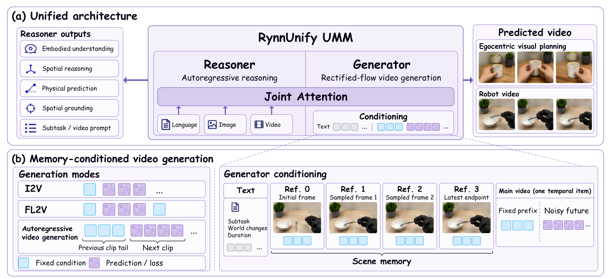
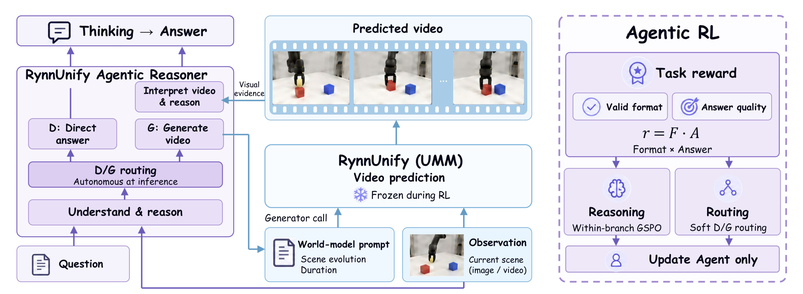
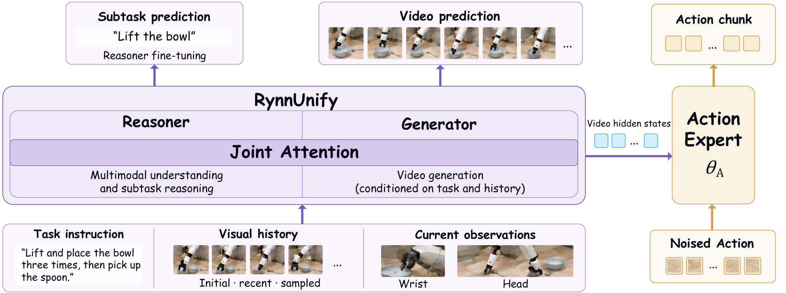
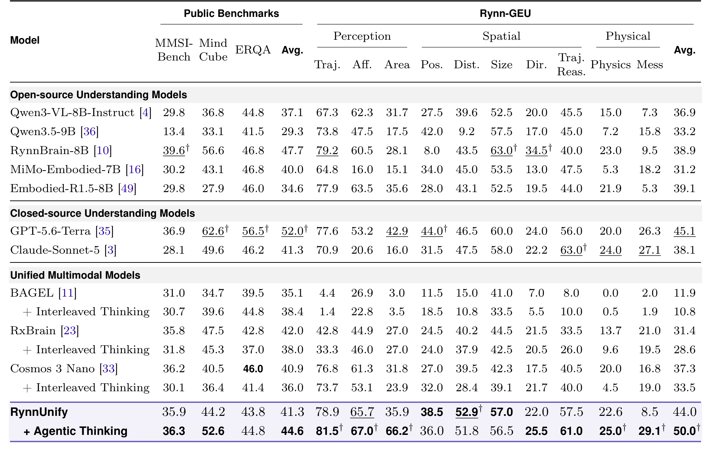
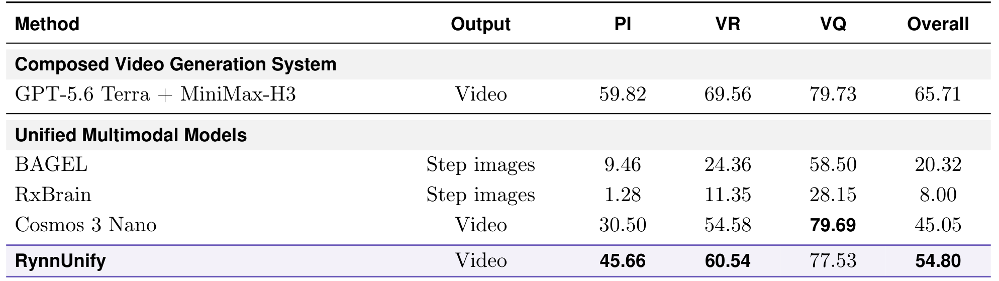
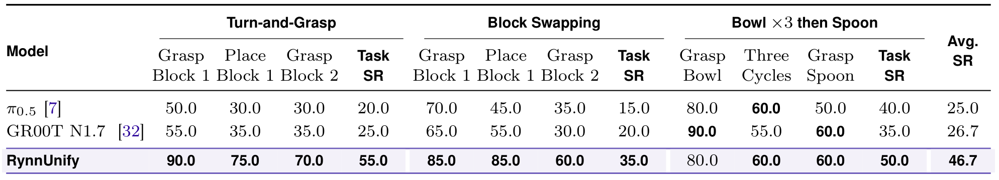

# RynnUnify: Towards Unified Embodied Brain

机器人可以用语言理解任务、用视频想象未来，也可以直接输出动作，但这三个接口通常来自不同模型。RynnUnify尝试让同一套理解与生成基础模型承担这些职责，再分别训练“什么时候借助视频回答”和“怎样从生成表征提取动作”。阅读时需要区分基础模型、额外推理代理与世界动作扩展；论文中的统一并不意味着所有结果都来自一套不变的参数。

Minghao Zhu、Bohan Hou 等，[arXiv:2610.32965v1](https://arxiv.org/abs/2610.32965)，首次提交为北京时间2026-10-24 01:54:07。本文核读41页全文及附录。[官方代码](https://github.com/alibaba-damo-academy/RynnUnify)创建于10月25日20:40:22；[当日固定提交](https://github.com/alibaba-damo-academy/RynnUnify/tree/0ec0a0d710f2464902a868ab06d0585b802f860a)可用于区分后续文档更新。[项目页](https://alibaba-damo-academy.github.io/RynnUnify.github.io/)连接模型资源。

## 统一基础模型如何接上视觉规划

单纯让视频模型生成一个“完成任务”的短片，容易得到局部合理但无法连续执行的画面。作者从Cosmos 3的混合变换器架构出发，以独立的8B自回归推理器和8B整流流生成器组成16B基础模型：前者处理文字与多模态语义，后者预测视频潜变量，两者通过联合注意力交换信息。这种分工保留了理解与生成各自的表示，并不是把视频离散化后全部交给语言解码器。

以整理桌面为例，输入任务、当前图像及最近三个子任务的历史，推理器先输出一个子计划、供世界建模使用的提示词和持续时间。生成器据此预测片段，片段末帧成为下一轮推理的观察，最多展开15步。这里末帧仍是模型想象的状态；只有动作扩展才接入真实执行后的新观察。输出480p、24 fps描述的是视频格式，不能当作生成速度或机器人控制延迟。

*图2，源文第3页：推理器、视频生成器以及历史条件如何交换信息。*

图中的关键是历史进入了两条通道。主视频序列使用上一段原始视频最后13帧作为时间前缀；另有四帧场景记忆，分别来自初始状态、两个更早的历史时刻与最近状态。这四帧独立编码，并不继续占据主视频时间轴。这样既保留局部运动连续性，又让较早的物体状态有机会被看见。视频自编码器在空间压缩16倍、时间压缩4倍，训练的2、4、8帧潜变量前缀分别对应5、13、29帧原视频；前缀不超过目标潜序列的一半。前段太短时退回末帧图生视频，同时保留场景记忆。

## 历史画面如何变成训练条件

上述循环在训练时面临一个偏差：真实历史很干净，而推理时下一段历史来自模型自己。作者使用两类处理减轻偏差。部分规划图生视频样本对条件图像加噪声与模糊；另一类使用提前离线生成的前段末帧和历史缓存，替换理想的历史条件。这些缓存一次准备后保持固定，不是在每次参数更新后在线重采样。初始真实观察仍作为锚点，监督的未来视频也保持真实目标，因此训练意图是让生成器从受扰动的条件恢复，而非把错误生成结果当成真值。

理解侧监督只对助手回答计算损失：先给提示，再把真实视频作为用户消息，最后训练回答。训练材料包括约200万通用样本、55万人类规划样本、60万机器人样本及86,800个RoboCasa样本等；这些数字属于不同来源与构造，不能相加解释为独立机器人轨迹。生成侧使用1,083,458个片段、约1370.1小时数据。

生成器的主要目标可写为：

$$
\mathcal L_G=\mathbb E\left[\frac{1}{|\Omega|}\sum_{j\in\Omega}\|v_\theta(z_t,t,c)_j-v^*_{t,j}\|^2\right].
$$

其中$z_t$是加噪潜变量，$t$是流时间，$c$是文字、前缀和记忆条件，$v_\theta$预测速度，$v^*_t$为目标速度，$\Omega$只包含需要预测的未来位置。只在这些位置平均误差，意味着记忆帧和时间前缀提供条件而不被当成未来重建目标。实现时需要把条件位置从损失掩码排除，不能仅把历史图像接在输入后就认为目标等价。

生成器训练冻结推理器，进行8000步更新，学习率为$2\times10^{-5}$，前800步预热，AdamW动量参数为0.9与0.95，梯度裁剪0.3。正文没有独立隔离场景记忆、离线自强迫条件与持续时间预测的完整消融。因此这些设计有清晰动机，但不能从总体成绩反推出每个组件各自贡献了多少。

## 什么时候值得调用视频生成

视频想象也可能误导回答：生成的几何关系不正确时，增加一段视频反而引入幻觉。BCPO为此在基础模型之外增加一个8B代理；它学习选择直接推理分支D，或调用视频生成后再推理的分支G。每道训练问题在两条分支各采样四个回答，以格式奖励和答案奖励的乘积评分。几何题可以获得分级奖励，并非所有任务都只用二元对错。

*图4，源文第13页：同一道问题的两组采样同时提供回答优化和路由监督。*

分支内部采用GSPO的组相对优势：每个样本奖励减去本分支均值，再除以标准差和稳定项。序列重要性比率由平均对数概率差取指数得到。因为组内归一化会抹去两条分支的平均优劣，作者另设路由目标：

$$
q_G(x)=\operatorname{stopgrad}\!\left[\sigma\!\left(\frac{\mu_G(x)-\mu_D(x)}{T_{\rm route}}\right)\right],\qquad T_{\rm route}=0.1.
$$

$x$是原始问题，$\mu_G$和$\mu_D$是各分支平均奖励，$\sigma$为逻辑函数。停止梯度表示这个目标只作为监督，不能通过改变奖励均值投机地降低路由损失。只有有效且有信息的分支比较参与掩码二元交叉熵。推理时代理只根据原始输入决策，不会先知道两条路径的正确答案。

总目标为$\mathcal L_{\rm GSPO}+0.01\mathcal L_{\rm route}+0.001\mathcal L_{\rm KL}-0.001H$，其中KL约束代理偏离参考模型的程度，$H$鼓励输出熵。22,007个训练问题、883个验证问题用于这一阶段；每批64题、每题8条回答，共512条，训练一轮约344次更新，学习率$10^{-6}$。只更新代理，基础视频模型冻结。因而和基础模型相比，新增的不只有调用策略，还包括额外容量与强化学习，不能把差值全部归因为“看过未来视频”。

## 世界模型如何输出机器人动作

世界动作模型扩展把视频表征接到连续控制。推理器最多读取12张图像：三路当前相机、初始状态、五帧左侧历史和三帧腕部历史，再产生子任务条件。生成器先进行一次视频去噪，随后另一次前向提取36层隐状态。18个动作模块分别交叉关注相邻两层生成器特征，把“未来会怎样”的表征转为动作流。

*图5，源文第16页：子任务推理、视频条件与动作头的连接，以及三阶段训练范围。*

动作头一次预测48步、每步12维的序列，对应20 Hz下2.4秒；采用16个Euler积分步骤求解动作流，实际只执行前16个动作便重新规划。这里“16步积分”和“执行16个动作”属于两条不同时间轴，也不是视频去噪16次。

训练第一阶段以交叉熵学习子任务推理，第二阶段以1:1权重结合视频与原生动作流匹配，第三阶段训练生成器和新动作头，冻结推理器及原生动作输出。第三阶段目标为$\mathcal L_{\rm act}+0.01\mathcal L_{\rm pose}+0.005\mathcal L_{\rm rel}$，后两项分别监督未来相机姿态及关系；它们通过训练期辅助头约束表示，部署时不需要输出这些辅助量。论文未充分隔离辅助损失和历史机制的独立收益。

机器人训练包含约1600小时原子技能和177小时组合任务。真机模型从原子技能模型继续适配，冻结推理器、训练生成器和动作头。这是有真机适配的结果，不能称为零样本跨本体部署。

## 理解与想象的提升分别说明什么

理解评测首先显示统一模型的定位：多个公开基准归一化后不加权平均为57.9，高于Cosmos的53.2，但低于专用理解模型RynnBrain的61.2。“统一多模态模型中的最好”与“所有模型中的最好”是不同结论。

*表3，源文第21页：GEU各项任务与公开理解基准上的变化。*

BCPO在GEU十项任务的均值从44提高到50，公开三项基准均值从41.3提高到44.6。面积判断35.9到66.2、杂乱程度8.5到29.1改善明显；位置38.5到36.0、距离52.9到51.8、尺寸57.0到56.5则下降。其他统一模型直接使用生成结果也可能退步，如BAGEL的GEU从11.9降到10.8。这组对照支持“需要选择性调用”，却没有在相同容量和训练预算下单独验证生成内容的因果增益。

视觉规划评测RynnVP含200项第一视角任务，最多15个子步骤，参考视频仅用于评估。自动评审使用GPT-6-sol/Codex工具链审核技能与幻觉，最多检查50张来源帧和30个候选面板；10名主审及参与者累计300次人工检查覆盖200任务，用于迭代校准。这不是盲测人类试验，也未提供独立评审一致性统计。

*表4，源文第23页：统一模型比较与组合式系统比较需要分开阅读。*

总分按$0.5PI+0.4VR+0.1VQ$组合计划指标、视觉相关性和视频质量。RynnUnify为54.80，Cosmos为45.05；前者计划指标45.66高于30.50、相关性60.54高于54.58，但视频质量77.53低于79.69。更强的Terra与MiniMax H3组合为65.71。统一模型改善了同类基线，仍没有超过该组合式系统；而这些都是想象轨迹的评分，不能替代机器人成功率。

## 动作成绩与复现边界

RoboCasa365完整测试集上，已见任务成功率52%、未见任务50%。Selected20由20项任务各10个回合组成，成绩51.5%，对照CMA为47%、Cosmos为45%、Xiaomi为46%。完整划分部分基线取自已发表报告，Selected20则由作者重跑；复现时必须保留这种差异，不能把所有表格视为一次同硬件、同训练预算的竞赛。

*表6，源文第25页：各阶段独立评分，不能把它们解释为连续条件成功率。*

Astribot S1上三项任务各试验20次，共60次。最终成功率分别55%、35%、50%，均值46.7%，对应28次完整成功；GR00T N1.7与π0.5分别为26.7%和25%。表内阶段分数独立计数，即便早先阶段失败也继续评分，不能相乘推导整条任务概率。60次试验提供了实际操作证据，但不是跨训练种子置信区间，也不足以证明任意环境迁移。

截至本次核查，官方仓库包含BCPO和VisualPlan实际目录；模型页面可访问并列出权重分片，但其当前状态包含10月26日更新，首次上传时间未可靠核定，不能称为10月25日首次发布权重。本次没有执行训练或推理。工程复用应先分别验证基础生成、代理路由、动作闭环三个接口，固定检查点、子任务历史、生成预算及评分器，再评估端到端延迟；论文的24 fps视频格式与20 Hz动作采样都没有给出完整服务延迟保证。
