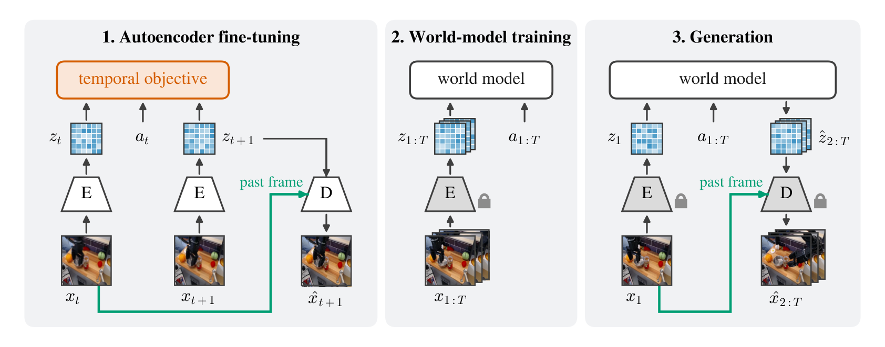
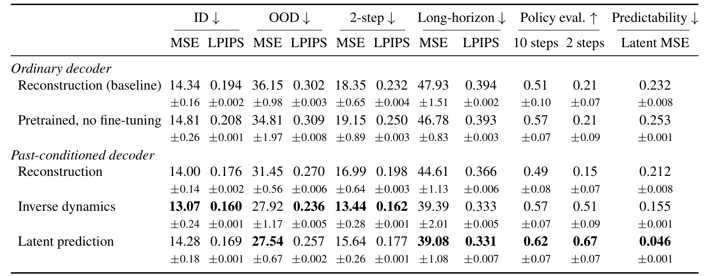
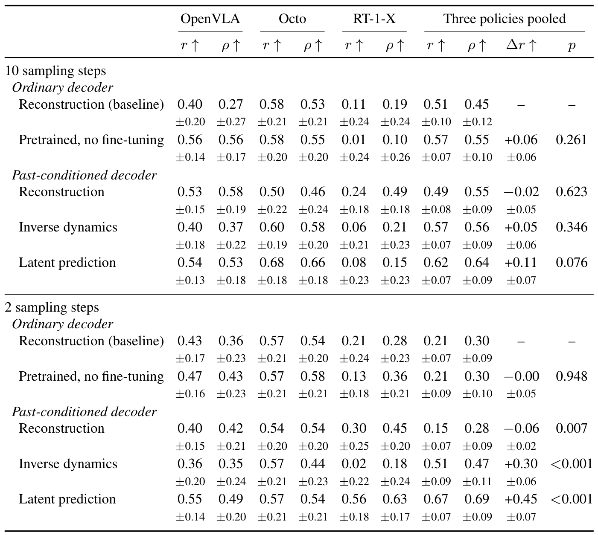

# Video World Models Need Predictable Latents

把图像压缩成容易重建的潜变量，并不意味着未来潜变量容易预测：编码器可能保留大量与动力学无关的细节。本文先用受控实验拆开重建与时序可预测性，再让解码器从过去画面补回静态细节，使潜变量更专注于变化。它改的是世界模型之前的表示学习，而非直接给机器人策略换一个动作头。

Mattia Scardecchia、Sherry Yang，纽约大学；[arXiv:2610.34663v1](https://arxiv.org/abs/2610.34663)，首次提交为北京时间2026-10-26 08:50:03。[作者代码仓库](https://github.com/mattia-scardecchia/predictable-latents)。核读54页全文及相关附录；实际技术附录从约20页展开，正文中提前引用附录的句子不代表正文在第6页结束。本次没有训练或生成复现。

## 能重建的潜变量为什么仍难预测

标准流程用编码器$E$逐帧得到$z_t=E(x_t)$，解码器$D$从$z_t$重建$x_t$，再冻结二者训练动作条件世界模型。重建目标必须照顾纹理、背景和随机细节，动力学模型却要为这些内容的未来承担预测难度；只用时序目标又可能丢掉视觉评审或策略需要的信息。

作者以102维合成观察说明冲突：2维状态按动作确定性移动，100维噪声每步独立重采样。仅重建倾向保留高方差细节，仅时序对比目标几乎只保留可预测信号；二者结合在潜维100时维持接近重建的观察恢复能力，未来潜误差却低约50倍。这个简单分布揭示机制，不是对真实视频的普适定理。

*图1，源文第2页：橙色时序监督和绿色过去帧条件解码是相对基线的两处主要改动。*

图1的阶段顺序很重要：先改变自编码器，再冻结它训练动力学模型。用于表示学习的小预测器在后一阶段丢弃，所以不是不断共同适配编码器、解码器和生成器的端到端方法。

## 时序目标怎样改变编码器

作者微调FLUX.1-schnell自编码器，以

$$
\mathcal L=(1-\lambda)\mathcal L_{\rm rec}+\lambda\mathcal L_{\rm temp}
$$

平衡两种任务。$\lambda$为0至1的权重，重建损失是像素平均绝对误差加VGG-LPIPS感知距离，时序项利用相邻帧和已执行动作。主视频实验不使用对抗损失，KL默认权重为零；实现把上述总损失乘二，使$\lambda=0.5$时两项各为单位权重，这个常数仍会通过梯度裁剪影响优化。

四种时序项分别为预测未来潜变量、预测未来像素、对比识别真实未来，以及从前后潜变量预测动作。潜预测的关键式为

$$
\mathcal L_{\rm latent}=\frac{1}{d_z}\|P(z_t,a_t)-\operatorname{sg}[z_{t+1}]\|_2^2.
$$

$P$是辅助预测器，$a_t$为动作，$d_z$为潜坐标数，$\operatorname{sg}$停止目标分支梯度。这样当前编码必须提供足够信息以预测未来，但目标不会通过同一误差立即追着预测移动；没有动量目标编码器。对比版本则使用InfoNCE、动量编码器及40,960个负键队列。逆动力学从两帧预测七维动作：六维运动分量用标准化平方误差，夹爪状态用二元交叉熵，两个潜分支都接收梯度。

FLUX每帧256×256映射为16×32×32潜变量，空间缩小8倍，未压缩时间。潜预测器约15.6M参数，逆动力学头约7.1M。论文区分逐帧空间压缩和时序监督，不能把它称为新增了时间压缩的三维视频自编码器。

## 让过去帧承担静态细节

在同重建质量实验中，潜预测能改善未来预测，却需要约156,500次自编码器更新，纯重建约4400次，相差约35倍；对比预测约96,000次。这说明单加目标并不是免费的改进。

解决办法是让解码器读取过去真实帧：训练时用$\hat x_{t+1}=D(z_{t+1},x_t)$。静态背景已经在$x_t$里，未来潜变量可减少重复编码，缓解重建细节与动力学简洁性之间的冲突。作者在预训练解码器中加入五个八头交叉注意力适配器，输出投影零初始化，使初始行为接近原解码器。过去帧由冻结上下文编码器的特征和像素块组成1024个上下文词元；新增可训练部分约4.6M参数。

推理时条件始终是初始真实帧$x_1$，并不每一步改成刚生成的画面，也不读取真实未来。条件特征只需每条轨迹计算一次。反过来，这让解码器在长轨迹中依赖可能越来越陈旧的初始外观，是复用时需要观察的边界。

权重扫描中，普通解码器把$\lambda$从0提高到0.7，线性不可预测方差占比0.21降至0.07，但重建误差增加54%。过去帧条件解码在各权重下使重建误差再降17%至25%；$\lambda=0.5$时能接近普通纯重建质量，同时把不可预测占比约减半。禁用或打乱上下文会增加重建误差，且高权重时更严重；这支持“过去帧补信息”的设计，而不是潜变量单独保留了全部细节。

## 冻结表示之后怎样训练和生成

Bridge V2含53,192条训练视频、6872条留出视频，以5 Hz记录。固定预算实验微调自编码器80,000步，再冻结、按通道统计标准化潜变量，训练64.4M的空间时间分离扩散变换器100,000步。另一组同重建质量实验使用608M模型及不同批量、标准化和训练预算，两组表格不能直接互比。

世界模型每帧内双向空间注意力、帧间因果时间注意力交替，动作和噪声水平分别调制各帧。扩散强迫为每帧独立选择噪声水平；生成时按金字塔噪声日程用DDIM逐步产生未来潜变量，再反标准化并用初始真实帧条件解码。默认可联合生成最多八个未来帧，采样步数扫描则逐帧生成，不能把两种设置的速度或误差混在一起。

分布内评估2000条九步预测；域外为AutoEval全部479条轨迹、四项任务等权，使用第21帧为初始上下文并预测后29帧；长预测最长59个未来帧，是训练十帧片段长度约六倍。长轨迹后段可用视频数由716下降至约224，曲线47至49步的跳变部分来自样本集合变化，不代表动力学在那一刻突然失稳。

## 哪些误差改善，哪些指标退步

*表2，源文第10页：先比较解码器，再在相同解码器下比较时序监督，避免混淆两种贡献。*

| 配置 | 域外像素MSE×1000 | 域外LPIPS | 长预测MSE×1000 | 长预测LPIPS |
|---|---:|---:|---:|---:|
| 普通解码、纯重建 | 36.15 | 0.302 | 47.93 | 0.394 |
| 过去帧解码、纯重建 | 31.45 | 0.270 | 44.61 | 0.366 |
| 过去帧解码、逆动力学 | 27.92 | 0.236 | 39.39 | 0.333 |
| 过去帧解码、潜预测 | 27.54 | 0.257 | 39.08 | 0.331 |

主结果多数为三种训练种子的均值与标准误。域外及长预测改善约15%至24%，解码器本身提供一部分，时序目标再提供一部分。潜预测一步潜MSE从0.232到0.046，约降80%，但这个指标更好不等于所有视觉指标更好：$\lambda=0.7$时潜预测FID21.5、FVD45.6，差于相同条件解码纯重建的17.5和36.0；其分布内像素MSE14.28也略高于14.00。

> **图表占位：Figure 6 — 采样步数、长轨迹与训练曲线**
> **建议位置：** 哪些误差改善，哪些指标退步
> **放置原因：** 九个面板分别检验采样预算、滚动长度和训练进度，防止将单一误差当成全面领先。
> **当前状态：** 一次有界裁剪修复后仍混入正文，未插入；保留源文第31页图6引用及正文定量解释。

在相同变换器更新数下，时序方案以两次DDIM采样获得优于普通基线十次的LPIPS和SSIM；逆动力学同时改善像素误差，潜预测两步像素误差15.64仍高于普通基线十步14.34，因此“五倍更便宜”必须带具体指标条件。达到基线最终验证LPIPS所需世界模型更新数缩短7.6倍、8.8倍；MSE阈值对应仅1.2倍、1.8倍，不能用前者概括全部训练收敛。

附录进一步显示，潜预测低权重更有利FID/FVD，高权重更有利长预测；DINOv2与RAE替代表示在$\lambda=0.1$时总体改善，0.3或0.7常使多数指标退步。更大608M世界模型仍保留域外和低采样步数收益，但长预测收益缩小。时序目标是需要调节的约束，并不是越强越好。

## 策略评估和计算成本应怎样读

*表8，源文第34页：单训练种子上的任务自助采样，不等于跨训练种子的置信范围。*

WorldGym让OpenVLA、Octo、RT-1-X在17项Bridge任务里闭环行动，每任务十个起始帧、每起点三次、每次40帧。评审改为Claude Opus 5.5，看第0、20、40帧，每条轨迹问三次，众数决定结果、平票取较高分，部分成功记0.5。它测的是世界模型能否保留真实策略差异，没有把这些世界模型用于真实策略训练后验证收益。

三策略51个任务对合并时，十步采样潜预测Pearson相关0.62，普通基线0.51，差值自助采样p=0.076，尚不能按常用0.05阈值称为可靠显著提升。两步采样则0.67对0.21，p<0.001；逆动力学为0.51。只用过去帧解码而没有时序目标为0.15，说明视觉误差改善本身不足以保证评估排名。自助采样单位是17个任务，整组保留三策略，只有一个训练种子。

评审在48条人工标注真实轨迹中判断正确42条，24条成功全对、24条失败中18条对，六个错误全部把失败判成成功。相关度因此包含评审偏差，不能当成可靠自动物理验收。

计算比较也要分阶段。H200上普通自编码器固定预算微调约31小时，条件解码约42小时；64.4M世界模型训练约17小时。同更新数不是同总GPU小时，减少采样步数也未直接给出完整解码与服务链路的五倍墙钟加速。本论文支持优先设计可预测潜空间，并把重建、域外预测、分布指标及策略评估分别测量；尚未覆盖导航、游戏或时间压缩自编码器的普适性。
