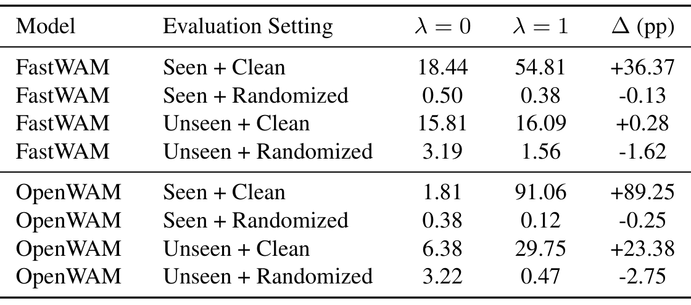
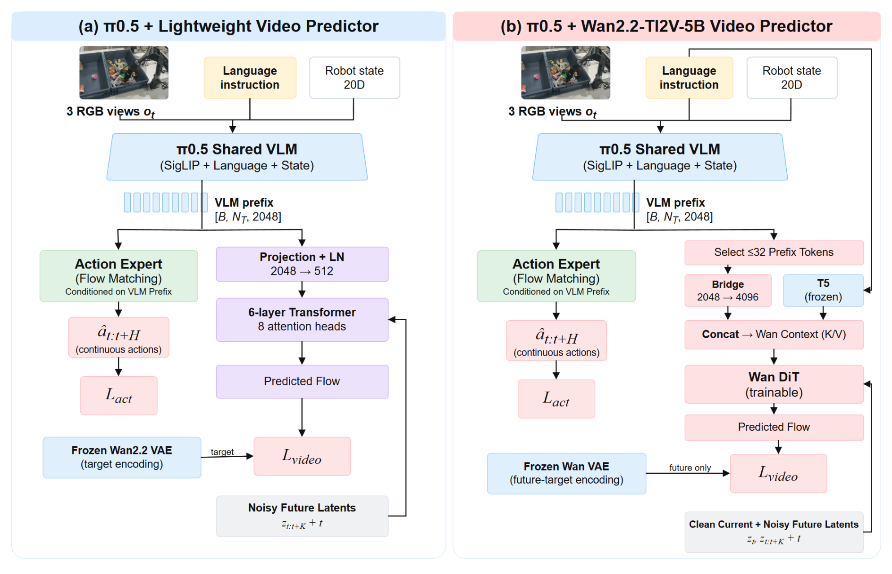
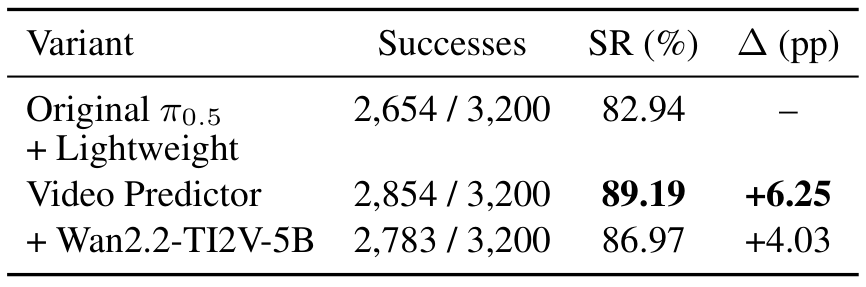

# What Does World Modeling Actually Improve in Robot Action Learning?

世界动作模型在训练时同时预测未来画面和动作，成功率上升却不意味着它已经学会可迁移的物理理解。这篇论文把问题缩小到一个可控制的变量：保留同样的网络，只开关未来视频预测损失，再分别检查熟悉任务、轨迹行为和分布变化。它的价值主要在实验拆分，也给出了不依赖大型视频生成分支的辅助训练方案。

Hanwen Cui、Yuanyuan Li等，中国科学院自动化所、国科大、极智嘉及中南大学；[arXiv:2610.34593v1](https://arxiv.org/abs/2610.34593)，首次提交为北京时间2026-10-26 05:47:19。核读18页全文及补充材料。本次未确认公开项目或代码入口，没有执行训练复现。

## 先把预测监督与预测架构分开

比较两个完整机器人系统时，未来预测能力往往和网络规模、初始化、数据、冻结策略一起变化。作者在FastWAM和OpenWAM各自内部保持这些因素及训练步数不变，只比较

$$
\mathcal L=\mathcal L_{\rm action}+\lambda_{\rm video}\mathcal L_{\rm video},\qquad \lambda_{\rm video}\in\{0,1\}.
$$

$\mathcal L_{\rm action}$监督机器人动作，$\mathcal L_{\rm video}$监督未来视觉预测；$\lambda_{\rm video}=0$关闭后者的显式损失，却保留世界模型架构及视觉表征。因此“No-WM”在本文应理解为无视频预测监督，不能解释成删除了世界模型。两个家族的绝对分数也不能直接相减，因其预训练、规模和训练管线并不匹配。

*图1，源文第3页：架构内消融、行为分解、分布变化及轻量辅助预测的研究关系。*

图1先展示问题层次，再展示结果，而不是声称一条机制解释所有收益。图中的散点布局为示意图，标注的频率和成功率才是实测统计；不能从点的形状推断真实轨迹几何。

## 三种实验分别排除了什么解释

机器人数据来自RoboTwin 2.0双臂任务，每个训练任务使用45条示范、5条验证，训练集合涉及40个任务，未见评测任务从训练排除。已见任务的测试初始状态另行留出，因此不是重放训练示范；但任务身份和标准环境仍熟悉。

实验一在十个已见、干净任务上评估，每配置3200条轨迹。FastWAM从14.97%到39.34%，按未舍入结果差为24.38个百分点；OpenWAM从7.00%到79.91%，提高72.91个百分点。FastWAM十项中八项改善，倒瓶入垃圾桶与旋转二维码分别下降3.44和2.50个百分点；OpenWAM十项均改善。它说明预测监督在这些配置中有用，没有说明每个任务都受益。

实验二换成五个任务研究轨迹，仅开笔记本与实验一重合。每任务十个场景、每配置每场景128条完整轨迹，两个配置合计每家族12,800条。实验三则另选五个已见任务和十个未见任务，交叉改变任务身份与环境配置，每家族共19,200条轨迹。三组任务集合不同，不能把实验三较高的已见成功率说成模型在实验一基础上又进步。

这些大样本主要降低固定检查点评估噪声。作者明确每训练配置只有一次运行，因此上万次测试仍不等于多训练种子稳定性；论文也没有真机控制实验。

## 相似轨迹里的成功率为何仍会改变

成功率可以按轨迹簇分解：

$$
P(S\mid m)=\sum_kP(z=k\mid m)P(S\mid z=k,m).
$$

$S$表示完成任务，$m$表示视频损失设置，$z$表示轨迹簇。第一项是某类轨迹出现的频率，第二项是落在该簇内后的成功率。总体改善既可能来自更常选择某类动作，也可能来自相近动作模式下更可靠的执行；此式只是全概率分解，并没有自动识别因果机制。

作者把同任务的两个配置与全部场景轨迹汇在一起，使用接触位置、末端朝向、接触前后路径及双臂接触时差等数值特征。刚体任务平移到物体中心并按目标方向对齐；无接触手臂保留指示位、其余相关特征置零，避免静止手臂主导聚类。各维经中位数中心化、标准差缩放、裁剪，再对特征组按维数平方根反比加权。K-means尝试2至8簇，要求每簇至少32条，最佳轮廓系数低于0.15时退回单簇；不输入模型、场景或成功标签。

FastWAM叠两块积木的主簇占比90.4%→90.0%，簇内成功50.2%→89.5%；放物体上支架的两个簇始终各约50%，簇内成功分别67.8%→77.7%和84.5%→97.3%。OpenWAM开笔记本则既改变簇频率，也提高簇内成功。这些结果排除了“收益只体现在粗轨迹类型占比改变”的简单描述，但数值簇可能反映场景几何，不能进一步声称模型获得更精确力控或某种内部物理推理。论文没有测量这些中间能力。

## 环境一变，收益还剩多少

*表3，源文第7页：已见收益、跨任务收益与环境随机化下的地板效应应分别解释。*

实验三的已见干净任务中，FastWAM为18.44%→54.81%，OpenWAM为1.81%→91.06%。未见但干净时，前者15.81%→16.09%，仅加0.28个百分点；后者6.38%→29.75%，加23.38个百分点，但主要集中在容器放盘、开微波炉、按订书机等少数任务。

环境随机化后，两家族无论是否使用预测损失都很低，最高仅3.22%。FastWAM两类任务的变化为约−0.13和−1.62个百分点，OpenWAM为−0.25和−2.75。论文没有观察到稳定正收益，但地板效应使这些小负差也不能证明无预测版本更稳健。更准确的结论是：现有配置在这些随机化条件下整体能力不足，熟悉环境中的大幅增益没有转化成可靠迁移。

## 轻量预测头怎样给动作路径提供监督

既然预测可以只在训练期发挥作用，是否需要加载大型视频扩散变换器？作者在π0.5共享视觉语言前缀后接一个训练期分支。当前三视角RGB经可训练SigLIP编码，与指令和机器人状态共同进入共享主干；原有动作专家仍用流匹配生成动作。

*图2，源文第5页：视频损失更新共享前缀和视觉路径，不直接更新私有动作专家。*

轻量分支把2048维前缀投影并归一到512维，送入随机初始化、六层八头的变换器。冻结Wan2.2 VAE离线编码九帧三视角视频窗口，取两个未来时间潜块为目标；预测头输入带噪未来潜变量和扩散时刻，当前状态信息来自共享前缀。视频损失权重在前1000步由0升到0.1，之后不变。这样辅助梯度可以促使共享表示保留预测所需的信息，而不改变私有动作专家的直接监督来源。

大型分支把前缀由2048映射到4096维，与冻结T5的离线文本特征拼接，条件化可训练Wan2.2-TI2V-5B。输入包含干净当前潜变量和带噪未来潜变量，只对未来计算损失；外部视频损失系数从始至终为1，并使用Wan调度器权重。两个分支推理时都移除，不需要先生成未来视频才能行动。

原版与轻量版共享初始化、数据划分、种子42、动作优化器、有效批量32及50,000步。使用四GPU、每GPU四样本、梯度累积两步，AdamW余弦学习率从$2.5\times10^{-5}$到$2.5\times10^{-6}$，预热1000步。Wan版也比较50,000步检查点，但架构、初始化、条件路径和损失尺度同时不同，不能视作严格的模型规模消融。

*表4，源文第8页：轻量分支点估计最高，但与Wan分支的差异未达到可靠统计区分。*

同十个已见任务、100个固定场景及匹配动作噪声下，原版2654/3200成功，82.94%；轻量版2854/3200，89.19%；Wan版2783/3200，86.97%。按任务内场景配对自助采样，轻量减原版的95%区间为[2.31,10.31]个百分点，Wan减原版为[0.16,8.22]；但Wan减轻量为[−5.63,1.25]，包含零。因此轻量辅助预测有效，却不能宣布它显著优于大型分支。

## 这些证据怎样改变复现设计

这项实验把三个容易混在一起的目标分开：训练期监督是否有用、执行行为怎样变化、环境变化后是否仍然有效。工程上可以先尝试仅训练期存在的小预测头，再按已见/未见与干净/随机化四格评估，而不先承担完整视频生成服务。

仍需保留两项成本边界：轻量头依赖预训练Wan VAE目标，并未证明完全不用视频预训练表示也有效；论文未系统测量三种方案的总训练时长、显存与推理延迟，参数少不能直接换算成训练更便宜。后续最值得复现的是增加训练种子，并匹配辅助目标权重和训练预算，再把行为簇观察转成接触、误差或干预实验；现有聚类与成功率本身不足以完成这一步因果解释。
