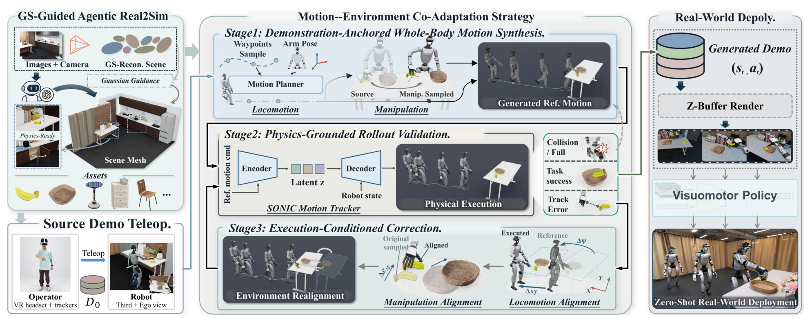
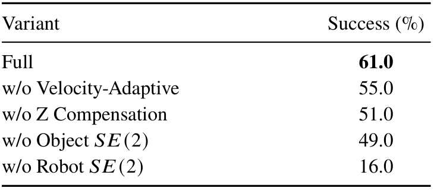
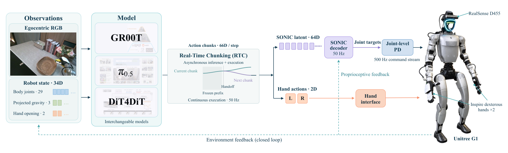
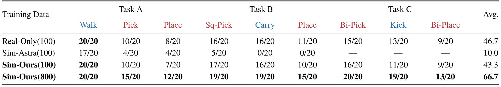
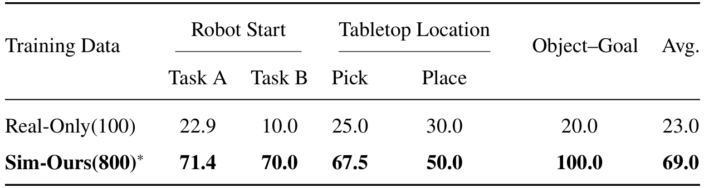

# Zero-HLM: Generalizable Humanoid Loco-Manipulation without Real Robot Data

人形机器人在走动中抓取、蹲下和用脚操作，难点不只是图像逼真：参考运动即使在几何上可行，经过平衡控制器执行后，手和物体也可能错位。Zero-HLM把场景重建、全身参考运动和执行反馈连成数据生成流程，再用实际成功的仿真轨迹训练视觉策略。标题中的“没有真机数据”针对下游策略的任务示范，不代表没有实景采集、机器人标定或预训练控制器。

Dianyi Yang、Mengya Liu等，北理工、BIGAI、清华及Delta Intelligence；[arXiv:2610.35075v1](https://arxiv.org/abs/2610.35075)，首次提交为北京时间2026-10-26 17:20:31。[项目页](https://young-bit.github.io/zero-hlm/)。核读23页全文及附录，本次没有运行重建、策略训练或真机部署。

## 视觉场景和物理场景为什么要分开

从手机图像直接提取的高斯场景适合还原外观，却不自动提供准确碰撞面、铰链和质量；直接用简化物理网格渲染又会扩大视觉域差。作者将MAtCha重建的高斯表示用于外观及空间参考，将可编辑网格用于碰撞和关节，二者放在同一米制坐标系。棋盘格确定尺度与地面对齐，关键交互物体另行视频采集、COLMAP估计位姿并标定尺度。

多模态代理通过Blender MCP与IsaacLab建立物理场景，主动选择相同视点比较高斯与网格渲染，再修正尺寸和位置。柜门开合、物体释放测试用于检查铰接、重力与支撑。这里视觉相似和物理可用是两个验收条件，而不是同一个Chamfer距离指标。

*图2，源文第4页：高斯引导场景、运动环境协同修正、执行状态渲染及策略部署。*

## 从一条源示范生成可执行全身运动

每任务先在仿真遥操作收集15条成功示范，共45条。根据手闭合、物体接近、位移及成功谓词划分行走、操作和腿部交互片段；新目标优先从空间距离和旋转距离较近的有效源示范中随机选取，而不是每个场景从头规划复杂手部动作。

行走段先由A*规划路径，SONIC规划器用四帧运动上下文生成全身参考，每轨迹固定采样0.5至0.7 m/s步行速度。携物时保留上身姿态，蹲起时调整根部高度，踢门等腿部关键动作保留示范下身运动。

操作段采用物体相对变换：

$$
\widetilde T_{e,t}=T_o(T_o^{\rm src})^{-1}T_{e,t}^{\rm src}.
$$

$T_o^{\rm src}$与$T_o$分别为源与新物体或放置目标的世界位姿，$T_{e,t}^{\rm src}$为源手位姿。先把手变到源目标局部系，再搬到新目标系，可以保留抓取或放置的相对关系。随后用手臂逆运动学修改活动手臂，参考构造时根部与不活动关节不变；它们最终执行状态仍由全身控制决定。

不同片段通过继承上一段终态、逐渐衰减手位置偏移衔接，并依据源手线速度和角速度调整过渡时长，同步抓取释放命令。这个操作段重定时与步行速度采样分开。抓住后先抬升再运输，减少与支撑面接触。这样得到的是连续参考，尚未获得物理可执行保证。

## 跟踪偏差如何反过来修正环境

SONIC编码器把参考窗口变为64维潜命令，冻结解码器结合本体历史输出身体关节目标，两只手的开合另行控制。执行后记录机器人、物体状态及66维动作，按任务成功、稳定性和碰撞标准筛选。跌倒、无效碰撞或超出修正范围的失败重新采样，可修复的跟踪误差才进入协同修正。

若参考根部平面位姿为$(x,\psi)$、实际到达$(x',\psi')$，场景资产原位姿为$(x_j,\psi_j)$，修正为

$$
x_j^+=x'+R_2(\psi'-\psi)(x_j-x),\qquad
\psi_j^+=\psi_j+\psi'-\psi.
$$

$R_2$是二维旋转。该式以执行根部替代理想根部，保留机器人与资产的相对关系；实现上移动的是下一次数据生成的场景配置，而不是部署时把真实物体瞬移到手旁。局部抓取或释放残差再相对成功源轨迹作平面补偿；垂直腕部误差则平滑修改参考手高度、经逆运动学更新，不改变物体高度。每次修正后必须重新执行同一物理验证，不能因位置对齐就直接接纳。

*表6，源文第10页：Task A的Base生成设置，完整流程与逐项移除比较。*

此消融以每版本获取100条成功轨迹为目标，完整生成成功率61%；移除机器人平面修正降为16%，移除物体平面修正为49%，移除高度补偿为51%，移除速度自适应过渡为55%。它支持执行反馈的重要性，但不是全部采样分布下的生成率：全量Tasks A/B/C生成成功仅33%、34%、25%。失败仍多发生在抓取，不能把4800条成功数据理解为4800次尝试全部通过。

## 策略实际看到什么并输出什么

视觉观察来自验证通过后的执行状态重放。高斯背景与模拟器中的机器人、动态物体用掩码和z缓冲合成，不能用原计划参考直接渲染成标签，否则会把“想执行”与“已执行”混淆。

*图3，源文第7页：视觉策略输出潜动作与手命令，SONIC身体解码与底层命令流分别运行。*

G1有29个身体自由度，两只Inspire手各以单标量控制；D455提供第一视角RGB，关闭自动曝光。策略输入34维状态：29关节位置、3维投影重力、2手开合，输出64维SONIC潜命令加2手命令。实时动作分块让异步推理与50 Hz连续执行并行；图中500 Hz关节命令流不等于视觉模型每秒推理500次。策略及SONIC运行在RTX 4090，生成使用8张4090，训练使用8张A100。

策略比较包括Diffusion Policy、π0.5、GR00T N1.7和DiT4DiT，各保留原生训练配方并适配共同接口。GR00T冻结两个主干，更新动作扩散、投影及部分视觉语言归一化层；预测40步。π0.5预测50步，DiT4DiT预测40步，但预测跨度不等于执行跨度：Diffusion Policy每次执行16步，其余模型Task A执行16步、B/C执行40步。

零真机任务示范也不意味着机器人没有参与设置。相机外参通过真实上身运动、图像关节点与URDF对应关系进行PnP和稳健重投影优化。这个标定、手机拍摄及已有SONIC/基础模型的来源，都应和下游任务训练数据分开记录。

## 真机收益与数据数量如何对应

三项长时域任务分别为走到桌边拿香蕉放篮、蹲下拿帽后携带放柜、双手搬篮并用脚关门后放凳。Base每任务20次真机试验；末阶段要求整条任务成功，中间阶段是独立诊断指标，不能把阶段百分比相乘。

*表8，源文第11页：比较时同时保留每任务示范数量和完整任务成功计数。*

| 每任务训练数据 | Task A完整成功 | Task B完整成功 | Task C完整成功 | 三任务均值 |
|---|---:|---:|---:|---:|
| 100条真机示范 | 8/20 | 11/20 | 9/20 | 46.7% |
| 100条仿真示范 | 7/20 | 10/20 | 9/20 | 43.3% |
| 800条仿真示范 | 12/20 | 15/20 | 13/20 | 66.7% |

同100条时，仿真略低于真机点估计；扩大仿真后才高出20个百分点。这支持“可扩展的仿真数据流程带来实用收益”，没有隔离同数量数据的天然优劣，也没有给出跨训练种子置信区间。Sim-Astra基线仅A/B有可用数据，平均10%不能直接和三任务平均比较；其管线经过人工调试，Task C未成功且尝试总数缺失。

*表9，源文第12页：分项成功率与100次试验池化均值，Base被排除。*

扩展训练覆盖机器人起点、抓取放置位置及新物体目标组合，总体23/100→69/100。五类试验分别35、10、40、10、5次，因此69%是池化结果，不是五个百分比的简单平均。物体目标替换20%→100%仅对应1/5→5/5，不能当广泛物体泛化证据。不同配置有专门扩展生成数据，表中的零样本指没有新增真机示范，并不表示策略从未见过相关仿真配置。

## 采集成本、混合训练和泛化边界

获取50条成功数据时，Task A/B/C仿真耗时0.56/0.63/1.19小时，真机1.35/1.02/1.68小时，分别约2.4/1.6/1.4倍，平均约1.8倍。真机一侧不含设置，场景和七资产重建另报7小时13分、22.82美元分摊订阅成本，且生成使用8张GPU。它不是包括首次建模、人工与算力的完整成本优势。

视觉保真消融中100条数据时，Task A从网格渲染3/20完整成功到高斯7/20。另一个小实验固定仿真动作标签、把图像换成真实回放图像后，两区域各5/5，支持视觉域差是限制之一，但人工调整真实物体位置和极小分母限制了因果外推。混合100条真机与800条仿真后三任务均值53.3%，仍低于纯800仿真的66.7%，表明简单加数据不保证最好。

同Task A政策在仿真与真机的绝对分数相近，却发生排序反转：真机训练模型8/20真机、31/100仿真，仿真训练模型7/20真机、39/100仿真。因此这个基准近似刻画难度，尚不能保证准确排名。三个任务、一个重建场景和一个控制器的证据，也不能证明跨场景、跨本体普适迁移。最值得复用的是“先记录执行偏差，再决定改运动还是改数据生成布局”的流程，同时保留失败率、重建成本与同数量对照。
