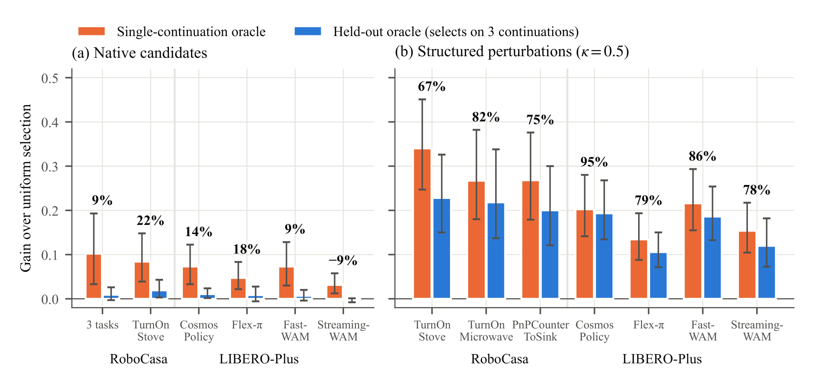
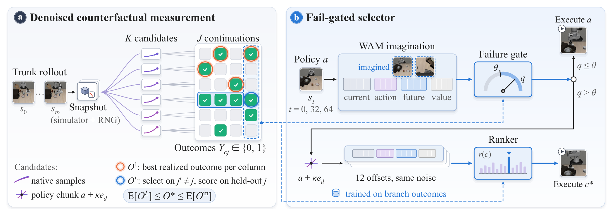
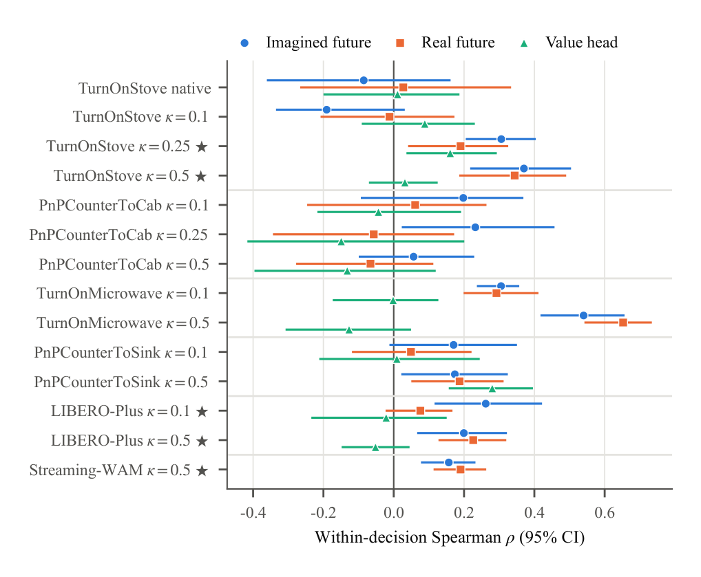
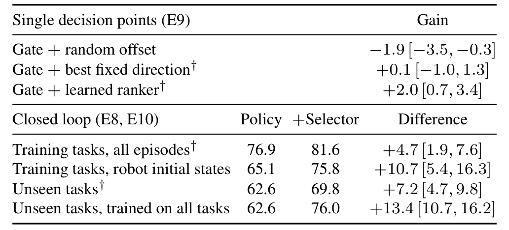

# How Much Can Best-of-N Help a World Action Model? Measuring Selectable Headroom and Realizing It in Closed Loop

给机器人策略多采样几个动作，再让世界模型挑一个，看起来是自然的测试时扩展。然而，某个动作在一次续跑中成功，可能只是后面的随机决策运气好。本文先测量真正可选择的收益，再用这个测量结果设计选择器；它研究的是选择的机会与证据，不是单纯扩大候选数。

Haojia Gao、Yue Cao等，清华大学、Everwise-Tech、复旦大学等；[arXiv:2610.37196v1](https://arxiv.org/abs/2610.37196)，北京时间2026-10-27首次提交。以下依据24页全文与相关实验附录，未进行独立复现。

## 候选最好的一次，为什么不是候选本身最好

世界动作模型可以生成动作块及其未来观测。常见评估从同一仿真状态执行16个候选，每个候选接着由原策略跑到结束，再把成功的最好结果当作选择上限。这个过程把两件事混在一起：当前动作是否好，以及之后若干次策略查询是否碰巧选对。候选越多，从随机性里挑到一次成功的机会也越大。

把候选$c$之后最终成功的概率记作$p_c$，共有$K$个候选，真正相对均匀随机选择的收益为

$$
O^*=\max_c p_c-\frac{1}{K}\sum_c p_c.
$$

这里的概率对后续策略随机性取期望，当前候选固定。这个定义说明，选择器需要识别高成功概率的动作，而不是事后识别某次成功。若候选池包含原策略动作，还应另外报告相对原动作$p_0$的收益；相对随机候选均值的优势不能直接当作对原策略的改善。

*图1：橙色为单次续跑oracle，蓝色为留出评估；两种候选池的差异说明增加数量和创造有效变化不是一回事。*

作者按此前单次分支协议复现约12.3个百分点的收益，但在另一次独立续跑上只能兑现其中约9%。这不意味着原生采样永远没有价值，而是说明原测量不能直接代表可稳定实现的价值。

## 怎样把同一决策点分成可比较的未来

先保存完整MuJoCo状态、全局随机数状态以及炉火等关节之外的fixture状态。动作、本体状态、相机帧和成功标记必须逐字节复现，图像还经过在线与离线渲染一致性检查；只恢复关节位置不足以形成公平分支。候选执行完后，各自重复$J$次续跑，得到二元结果$Y_{cj}$。

对于留出的第$j$次续跑，选择只看其余续跑：

$$
B_j=\arg\max_c\frac{1}{J-1}\sum_{j'\ne j}Y_{cj'},\qquad O^L=\frac{1}{J}\sum_j\left[\operatorname{mean}_{c\in B_j}Y_{cj}-\operatorname{mean}_cY_{cj}\right].
$$

$B_j$允许并列候选并取平均。实现上，先用其他列排候选，再到未参与选择的列计分，防止“挑选和评价用同一次随机结果”。全部列平均后再取最大值得到样本内oracle $O^{\mathrm{in}}$；在论文假设下有$\mathbb E[O^L]\le O^*\le\mathbb E[O^{\mathrm{in}}]$。有限续跑的留出值是下界，不能把它说成真实收益的精确值。

*图2：左侧将同一候选在不同续跑中的结果组织成矩阵，右侧把测量发现转成是否偏离和往哪里偏离两个决策。*

数据覆盖四个WAM、RoboCasa与LIBERO-Plus，超过100,000次分支rollout。先各跑一次，结果不同的决策点和其余点中哈希选出的四分之一再追加续跑；后者逆概率加权4倍，只用第二阶段结果估计，避免用触发采样的结果再次挑选。区间按状态聚类bootstrap；比较评分器时共享随机数，而评分器随机数与候选独立。

LIBERO-Plus只选择四模型初测均处于30%–90%成功率的布局和机器人初始状态两类扰动。17次续跑中，Cosmos原生候选可选择份额的点估计上下界为24%与52%，Flex-π为33%与66%，Fast-WAM为33%与63%。这些是估计值范围，不能描述为所有WAM的普适常数；部分预注册的更强上界假设并未通过。

## 结构化偏移创造了什么，又破坏了什么

原生候选在执行后末端位置往往只差毫米。论文改为给策略动作块的位置分量沿机器人坐标轴加偏移，并裁剪到合法动作范围，姿态和夹爪保持不变。偏移系数$\kappa$取0.1、0.25、0.5；实际累计位移随动作尺度和执行长度变化，不能把系数直接当成米。

原动作加六个正负轴方向形成每尺度七个候选。结构候选67%–95%的单次oracle收益在留出评估后保留，但平均扰动候选反而比原动作低7–14个百分点。于是“多扰动几个就更稳”恰好不是结论：需要有能力挑出正确方向，并在原动作已足够好时拒绝偏离。

方向还依赖状态。在TurnOnStove中，全局方向只解释候选方差的2%–6%；固定一个训练集上最好的方向无法稳定改善原策略。该结果把设计问题从采样数量转成了同一状态下的相对动作判断。

## 状态价值准确，为什么仍不会选动作

在策略rollout上微调后，价值头区分不同状态最终成败的AUROC可达0.87–0.90，但同一决策点内原生候选的排序相关度绝对值不超过0.05。前者主要比较状态难度，后者需要分辨很接近的兄弟动作，两种学习任务并不等价。

作者对最终Transformer块的未来帧token训练线性ridge探针，用同一状态内部中心化和全局方向残差化，减少“只知道向上通常更好”造成的虚假收益。Cosmos想象未来在多个结构扰动条件下含有候选结果信号；Streaming-WAM在更大新状态集上也达到相关度0.16。探针只适用于支持动作条件想象的两个检查点，并非四模型都测试了相同能力。

*图4：蓝橙为同类线性读出，绿色为价值头；相关度及区间比单一总体状态价值分数更贴近候选选择问题。*

预注册等价检验的界为相关度差$\pm0.15$。“没有检测到想象比真实差”只在这个界、这些读出和预测跨度内成立，不是物理模型完全正确。Cosmos未来帧在去除动作帧可解释部分后仍保留信号，支持预测后果有信息；但不证明所有部署收益都非得生成未来才能获得。

## 先决定是否偏离，再决定往哪里走

在步骤0、32、64，逻辑读出门控先预测原动作是否容易失败。未超过阈值时执行原动作；触发后才对两尺度十二个偏移共享想象噪声并排序，执行评分最高者。门控与排序器都由真实分支结果训练，不能用现成状态价值分数替代。

*表1：同一个门控配随机偏移仍会退步，闭环已见任务与选择器未见任务也须分开读取。*

| 比较 | 成功率或增益 | 证据含义 |
|---|---|---|
| 同门控加随机方向 | −1.9个百分点 | 门控不能单独保证收益 |
| 同门控加固定最佳方向 | +0.1个百分点 | 全局纠偏不足 |
| 同门控加学习排序 | +2.0，95%区间[0.7,3.4] | 新决策点上需要状态相关选择 |
| 已见任务保留回合 | 76.9%→81.6% | 480回合，每条件三次共享随机数 |
| 选择器未见任务 | 62.6%→69.8% | 四折按40个基础任务留出 |

已见任务总提升4.7个百分点，机器人初始状态扰动提高10.7点；布局扰动却从88.6%降至87.4%，差值区间跨零。未见任务30/40改善，仍有明确反例。未见是选择器训练未见，WAM检查点保持相同，不代表整个系统从未接触过这些任务。

## 怎样复用这套评估而不越过证据边界

最可复用的是先测候选池，再优化判断器。保存全部状态和随机数、用独立续跑选与评、分别报告对均匀选择和原动作的收益，能避免把续跑幸运值当作可利用的空间。HeadroomBench承诺提供适配器、结果表、表示和选择器轨道；本次未确认可公开下载的完整代码与数据，不将拟发布包写成已复现资源。

计算也有代价：门控让闭环每回合在12次策略查询之外增加17.5次想象前向，不是零额外推理。当前状态加方向的排序对照在已见任务离线交叉验证中已接近完整模型，按任务分组的离线对照区间又重叠，因此我的分析是：想象确实含信号，但想象对最终闭环收益是否必要尚不能确定。

本文测量依赖可快照和带种子查询的仿真；真机只能用重复重置近似，必须额外面对重置噪声。闭环部署只验证Cosmos Policy，不能外推为所有模型、真机环境或连续安全保证。后续复现应先匹配检查点、扰动分布、候选位移、执行长度和预注册测试，再讨论扩大候选数。
