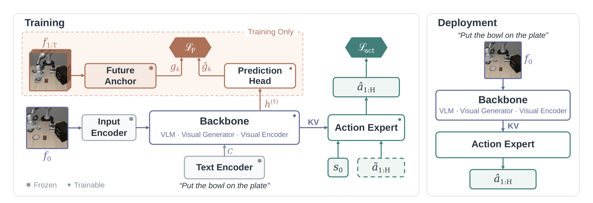
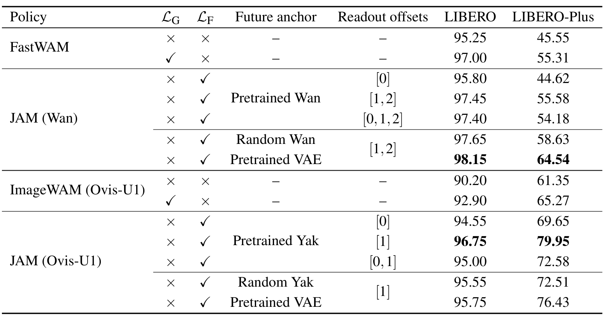
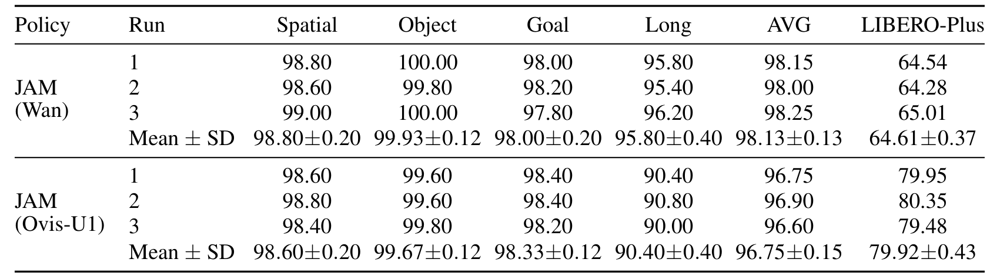
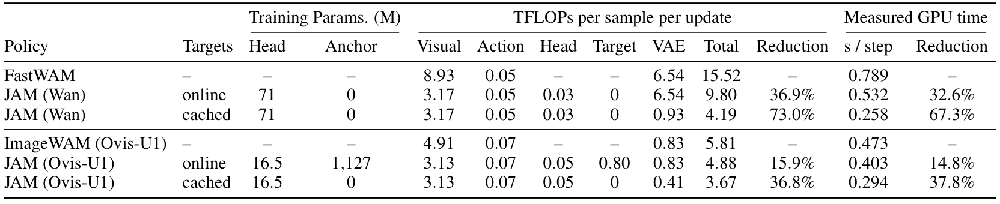

# Vision-Language-Action or World-Action? Just Action Models

机器人控制究竟该从视觉语言模型还是视频生成器出发，这个争论混合了三个选择：预训练权重、未来观测的监督目标，以及推理时保留哪些模块。JAM把它们拆开：当前观测负责出动作，记录的未来只在训练时提供冻结表征目标，不必把未来图像重新生成出来。

Yonghao Yu、Lang Huang、Runyi Li、Toshihiko Yamasaki，东京大学与日本国立情报学研究所；[arXiv:2610.37219v1](https://arxiv.org/abs/2610.37219)，北京时间2026-10-27提交。[项目页](https://y0uroy.github.io/JAM)与[作者代码](https://github.com/y0urOy/JAM)。本笔记核读24页全文及相关附录，未训练或运行模型。

## 先分开骨干初始化、未来目标和推理模块

动作损失相同不代表学习过程相同。一般VLA只用动作监督，WAM增加图像或视频去噪监督；但FastWAM和ImageWAM在部署时本来就不生成未来，因此不能把它们和JAM的差异解释成“JAM首次消除了推理期视频生成”。这里的变化是训练目标和训练计算路径。

JAM保留匹配基线的视觉骨干与动作专家，训练目标为

$$
\mathcal L_{\mathrm{JAM}}=\mathcal L_{\mathrm{act}}+\lambda_F\mathcal L_F.
$$

$\mathcal L_{\mathrm{act}}$是动作流匹配目标，$\mathcal L_F$是未来表征预测损失，$\lambda_F$控制总辅助监督强度。取消视觉生成损失并不取消预训练生成知识：Wan版本仍从预训练视频骨干初始化，动作专家也仍进行流匹配采样。

## 当前观测怎样获得未来监督而不泄漏答案

训练样本含当前图像$f_0$、本体状态$s_0$、指令$c$、动作块$a_{1:H}$和记录未来$f_{1:T}$。骨干只编码当前输入，其第$\ell$层视觉token记作$h^{(\ell)}$，动作专家从这个上下文、状态和带噪动作学习出动作。未来帧只送入冻结锚点$E_\phi$，得到各时间读出位置的目标$g_k$。

*图2：训练期虚线框内的未来锚点和预测头被删除，未来观测没有进入动作专家输入。*

训练头$p$将当前token映射到未来目标维度，对每个空间token $n$、目标位置$k$计算

$$
\mathcal L_F=\frac{1}{|\mathcal K|}\sum_{k\in\mathcal K}\mathbb E_n\left[1-\cos\left(\hat g_{k,n},\operatorname{sg}[g_{k,n}]\right)\right].
$$

$\hat g_{k,n}=p_k(h^{(\ell)})$，$\mathcal K$是被监督的时间位置集合，$\operatorname{sg}$停止目标侧梯度。余弦距离让当前表示学习未来的方向结构，梯度只更新预测头和策略骨干；冻结目标避免双方共同移动造成不稳定的监督。总损失对时间位置平均，增加位置数量不会自动增加辅助权重。

实现中的预测头含输入投影、两个共享pre-LayerNorm Transformer块和每个位置独立线性读出；Wan默认头约71M参数。训练后删除它和锚点，推理编码当前图像一次，动作专家在流采样各步复用上下文。它不是部署时多步预测再规划，也没有在训练时把真实未来作为策略条件。

## 未来锚点为什么不一定需要大生成器

固定目标可以是冻结生成器、同结构随机网络，或直接VAE特征。随机锚点指对输入未来产生稳定特征的冻结随机网络，不是每次抽独立噪声。Wan的VAE直接目标把192维补丁重复并缩放到3,072维，以保持范数和余弦关系，不需另跑目标Transformer。

*表1：未来目标位置与目标空间都影响结果；不能把最佳配置的全部收益只归因于余弦损失。*

在Wan中，仅把生成损失换成预训练Wan未来目标，LIBERO-Plus从55.31%变为55.58%；使用VAE直接未来目标才达到64.54%。当前位置目标为44.62%，未来位置明显更有效；但Wan锚点有双向注意力，位置0本身也可能含未来上下文，不能称它为完全不含未来信息的目标。

Wan的九帧窗口经因果VAE变成三个时间位置：[0]为当前，[1]覆盖环境步骤4–16，[2]覆盖20–32。其他骨干通常以16步后的单帧为位置[1]。所以“都预测一步”不代表物理时间相同。

Ovis-U1恰好更依赖预训练Yak目标：LIBERO-Plus为79.95%，随机Yak为72.51%，VAE为76.43%。论文解释这是不同时间输入和预训练表示作用的可能差别，并未证明一种锚点普遍最好。Wan随机骨干的实验还保留预训练动作专家、VAE与文本条件，不能描述为全系统从零训练。

## 匹配实验和跨骨干比较分别证明了什么

核心对照保持各家族架构、数据、优化器、训练预算和部署路径相同。LIBERO每40任务各50次；LIBERO-Plus固定1,506个扰动任务，每个一次、全部本地策略共享。RoboTwin含50任务，每任务每场景100次，Clean与Randomized分别评估。

| 配对 | LIBERO | LIBERO-Plus |
|---|---:|---:|
| FastWAM | 97.00% | 55.31% |
| JAM Wan，VAE未来目标 | 98.15% | 64.54% |
| ImageWAM Ovis-U1 | 92.90% | 65.27% |
| JAM Ovis-U1，Yak未来目标 | 96.75% | 79.95% |

按任务bootstrap的配对区间都支持这两组改善；例如Plus的差值分别为9.23点[6.84,11.69]、14.67点[12.15,17.13]。RoboTwin的Wan均值91.2%→91.4%，Ovis 89.0%→89.9%，不是处处大幅提高。Wan在背景扰动、Ovis在机器人状态扰动上落后匹配基线，汇总分不能掩盖退步。

*表21：Wan与Ovis-U1的三次训练方差较小，但评估任务和种子固定，不能把这些方差当成所有部署不确定性。*

三训练运行Plus结果分别为64.61±0.37%、79.92±0.43%。这是所选JAM配置的稳定性，不意味着所有基线和超参数都完成同样重复。训练使用八张GH200、bf16、AdamW；LIBERO全局batch 128，Wan 20k更新、其他ImageWAM式配方21.7k更新，RoboTwin均五epoch但batch与总更新数依家族而变。

跨骨干实验中DINOv2-L达到70.39%、Qwen3.5-2B达到81.14% Plus。Qwen自己的动作单损失为77.03%，DINO为68.26%，支持未来监督能接入非生成骨干；但语言、光照或背景有部分回退。不同架构、参数和动作接口同时变化，不能由跨骨干表格断言某种预训练范式因果上更优。

## 缓存节省的是哪些训练操作

锚点、预处理、时间索引和条件全部固定时，未来目标可以一次抽取并复用。Wan在线训练时只处理当前帧，从294个视觉token减少到98个，且避免每次重新编码完整未来窗口。缓存若随着随机增强或锚点更新而失效，就不再适用原成本估计。

*表9：online与cached须分开；GPU计时覆盖指定操作，不能直接换算成完整训练总账单。*

Wan每样本每更新估计15.52→4.19 TFLOPs，下降73.0%；Ovis 5.81→3.67，下降36.8%。在单GH200、batch 16的指定操作计时中分别0.789→0.258秒、0.473→0.294秒。未缓存时只有36.9%和15.9%的FLOPs下降。估计省略部分注意力分数、文本编码与优化器，缓存值不含一次目标抽取；Ovis计时还扣除两方案相同的文本编码及优化器时间。

## 复现时最容易混淆的接口与边界

首先应确保未来目标不进入可训练当前上下文，而不是仅把输入名改成“监督”。随后固定目标时间范围与总权重，区分改变目标空间和改变损失形式。最后分别核算预计算、存储与在线更新，才能知道缓存是否在自己的数据流程里摊销得回来。

作者证明的是在这些仿真基准和匹配配方中，未来表征监督能替代视觉生成监督；尚不能确定真机迁移、多任务预训练或更广扰动是否同样获益。注意力热图与未来PSNR探针是诊断，不是控制机制因果证明。推理路径与基线相同也意味着不能额外宣布JAM比这些匹配基线推理加速73%；73%属于特定缓存条件下的在线训练FLOPs。
