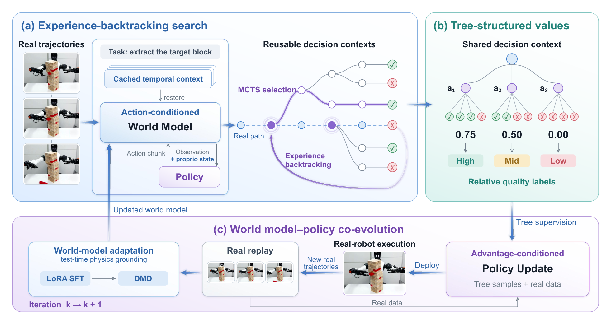
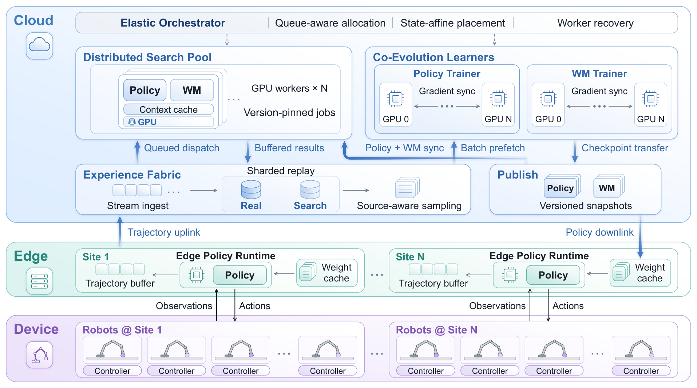
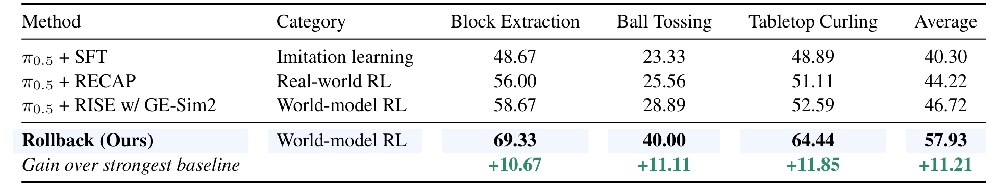
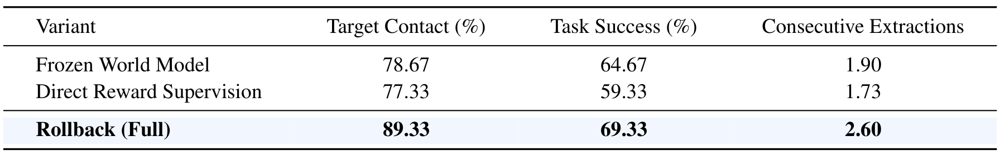

# Rollback: Experience Backtracking in World Models for Policy Improvement

物理机器人失败后只能重置，学习到的世界模型却能恢复中途上下文，从关键一步尝试不同动作。Rollback利用这个差别，把想象从一条条独立前向轨迹改成可共享前缀的搜索树，再把同状态动作的下游结果转成策略监督。真实机器人持续提供转移数据，纠正逐渐被新策略访问到的模型盲区。

Jiayi Luo、Yang Zhang、Liliang Chen等，AgiBot、北京航空航天大学、新加坡国立大学；[arXiv:2610.36068v1](https://arxiv.org/abs/2610.36068)，实际提交为北京时间2026-10-27 02:01:02，PDF封面UTC日期为26日。[项目页](https://rollback-wm.github.io/)。依据25页全文与相关附录，未进行独立机器人复现。

## 为什么把世界模型当成可回退环境

只让世界模型从初态向前滚动，每探索一个替代动作都要重新生成前面相同的过程，而且一条轨迹的成败很难归因到其中某个动作块。Rollback把世界模型的时序上下文$m_t$视为可缓存状态；恢复它之后，再喂不同候选动作$a_t$生成后续观测和新的上下文。

这里恢复的是学习模型的上下文，不是精确物理状态。GE-Sim 2.0同时预测三路相机图像和16维本体状态，后者包括双臂各七关节与一个夹爪，策略才能在想象里接收与真机相同类型的输入。若只生成图像让策略猜关节，细接触与释放时刻会缺少信息。

*图2：真实路径提供分支起点，树中的结果比较用于训练；世界模型适配只使用真实转移。*

一段真实示范或策略尝试先成为参考路径，其真实成败沿路径回传，构成第一条已评估分支。随后可从真实中间点恢复，也可以从已生成的想象节点继续分支，不必重新生成公共前缀。这是比“把世界模型作为仿真器”更具体的执行接口。

## 一条真实尝试怎样长成搜索树

树节点记录访问次数$N$和成功回报总和$W$，用$Q=W/N$衡量已探索续跑的经验成功率。MCTS以经验价值和探索奖励选择已有子节点；连续动作不能穷举，因此采用渐进扩宽，访问越多才允许更多新候选，候选由当前最高质量条件策略用新噪声采样。

每个新分支先采两个动作，世界模型一直滚动到成功或深度上限。任务专门训练的GE-Sim world judge把想象结果判成二元成败，回传更新树。当同胞动作落入不同暂定质量箱时，算法优先给访问少的兄弟追加确认续跑，减少一次偶然成功造成的错误标签。确认次数按任务为5/9/5，并非每个动作都拥有无限精确的价值估计。

我的分析是，缓存节省前缀成本，渐进扩宽控制动作数量，而分歧确认把计算集中到会提供相对监督的地方；三者解决不同问题。模型不准确或judge误判仍会沿树传播，搜索深度大不自动意味着标签可靠。

## 把子树结果转成动作块训练目标

动作$a_i$从父节点$v$通向子节点$u_i$，其下游叶子集合为$\mathcal L(u_i)$。相对质量按下面的步骤构造：

$$
\hat q(v,a_i)=\frac{1}{|\mathcal L(u_i)|}\sum_{\ell\in\mathcal L(u_i)}y_\ell,\quad \rho_i=\frac{\hat q(v,a_i)}{q_{\max}(v)},\quad b_i=\min\left(K,1+\lfloor K\rho_i\rfloor\right).
$$

$y_\ell$是judge判断的叶结果，$q_{\max}$是同胞动作最高经验值，$K=5$为质量箱数。只有至少两个动作、$q_{\max}>0$而且箱号不同的同胞组才进入训练。全失败或所有动作同箱的组没有偏好信息。按同一父状态归一化，使难易不同的状态能贡献可比较的质量标签；这不是无偏的真实环境优势函数。

π0.5采用RECAP式质量条件训练。动作归一化后，以$x_s=(1-s)a+s\epsilon$构造带噪输入，网络拟合速度$\epsilon-a$；$s$是流时间，$\epsilon$是高斯噪声。训练数据混合树样本、离线示范和真实尝试，真实成功标最高箱、失败标最低箱。条件以概率0.5丢弃，生成时用最高箱和系数1.5的classifier-free guidance，引导动作趋向高质量分布。

因此“不额外训练价值模型”不代表“不需要评价器”：仍需任务专门训练的成功judge。它在完整想象轨迹末端判成功，再由树聚合成动作级标签；真机报告的成功率则依据物理结果人工/实际标注，不由这个judge决定。

## 异步系统如何保持每棵树内部一致

真实机器人慢，搜索与训练快慢又不同，强制同步会让资源互相等待。系统通过分开保存真实轨迹与树监督、发布版本化权重实现异步：世界模型只用真实转移适配，策略混合全部来源训练；搜索任务在开始时固定策略和世界模型版本，直到整棵树结束不切换，否则缓存上下文与同胞结果不再可比。

*图3：云端执行搜索与学习，边缘站点执行策略推理；图示可扩展多站点，但实验只验证一站点一机器人。*

机器人只在回合结束切换新策略；搜索worker只在下一棵树采用新版本。世界模型每次收到新真实数据后执行400步LoRA SFT，再100步DMD恢复少步生成。这里“test-time physics grounding”的test time相对世界模型预训练阶段而言，指世界模型作为策略训练环境期间继续适配，不是机器人每个动作前在线搜索或重新训练模型。

策略控制为30 Hz、16维动作；抽积木与投球预测50步动作块，用实时分块，延迟6步、重规划步长32。三路观测统一到384×512画布。云端不直接处于机器人低层控制闭环，端侧只执行蒸馏得到的策略。

## 真机增益来自哪些可比实验

AGIBOT Genie-02上比较三项任务，抽积木六初始位置各25次，投球六位置各15次，桌面冰壶九位置各15次，分母分别150、90、135。冰壶在双方各两次投掷之后按最终位置计分，后续碰撞可能改变前次得分，不能按单次落点提前判断。

*表1：RISE w/ GE-Sim2是作者在同世界模型上的复现；比较应围绕这个版本，不把数字归到原RISE论文。*

| 方法 | 抽积木 | 投球 | 桌面冰壶 | 三任务均值 |
|---|---:|---:|---:|---:|
| π0.5 SFT | 48.67% | 23.33% | 48.89% | 40.30% |
| π0.5 RECAP | 56.00% | 25.56% | 51.11% | 44.22% |
| RISE w/ GE-Sim2 | 58.67% | 28.89% | 52.59% | 46.72% |
| Rollback | 69.33% | 40.00% | 64.44% | 57.93% |

相对同世界模型RISE复现，三任务提高10.67、11.11、11.85个百分点，均值增加11.21点；不是均值相对提高11.21%。表中位置级结果仍有退步，例如部分抽积木位置完整模型低于基线，不能把均值领先当成每种初态都更好。

*表2：两项消融保留不同路径，帮助区分动态模型持续校正和对下游结果聚合的作用。*

抽积木完整成功69.33%、连续取块2.60；冻结模型为64.67%、1.90；以单轨迹奖励替代子树聚合为59.33%、1.73。投球冻结模型26.67%，低于完整40.00%。这些支持在当前系统中两组件有贡献，但搜索、标签与后续策略分布相互影响，不能据此独立预测每组件在另一机器人上的固定增益。

## 成本、奖励误差和人类比较的边界

8小时策略改善使用一台真实机器人与48张H200，其中40张搜索、8张策略训练。此前还需世界模型10K步SFT、2,500步DMD，以及策略100K步预热；这些不能从“8小时超越人类”中消失。文中没有把多站点扩展实际跑通为大规模实验，也未给出覆盖所有阶段的完整成本账单。

人类基线每任务三人，投球31.48%、冰壶58.39%；机器人最终40.00%、64.44%，在特定初态与评分下超过平均值，不是广义人类运动能力。论文未报告完整多训练种子不确定性，有限试验也限制相近结果的推断。

世界模型保真对照中，64条冰壶真实轨迹的RGB L1由19.52降至12.96，但这些轨迹参与了共同适配而冻结模型未见它们。这说明已访问分布的拟合改善，不是严格未见测试泛化。另一个检查在八条失败抽积木轨迹的40次模型回放中观察到0次奖励误报；它是有限失败回放集合，不能证明搜索分布或生产部署零误报。

作者明确承认依赖任务专属奖励模型、长接触过程中的模型准确度以及单任务单机器人训练。最值得复用的工程原则是同时固定树内模型版本、保留真实与想象数据来源、给分歧动作追加证据；尚不能确定跨任务、跨本体及更低算力预算下能保留多少收益。
